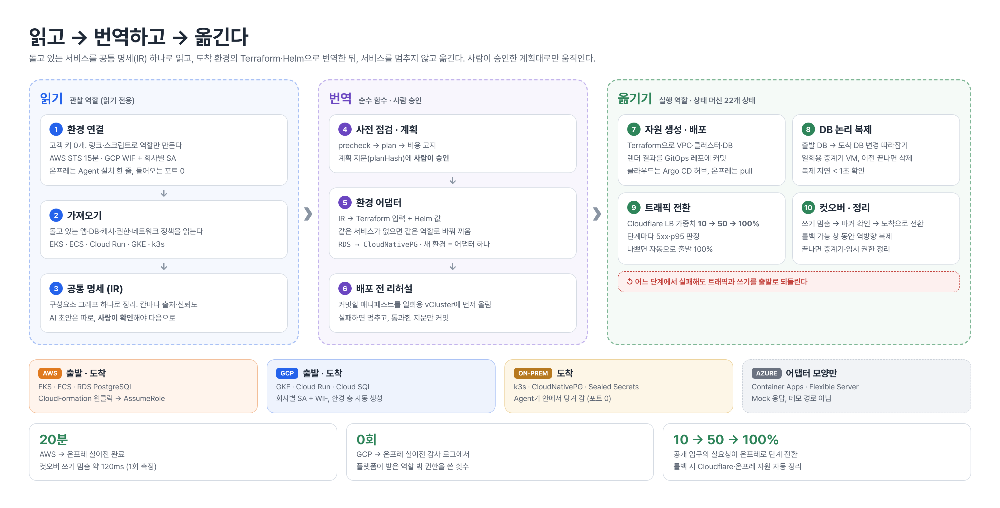
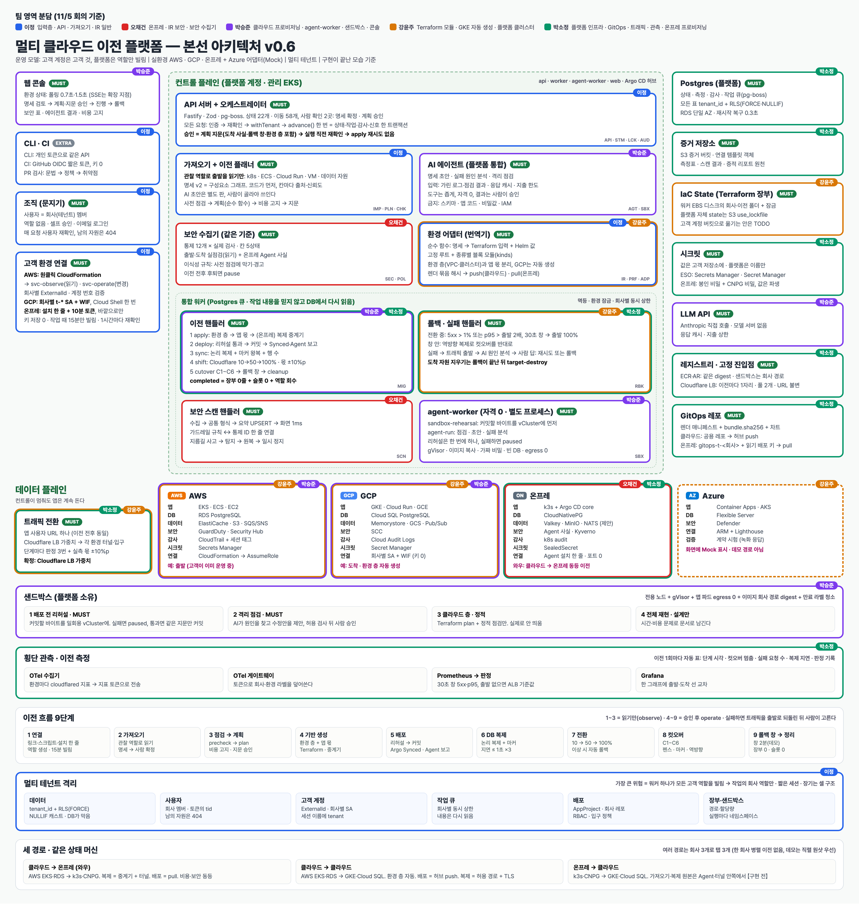
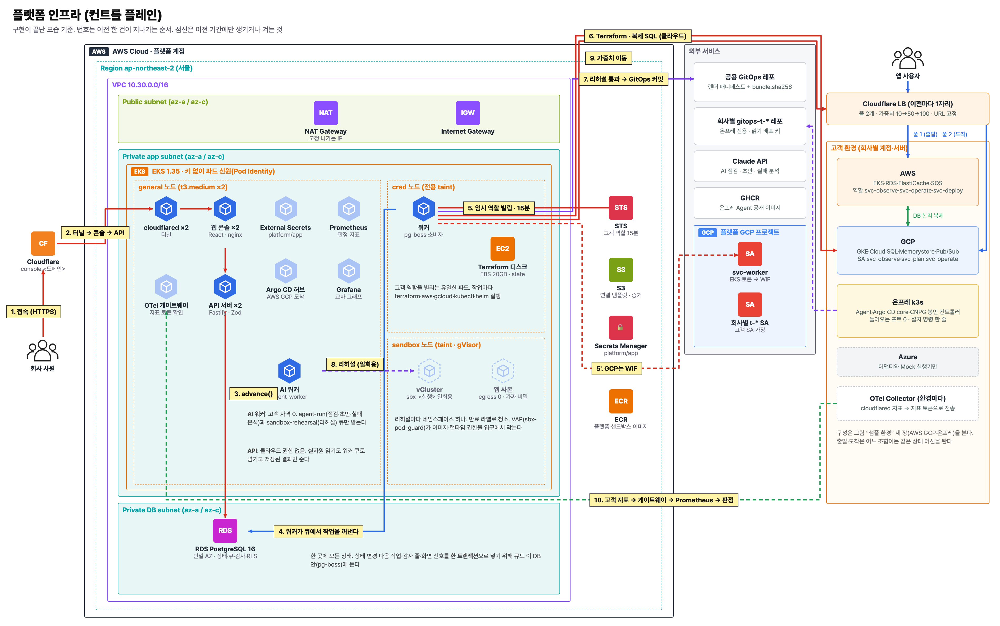
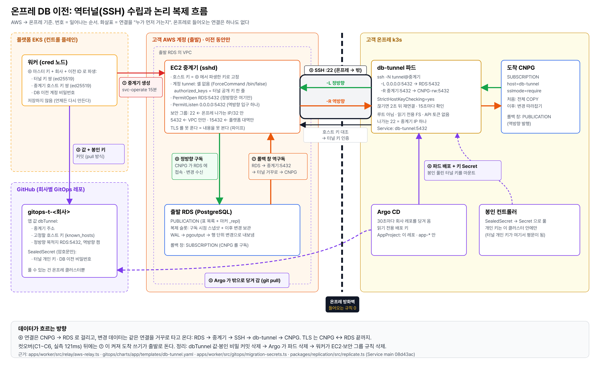
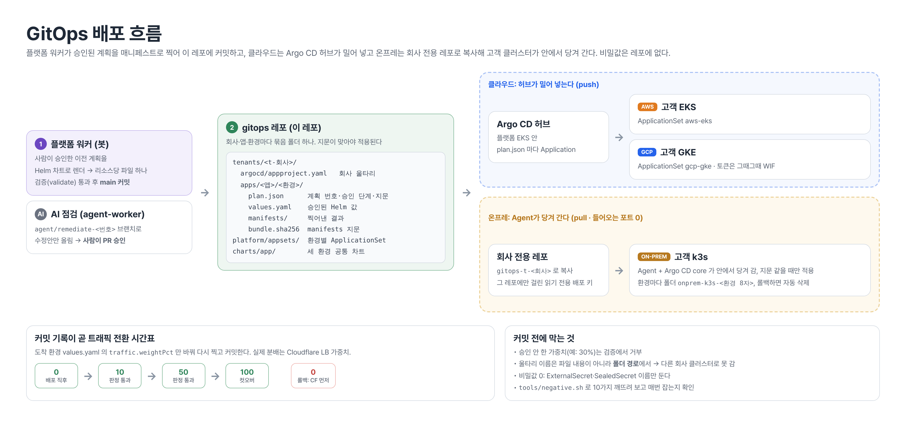
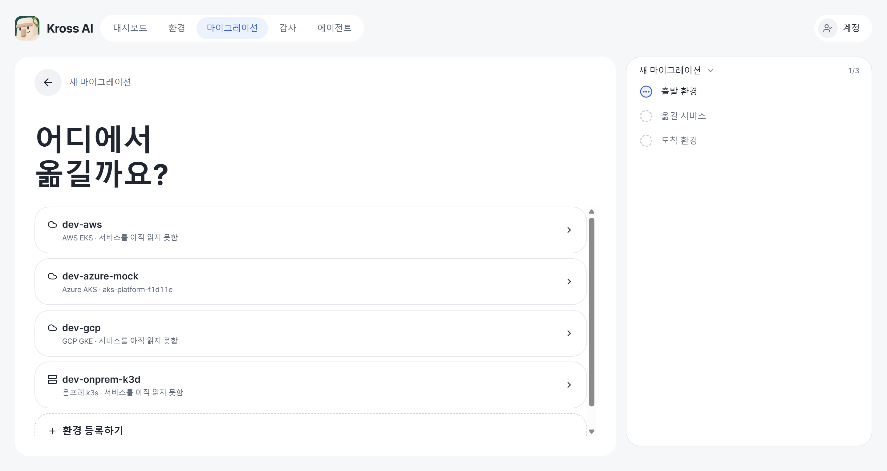
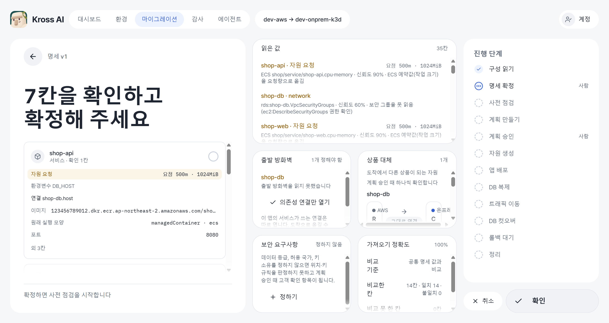
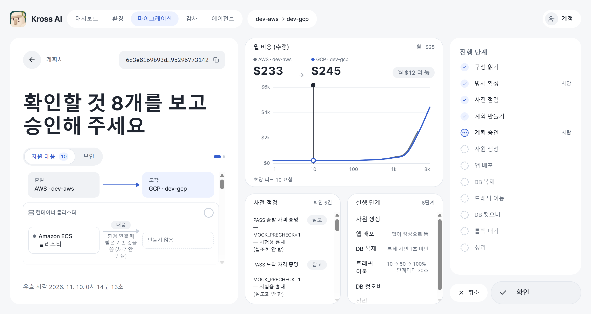
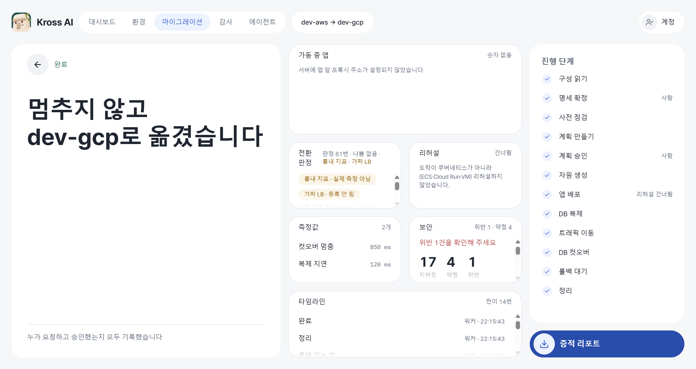
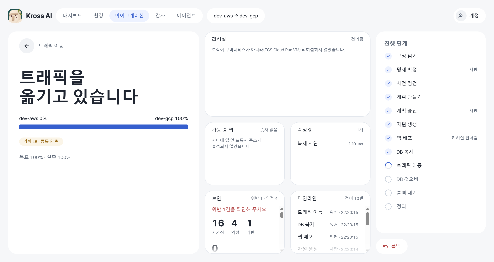

<div align="center">

# 🧭 Team Iron · 멀티 클라우드 이전 플랫폼

### "아무것도 내주지 않고, 출발 환경 그대로 어디로든."

돌고 있는 서비스를 **공통 명세(IR) 하나**로 읽고, 도착 환경의 **Terraform·Helm**으로 번역해<br>
AWS · GCP · 온프레미스(k3s) 사이를 **서비스 중단 없이** 옮기는 플랫폼


</div>

<p align="center"></p>

## 🔎 무엇을 하나

클라우드 사이 원클릭 이전에서 진짜 어려운 건 기술보다 **이전하는 동안의 보안**이었습니다. 그래서 이 플랫폼은 고객에게 **키도, 열린 포트도, DB 접속도** 달라고 하지 않고 옮깁니다.

| 단계 | 하는 일 |
|---|---|
| **읽기** | 고객이 링크·스크립트로 임시 역할만 만들면, 관찰 역할로 돌고 있는 앱·DB·캐시·권한·네트워크 정책을 읽어 **공통 명세(IR)** 로 정리합니다. |
| **번역** | 환경 어댑터가 명세를 도착지 Terraform 입력과 Helm 값으로 바꿉니다. 같은 서비스가 없으면 같은 역할로 바꿔 끼웁니다(예: RDS → CloudNativePG). **새 환경 = 어댑터 하나.** |
| **옮기기** | 사람이 승인한 계획대로 자원 생성 → GitOps 배포 → DB 논리 복제 → 트래픽 10→50→100% 전환 → 컷오버 → 정리. 문제가 생기면 **출발로 되돌립니다.** |

> **연결 → 가져오기 → 명세 확인 → 점검·계획 → 승인 → 자원 생성 → 배포 → DB 복제 → 트래픽 이동 → 컷오버 → 롤백 가능 창 → 정리**

## 🏗️ 아키텍처

### 본선 아키텍처 v0.6

<p align="center"></p>

### 플랫폼 인프라 (컨트롤 플레인)

이전 한 건이 지나가는 순서

<p align="center"></p>

### 온프레 DB 이전

역터널(SSH)과 논리 복제 흐름

<p align="center"></p>

### GitOps 배포

클라우드는 허브가 밀고, 온프레는 안에서 당긴다

<p align="center"></p>

## 🛡️ 보안 다섯 겹

| # | 겹 | 어떻게 |
|---|---|---|
| 1 | 입구에 열린 포트 없음 | Cloudflare 터널이 플랫폼 **안에서 밖으로** 열립니다. |
| 2 | 권한을 한 파드에 가둠 | **API 서버는 클라우드 권한 0.** 고객 권한은 전용 cred 노드의 워커 하나만 씁니다. |
| 3 | 고객 키 0, 15분 임시 역할 | AWS는 STS 15분, GCP는 WIF + 회사별 서비스 계정. 누가 승인했는지 고객 감사 로그에 남습니다. |
| 4 | AI는 권한 0, 리허설 뒤 사람 승인 | AI 워커는 고객 권한 없이 돌고, 결과물은 일회용 vCluster에서 리허설한 뒤 사람이 승인해야 나갑니다. |
| 5 | 데이터·배포 길도 닫힌 채로 | 온프레는 GitOps 레포를 안에서 당겨 가 **들어오는 포트 0**. DB는 이전 동안만 일회용 중계기로 복제한 뒤 지웁니다. |

회사 사이 격리는 `tenant_id` + Postgres RLS(FORCE), 회사별 AppProject·서비스 계정·작업 큐 상한으로 겹겹이 막습니다.

## 📊 실측 결과

| 경로 | 결과 | 비고 |
|---|---|---|
| AWS → 온프레 | 실이전 **20분** 완료, 컷오버 쓰기 멈춤 **약 120ms** | 컷오버 시간은 1회 측정 |
| GCP → 온프레 (k3d · UTM VM) | 공개 입구 실요청이 온프레로 **10 → 50 → 100%** 단계 전환, 롤백 시 Cloudflare·온프레 자원 자동 정리 | 판정 지표는 MOCK, 롤백 없이 끝까지 가는 경로는 미확인 |
| GCP → 온프레 감사 로그 | 플랫폼이 받은 역할 **밖 권한 사용 0회** | 전용 역할 권한 축소(34 → 30) 반영 |

## 🛠️ Tech Stack

### ⚙️ Platform

     

### ☁️ Infra & Delivery

      

### 🛡️ Security & Sandbox

    

### 📈 Observability & AI

    

## 🖥️ 이전 콘솔

> 아래 화면은 로컬에서 실제 API·워커·DB로 돌린 콘솔이다. 클라우드 쪽(Terraform, Argo CD, 사전 점검, 트래픽 지표, LLM)만 시험 스위치로 흉내 냈다 (`apps/web/README.md`의 "실제 서버로 돌리기"). 환경 이름과 숫자는 시험 데이터다.

### 1. 이전 시작
출발 환경, 옮길 서비스, 도착 환경을 차례로 고른다. 오른쪽에서 지금 몇 번째 단계인지 본다.

<p align="center"></p>

### 2. 명세 확인
가져오기가 읽은 공통 명세(IR)를 사람이 확인해야 다음 단계로 넘어간다. 값마다 어디서 읽었는지와 신뢰도가 붙고, 도착에서 다른 상품이 되는 자원(예: RDS → CloudNativePG)도 여기서 보인다.

<p align="center"></p>

### 3. 계획 승인
계획 번호·지문(planHash)·롤백 기준·단계별 되돌리기를 보고 승인한다. 승인한 지문과 다른 계획은 실행되지 않는다.

<p align="center"></p>

### 4. 이전 완료
진행 단계를 모두 지나 완료. 전환 판정, 측정값, 보안 통제 표, 타임라인이 남고, 증적 리포트로 내려받는다.

<p align="center"></p>

### 트래픽 전환 화면
트래픽을 옮기는 동안 출발·도착 비율(목표와 실측)을 보고, 문제가 있으면 바로 롤백한다.

<p align="center"></p>

## 📁 레포 구조

아키텍처 9개 영역이 코드 위치와 1:1로 맞물립니다. 자세한 규칙은 [CLAUDE.md](CLAUDE.md) 2절.

| 영역 | 코드 위치 |
|---|---|
| 1 입력층 (콘솔·로그인·환경 연결) | `apps/web`, `apps/api/src/routes/environments*` |
| 2 API 서버 + 오케스트레이터 | `apps/api`, `apps/worker`, `packages/core` |
| 3 가져오기 · 공통 명세 · 어댑터 | `packages/contracts/src/spec.ts`, `packages/adapters`, `infra/` |
| 4 계획 · 상태 머신 · DB 컷오버 | `packages/contracts/src/migration.ts`, `packages/replication`, `apps/worker/src/jobs/cutover.ts` |
| 5 트래픽 전환 · 자동 롤백 | `packages/traffic`, `apps/worker/src/jobs/shift.ts` |
| 6 GitOps · 여러 클러스터 배포 | `gitops/charts`, 별도 [gitops 레포](https://github.com/Softbank-Hackathon-Team/gitops) |
| 7 보안 · 거버넌스 | `packages/security` |
| 8 AI 에이전트 · 샌드박스 | `apps/agent-worker`, `packages/agent` |
| 9 플랫폼 운영 · 관측 | `deploy/` (Helm·Argo CD·관측) |

## 🚀 빠른 시작

전제: Node.js 22 이상, Docker + compose v2. 자세한 순서는 [docs/QUICKSTART.md](docs/QUICKSTART.md).

```bash
cp .env.example .env
bash scripts/dev-check.sh   # 준비물 점검
bash scripts/dev-up.sh      # DB + API + 워커 + 웹 한 번에 띄우기
npm run smoke               # 이전 1건을 끝까지 돌려 completed 확인
```

```bash
npm test                    # 단위 테스트 (가짜 클라우드·가짜 LLM)
npm run test:db             # DB 붙은 통합 테스트
```

## 📚 문서

| 문서 | 내용 |
|---|---|
| [tools/demo/RUNBOOK.md](tools/demo/RUNBOOK.md) | 결선 시연 런북 (최신) |
| [contracts/](docs/contracts/README.md) | API · 상태 머신 · 데이터 모델 · 작업 큐 계약 |
| [SECURITY-VIEW.md](docs/SECURITY-VIEW.md) · [THREAT-MODEL.md](docs/THREAT-MODEL.md) | 보안 표와 위협 모델 |
| [INFRA-INTERFACE.md](docs/INFRA-INTERFACE.md) | 코드와 인프라가 주고받는 값 |
| [GLOSSARY.md](docs/GLOSSARY.md) | 화면·문서 용어 표 |
| [archive/](docs/archive/README.md) | 10/31~11/01 초기 발표·데모 문서 (지금 구현과 다른 곳이 있음) |

## 👥 Team Iron

### 이정 · Team Lead · Architecture · Control Plane

전체 아키텍처 설계와 팀 운영, API 서버 · 오케스트레이터, 클라우드 ↔ 클라우드 · 온프레미스 어댑터 계층, DB 무중단 이전, GCP → 온프레미스 실검증

- **팀 리드**: 시스템을 9개 영역으로 나눠 담당자를 정하고, 영역 사이 빈틈을 점검해 인계. 팀 개발 환경 운영 구축
- **아키텍처 설계**: 본선 아키텍처(v0.5 → v0.6)와 전체 아키텍처 가이드 v4, 보안 다섯 겹 설계, 기능 · API 명세 작성
- **코드 베이스 구축**: 모노레포 뼈대와 초기 코드(상태 기계 · DB 복제 · 워커 · 웹 콘솔 · 헬름 차트)
- **입력층**: 고객 키를 받지 않는 연결(AWS AssumeRole + ExternalId 원클릭, GCP WIF, 온프레 Agent 아웃바운드), GitHub 로그인 · CLI 토큰 · 회사별 행 수준 격리
- **API 서버 · 오케스트레이터**: Fastify + Zod + pg-boss, 22개 상태 전이를 `advance()` 하나로, 계획 지문 · 환경 잠금 · 감사 해시 체인
- **공통 명세 · 어댑터**: 가져오기 → IR → 어댑터 → Terraform · k8s 계층 설계, 클라우드 → 온프레 대체 규칙(관리형 → 오픈소스, 달라지는 항목은 사람 승인)
- **DB 무중단 이전**: PostgreSQL 논리 복제 채택, 복제 · 지연 판정 · 컷오버 · 쓰기 차단 · 역방향 복제 롤백
- **실검증**: GCP 출발 복제 중계기와 무입력 자동화, 이전마다 Cloudflare 입구 자동 생성 · 0 → 10 → 50 → 100 전환, 노트북 k3d와 VM(Rocky + k3s) 두 도착지에서 실요청 도착 · 롤백 확인, 감사 로그로 쓰지 않는 권한 제거
- **발표**: 중간발표 기획 · 대본 · 발표

### 박승준 · Sandbox Rehearsal · Cloud Provisioning · Web Console

vCluster 배포 리허설 샌드박스와 AI 점검 연결, 클라우드 → 클라우드 프로비저닝(GKE 자동 생성 권한 분리), 웹 콘솔과 디자인 시스템, 비용 예측 POC

### 박소정 · Platform Infra · Traffic

플랫폼 기반 인프라(ECR · RDS · S3 · ESO · Cloudflare Tunnel), Argo CD 허브와 키 없는 GKE · GCP 접근, 트래픽 전환 판정, Prometheus · Grafana · OTel 관측, 인프라 ADR

### 오채건 · Security · Governance · On-premises

보안 판정 엔진과 가드레일, 온프레미스 Agent · 한 줄 설치 · 회사별 gitops 레포, 중계 서버 SSH 터널 양방향 DB 복제, AWS ↔ 온프레미스 양방향 이전 실검증

### 강윤주 · Platform Infra

Terraform bootstrap · 플랫폼 VPC · EKS · 노드 그룹, Pod Identity, ECR 파이프라인과 helm 템플릿, 고객 클러스터 ESO · GKE 자동 생성, 시연용 GCP 출발 환경

---

<div align="center"><b>Team Iron · SoftBank Hackathon 2026</b></div>
