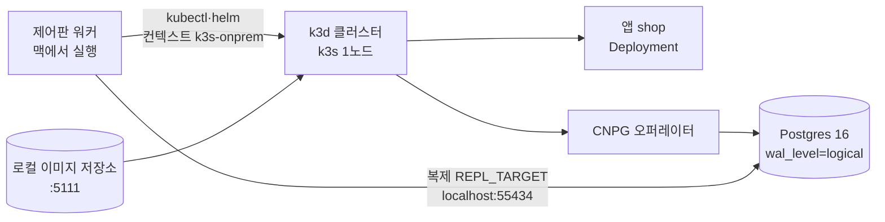

로드맵 위치: 본선 직전 / 온프레 도착 환경(k3s + CloudNativePG) 로컬 재현 / 심사 "클라우드 활용"·"완성도·데모" (AWS·GCP 말고 세 번째 도착지를 노트북 한 대로 보여 주기)

# 온프레 k3s 로컬 데모

문서 상태: AI 초안 DRAFT(ai), 팀 검토 전 (2026-10-31). 컨테이너에서 확인한 것과 맥에서 확인할 것을 【사실】/【미확인】으로 나눠 적었다.



## 이게 뭔가 (0부터)

- **k3s**: 쿠버네티스를 바이너리 하나로 줄인 배포판. 공장·매장 서버 같은 "온프레"에서 많이 쓴다. 우리 설계의 온프레 도착지가 이것이다.
- **k3d**: k3s를 Docker 컨테이너 안에서 돌려 주는 도구. 맥에는 리눅스 커널이 없어 k3s를 바로 못 깐다. 그래서 Docker Desktop 위에 k3s를 컨테이너로 띄운다. 노트북 한 대 = 온프레 서버 한 대 역할.
- **CloudNativePG(CNPG)**: 쿠버네티스 안에서 Postgres를 운영해 주는 오퍼레이터. `Cluster`라는 YAML 하나를 주면 DB 파드, 접속 서비스(`<이름>-rw`), 비밀번호 Secret을 만든다. 클라우드의 RDS·Cloud SQL 자리를 온프레에서 대신한다.
- **wal_level=logical**: Postgres가 "어떤 행이 바뀌었는지"를 다른 DB에 흘려보낼 수 있게 하는 설정. 우리 DB 이전(@svc/replication)은 이게 켜져 있어야 동작한다.
- **앱 배포 순서**: 제어판이 클라우드에 하는 일과 같다. ① 이미지 복사 ② 어댑터가 값 만들기 ③ 앱 바닥(네임스페이스·할당량·네트워크 정책) ④ Helm 차트로 앱+DB 설치 ⑤ 준비 완료 대기. 이 폴더 스크립트가 그 순서를 손으로 한 번 따라간다.

## 파일

| 파일 | 하는 일 |
|---|---|
| `scripts/lib.sh` | 버전·포트·이름 모음 (다른 스크립트가 읽음) |
| `scripts/00-preflight.sh` | 도구·Docker 메모리·CPU 종류·포트 점검 |
| `scripts/01-cluster-up.sh` | k3d 저장소 + k3s 1노드 클러스터, 컨텍스트 이름 `k3s-onprem` |
| `scripts/02-cnpg-install.sh` | CNPG 1.30.1 릴리스 매니페스트 설치 |
| `scripts/03-app-deploy.sh` | 이미지 복사 → 어댑터 값 → 바닥 → 복제 계정 Secret → Helm → 대기 |
| `scripts/04-db-check.sh` | wal_level, 복제 계정, superuser Secret, 맥에서 바깥 접속 확인 |
| `scripts/05-env-print.sh` | 제어판 .env 변수 이름 출력 (`--write`면 값까지 `.env.onprem`에) |
| `scripts/99-cleanup.sh` | 전부 지우기 |
| `scripts/gen-values.ts` | `adapterFor("onprem")`의 `toTerraform`·`toHelmValues` 결과를 파일로 |
| `manifests/app-floor.yaml` | Terraform 모듈 `infra/modules/onprem/app`과 같은 바닥을 kubectl로 |
| `manifests/db-expose.yaml` | 데모 전용: NodePort 30432 + 5432 허용 정책 |
| `values/demo-overrides.yaml` | 데모 덧씌우기: 터널 끄기, 복제 켜기 |
| `chart-patch/cnpg.yaml` | `gitops/charts/app/templates/cnpg.yaml` 교체본 (CHANGES.md 참고) |

## 맥(Intel x86_64)에서 한 번 깔기

Homebrew 소스 빌드를 피하려고 바이너리를 직접 받는다. Docker Desktop은 이미 있다고 본다.

1. Docker Desktop 메모리를 6GB 이상으로 (Settings → Resources → Memory). 지금 값 확인:

```
docker info --format '{{.MemTotal}}'
```

2. 내 CPU가 Intel인지 확인 (`x86_64`가 나와야 아래 `amd64` 파일이 맞다):

```
uname -m
```

3. 도구 넣을 폴더를 만든다:

```
mkdir -p ~/bin
```

4. k3d 5.8.3 받기 → 실행 권한 주기:

```
curl -Lo ~/bin/k3d https://github.com/k3d-io/k3d/releases/download/v5.8.3/k3d-darwin-amd64
```

```
chmod +x ~/bin/k3d
```

5. kubectl (k3s 1.31과 맞는 1.31.5) 받기 → 권한:

```
curl -Lo ~/bin/kubectl https://dl.k8s.io/release/v1.31.5/bin/darwin/amd64/kubectl
```

```
chmod +x ~/bin/kubectl
```

6. helm 3.19.0 받기 → 풀기 → 옮기기:

```
curl -Lo /tmp/helm.tgz https://get.helm.sh/helm-v3.19.0-darwin-amd64.tar.gz
```

```
tar -xzf /tmp/helm.tgz -C /tmp
```

```
mv /tmp/darwin-amd64/helm ~/bin/helm
```

7. 지금 터미널에서 `~/bin`을 먼저 찾게 하기 (zsh 설정에 영구로 넣으려면 두 번째 줄):

```
export PATH="$HOME/bin:$PATH"
```

```
echo 'export PATH="$HOME/bin:$PATH"' >> ~/.zshrc
```

8. 버전 세 개가 나오면 끝:

```
k3d version
```

```
kubectl version --client
```

```
helm version --short
```

- 이미 `kubectl`이나 `helm`이 brew로 깔려 있으면 그걸 써도 된다. 위 단계는 없을 때만.
- 【사실】 2026-10-31 컨테이너에서 k3d `k3d-darwin-amd64`, kubectl `v1.31.5/bin/darwin/amd64` 주소가 응답함(206). CNPG 1.30.1 매니페스트는 실제로 받아 적용함.
- 【미확인】 helm 주소(get.helm.sh)는 컨테이너에서 막혀 확인 못 함. 안 받아지면 `brew install helm`(병 파일이 있어 소스 빌드 아님 【추정】).

## 데모 순서 (맥, Service 폴더 기준)

이 폴더를 맥에 복사해 두었다고 하고 (예: `~/Softbank_final/onprem-demo`), 한 줄씩:

```
cd ~/Softbank_final/onprem-demo
```

```
export SERVICE_DIR=~/Softbank_final/Service
```

```
bash scripts/00-preflight.sh
```

```
bash scripts/01-cluster-up.sh
```

```
bash scripts/02-cnpg-install.sh
```

```
bash scripts/03-app-deploy.sh
```

```
bash scripts/04-db-check.sh
```

```
bash scripts/05-env-print.sh
```

앱 화면 확인 (다른 터미널에서 첫 줄 실행 → 브라우저나 curl):

```
kubectl --context k3s-onprem -n app-shop port-forward svc/shop 18080:80
```

```
curl -s localhost:18080/healthz
```

다 보고 나면 정리:

```
bash scripts/99-cleanup.sh
```

- 맥 주의: Homebrew postgresql@16이 5432를 쓰고 있어도 이 데모는 55434·5111·6550만 쓴다. 00-preflight가 셋이 비었는지 본다.
- Terraform으로 바닥을 만들고 싶으면 `USE_TERRAFORM=1 bash scripts/03-app-deploy.sh`. 로컬 k3d 컨텍스트에만 apply한다(클라우드 자원 없음). 학습자가 직접 결정해서 쓰는 옵션이다.

## 제어판에 환경으로 등록할 때 필요한 값 (이름만)

`05-env-print.sh`가 아래를 출력한다. 비밀번호는 `--write`일 때만 `$SERVICE_DIR/.env.onprem`(권한 600, `.gitignore`의 `.env.*`)에 채운다. 채팅·공유 폴더에 붙이지 않는다.

| 변수 | 뜻 | 데모 값 |
|---|---|---|
| `ONPREM_ENV_NAME` | environments.name | `onprem-k3s-local` |
| `ONPREM_KUBE_CONTEXT` | 어댑터 `kube_context` (`region=local`일 때 기본) | `k3s-onprem` |
| `ONPREM_KUBECONFIG` | kubeconfig 파일 | `$HOME/.kube/config` |
| `ONPREM_REGISTRY_HOST` | 클러스터 안에서 이미지 받는 주소 = 어댑터 `registryHost` | `k3d-onprem-registry.localhost:5111` |
| `ONPREM_REGISTRY_PUSH_HOST` | 워커가 이미지 올리는 주소 | `localhost:5111` |
| `ONPREM_ARCH` | 노드 CPU (어댑터 capabilities `arch.*`) | Intel 맥이면 `amd64` |
| `ONPREM_AGENT_KEY_ID` / `ONPREM_AGENT_HMAC_SECRET` | 온프레 Agent 보고 서명(@svc/agent onprem) | 비움. STUB |
| `REPL_TARGET_URL` | 워커 → CNPG 관리자 접속 | `postgres://postgres:<pw>@localhost:55434/shop?sslmode=require` |
| `REPL_TARGET_PEER_URL` | 출발 DB(맥 docker) → CNPG | `...@host.docker.internal:55434/...` |
| `REPL_TARGET_PROVIDER` | 점검 메시지용 | `cnpg` |
| `REPL_TARGET_APP_ROLE` | 컷오버 때 권한을 다루는 앱 계정 | `app` (CNPG initdb owner) |

- TODO(human): `ONPREM_*` 이름은 아직 코드가 읽지 않는다. environments 표에는 접속 정보 칸이 없고(`external_id`, `account_id`만), 연결 확인(`verify-connection`)도 STUB이다. 이 이름으로 정할지 통합 스레드와 맞추기.
- 출발 DB를 맥 docker로 쓰면 CNPG 파드가 출발에 붙을 때는 `host.k3d.internal:55432` (k3d가 CoreDNS에 넣어 주는 맥 주소). 이건 `REPL_SOURCE_PEER_URL` 쪽.

## 실측

| 무엇 | 값 | 조건 | 표시 |
|---|---|---|---|
| k3s 기동 → coredns Ready | 17 s (1회) | 컨테이너, k3s v1.31.5 단일 바이너리 `--docker` | 【사실】 |
| CNPG 1.30.1 CRD 설치 | 11개 CRD 생성, 에러 0 | `kubectl apply --server-side` | 【사실】 |
| 앱 재배포 (바닥 → Helm 렌더 적용 → Ready) | 2084 / 2078 / 2085 ms (중앙 2084) | 3회, 이미지 캐시됨, DB 비밀번호는 대역 Secret | 【사실】 |
| 앱 확인 | `/healthz` → `{"status":"OK"}`, 메시지 `onprem k3s demo`, `DB_HOST=shop-db-rw` | ClusterIP로 curl | 【사실】 |
| 할당량 + 요청량 없는 파드 | 거부 `must specify requests.cpu` | 원래 차트의 CNPG Cluster에 resources 없음 → 수정함 | 【사실】 |
| CNPG Cluster Ready까지 | — | 오퍼레이터 이미지(ghcr.io)를 컨테이너에서 못 받음 | 【미확인】 |
| k3d 클러스터 기동 | — | 컨테이너에선 노드 안 runc가 막혀 실패 → 맥에서 잴 것 | 【미확인】 |

- 【추정】 맥(Intel, Docker Desktop)에서 01은 30–60 s, 02는 이미지 받기 포함 30–90 s, 03의 DB Ready는 initdb 포함 60–120 s. 맥에서 3회 재서 이 표에 채운다.

### 컨테이너에서 어디까지 했나

- 【사실】 k3d·k3s-in-docker 둘 다 노드 컨테이너 안 runc가 `oom_score_adj` 권한 오류로 파드를 못 띄움. 그래서 k3s 바이너리를 호스트에서 `--docker`로 띄우고, 음수 oom 점수를 0으로 바꾸는 runc 감싸개를 dockerd 기본 런타임으로 썼다(컨테이너 전용 우회, 맥엔 필요 없음).
- 【사실】 G 어댑터(`adapterFor("onprem")`)로 만든 값으로 Helm 렌더·`helm lint` 통과, 실제 적용. `03-app-deploy.sh`는 1~5단계(이미지 복사, 어댑터, 바닥, 복제 Secret, Helm 설치)까지 그대로 돌았고, 6단계 CNPG 대기에서 멈춤(오퍼레이터 없음).
- 【사실】 CNPG 웹훅이 없는 상태에서 Cluster를 CRD 스키마로만 검사: `managed.roles`(replication, inRoles), `enableSuperuserAccess`, `resources`, 파라미터 3개가 그대로 저장됨.
- 【미확인】 실제 Postgres 기동, wal_level 값, 복제 계정 생성, NodePort 바깥 접속(04 전체), k3d 저장소 경유 이미지 받기.

## 핵심 결정 3개 (+대안)

1. **k3d (k3s를 Docker 안에)** — 대안: kind(k3s가 아니라 표준 k8s라 온프레 대상과 다름), multipass VM에 진짜 k3s(Intel 맥에선 가능하지만 VM 2GB+ 더 쓰고 기동이 느림), Rancher Desktop(설치가 무겁고 Docker Desktop과 충돌 가능). 버린 이유: 본선 온프레 대상이 k3s이고, 이미 있는 Docker Desktop만으로 끝난다. `bootstrap.sh`(진짜 서버용)와 같은 k3s 버전 계열을 쓴다.
2. **CNPG는 릴리스 매니페스트 한 장, 버전 1.30.1 고정** — 대안: Helm 차트(`bootstrap.sh` 방식). 버린 이유: 저장소 추가·갱신 단계가 없고 버전이 URL에 박혀 드릴 시간이 준다. 컨테이너에서 차트 저장소(`cloudnative-pg.github.io`)는 막혔고 매니페스트는 받아졌다.
3. **DB 복제 권한은 차트 값 `database.replication.enabled`로 켠다 (superuser Secret + REPLICATION 계정)** — 대안: 데모 때 `kubectl patch`로 덧대기(Argo CD가 되돌림), CNPG `Publication`/`Subscription` CRD로 선언형 복제(우리 @svc/replication이 SQL로 직접 하므로 이중 관리). 버린 이유: 같은 차트가 EKS·GKE·k3s 공통이라 값 하나로 켜고 끄는 게 일관된다. TODO(human): superuser 대신 PG16 `pg_create_subscription`으로 줄일지.

## 셀프 연습 1개

`chart-patch/cnpg.yaml`에서 `resources:` 두 줄을 지우고 `03-app-deploy.sh`를 다시 돌린다.
- 기대: `04`까지 못 가고 `kubectl -n app-shop get events`에 `failed quota: platform-quota: must specify requests.cpu`가 나온다. CNPG Cluster는 `Setting up primary`에서 멈춘다.
- 원래대로 되돌리고 다시 돌리면 Ready.
- 생각해 볼 것: 할당량을 빼는 것과 요청량을 넣는 것 중 무엇이 맞나? (힌트: 할당량이 없으면 한 앱이 노트북 메모리를 다 먹는다)

## 검증 명령과 기대 출력

```
bash scripts/00-preflight.sh
```
- 기대: `ok` 줄만 나오고 끝 (MISS/BUSY 없음), `CPU x86_64`

```
bash scripts/01-cluster-up.sh
```
- 기대: 마지막에 `cluster_up_ms=...`, 노드 1개 `Ready`

```
bash scripts/02-cnpg-install.sh
```
- 기대: `deployment "cnpg-controller-manager" successfully rolled out`, CRD 목록에 `clusters.postgresql.cnpg.io`

```
bash scripts/03-app-deploy.sh
```
- 기대: `digest=sha256:...`, `db_ready_ms=...`, `app_ready_ms=...`, `cluster.postgresql.cnpg.io/shop-db ... Cluster in healthy state`

```
bash scripts/04-db-check.sh
```
- 기대: `wal_level=logical`, `max_replication_slots=10`, `repl_role=repl replication=t`, `app_owner=shop owner=app`, `external ok PostgreSQL 16...`

```
bash scripts/99-cleanup.sh
```
- 기대: `cleanup_ms=...`, `k3d cluster list`에 `onprem` 없음
