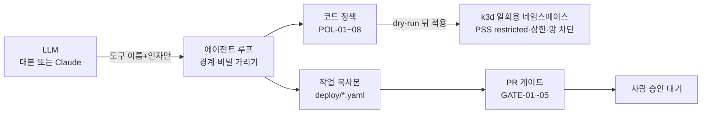

로드맵 위치: 본선 직전 / AI 점검·수정 장면을 실제 LLM + k3d 샌드박스로 / 본선 연결점: AI 10, 완성도·데모 30, 클라우드 활용 30

# AI 점검·수정 샌드박스 (memory / k3d)

> 문서 상태: AI 초안 · 2026-10-31 · 기준 코드 `integration/service-current.tgz`(int3) + 작업 Z22 · 클라우드 컨테이너에서는 가짜 kube API 로만 시험, 맥 k3d·진짜 LLM 실행 전



## 1. 한 줄 요약

- 【사실】 AI 에이전트가 "계속 재시작하는 앱"을 샌드박스에서 살펴보고, 매니페스트를 고쳐 샌드박스에 적용해 본 뒤, 고친 내용을 PR 후보로 넘긴다.
- 【사실】 같은 루프에 LLM 2종(대본 / 진짜 Claude), 샌드박스 2종(메모리 가짜 / k3d 네임스페이스)을 끼울 수 있다. 환경변수 두 개로 고른다.
- 【사실】 기본값은 대본 + 메모리다. 토큰도 클러스터도 안 쓴다. 맥 데모에서만 `AGENT_LLM=real`, `SANDBOX_MODE=k3d` 로 켠다.

## 2. 고르는 법

| 환경변수 | 값 | 기본 | 뜻 |
|---|---|---|---|
| `AGENT_LLM` | `scripted` / `real` | `scripted` | 대본 = 정해진 도구 호출 8개. real = Anthropic API (키 필요) |
| `AGENT_MODEL` | 모델 이름 | `claude-sonnet-5-5` | real 일 때만. `claude-opus-5-5` 로 바꿀 수 있다 |
| `AGENT_LLM_EFFORT` | low~max | `medium` | real 일 때 생각 깊이 |
| `ANTHROPIC_API_KEY` | 키 | 없음 | `.env` 에만. 코드는 "있는지"만 본다 |
| `SANDBOX_MODE` | `memory` / `k3d` | `memory` | k3d = 맥 로컬 클러스터 `agent-sbx` |
| `SANDBOX_KUBE_URL` | 주소 | `http://127.0.0.1:8001` | `kubectl proxy` 주소. 인증서는 kubectl 이 들고 있고 앱은 비밀을 안 받는다 |
| `SANDBOX_NODE_PREFIX` | 글자 | `k3d-agent-sbx-` | 노드 이름이 이걸로 시작하지 않으면 아무것도 만들지 않는다 (운영 클러스터 오접속 방지) |

- 명세 초안 에이전트(작업 K)는 따로 `AGENT_LLM_PROVIDER` 를 쓴다. 이 문서의 두 변수는 점검·수정 경로에만 걸린다.

> **용어** | **샌드박스** = 망가져도 되는 격리된 실험 공간. **네임스페이스** = 쿠버네티스 안의 칸막이. 이름·권한·자원 상한을 칸마다 따로 둔다. **PSS restricted** = 쿠버네티스 기본 내장 검사. root 실행·권한 상승·host 공유 파드를 거부한다. **server dry-run** = 쿠버네티스 API 서버가 진짜 검사를 다 하되 저장만 안 하는 시험 적용.

## 3. 실행 한 건의 흐름 (k3d)

1. 오접속 방지: 노드 목록을 읽어 전부 `k3d-agent-sbx-` 로 시작하는지 본다. 아니면 멈춘다.
2. 네임스페이스 `sbx-<회사8>-<실행8>-<난수4>` 를 만든다. 라벨: PSS restricted 강제, 관리 표시, 만료 시각.
3. 같은 칸에 자원 상한(파드 6, 메모리 합 2Gi, 컨테이너당 최대 1Gi)과 망 정책(같은 칸 + DNS 말고 밖으로 못 나감)을 둔다.
4. 씨앗: 작업 복사본 `deploy/*.yaml` 을 그대로 적용해 문제를 재현한다. 여기서 쓰인 이미지만 이후에 쓸 수 있다.
5. 에이전트 루프: LLM 은 도구 이름과 인자만 낸다. 도구 7개(읽기·로그·레포 읽기·수정·적용·검사·끝).
6. 적용 도구: 코드 정책 → server dry-run → 진짜 적용. 앞 단계에서 걸리면 클러스터에 아무 요청도 안 간다.
7. 검사 도구: 롤아웃이 끝나길 기다린 뒤 N초 관찰해 재시작 증가를 센다.
8. 끝나면 성공·실패 상관없이 네임스페이스를 지운다. 남은 것은 라벨로 한 번에 지운다.
9. PR 은 에이전트가 아니라 플랫폼이 만든다. 게이트를 통과한 제안만 PR 후보가 된다.

## 4. 막는 것 (이 경로에서 반드시)

| 위협 | 막는 곳 | 시험 |
|---|---|---|
| Z3-F1 도구 결과 경계 탈출 (로그·오류 글 안의 `</tool_result>`) | `guard.ts` `wrapToolResult`: 결과 안의 `<` 를 모두 `<` 로. 출처 이름도 허용 글자만 | 로그·PSS 오류 메시지에 태그를 넣어도 닫는 태그는 결과마다 1개 |
| Z3-F5 평문 비밀 → LLM | 로그·오류 글 `redactText`, 레포 읽기 `redactManifestText`, 객체 읽기 `redact` + Deployment env 는 이름만 | AWS 키·`DB_PASSWORD=`·주소 안 비밀번호·이미 새어 있던 env 값 4종이 LLM 요청 어디에도 없음 |
| Z3-F5 평문 비밀 → 매니페스트·PR | 수정 도구 `TOOL-06`, 적용 정책 `POL-06`, PR 게이트 `GATE-05` (YAML 이 깨져도 동작) | 납치 흉내가 GitHub 토큰을 env 에 넣으려 하면 세 곳 모두 거부 |
| 다른 네임스페이스·금지 종류·권한 상승·hostPath·처음 보는 이미지·틀린 apiVersion | `POL-01~08` (클러스터에 보내기 전) | 7종 모두 PATCH 요청 0건 |
| 코드 정책을 통과한 위반 (예: runAsNonRoot 빠짐) | 클러스터 PSS restricted → server dry-run 에서 거부 | dry-run 요청에서 멈추고 진짜 적용 요청 없음 |
| 운영 클러스터에 붙음 | 노드 이름 접두어 검사 | GET 1건 뒤 멈춤, 만든 것 0 |
| 샌드박스 연결 끊김 | 루프가 도구 오류(`KUBE_CONNECTION`)로 돌려줌 | 실행은 `finished`, 죽지 않음 |

## 5. 아직 막지 못하는 것 (말로 밝힌다)

- 【사실】 네임스페이스 격리라 커널은 같다. 컨테이너 탈출 취약점이 있으면 노드까지 닿는다. 다음 단계는 설계 v1 의 vCluster + gVisor + Kyverno.
- 【사실】 `kubectl proxy` 는 맥 사용자의 `agent-sbx` 관리자 권한으로 붙는다. 클러스터를 샌드박스 전용으로 따로 둔 것이 지금의 경계다. TODO(human): 샌드박스 전용 서비스 계정 + 좁은 ClusterRole 로 바꿀지.
- 【추정】 망 차단은 k3s 내장 망 정책 컨트롤러가 집행한다. 맥에서 `CHANGES.md` §3-4 명령으로 확인 전.
- 【사실】 큐(agent-run) 경로의 remediate 저장소는 아직 메모리다. 작업 복사본을 GitOps 레포에서 읽어 오는 저장소가 없어서, 맥 데모는 `scripts/remediate-demo.ts` 로 한 건을 직접 돌린다.

## 6. 숫자

| 무엇 | 값 | 조건 |
|---|---|---|
| 새 시험 11개 전체 | 717 / 760 / 772 / 822 / 851 ms (중앙값 772) | 가짜 kube, 5회, 프로세스 시작 포함 |
| 데모 1건 memory + 대본 | 에이전트 24 ms, 8단계, 실패 0 | 3회 모두 제안+게이트 통과 |
| 데모 1건 k3d(가짜 kube) + 대본 | 아래 CHANGES.md §4 | run_check 60초를 실제로 기다림 |
| 맥 k3d·진짜 LLM | 【미확인】 | CHANGES.md §3 명령 |

## 핵심 결정 3개 (+대안)

1. **k3d 는 kube API 를 직접 부르고, 접속은 `kubectl proxy` 에 맡긴다.** 대안: `kubectl apply` 를 자식 프로세스로 실행(버림: 시험에 가짜 kubectl 이 필요하고 오류 글 파싱이 약함), `@kubernetes/client-node` 추가(버림: 의존성·lock 이 크게 바뀜). 앱 프로세스가 인증서를 안 받는 것이 덤.
2. **적용은 코드 정책 → server dry-run → 진짜 적용 3단.** 대안: dry-run 만(버림: 재시작 0 을 확인할 수 없음), 진짜 적용만(버림: 거부 이유가 반쯤 적용된 상태로 남음). 코드 정책은 클러스터에 아예 안 보내기 위해, dry-run 은 PSS·LimitRange 같은 클러스터 쪽 규칙까지 미리 보기 위해 둔다.
3. **샌드박스 클러스터를 운영(온프레 데모)과 따로 둔다 (`agent-sbx`, 노드 이름 검사).** 대안: 온프레 클러스터 안에 네임스페이스만(버림: 에이전트 도구가 운영 클러스터 API 에 닿음), vCluster(버림: 본선 전 설치·검증 시간이 없음, 다음 단계로).

## 셀프 연습 1개

`apps/agent-worker/scripts/fixtures/oom-web.yaml` 에서 `runAsNonRoot: true` 를 지우고 `SANDBOX_MODE=k3d npx tsx scripts/remediate-demo.ts` 를 돌린다. 씨앗 적용이 server dry-run 에서 `violates PodSecurity "restricted:latest"` 로 멈추고, 네임스페이스가 남지 않는지(`kubectl --context k3d-agent-sbx get ns`) 본 뒤 되돌린다. 질문: 이 거부를 코드 정책(POL)에서 먼저 잡게 하면 무엇을 얻고 무엇을 잃을까?

## 검증 명령과 기대 출력

```bash
npm run typecheck
node --import tsx --test packages/agent/test/k3d-sandbox.test.ts
```

- `typecheck`: 출력 없이 끝남
- 시험: `# pass 11`, `# fail 0`
- 맥 k3d·진짜 LLM 순서와 기대 출력은 `CHANGES.md` §3
