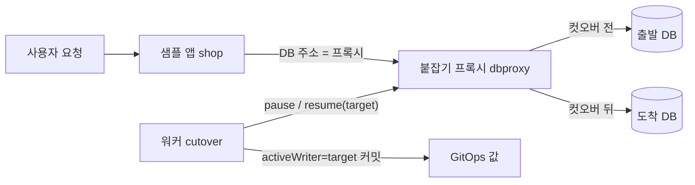
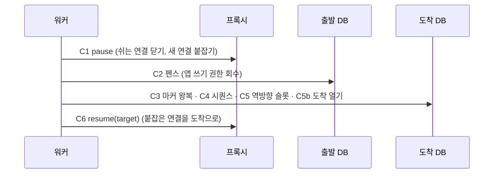

로드맵 위치: 본선 직전 / 장애 대응·무중단 이전(컷오버 때 앱 DB 연결 옮기기) / 필수 데모 1 "가동 중 이전" 실패 0, 심사 완성도·데모 30 + 클라우드 활용 30

# 컷오버 때 앱 연결 옮기기 (붙잡기 프록시)

상태: DRAFT(ai), 10/31 17:55Z. 클라우드 컨테이너 실측 (PG 16 ×3, 샘플 앱 shop, 실제 논리 복제). 맥·도커 compose 는 아직 안 돌려 봄. "앱 연결 드레인"은 TODO(human)였는데, 17:03Z 기본값 승인 방침에 따라 AI 기본값으로 정했다. 바꾸려면 아래 "버린 대안" 표를 보고 고르면 된다.

## APP-22 (가) 팀 결정 (11/4): 도착 앱은 컷오버 전까지 출발 DB 에 붙는다

DECISION(team): 컷오버 전까지 도착 앱은 출발 DB 에 붙고(트래픽 10·50% 동안 쓰기가 전부 출발로), 컷오버 때 도착 DB 로 바꾼다. 롤백하면 다시 출발. 도착 직접 쓰기 감지(TARGET_LOCAL_WRITES)는 안전망으로 둔다.

| 칸 | 무엇 |
|---|---|
| 차트 값 | `database.activeWriter`(처음 `source`) + `database.endpoints.source`(host·port·user·secretRef) / `endpoints.target`(link 출력). activeWriter 로 DB_HOST·PORT·USER·PASSWORD 를 고르고 체크섬으로 다시 띄움 |
| 출발 경로 | deploy 앞에서 출발 DB 에 도착 egress 만 여는 경로와 전용 최소 권한 계정 `svc_link_<이전 id 앞 8자>` 를 만든다 (`SOURCE_DB_LINK=real`). 손으로 마련한 경로면 `APP_LINK_SOURCE_URL` |
| 컷오버 | C2 울타리가 앱 계정과 전용 계정 둘 다 막음 → C6 뒤 `activeWriter=target` 커밋(3번 재시도). 프록시(`APP_LINK_URLS`)가 있으면 빠른 길로 같이 |
| 롤백(컷오버 뒤) | DB 되돌림 → `activeWriter=source` 커밋. 출발 울타리 걷기가 전용 계정 권한도 되돌림 |
| Terraform 이 앱을 띄우는 도착 (ECS·Cloud Run·VM·관리형 잡) | apply 가 출발 경로를 얻어 비밀번호를 도착 그릇(aws `platform/<회사>/<앱>/db-link` JSON password, gcp `app-<앱>-db-link`)에 stdin 으로 넣고 루트 변수 `db_writer_json`(active=source)로 띄운다. 경로 사실(비밀번호 뺀 것)은 작업 폴더 `db-writer.json`. 컷오버(C6 뒤) = active=target 으로 다시 apply, 컷오버 뒤 롤백 = active=source 로 다시 apply (실패해도 destroy 안 함, 3번 재시도, 도착 실행 역할 apply 천장). 정리·도착 지우기 때 그릇 삭제 |
| 막기 | 사전 점검 `PC-APPLINK-PATH`(경로 없음·루프백·{tf:} 미해결, Terraform 실행 방식이면 계정·비밀번호·DB 이름 필요). 컷오버 때 바꿀 길이 없으면 울타리 전에 `APP_LINK_UNAVAILABLE` |
| 끄기 | `APP_LINK=0` (시험 전용) |

## 그림 먼저



- 앱은 DB 주소를 한 번도 안 바꾼다. 앱이 보는 주소는 늘 프록시다.
- 컷오버 순간에 워커가 프록시에게 "잠깐 붙잡아"(pause) → DB 전환 → "도착으로 풀어"(resume) 를 보낸다.
- 끝나면 GitOps 값 `database.activeWriter` 를 `target` 으로 남긴다. 프록시가 재시작해도 도착을 본다.

## 한눈에 (결론 먼저)

| 방식 | 회 | 요청 | 사용자에게 간 실패 | p95 | 받은 주문 → 있어야 할 DB 에 있음 |
|---|---|---|---|---|---|
| **붙잡기 프록시 (이번)**, 부하기 재시도 0 | 3 | 3,245 / 3,243 / 3,191 | **0 / 0 / 0** | 7.2 / 7.2 / 7.0 ms | 2605/2605, 2639/2639, 2543/2543 |
| 붙잡기 프록시 + 컷오버 뒤 롤백 | 2 | 3,246 / 3,233 | **0 / 0** | 7.4 / 7.5 ms | 출발 DB 에 2573/2573, 2643/2643 |
| 연결 전환 없음 (= 지금 통합본) | 2 | 3,241 / 3,236 | **857 / 857** (HTTP 500) | 7.8 / 8.1 ms | 1935/1935, 1911/1911 |

- 부하: 샘플 앱 writer.mjs 초당 100 쓰기, 동시 8, **재시도 0** (Z6 는 재시도 3번이었다).
- 붙잡힌 시간: 연결이 기다린 최대 76~102 ms, 프록시가 붙잡고 있던 시간 97~115 ms, 붙잡힌 연결 6~8개.
- 앱 안 재시도(db.mjs, 연결 오류면 1번 다시): 0~2회, 실패 0. 왜 생기는지는 "한계" 1번.
- 복제 유실(RPO)은 모든 방식에서 0. 문제는 유실이 아니라 "앱이 어디에 쓰나"였다.

## 컷오버 안에서 무슨 일이 일어나나

상태기계 22상태는 그대로다. 아래는 전부 `cutover` 상태 안의 서브스텝(C1~C6)이다. 계약(contracts)은 안 바뀐다.



| 단계 | 프록시가 하는 일 | 앱이 보는 것 |
|---|---|---|
| C1 붙잡기 | 트랜잭션 밖에서 쉬는 연결은 바로 닫는다. 트랜잭션 중인 연결은 COMMIT 답을 앱에 넘긴 직후 닫는다. 새 연결은 받아만 두고 읽지 않는다 | 새 질의가 "연결 중"으로 잠깐 기다린다. 에러 없음 |
| C2~C5b | 아무것도 안 한다 (기다리게 둔다) | 계속 기다림 (실측 100 ms 안팎) |
| C6 풀어 주기 | 쓰기 대상을 도착으로 바꾸고, 기다리던 연결을 도착에 잇는다 | 질의가 도착 DB 에서 끝난다 |
| C6' 되돌림 (따라잡기 실패) | 대상은 출발 그대로 두고 풀어 준다 | 질의가 출발에서 끝난다 |
| 롤백 (rollback_window 안) | 같은 일을 반대 방향으로: pause → resume(source) | 질의가 출발에서 끝난다 |

"쉬는 연결"을 어떻게 아나: 프록시는 Postgres 메시지의 머리(종류 1바이트 + 길이 4바이트)만 읽는다. 서버가 보내는 ReadyForQuery(`Z`) 의 끝 바이트가 `I`(쉼) / `T`(트랜잭션 중) 를 알려 준다. 인증(SCRAM)은 그대로 통과시키므로 프록시는 비밀번호를 모른다.

## 두 길: 빠른 길과 오래가는 길

| 길 | 무엇 | 걸리는 시간 | 왜 필요한가 |
|---|---|---|---|
| 빠른 길 | 프록시 pause/resume | 100 ms 안팎 | 사용자가 에러를 안 보게 |
| 오래가는 길 | GitOps 값 `database.activeWriter: target` 커밋 → 프록시 설정 `DBPROXY_ACTIVE` | 커밋 몇 초 (실패해도 컷오버는 안 되돌림) | 프록시 파드가 재시작해도 출발로 돌아가지 않게. resume 이 끝내 실패했을 때 복구 길 |

코디네이터 제안은 "GitOps 값 갱신 → 앱 재배포 + 그동안 HTTP 요청 붙잡기"였다. 재배포는 Argo 동기화 + 파드 교체로 수십 초다. HTTP 요청을 그만큼 붙잡으면 사용자 쪽 시간 초과가 난다. 그래서 GitOps 값은 남기되 앱이 아니라 프록시의 설정 칸으로 쓰고, 앱 재배포는 안 한다. 설계 문서의 기존 결정 "앱 DB 주소 = PgBouncer 주소 (DB 주소를 직접 쓰면 컷오버 때 앱을 다시 배포해야 한다)" 과 같은 방향이다.

## 일이 틀어지면

| 상황 | 동작 | 확인한 것 |
|---|---|---|
| 프록시 제어가 죽음 (pause 실패) | 훅이 C1 에서 예외 → **펜스 전에 멈춤**. 출발 DB 쓰기 권한 그대로, 앱 실패 0. 이전은 int4 에선 cutover 에 멈춤, Z19 위에선 failed(CUTOVER_ERROR_UNFENCED) | 실측 1회: 요청 6,501건 실패 0, 출발 쓰기 권한 그대로, 작업 failed `APP_LINK_PAUSE_FAILED` |
| 프록시 여러 개 중 하나만 pause 실패 | 붙잡은 쪽은 지금 대상 그대로 풀고 예외 | 단위 시험 |
| resume 이 끝내 실패 (3번 재시도 100/300/900 ms) | 예외를 **안 던진다**. C6 은 DB 가 이미 바뀐 뒤라, 던지면 "반쯤 컷오버"(Z19 의 CUTOVER_HALFWAY)가 된다. 대신 감사 detail `appLink.resumeFailed=true`, 측정값 `app_link_resume_failed=1`. 프록시는 holdMax(25초) 뒤 지금 대상(출발)으로 스스로 푼다 → 이때 쓰기는 실패. GitOps `activeWriter=target` 이 프록시 재시작 뒤 복구 | 단위 시험. 실환경 미확인 |
| 트랜잭션이 드레인 시간(2초) 안에 안 끝남 | 그대로 두고 진행. C2 펜스가 그 세션을 끊는다 (앱은 연결 오류 → db.mjs 1회 재시도) | 단위 시험 |
| 워커가 pause 와 resume 사이에 죽음 | 프록시가 holdMax(25초) 뒤 지금 대상으로 푼다. 무한 대기 없음 | 단위 시험 |

## 설정

워커 쪽 `.env` (없으면 훅 없음 = 지금까지와 같음):

| 이름 | 기본 | 뜻 |
|---|---|---|
| APP_LINK_URLS | (없음) | 프록시 제어 주소, 쉼표로 여러 개. 예 `http://127.0.0.1:6480` |
| APP_LINK_TOKEN | (없음) | 프록시의 DBPROXY_TOKEN 과 같은 값. 값은 `.env` 에만 |
| APP_LINK_TIMEOUT_MS | 3000 | 제어 호출 한 번 제한 시간 |
| APP_LINK_RETRIES | 3 | resume 재시도 횟수 |
| APP_LINK_DRAIN_MS | 프록시 기본 | pause 가 진행 중 트랜잭션을 기다리는 최대 시간 |

프록시 쪽 (`packages/dbproxy/src/proxy.ts`, 의존성 없음, `node proxy.ts` 로 바로 실행):

| 이름 | 기본 | 뜻 |
|---|---|---|
| DBPROXY_UPSTREAMS | source=localhost:55432,target=localhost:55433 | 이름=호스트:포트 |
| DBPROXY_ACTIVE | source | 처음 대상. GitOps `database.activeWriter` 가 들어오는 칸 |
| DBPROXY_PORT / DBPROXY_CONTROL_PORT | 6432 / 6480 | 앱용 / 제어용 |
| DBPROXY_CONTROL_HOST | 127.0.0.1 | 제어 포트는 밖에 열지 않는다 |
| DBPROXY_DRAIN_MS / DBPROXY_HOLD_MAX_MS | 2000 / 25000 | 드레인 최대 / 붙잡기 최대 |
| DBPROXY_TOKEN | (없음) | 있으면 제어 호출에 Bearer 필요 |
| DBPROXY_INSECURE_NO_TOKEN | (없음) | 제어 포트를 127.0.0.1 밖에 열면서 토큰이 없으면 프록시가 안 뜬다(종료 코드 2). 데모 compose 만 1 (Z38 P-1) |

샘플 앱 compose(`examples/shop/docker-compose.yml`)는 이제 기본으로 `dbproxy` 를 띄우고 앱의 `DB_HOST` 를 `dbproxy:6432` 로 둔다. 예전처럼 직접 붙이려면 `APP_DB_HOST=db APP_DB_PORT=5432`.

## 버린 대안

| 대안 | 버린 이유 | 숫자 |
|---|---|---|
| HTTP 붙잡기 프록시를 앱 앞에 (Z6 모의) | 앱이 두 벌(출발 DB용, 도착 DB용) 필요. 트래픽 가중치 전환(Cloudflare)과 같은 자리라 겹친다. 상태를 50 ms 마다 물어서 붙잡는 시간이 cutover 상태 전체(약 0.5초) | Z6: 실패 0, 최대 붙잡힘 544~594 ms |
| 환경 변수 재주입 + 앱 재배포 | 파드 교체 수십 초. 그동안 옛 파드는 펜스된 출발에 쓰다 실패하거나, 펜스 전이면 두 DB 에 동시에 쓴다 | 측정 안 함 【추정】 |
| GitOps 값만 바꾸고 재배포 | 위와 같음 + Argo 동기화 지연 | 측정 안 함 【추정】 |
| 진짜 PgBouncer (PAUSE/RESUME + 설정 RELOAD) | 실환경 정답 후보. 다만 대상 바꾸기가 설정 파일 수정 + RELOAD 라 제어 API 를 따로 만들어야 하고, 이 컨테이너엔 설치 불가 | 본선 전 맥에서 비교 【미확인】 |
| 앱 재시도에만 기대기 | 컷오버가 약 0.3초를 넘으면 샘플 앱 재시도(3×100 ms)가 버티지 못한다 | M 실측: 500 ms 펜스 → 56건 실패 |

## 한계 (정직하게)

1. 쉬는 연결을 "옮기지" 못하고 닫는다. 서버 인증을 프록시가 대신 못 하기 때문이다(PgBouncer 는 한다). 닫는 순간 앱이 그 연결을 막 빌려 가면 "Connection terminated" 가 나고, 샘플 앱 db.mjs 가 200 ms 뒤 1번 다시 한다. 실측 0~2회, 사용자 실패 0. 재시도 없는 앱이면 이게 실패로 보인다.
2. TLS 를 못 푼다. SSLRequest 에 'N' 으로 답한다. 앱 ↔ 프록시는 같은 파드/네트워크 안 평문 전제. 실제 클라우드(RDS·Cloud SQL 은 TLS 강제)에서 프록시 → DB 구간 TLS 는 아직 없다 → 실환경은 PgBouncer 로 바꾸는 게 맞다 TODO(human).
3. 교차 클라우드에서는 프록시가 클러스터마다 하나다 (출발 쪽 앱, 도착 쪽 앱). `APP_LINK_URLS` 에 둘 다 넣으면 둘 다 붙잡고 둘 다 푼다. 두 클라우드 사이 제어 호출 왕복 시간은 안 쟀다 【미확인】.
4. Helm 차트(gitops/charts/app)에는 아직 프록시가 없다. 차트에 붙이는 안은 `proposals/Z31-chart-dbproxy.md`.
5. GitOps 기록은 commitBundle 의 kind 가 deploy|traffic 둘뿐이라 traffic 으로 남긴다.

## 핵심 결정 3개 (+대안)

1. **앱 연결 전환 = DB 붙잡기 프록시 (PgBouncer 흉내) + GitOps activeWriter 기록.** 대안: HTTP 붙잡기(Z6), 재배포, 진짜 PgBouncer. 이유: 앱 재배포 없이 100 ms 안팎으로 끝나고, 앱이 한 벌이라 트래픽 가중치 전환과 안 겹친다. 측정: 실패 0 (3/3, 재시도 0), 전환 없음 857건 실패 (2/2).
2. **pause 실패는 예외(펜스 전 멈춤), resume 실패는 예외 아님(기록 + 자동 풀림 + GitOps 복구).** 대안: 둘 다 예외. 이유: C6 은 DB 가 이미 바뀐 뒤라 예외 = 반쯤 컷오버. 측정: 제어 죽은 프록시 1회 → 출발 쓰기 권한 그대로, 이전은 cutover 에서 멈춤.
3. **상태기계·계약 그대로, cutover 안 서브스텝.** 대안: `app_switching` 같은 새 상태. 이유: 22상태·화면·OpenAPI·시험 전부 그대로. 증거는 감사 detail `appLink` 와 측정값 `app_link_*` 로 남는다.

## 셀프 연습 1개

`.env` 에서 `APP_LINK_URLS` 줄을 지우고 `MODE=dbhold` 로 한 번 돌린다(앱은 프록시를 거치지만 워커가 프록시를 안 부른다). 결과의 "사용자에게 간 실패" 가 몇 건인지, 왜 `MODE=none` 과 비슷한지 한 줄로 적는다. 다시 넣고 실패 0 으로 돌아오는지 본다.

## 검증 명령과 기대 출력

단위 시험 (DB 없음):

```
node --import tsx --test packages/dbproxy/test/proxy.test.ts apps/worker/test/z31-app-link.test.ts
```

기대: `# pass 13`, `# fail 0`.

가동 중 이전 재현 (플랫폼 DB 5432, 출발 55432, 도착 55433 Postgres 가 떠 있고 wal_level=logical, Service 폴더에서):

```
MODE=dbhold RUN=1 sh tools/load/live-app/run-z31.sh
```

기대: `writer summary: {... "failed":0 ...}`, `{"acked":N,"found":N,"missing":0}`, 감사 줄 `cutover.rollback_window|{... "resumeFailed": false}`.

```
MODE=none RUN=1 sh tools/load/live-app/run-z31.sh
```

기대: `"failed":` 수백 건, `"errors":{"http_500":...}` (지금 통합본 동작).

```
ROLLBACK_AFTER_CUTOVER=1 ROLLBACK_WINDOW_SEC=20 MODE=dbhold RUN=1 sh tools/load/live-app/run-z31.sh
```

기대: `"failed":0`, 출발 DB 확인에서 `"missing":0`, 감사 줄 `rollback.rolled_back|{... "upstream": "source" ...}`.
