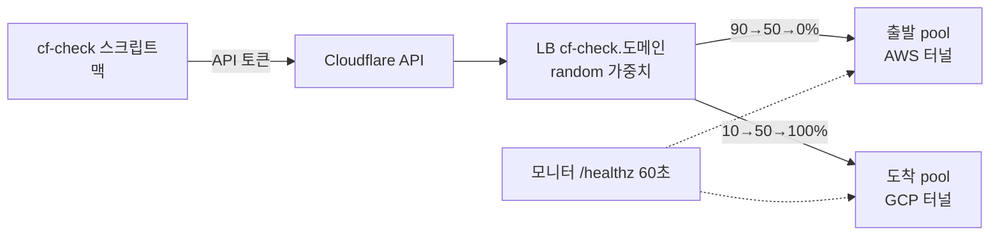

로드맵 위치: 결선 준비 / Cloudflare LB 실연결 검증 / 클라우드 활용 30·완성도 30 (라이브 트래픽 전환 데모)

# Cloudflare 트래픽 전환 실연결 검증

상태: AI 초안. 스크립트는 가짜 Cloudflare 서버로만 돌려 봤다. 실제 계정 실행 전 (2026-10-31).

## 0. 한눈에 보기



- 트래픽을 나누는 건 Cloudflare Load Balancer(LB) 하나다. LB 아래에 pool 이 두 개(출발, 도착) 있고, pool 마다 오리진(실제 서버 주소)이 하나씩 있다.
- 가중치는 LB 의 `random_steering.pool_weights` 에 적는다. 출발 0.9, 도착 0.1 이면 요청 10개 중 1개꼴로 도착에 간다.
- 모니터는 pool 이 살아 있는지 60초마다 `/healthz` 로 확인한다. 죽은 pool 에는 가중치가 있어도 안 보낸다.
- 워커(전환 작업)는 이미 있는 LB 의 가중치만 바꾼다. LB·pool·모니터를 만드는 건 이 검증 스크립트뿐이다.

## 1. 개념 먼저

- **모니터**: "이 주소로 GET 해서 200 이 오면 건강" 이라는 규칙. 계정에 하나 만들어 두고 여러 pool 이 같이 쓴다.
- **pool**: 오리진 묶음. 모니터를 하나 붙인다. 계정 아래 자원이라 경로가 `/accounts/{계정}/load_balancers/pools` 다.
- **LB**: 도메인(zone) 아래 자원. 이름이 곧 호스트 이름(`cf-check.도메인`)이다. 어느 pool 들을 쓸지(`default_pools`), 다 죽으면 어디로 갈지(`fallback_pool`), 어떻게 나눌지(`steering_policy`)를 적는다.
- **만드는 순서는 모니터 → pool → LB**, 지우는 순서는 그 반대다. pool 이 모니터를, LB 가 pool 을 가리키기 때문에 거꾸로 하면 "사용 중" 오류가 난다.
- **proxied(주황 구름)**: 요청이 Cloudflare 엣지를 거친다. 가중치를 바꾸면 DNS 캐시와 상관없이 바로 먹는다. DNS-only 면 TTL 만큼 늦어서 롤백이 느리다. 그래서 proxied 만 쓴다.
- **속도 제한**: 【사실】 사용자당 5분에 1,200번. 넘으면 다음 5분 동안 모든 API 호출이 429 로 막힌다. 스크립트 한 번은 40번 안팎이다.

## 2. 이 스크립트가 하는 일

| 단계 | 하는 일 | dry-run(기본) | `--apply` |
|---|---|---|---|
| 1 | 토큰이 살아 있나 (`/user/tokens/verify`) | GET | GET |
| 2 | zone 이름 → zone ID, 계정 ID (화면엔 앞 4자리만) | GET | GET |
| 3 | 모니터·pool·LB 목록 읽기 = 권한 확인, 터널 목록 = 오리진 주소 후보 | GET | GET |
| 4 | 이름이 `cf-check` 인 모니터·pool 2개·LB 를 찾고 없으면 만든다 | 본문만 찍음 | POST |
| 5 | preflight(설계 조건) → 90/10 → 50/50 → 0/100 → 100/0, 단계마다 PATCH+GET 시간 3번 | 본문만 찍음 | PATCH·GET |
| 6 | LB → pool → 모니터 순서로 지움 (`--keep` 이면 남김) | 찍기만 | DELETE |
| 7 | 측정 요약 | - | 숫자 출력 |

- 5단계는 워커와 같은 코드(`cloudflareLb` + `setAndVerify`)를 쓴다. 여기서 되면 워커도 된다.
- 이름이 `cf-check` 로 시작하지 않는 자원은 읽기만 한다. 다시 돌려도 이미 있는 건 새로 안 만든다.

## 3. 준비 (맥, 한 번만)

Z14 파일이 `Service` 에 들어간 뒤에 한다.

`.env` 에 아래 값이 있어야 한다. 토큰과 zone 이름은 계정 세팅 때 넣은 것이다.

```
CLOUDFLARE_API_TOKEN=(계정 세팅에서 넣은 값)
CLOUDFLARE_ZONE_NAME=softbank-team-iron.com
CF_CHECK_SOURCE_ORIGIN=(출발 터널 주소)
CF_CHECK_TARGET_ORIGIN=(도착 터널 주소)
CF_CHECK_SOURCE_HOST_HEADER=(출발 터널에 등록한 공개 호스트 이름)
CF_CHECK_TARGET_HOST_HEADER=(도착 터널에 등록한 공개 호스트 이름)
```

- 터널 주소는 `<터널 UUID>.cfargotunnel.com` 모양이다 【추정】. 3번 명령(dry-run)이 터널 목록에서 후보를 찍어 준다.
- Host 헤더는 터널이 "어느 앱으로 보낼지" 고르는 데 쓴다 【추정】. 비워 두면 안 붙인다.
- 오리진 두 개가 아직 없으면 우선 둘 다 같은 주소를 넣어도 된다. 가중치 전환 API 검증은 그대로 된다.
- 이 값들은 `.env` 에만 둔다. 채팅이나 공유 폴더에 붙이지 않는다.

## 4. 실행 (맥 RC 에서 한 줄씩)

레포 맨 위로 간다.

```bash
cd ~/Softbank_final/Service
```

타입 검사. 기대: 아무 출력 없이 끝남.

```bash
npm run typecheck
```

트래픽 패키지 시험. 기대: `# pass 26`, `# fail 0`.

```bash
node --import tsx --test packages/traffic/test/*.test.ts
```

dry-run. 읽기만 하고 아무것도 안 만든다. 기대: 1~3단계 `OK`, 4~6단계는 `할일 … (dry-run: 안 보냄)`, 마지막 줄 `API 호출 6번, 전부 GET`.

```bash
npm run cf:check
```

3단계에서 `읽기 실패 HTTP 403` 이 나오면 토큰 권한이 모자란 것이다. 어느 줄이 실패했는지 보고 토큰에 그 권한을 더한다.

실제로 만들고 → 전환하고 → 지운다. 모니터가 첫 확인을 하도록 단계마다 70초 기다린다 (전체 약 5분).

```bash
npm run cf:check -- --apply --hold-sec=70
```

기대 출력 (숫자는 그때마다 다르다):

```
[5/7] 설계 조건 점검 + 가중치 전환 (어댑터 그대로)
  OK   preflight 통과 (enabled, proxied, 쿠키 고정 없음, fallback=출발)
  OK   90/10 확인 (GET 0.9/0.1), PATCH+GET …ms
  OK   50/50 확인 (GET 0.5/0.5), PATCH+GET …ms
  OK   0/100 확인 (GET 0/1), PATCH+GET …ms
  OK   100/0 확인 (GET 1/0), PATCH+GET …ms
[6/7] 정리
  OK   LB 지움
  OK   출발 pool 지움
  OK   도착 pool 지움
  OK   모니터 지움
```

오리진이 응답 헤더로 자기 이름을 돌려준다면, 실제로 몇 대 몇으로 갔는지도 센다. 헤더 이름 기본값은 `x-served-by` 다.

```bash
npm run cf:check -- --apply --hold-sec=70 --probe=50
```

데모용으로 남겨 두려면 `--keep`. 끝에 `.env` 에 넣을 4줄(TRAFFIC_PROVIDER, TRAFFIC_LB_ID, 두 pool ID)을 찍어 준다.

```bash
npm run cf:check -- --apply --keep --hold-sec=70
```

중간에 끊겼거나 `--keep` 으로 남긴 것을 지운다. 두 번 돌려도 안전하다 (두 번째는 "지울 것 없음").

```bash
npm run cf:check -- --cleanup --apply
```

옵션 정리:

| 옵션 | 뜻 | 기본 |
|---|---|---|
| `--apply` | 실제로 보낸다. 없으면 dry-run | 꺼짐 |
| `--keep` | 끝나고 안 지운다 | 꺼짐 |
| `--cleanup` | 만들지 않고 `cf-check` 자원만 지운다 (`--apply` 와 같이) | 꺼짐 |
| `--hold-sec=N` | 단계마다 N초 기다림 | 5 |
| `--repeat=N` | 단계마다 PATCH+GET 몇 번 잴지 | 3 |
| `--probe=N` | 단계마다 LB 주소로 요청 N번 보내 실제 분배 세기 | 0 |
| `--settle-sec=N` | (`--probe` 와 `CF_CHECK_PROBE_TARGET` 이 있을 때) 가중치를 바꾼 뒤 본 probe 전에, 예비 probe 를 되풀이해 도착 몫이 기대 폭 안에 들 때까지 최대 N초 기다린다. 걸린 시간은 7/7 요약에 "엣지 반영 N초" 로 남는다. 예비 결과는 판정에 안 넣는다. 0 이면 안 기다림 (z75-38) | 90 |
| `--settle-probe=N` | 예비 probe 한 회의 요청 수 | 10 |
| `--dns-wait-sec=N` | 첫 probe 전 LB 이름이 풀릴 때까지 기다리는 최대 초. 공개 DNS(`CF_CHECK_DNS_SERVERS`, 기본 `1.1.1.1,1.0.0.1`)에 직접 묻고, 그 주소로만 요청한다 (맥 리졸버의 "없음" 캐시를 안 탄다, Z70-2) | 120 |
| `--health-wait-sec=N` | 첫 probe 전 두 pool 이 모니터 기준 건강해질 때까지 기다리는 최대 초 (읽기만). 나쁘면 이유(예: `TCP connection failed`)를 찍는다 (Z70-3) | 150 |
| `CF_CHECK_PREFLIGHT=0` | probe 전 선행 점검 3개를 끈다 (기본 켬, z75-32). ① 오리진 직접 GET (자원 만들기 전, 자체 서명 허용) ② pool 건강 API ③ LB 이름이 1.1.1.1·권한 서버로 Cloudflare 대역에 풀리나. 하나라도 실패하면 `선행 점검 실패 [ORIGIN\|POOL\|DNS] <오리진>: <이유>` 를 찍고 만든 것을 지운 뒤 **종료 코드 2** (분배 판정 실패는 1) | 켬 |
| `CF_CHECK_ORIGIN_SCHEME=http` | ① 오리진 직접 점검을 http 로 (리허설용). 기본 https (구역 Full 과 같은 길) | https |
| `CF_CHECK_PROBE_TIMEOUT_SEC` | probe 요청 하나 제한 시간. Cloudflare 가 오리진을 약 20초 기다린 뒤 522 를 주므로 그보다 길게 (Z70-3) | 30 |
| `CF_CHECK_PROBE_MAX_ERR_PCT` | 단계마다 오류(요청 실패·헤더 없는 응답 `HTTP 522` 등)가 이 비율을 넘으면 비율과 상관없이 실패 (Z70-3) | 20 |
| `CF_CHECK_MONITOR_STRICT_TLS=1` | 모니터가 오리진 인증서를 검사 (기본은 안 함: 시험 오리진이 자체 서명). 이미 만든 모니터는 안 바뀌니 `--cleanup --apply` 먼저 (Z70-3) | 끔 |
| `CF_CHECK_PROBE_ADDR`·`_PORT`·`_SCHEME=http` | 가짜 엣지 리허설 전용 (`EDGE_PORT=8788 FAKE_EDGE=522\|ok node scripts/cf-fake-server.mjs`). 실제 실행에선 비운다 | 없음 |
| `--probe-target=NAME` | 도착 오리진의 `x-served-by` 이름. 주면 단계마다 도착 몫이 가중치 ±10%p 안인지 판정, 하나라도 틀리면 종료 코드 1 (`CF_CHECK_PROBE_TARGET`) | 없음 |
| `CF_CHECK_DNS_FALLBACK=system` | 공개 DNS 직접 질의(53번)가 막힌 망에서만: 실패하면 시스템 리졸버로. 기본은 안 씀 | 끔 |
| `--steps=90/10,50/50` | 단계 바꾸기 | 90/10,50/50,0/100,100/0 |

## 5. 토큰 없이 리허설 (가짜 Cloudflare)

터미널 하나에서 가짜 서버를 띄운다.

```bash
node scripts/cf-fake-server.mjs
```

다른 터미널에서 가짜 서버를 보게 해서 돌린다. 기대: dry-run 과 같은 화면, `API 호출 6번`.

```bash
CF_CHECK_API_BASE=http://127.0.0.1:8787/client/v4 CLOUDFLARE_API_TOKEN=fake-token CLOUDFLARE_ZONE_NAME=example.test npx tsx scripts/cf-check.ts
```

같은 줄 끝에 `--apply` 를 붙이면 만들기 → 전환 → 지우기까지 가짜로 돈다. `CF_CHECK_SOURCE_ORIGIN=a.example.test CF_CHECK_TARGET_ORIGIN=b.example.test` 도 앞에 붙인다.

## 6. 비용

| 항목 | 금액 | 근거 |
|---|---|---|
| Load Balancing 기본 | 월 $5 부터 | 【사실】 cloudflare.com/plans "Starting at $5/mo" |
| 기본에 들어 있는 오리진 수 | 2개 | 【추정】 공식 페이지에서 숫자를 못 찾음 |
| 오리진 추가 | 1개당 월 $5 안팎 | 【추정】 |
| 지금 구성 (pool 2개 × 오리진 1개) | 월 $5 | 【추정】 |
| 온프레까지 pool 3개 | 월 $10 안팎 | 【추정】 |
| 모니터 60초보다 짧게 | Business 이상 요금제 필요 | 【사실】 빠른 시작 문서 (60/15/10초) |

- 정확한 금액은 대시보드 → 청구(Billing) → 구독(Subscriptions)에서 Load Balancing 줄을 본다. 【미확인】
- 스크립트를 여러 번 돌려도 API 호출 자체는 돈이 들지 않는다 【추정】. 오리진 수가 늘 때만 오른다.

## 7. 결선 뒤 해지

LB 를 먼저 지우고 구독을 끊는다. 순서를 지키면 "사용 중이라 못 지움" 오류가 안 난다. 대시보드 → 도메인 → Traffic → Load Balancing 에서 데모용 LB 를 지우고, 같은 화면의 pool 과 모니터 목록에서 우리가 만든 것을 지운다 (`cf-check` 자원은 `npm run cf:check -- --cleanup --apply` 로 지운다). 그다음 계정 → 청구 → 구독에서 Load Balancing 을 취소한다. 취소가 바로 끝나는지, 이번 달 끝까지 청구되는지는 【미확인】이라 취소 화면 문구를 확인한다. 마지막으로 내 프로필 → API 토큰에서 `finals-traffic-worker` 토큰을 지우고, 도메인을 계속 안 쓸 거면 등록 기관에서 자동 갱신을 끈다.

## 8. 핵심 결정

| 결정 | 대안 | 버린 이유 |
|---|---|---|
| 429·4xx 는 재시도 안 하고 바로 실패 → rollback 작업이 나중에 다시 | 지수 대기로 5분 넘게 재시도 | 【사실】 429 는 5분 차단. 그 사이 shift 작업이 묶이고 판정도 멈춘다. 롤백 큐가 따로 있으니 거기서 다시 하는 게 단순 |
| LB 설정이 조건에 안 맞으면 전환 시작 전에 paused | 경고만 남기고 진행 | 쿠키 고정이 켜진 채 진행하면 롤백해도 사용자가 도착에 남는다. 시작 전엔 도착 0% 라 멈춰도 피해 없음 |
| 검증 스크립트는 이름(`cf-check`)으로 찾아서 있으면 재사용 | 실행마다 새로 만들고 ID 를 파일에 저장 | ID 를 파일에 남기지 않아도 되고, 중간에 끊겨도 다시 돌리면 이어서 된다 |

## 9. 셀프 연습

가짜 서버로 `--apply --keep` 을 돌린 뒤, `scripts/cf-fake-server.mjs` 를 고치지 말고 `curl` 로 LB 의 `session_affinity` 를 `cookie` 로 PATCH 해 본다. 그다음 `--apply` 를 다시 돌려 5단계에 `주의 설계 조건 위반: CF_SESSION_AFFINITY` 가 뜨는지 본다. 워커였다면 이 상태에서 shift 가 `paused (TRAFFIC_LB_MISCONFIGURED)` 로 멈춘다 (시험 `Z14-06`).

## 10. 검증 명령과 기대 출력

```bash
node --import tsx --test packages/traffic/test/*.test.ts
```

```
# tests 26
# pass 26
# fail 0
```

```bash
npm run cf:check
```

```
끝 (dry-run). API 호출 6번, 전부 GET. 실제로 하려면: npm run cf:check -- --apply
```

측정값은 `decisions/` 에 옮긴다: 단계별 PATCH+GET 중앙값(3회), 롤백(0/100 → 100/0) PATCH+GET 시간, `--probe` 실제 분배 비율.
