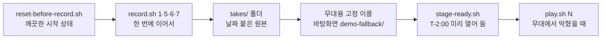

로드맵 위치: 결선 직전 / 데모 실패 대비 녹화본 / 본선 연결점: 완성도·데모 30 (막혀도 30초 안에 다음 장면으로)

# 데모 녹화본: 무엇을 찍고, 어떻게 찍고, 무대에서 3초 안에 띄우기

> 문서 상태: AI 초안(DRAFT) · 2026-10-31 17:35 UTC 작성, 17:45 UTC Z33 갱신(대체 시간 5분판 15초·8분판 30초, 녹화본 1은 롤백 창 3초로 찍기, 보안 표 숫자) · 기준: 통합본 int3 + W `demo.sh` + Z8 런북 + Z24·Z28 콘티 · 스크립트는 클라우드 VM에서 문법·가짜 맥 명령으로만 검증, 맥 실녹화는 아직 안 함 · 팀 검토 전 · 18:20 UTC 2차 묶음: 녹화 6 칩 숫자

표시: 【사실】 코드·문서·실행으로 확인(출처 병기) / 【추정】 판단 / 【미확인】 아직 확인 못 함.

---

## 그림: 녹화본이 만들어지고 쓰이는 길



- 찍는 날: 전날 리허설(T-1). reset 한 번 → 네 개를 순서대로 → 데모 전에 reset 한 번 더.
- 쓰는 때: 무대에서 한 장면이 안 고쳐질 때만. 5분판(최종 발표)은 15초, 8분판(연습·중간 보고)은 30초가 기준이다. 라이브가 기본이다【사실: Z8 5-1, Z28 2절】.
- 도구는 맥에 원래 있는 것만 쓴다(`screencapture`, QuickTime, 미리보기, `osascript`). 새로 설치할 것은 없다.

---

## 0. 처음 보는 사람용: 이 문서의 말

- **대체 경로 단계 3**: 데모가 막혔을 때 내려가는 사다리의 세 번째 칸. 1 그 자리 재시도 → 2 미리 잰 숫자 → **3 녹화본·캡처** → 4 설계 문서로 말하기【사실: Z8 5-1】.
- **녹화본**: 이 문서에서는 영상(.mov) 2개와 캡처(.png) 2묶음, 합쳐 4개를 말한다. 콘티가 정한 4개 그대로다【사실: Z24 4절】.
- **take(원본)**: 한 번 찍은 파일. 여러 번 찍으면 `takes/`에 쌓인다.
- **무대용 파일**: take 중 쓸 것 하나를 고정 이름으로 복사한 것. 무대에서는 이 이름만 연다.
- **`screencapture`**: 맥에 들어 있는 화면 캡처 명령. `-v`를 붙이면 영상으로 찍는다.
- **`osascript`**: 맥 앱을 명령으로 조종하는 도구. 여기서는 "브라우저 창이 어디 있나"를 읽고, QuickTime을 전체 화면 재생시킬 때만 쓴다.

---

## 1. 녹화본 4개

| 번호 | 무대용 파일 | 형식 | 담는 장면 | 화면에 꼭 보여야 하는 것 | 길이 |
|---|---|---|---|---|---|
| 1 | `S1-S4.mov` | 영상, 브라우저 창 | S1 새 이전 → S3 계획서 → S4 승인·실행·완료 | 환경 표 dev-aws·dev-gcp, 진행 칸이 한 칸씩 초록, 마지막에 15칸 모두 초록 + "완료" | 찍기 75초 → 잘라서 40초 안팎 |
| 5 | `S5-numbers.png` | 캡처, 터미널 창 | S5 옮겨진 데이터와 쓰기 멈춤 | `rows`의 출발·도착 둘 다 `orders 2000`·`customers 100`, `numbers`의 `cutover_pause_ms`와 `stub(가짜)였나: f`, `measure`의 컷오버 중앙값·롤백 중앙값·실패 0 | 1장 |
| 6 | `S6-security-1.png` + `S6-security-2.png` | 캡처 2장 | S6 보안 시각화(필수 장면) | 1: 웹 보안 표(영역 6개, AWS→GCP 24줄, 요약 칩 "지켜짐 16 · 약점 5 · 위반 1 · 미구현 0"(완료된 이전, STUB)【사실, int5 2차 예정】, `screenshots/z18-02-completed.png` 모양). 2: 터미널 `wall`의 `401`·`{"items":[]}`·`404`, `audit`의 감사 줄과 해시 12자 | 2장 |
| 7 | `S7-agent.mov` | 영상, 터미널 창 | S7 AI 에이전트 샌드박스(필수 장면) | `ok 1`~`ok 5`, `# pass 5`, `# fail 0`. 실제 LLM 판(Z22)이 합쳐지면 그 실행 | 찍기 25초 |

- 왜 S5·S6는 영상이 아니라 캡처인가: 숫자와 표는 멈춘 화면이어야 짚으며 말할 수 있다. 영상은 지나가 버린다【추정】.
- 왜 S2(비용)·S8(숫자 3개)은 없나: S2는 콘티에서 제일 먼저 자르는 장면이고, 터미널 `demo.sh cost`가 따로 있다. S8은 말뿐이다【사실: Z24 1절·8절】.
- Z24 4절의 `S6-security.png` 한 장은 여기서 두 장(`-1`, `-2`)으로 나눴다. 보안 표(웹)와 회사 벽·감사(터미널)가 다른 창이라서다.
- S6 컷 1(보안 표)은 Z18이 합쳐진 통합본에서만 찍을 수 있다. 그전에는 `record.sh 6`에서 `n`으로 건너뛰고 2장만 만든다【사실: Z24 S6 "Z18 진행 중"】.

---

## 2. 파일 이름 규칙

두 층으로 나눈다. 원본은 지우지 않고 쌓고, 무대에서는 고정 이름만 연다.

| 층 | 위치 | 이름 | 예 |
|---|---|---|---|
| 원본(take) | `~/Desktop/demo-fallback/takes/` | `<장면>_<YYYYMMDD-HHMM>_<기준코드>.<확장자>` | `S7-agent_20261106-2130_int5.mov` |
| 터미널 글 | 같은 곳 | 원본과 같은 이름, 확장자만 `.txt` | `S7-agent_20261106-2130_int5.txt` |
| 무대용 | `~/Desktop/demo-fallback/` | `S1-S4.mov`, `S5-numbers.png`, `S6-security-1.png`, `S6-security-2.png`, `S7-agent.mov` | 고정 |

- `<장면>`은 다섯 가지뿐이다: `S1-S4`, `S5-numbers`, `S6-security-1`, `S6-security-2`, `S7-agent`. `promote.sh`는 이 밖의 이름을 거부한다.
- `<기준코드>`는 찍을 때 `REC_BASE=int4`처럼 준다. 안 주면 `local`. 어떤 통합본으로 찍었는지 나중에 알려고 붙인다.
- 시각은 맥 시계 그대로(한국 시간)다.
- 폴더는 바꿀 수 있다: `DEMO_FALLBACK_DIR=다른/폴더`. 무대에서 인터넷 없이 열려야 하니 노트북 안에 둔다【사실: Z8 5-1】.
- `.txt`는 화면에 찍힌 터미널 글이다. 비밀값 검사에 쓰고, 단계 4(말로 하기)에서 숫자를 읽을 때도 쓴다.

---

## 3. 맥에서 찍기

### 3-1. 스크립트 위치

스크립트 7개는 공유 폴더 `parallel/Z27/tools/demo-record/`에 있다. 맥에는 공유 폴더가 없으니, 통합본에 들어가거나 맥 작업 쪽에서 `Service/tools/demo-record/`로 복사해 둔다. 아래 명령은 전부 `Service` 폴더에서 친다.

| 파일 | 하는 일 |
|---|---|
| `lib.sh` | 공통 함수. 혼자 실행하지 않는다 |
| `check-tools.sh` | 필요한 도구·권한이 있는지 읽기만 하며 확인 |
| `reset-before-record.sh` | 녹화 직전 reset + 깨끗한지 숫자로 확인 + 화면 정리 체크 |
| `record.sh` | 녹화본 하나 찍기(1·5·6·7) |
| `promote.sh` | take 하나를 무대용 이름으로 복사 |
| `stage-ready.sh` | 데모 직전 무대용 파일 확인 + 영상 미리 열어 두기 |
| `play.sh` | 무대에서 녹화본 띄우기 |

전제: `docs/demo/demo.sh`가 있어야 한다(공유 폴더 `parallel/W/docs/demo/`를 복사, Z8 1-2)【사실: Z8 1-2】.

### 3-2. 설치 확인 (설치할 것 없음)

```bash
cd ~/Softbank_final/Service
bash tools/demo-record/check-tools.sh --test-record
```

- 첫째 줄: 서비스 폴더로 이동한다.
- 둘째 줄: `screencapture`·`osascript`·`open`·`mdls`·`curl`·`python3`·QuickTime·미리보기·`demo.sh`가 있는지 보고, 터미널과 브라우저 창 위치를 읽고, 화면을 2초 시험 녹화한 뒤 그 파일을 연다.
- 기대 마지막 줄: `결과: 실패 0`. 열린 시험 영상에 창들이 보여야 한다.
- 처음이면 맥이 두 번 묻는다. "터미널이 Google Chrome을 제어하려고 합니다" → 허용. 화면 기록 권한 → 시스템 설정 > 개인정보 보호 및 보안 > 화면 및 시스템 오디오 기록에서 터미널을 켜고, 터미널 앱을 껐다 켠다【추정: macOS 14·15 메뉴 이름】.
- 사파리를 쓰면 명령 앞에 `REC_BROWSER=Safari `를 붙인다. iTerm2는 저절로 알아본다.
- ffmpeg는 없어도 된다. 영상 자르기는 QuickTime의 Cmd+T로 한다. 그래서 Homebrew 설치는 하지 않는다(인텔 맥 소스 빌드가 느림)【사실: 사용자 메모】.

### 3-3. 녹화 직전 reset

```bash
bash tools/demo-record/reset-before-record.sh
```

이 한 줄이 다섯 단계를 차례로 한다.

1. 도커가 켜져 있는지 본다.
2. `bash docs/demo/demo.sh reset`으로 플랫폼 DB를 지우고 다시 만들고, 출발·도착 DB를 데모 시작 상태로 되돌린다【사실: W demo.sh `reset`】.
3. 멈추고 기다린다. 이때 사람이 터미널 B 워커, 터미널 A API를 Ctrl+C 후 다시 띄우고, 웹은 Cmd+R로 새로고침한 뒤 Enter.
4. 숫자로 확인한다: API 응답 200, 이전 목록 0건, `.env`의 `REPL_` 7줄, 도착 DB `orders` 0행, `docs/demo/measure-latest.txt` 있음. 하나라도 틀리면 멈춘다.
5. 화면 정리 목록을 보여 주고 Enter를 기다린다: 방해 금지 켜기, `.env`·클라우드 콘솔·계정 번호 창 닫기, 브라우저 탭 하나·즐겨찾기 막대 숨김·확대 125%, 터미널 글자 크게·Cmd+K.

- 미리 잰 숫자 파일이 없으면 먼저 `bash docs/demo/demo.sh prep`를 한다(약 13초)【사실: W 2-2】.
- 왜 매번 reset인가: 도착 DB가 비어 있지 않으면 복제 사전 점검(DB-T5)이 막고, 이전이 "DB 복제"에 멈춘다. 그 상태로 찍으면 실패 장면이 녹화된다【사실: W 함정, Z8 4-1】.

### 3-4. 찍는 순서 (한 번에 이어서)

```bash
REC_BASE=int3 bash tools/demo-record/record.sh 1
```

- S1~S4 웹 영상. Enter를 누르면 3초 뒤 브라우저가 앞으로 오고 75초 녹화가 시작된다. 녹화 중 클릭 순서: 출발 `dev-aws` → 도착 `dev-gcp` → 새 이전 만들기 → 명세 확정·사전 점검·계획 시작 → 승인 → 실행 시작 → 15칸 모두 초록.
- 끝나면 저장 경로와 길이를 찍고, "무대용으로 쓸까? [y/N]"를 묻는다. 먼저 열어 보고 싶으면 `n`.
- 클릭은 사람이 한다. 기계 시간은 8초 남짓이니 75초면 여유가 있다【사실: W 3절 8.3~8.6초】.
- 워커는 `ROLLBACK_WINDOW_SEC` 없이(기본 3초) 띄운 상태로 찍는다. 이 녹화본은 5분판 S4 대체용이라, 20초 창으로 찍으면 "롤백 가능 창" 칸에서 20초 멈춘 영상이 된다【추정】.

```bash
REC_BASE=int3 bash tools/demo-record/record.sh 5
```

- S5 숫자 캡처. 터미널을 지우고 `rows` → `numbers` → `measure`를 한 줄씩 보여 주며 실행한 뒤, 터미널 창을 그대로 찍는다. 클릭 없음.
- `stub(가짜)였나: f`가 안 나오면 경고한다. 워커가 복제 설정 없이 떠 있던 것이니 그 캡처는 쓰지 않는다【사실: Z24 S5 실패 칸】.

```bash
REC_BASE=int3 bash tools/demo-record/record.sh 6
```

- S6 캡처 2장. 먼저 브라우저에서 보안 표가 다 보이게 내려 두고 Enter → 브라우저 창을 찍는다(보안 표가 없는 통합본이면 `n`). 이어서 터미널에 `wall` → `audit`을 띄우고 터미널 창을 찍는다.

```bash
REC_BASE=int3 bash tools/demo-record/record.sh 7
```

- S7 에이전트 영상 25초. Enter 뒤 터미널을 지우고 녹화를 시작하고, `demo.sh agent`를 실행한다. 녹화 중 키보드·마우스를 건드리지 않는다.
- `# fail 0`이 안 나오면 경고한다.

순서를 지키는 이유: 5·6은 1에서 만든 이전 한 건을 읽는다. 1을 다시 찍으려면 3-3 reset부터 다시 한다.

녹화가 다 끝나면 데모 전에 reset을 한 번 더 한다. 안 하면 데모 첫 장면에서 이전 목록이 1건이고 DB-T5 함정에 걸린다【사실: Z8 1-11】.

### 3-5. 손 녹화 (스크립트가 안 될 때)

`record.sh`가 "영상이 N초뿐이다" 경고를 내거나 창 위치를 못 읽으면 맥 기본 녹화 막대로 찍는다.

- `Cmd + Shift + 5` → 화면 아래 막대에서 "선택 부분 기록" → 브라우저(또는 터미널) 창에 맞춰 네모를 끈다 → 기록.
- 멈출 때: 메뉴 막대 오른쪽 위 네모 정지 버튼.
- 캡처: 같은 막대에서 "선택한 윈도우 캡처" → 창 클릭.
- 저장된 파일은 2절 규칙대로 이름을 바꿔 `takes/`에 넣고 `promote.sh`로 복사한다.

```bash
bash tools/demo-record/promote.sh ~/Desktop/demo-fallback/takes/S1-S4_20261106-2130_int5.mov
```

- 이름 앞부분(`S1-S4`)을 보고 무대용 `S1-S4.mov`로 복사한다.

### 3-6. 확인과 자르기

- 영상: `open 파일경로` → QuickTime에서 처음부터 끝까지 본다. 자르기는 Cmd+T → 노란 손잡이로 앞뒤 → 다듬기 → Cmd+S.
- 볼 것: 비밀값·계정 번호·알림 팝업이 안 찍혔는가, 마지막 화면이 "완료"(1)·`# fail 0`(7)인가, 글자가 읽히는가.
- 터미널 글(`.txt`)은 `record.sh`가 비밀값 패턴(API 키 모양, AWS 키 모양, 12자리 숫자 등)을 자동으로 찾는다. 걸리면 줄 번호만 찍고 그 take는 쓰지 말라고 한다. 웹 영상은 자동 검사가 안 되니 눈으로 본다.

---

## 4. 무대에서 재생 (3초 안에)

### 4-1. 데모 직전(T-2:00)

```bash
bash tools/demo-record/stage-ready.sh
```

- 무대용 파일 5개(녹화본 4개, S6은 2장)가 있는지, 크기·길이·만든 시각을 찍는다.
- 영상 2개를 QuickTime에 뒤로(`open -g`) 열어 둔다. 미리 열려 있으면 무대에서 다시 읽지 않아 빨리 뜬다【추정】.
- 기대 마지막 줄: `결과: 없음 0`.
- 그다음 터미널 D를 Cmd+K로 지운다. QuickTime 창은 뒤에 있어 화면에 안 보인다.

### 4-2. 막혔을 때

5분판은 15초, 8분판은 30초가 지나면 터미널 D에서 한 줄:

```bash
bash tools/demo-record/play.sh 1
```

| 막힌 장면 | 칠 줄 | 뜨는 것 |
|---|---|---|
| S1~S4 | `bash tools/demo-record/play.sh 1` | QuickTime 전체 화면, 처음부터 재생 |
| S5 | `bash tools/demo-record/play.sh 5` | 미리보기에 숫자 캡처 |
| S6 | `bash tools/demo-record/play.sh 6` | 미리보기에 2장(왼쪽 목록에서 넘김) |
| S7 | `bash tools/demo-record/play.sh 7` | QuickTime 전체 화면, 처음부터 재생 |

- 터미널은 위 화살표(↑)로 앞 명령을 다시 부를 수 있다. 리허설 때 `play.sh` 줄을 한 번씩 쳐 두면 무대에서는 ↑ 몇 번 + 숫자 하나 + Enter다.
- 영상 끄기: Esc(전체 화면 나가기) → Cmd+W. 다음 장면은 라이브로 돌아간다.
- `play.sh`가 파일을 못 찾으면 `[없음]`을 찍는다. 그때는 단계 4(설계 문서로 말하기)로 내려간다.
- 전체 화면 재생(`present`)이 안 되면 QuickTime 창으로만 열린다. 그때는 Cmd+Ctrl+F로 전체 화면【미확인: 맥에서 아직 안 돌려 봄】.

3초 목표의 근거: 명령 한 줄 치기 1~2초 + 이미 열린 QuickTime 앞으로 오기 1초 안팎【추정, 맥에서 재야 함】. 리허설에서 세 번 재서 아래 셀프 연습 표에 남긴다.

### 4-3. 틀 때 말

- "실행 화면 녹화로 보여 드리겠습니다. 끝나고 노트북에서 직접 다시 돌려 보여 드릴 수 있습니다."【사실: Z24 4절, Z8 6절】
- 영상이 돌아가는 동안 콘티의 "말하는 한 줄"을 그대로 말한다. 녹화본에는 소리를 넣지 않았다(통역과 겹치지 않게)【추정】.

---

## 5. 다시 찍어야 하는 때

| 바뀐 것 | 다시 찍을 것 |
|---|---|
| 웹 화면이 바뀐 통합본(Z11 롤백 버튼, Z16 웹 문자열 등) | 1 |
| Z18 보안 표가 합쳐짐 | 6 (컷 1 새로) |
| Z22 실제 LLM 에이전트가 합쳐짐 | 7 (실제 LLM 판, 길이는 `REC_SECS=60`처럼 늘림) |
| `prep`를 다시 해서 미리 잰 숫자가 바뀜 | 5 |
| 결선 당일 아침 | 안 찍는다. 전날 것을 쓰고, `stage-ready.sh`만 돌린다 |

- 다시 찍을 때마다 `REC_BASE`를 새 통합본 이름으로 준다. 무대용 파일은 `promote.sh`로 덮어쓰고, 옛 take는 `takes/`에 남는다.

---

## 6. 클라우드 VM에서 확인한 것

- 【사실】 7개 스크립트 모두 `bash -n` 문법 통과, `shellcheck` 경고 0.
- 【사실】 리눅스에서 맥 명령(`screencapture`·`osascript`·`open`·`mdls`·`docker`·`curl`)을 가짜로 바꿔 끝까지 돌렸다. `check-tools` → `reset-before-record` → `record.sh 1·5·6·7` → `stage-ready` → `play.sh 1·5·6·7`. 무대용 5개 파일과 take·`.txt`가 2절 이름대로 생겼고, `screencapture`에 `-v -V 75 -k -x -R 0,25,1280,800`처럼 창 범위가 들어갔다.
- 【사실】 실패 길도 확인: 이전 목록이 1건이면 reset 스크립트가 멈춘다(종료 코드 1). 비밀값 모양(12자리 숫자, AWS 키 모양) 줄이 있으면 줄 번호만 찍고 실패한다. 규칙 밖 이름은 `promote.sh`가 거부한다.
- 【미확인】 맥에서 실제로: `screencapture -v -V 초`가 정해진 초만큼 찍고 저절로 끝나는지, 뒤에서 돌릴 때(7번) 일찍 끝나지 않는지. 일찍 끝나면 `record.sh`가 길이로 잡아내고 3-5 손 녹화로 안내한다.
- 【미확인】 QuickTime `present` 전체 화면 재생, 크롬 창 위치 읽기 권한 창. 맥 첫 실행 때 확인한다.
- 맥 기본 bash 3.2용으로 썼다(연관 배열 등 bash 4 기능 없음). 맥에서 한 번 돌려 봐야 확정이다【추정】.

---

## 핵심 결정 3개 (+대안)

| 선택 | 대안 | 이유 |
|---|---|---|
| 맥 기본 `screencapture`·QuickTime만 쓴다 | OBS, asciinema, ffmpeg 설치 | 인텔 맥에서 Homebrew 소스 빌드가 느리고, 결선 전 새 도구는 그 자체가 위험이다. 맥 기본 도구는 권한 하나만 켜면 된다 |
| 원본(take)과 무대용 고정 이름을 나눈다 | 찍은 파일을 그대로 무대에서 연다 | 무대에서 파일 이름을 찾는 시간이 없다. `play.sh 7` 한 줄이 늘 같은 파일을 열어야 한다. 옛 take는 남겨서 비교·복구가 된다 |
| S5·S6은 캡처, S1~S4·S7만 영상 | 넷 다 영상 | 숫자·표는 멈춘 화면이라야 짚으며 말할 수 있다. 영상 두 개면 녹화 시간도 약 10분 안에 끝난다【사실: Z24 결정 표 "4개, 약 10분"】 |

## 셀프 연습 1개

리허설 때 `play.sh`를 세 번 재 본다. 터미널 D에서 `play.sh 7`을 치는 순간부터 영상이 전체 화면으로 움직이기 시작할 때까지 휴대폰 초시계로 잰다.

| 회차 | `stage-ready` 했나 | 걸린 초 |
|---|---|---|
| 1 | 예 | |
| 2 | 예 | |
| 3 | 아니오(QuickTime 꺼진 상태) | |

- 1·2회가 3초를 넘으면: QuickTime이 미리 안 열려 있었는지, 파일이 바탕화면이 아닌 외장 디스크에 있는지 본다.
- 3회와 비교하면 "미리 열어 두기"가 몇 초를 줄이는지 숫자로 남는다. `decisions/`에 적는다.

## 검증 명령과 기대 출력

```bash
bash tools/demo-record/check-tools.sh
```

- 기대 마지막 줄: `결과: 실패 0`

```bash
bash tools/demo-record/stage-ready.sh
```

- 기대: `[ok] S1-S4.mov`부터 `[ok] S7-agent.mov`까지 5줄, 마지막 줄 `결과: 없음 0`

```bash
bash tools/demo-record/play.sh 7
```

- 기대: QuickTime이 전체 화면으로 `S7-agent.mov`를 처음부터 재생한다. 영상 안에 `# pass 5`, `# fail 0`.
