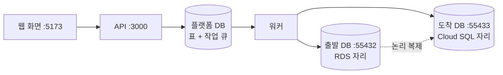

로드맵 위치: 본선 직전 / 데모 리허설 대본(분 단위) / 본선 연결점: 완성도·데모 30, 클라우드 활용 30, AI 10

# 데모 리허설 대본: 8분 안에 이전 한 건을 진짜 DB와 함께

> 문서 상태: AI 초안 · 2026-10-31 16:45 UTC · 기준 코드: 통합본 `service-current.tgz`(16:27 UTC, H2 복제 연결 포함) · 바탕: `parallel/L/docs/DEMO.md` · 팀 검토 전

## 그림

화면에서 버튼 네 번(만들기 · 명세 확정 · 승인 · 실행 시작)을 누르면, 진짜 Postgres 두 대 사이에서 데이터가 옮겨지고 이전이 "완료"까지 간다.



- L의 `DEMO.md`는 DB 복제를 "따로 시연"했다. 지금 통합본은 워커에 복제가 붙었다(H2). 그래서 이 대본은 복제를 화면 흐름 안에 넣었다.
- 화면에 안 나오는 숫자(컷오버 멈춤 ms, 옮겨진 행 수)는 도우미 스크립트 `demo.sh`로 한 줄에 꺼낸다.

## 이 문서로 하는 것

- 데모 15분 전 준비를 명령 그대로 따라 한다.
- 8분 동안 장면 10개를 시계에 맞춰 돈다. 장면마다 명령, 화면에 나올 것, 말할 것, 실패했을 때 대체 경로가 있다.
- 5분판(최종 발표)과 3분판(중간 보고 데모 부분)은 같은 장면에서 몇 개를 뺀다(6절).

【사실】 아래 기대 출력과 시간은 클라우드 컨테이너에서 같은 통합본을 직접 돌려 얻었다(2026-10-31 16:33~16:42 UTC, Postgres 16 세 대를 도커 없이 띄움, 웹 화면 대신 같은 API를 curl로 호출). 맥에서는 숫자가 조금 다를 수 있다. 맥 기록: 복제 켠 smoke 9.4초, 컷오버 멈춤 81.4ms(PROGRESS.md).

---

## 1. 준비물

| 무엇 | 어디 |
|---|---|
| 서비스 폴더 | `~/Softbank_final/Service` (최신 통합본 풀린 상태, `npm install` 끝) |
| 도우미 3개 | 이 문서 옆 `demo/` 폴더의 `demo.sh`, `cost-request.json`, `cost-summary.py` → 서비스 폴더 `docs/demo/`로 복사 |
| 터미널 4개 | A: api, B: worker, C: web, D: 시연용 명령 |
| 브라우저 | http://localhost:5173 하나만 열어 둔다 |

- `demo.sh`는 bash 스크립트다. zsh에서 `bash docs/demo/demo.sh 명령` 모양으로 부른다.
- 맥 기본 bash(3.2)에서 도는 문법만 썼다.
- `demo.sh` 안 DB 접속은 도커 기준(`docker compose exec`)이다.

---

## 2. 데모 15분 전 준비 (T-15:00 ~ T-2:00)

### 2-1. 맥 Postgres 끄고 복제를 켠다 (한 번만)

터미널 D에서:

```bash
cd ~/Softbank_final/Service
brew services stop postgresql@16
bash docs/demo/demo.sh enable-repl
grep -c '^REPL_' .env
```

- 둘째 줄: 맥에 깔린 Postgres가 5432를 잡고 있으면 끈다.
- 셋째 줄: `.env`에 복제 설정 7줄을 붙인다. 이미 있으면 아무것도 안 한다.
- 넷째 줄 기대 출력: `7`
- 이 7줄의 비밀번호는 로컬 도커 DB 전용 값(`postgres`)이다. 실제 비밀값이 아니다.

### 2-2. 복제 DB를 띄우고, 부하 측정을 미리 한 번 해 둔다

```bash
bash docs/demo/demo.sh prep
```

- 복제용 Postgres 두 대(55432 출발, 55433 도착)를 띄운다.
- 쓰기 부하를 건 채 컷오버·롤백을 5번씩 재고 `docs/demo/measure-latest.txt`에 저장한다. 장면 7에서 이 파일을 보여 준다.
- 마지막으로 출발 DB에 데모 데이터(주문 2000행, 고객 100행)를 넣는다.

기대 출력 (클라우드 실측, 13초 걸림):

```text
initial_copy_ms (100000 orders, 3회): 513, 307, 305 → min 305 / median 307 / max 513
sync gate: ready=true lags=1.3,1.8,13.6ms
cutover pause ms (5회, 부하 8 workers): 39, 46, 44, 41, 40 → min 39 / median 41 / max 46
rollback pause ms (5회): 45, 52, 42, 44, 41 → min 41 / median 44 / max 52
app writes ok=4338 fail=0 p50=12.0ms p99=59.6ms max=80ms errors={}
leftovers: []
seeded: source orders/customers, target empty schema
```

실패하면:

- `port is already allocated` → `cd packages/replication && npm run db:down && cd ../..` 후 다시 `prep`.
- `Cannot connect to the Docker daemon` → Docker Desktop을 켜고 다시.

### 2-3. 플랫폼 DB를 비운다

```bash
bash docs/demo/demo.sh reset
```

- 플랫폼 DB(5432)를 지우고 다시 만든다. 표 + 씨앗 데이터(회사 1, 환경 2)가 다시 들어간다.
- 출발·도착 DB도 데모 시작 상태로 되돌린다(`demo:seed`).
- 왜: 리허설 기록이 남아 있으면 목록이 지저분하고, 멈춘 이전이 환경 잠금을 쥐고 있을 수 있다(5절 "ENV_BUSY").
- 【미확인】 맥에서 걸리는 시간. 도커 볼륨을 지우고 다시 만드니 10~20초로 【추정】.

### 2-4. 세 개를 띄운다

터미널 A, B, C에서 한 줄씩:

```bash
npm run dev:api
```

```bash
npm run dev:worker
```

```bash
npm run dev:web
```

- 워커는 반드시 2-1 뒤에 새로 띄운다. `.env`는 시작할 때 한 번만 읽는다.
- 기대: 워커 마지막 줄 `worker ready: import, precheck, plan, apply, deploy, sync, shift, cutover, cleanup, rollback`

### 2-5. 마지막 점검 (T-2:00)

```bash
bash docs/demo/demo.sh check
```

기대 출력:

```text
== API
healthz {"ok":true}
readyz  {"ok":true}

== 복제 설정 (.env의 REPL_ 줄 수, 7이면 켜짐)
7

== 이전 목록 (0건이어야 깨끗)
0

== 출발 DB 행 수 (orders 2000, customers 100)
orders|2000
customers|100

== 도착 DB 행 수 (표가 없거나 0이어야 함)
orders|0
customers|0
```

- 하나라도 다르면 2-3부터 다시.
- 브라우저 http://localhost:5173 위쪽에 초록 점과 "API 연결됨"이 보이면 준비 끝.
- 터미널 D 글자를 크게(Cmd + `+` 두세 번) 해 둔다.

---

## 3. 8분 시간표

| 시계 | 장면 | 어디서 | 길이 |
|---|---|---|---|
| 0:00 | 0. 한 줄 소개 + 그림 | 설계 문서 | 0:30 |
| 0:30 | 1. 환경 두 개, 새 이전 | 화면 | 0:30 |
| 1:00 | 2. 가져오기 → 명세 검토 | 화면 | 0:30 |
| 1:30 | 3. 비용 비교 | 터미널 D | 0:45 |
| 2:15 | 4. 명세 확정 → 계획서 | 화면 | 0:45 |
| 3:00 | 5. 지문이 다르면 거부 | 터미널 D | 0:30 |
| 3:30 | 6. 승인 → 실행 → 완료 (진짜 복제) | 화면 | 1:00 |
| 4:30 | 7. 데이터가 옮겨졌다 + 멈춘 시간 | 터미널 D | 1:00 |
| 5:30 | 8. 감사 기록 | 터미널 D | 0:30 |
| 6:00 | 9. 회사 벽 | 터미널 D | 0:30 |
| 6:30 | 10. AI 에이전트 샌드박스 | 터미널 D | 0:45 |
| 7:15 | 11. 마무리 숫자 3개 | 말 | 0:30 |
| 7:45 | 여유 | | 0:15 |

- 기계가 일하는 시간은 다 합쳐 10초가 안 된다(아래 실측). 나머지는 말하는 시간이다.
- 【사실】 실측(3회): 만들기 → 명세 검토 447 / 557 / 427ms, 명세 확정 → 승인 대기 1,173 / 1,154 / 1,172ms, 승인 → 완료 6,685 / 6,902 / 6,916ms.

---

## 4. 장면별 대본

### 장면 0. 한 줄 소개 (0:00 ~ 0:30)

화면: 설계 문서의 아키텍처 그림.

말할 것:

- "이미 AWS에서 돌고 있는 서비스를, 멈추지 않고 GCP로 옮기는 플랫폼입니다."
- "지금부터 이전 한 건을 처음부터 끝까지, 진짜 DB 두 대 사이에서 보여 드리겠습니다."

### 장면 1. 환경 두 개, 새 이전 (0:30 ~ 1:00)

할 일 (화면):

- 왼쪽 위 "환경" 표에서 dev-aws(AWS), dev-gcp(GCP)를 가리킨다.
- "출발" `dev-aws (aws)`, "도착" `dev-gcp (gcp)`를 고른다.
- "새 이전 만들기"를 누른다.

화면에 나올 것: 목록에 한 줄이 생기고 상태가 "가져오기"로 바뀐다.

말할 것:

- "환경은 '연결됨'이어야 이전을 시작할 수 있습니다. 이 검사는 상태를 바꾸는 함수 한 곳에 있습니다."

실패하면:

| 증상 | 대처 |
|---|---|
| 화면 위 점이 빨강 | 터미널 A를 본다. 죽었으면 `npm run dev:api` |
| 버튼이 안 눌린다 | 출발·도착을 둘 다 골랐는지 본다 |

### 장면 2. 가져오기 → 명세 검토 (1:00 ~ 1:30)

할 일: 기다린다(1초 안).

화면에 나올 것: 진행 칸 1~3이 초록, "명세 검토"가 강조, 버튼 "명세 확정 → 사전 점검·계획 시작".

말할 것:

- "버튼을 누르는 순간 상태 변경, 감사 기록, 작업 예약이 한 트랜잭션으로 들어갔습니다."
- "워커가 출발 환경을 읽어 공통 명세를 만들었고, 이제 사람이 볼 차례입니다."

실패하면:

| 증상 | 대처 |
|---|---|
| "가져오기"에서 안 움직인다 | 터미널 B에 `worker ready` 줄이 있는지 본다. 없으면 `npm run dev:worker`. 작업은 큐에 남아 있어서 다시 띄우면 이어서 간다 |

### 장면 3. 비용 비교 (1:30 ~ 2:15)

터미널 D:

```bash
bash docs/demo/demo.sh cost
```

화면에 나올 것:

```text
가격 기준일: 2026-10-31T00:00:00Z 낡음: False
피크 rps: 10 필요 vCPU: 0.6
aws     t3.medium 2대 월 $227.5  미확인=['storage']
gcp     e2-medium 2대 월 $146.9  미확인=['db', 'storage']
onprem  k3s-vm-2c8g 2대 월 $250  미확인=['fixed', 'node']
가장 싼 곳: gcp
절약: {'from': 'aws', 'to': 'gcp', 'monthlyUsd': 80.6, 'creditPortionUsd': 73}
추천 1 gcp basic 점수 0.479
추천 2 aws basic 점수 0.624
추천 3 onprem basic 점수 0.665
최저 환경이 바뀌는 지점: [{'fromRps': 0, 'cheapest': 'gcp', 'nodes': 2}, {'fromRps': 190, 'cheapest': 'onprem', 'nodes': 3}, {'fromRps': 911, 'cheapest': 'gcp', 'nodes': 9}]
```

말할 것:

- "같은 명세로 세 환경의 월 비용을 계산했습니다. 지금 트래픽이면 GCP가 월 80.6달러 쌉니다."
- "190 rps를 넘으면 온프레가 더 싸집니다. '미확인'은 가격 근거가 추정인 부분이고, 숨기지 않고 표시합니다."

실패하면:

| 증상 | 대처 |
|---|---|
| `No such file` | `docs/demo/`에 세 파일을 복사했는지 본다. 급하면 건너뛰고 "비용 계산은 응답 20ms 안팎"이라고 말로만 |

【사실】 응답 시간 5회: 31 / 30 / 20 / 18 / 21ms.

### 장면 4. 명세 확정 → 계획서 (2:15 ~ 3:00)

할 일 (화면): "명세 확정 → 사전 점검·계획 시작"을 누른다.

화면에 나올 것 (약 1.2초 뒤):

- 상태 "승인 대기", 아래에 계획서.
- 지문(planHash) 64자, 만료 = 지금 + 2시간, 어댑터 `gcp@0.3.0`.
- 롤백 기준: 오류율 1% 초과 또는 p95 2배, 30초 동안.
- 단계 6줄: 자원 생성(terraform) / 앱 배포(argocd) / DB 복제 / 트래픽 이동(10 → 50 → 100%) / DB 컷오버 / 정리.

말할 것:

- "지문은 계획서 내용 전체의 sha256입니다. 같은 입력이면 같은 지문이 나옵니다."
- "사람이 본 계획과 실행할 계획이 같다는 걸 이 지문 하나로 묶습니다."

실패하면:

| 증상 | 대처 |
|---|---|
| "사전 점검"에서 멈춤 | 터미널 D에서 `bash docs/demo/demo.sh why`. 막은 이유가 한 줄로 나온다 |

### 장면 5. 지문이 다르면 거부 (3:00 ~ 3:30)

터미널 D:

```bash
bash docs/demo/demo.sh wronghash
```

화면에 나올 것:

```text
이전 <번호> / 계획 <번호> 에 틀린 지문으로 승인 요청
{"status":409,"code":"PLAN_HASH_MISMATCH","message":"plan changed since you viewed it","requestId":"req-.."}
지금 상태: awaiting_approval
```

말할 것:

- "누군가 계획을 바꾼 뒤 옛 화면에서 승인하면 이렇게 409로 거부됩니다. 상태는 그대로 승인 대기입니다."

실패하면: 건너뛴다. 다음 장면에 영향 없다. 이 명령은 이전을 바꾸지 않는다.

### 장면 6. 승인 → 실행 → 완료, 진짜 복제 (3:30 ~ 4:30)

할 일 (화면):

- "승인"을 누른다. 상태가 "승인됨"이 되고 "실행 시작 (Terraform)" 버튼이 나온다.
- "실행 시작"을 누른다.
- 진행 칸이 한 칸씩 초록이 되는 걸 같이 본다(화면은 1.5초마다 다시 읽는다).

화면에 나올 것 (약 7초):

| 칸 | 상태 | 지금 진짜인가 |
|---|---|---|
| 자원 생성 · 앱 배포 | 지문 3개(승인·계획·작업) 다시 대조 후 진행 | STUB(가짜 출력) |
| DB 복제 | 출발 → 도착 초기 복사 + 지연 측정 | **진짜** |
| 트래픽 이동 | 10 → 50 → 100% 판정 | STUB(지표 흉내) |
| DB 컷오버 | 쓰기 막기 → 따라잡기 → 주인 바꾸기 → 역방향 복제 준비 | **진짜** |
| 롤백 가능 창 | 3초 | 진짜(짧게 둔 값) |
| 정리 → 완료 | 복제 슬롯·발행·구독 지우기 | **진짜** |

- 마지막: 15칸 모두 초록, 오른쪽 위 "완료", 할 일 칸에 "끝난 이전이야."

말할 것 (칸이 움직이는 동안):

- "지금 DB 복제와 컷오버는 진짜 Postgres 두 대 사이에서 돌고 있습니다. 출발이 RDS 자리, 도착이 Cloud SQL 자리입니다."
- "클라우드 자원 생성과 트래픽 지표는 아직 흉내입니다. 칸 이름 옆에 그렇게 적어 두었습니다."

실패하면:

| 증상 | 대처 |
|---|---|
| "DB 복제"에서 5초 넘게 멈춤 | 터미널 D에서 `bash docs/demo/demo.sh why`. `DB-T5 target not empty`면 2-3을 안 한 것. 말할 것: "도착 DB가 비어 있지 않으면 사전 점검이 막습니다. 안전장치가 동작한 겁니다." 그다음 장면 7은 `bash docs/demo/demo.sh measure`(미리 잰 값)로 바꾼다 |
| "롤백 가능 창"에서 3초 넘게 | 정상. 정리 작업이 창 끝에 깨어난다. 3~4초 기다린다 |
| 진행 칸이 전혀 안 움직임 | 터미널 B 확인. 죽었으면 `npm run dev:worker`. 하던 작업은 큐에서 이어진다 |

### 장면 7. 데이터가 옮겨졌다 + 멈춘 시간 (4:30 ~ 5:30)

터미널 D에서 한 줄씩:

```bash
bash docs/demo/demo.sh rows
bash docs/demo/demo.sh numbers
bash docs/demo/demo.sh measure
```

화면에 나올 것 (클라우드 실측 예):

```text
== 출발 DB
orders|2000
customers|100

== 도착 DB
orders|2000
customers|100
```

```text
sync.shifting replication_lag_ms 1.1 ms
sync.shifting initial_copy_ms 102 ms
cutover.rollback_window cutover_pause_ms 27.5 ms
cutover.rollback_window sequences_synced 2 count
stub(가짜)였나: f
```

- `measure`는 2-2에서 저장한 부하 측정 6줄이다.

말할 것:

- "준비 전에는 도착 DB가 0행이었습니다. 지금은 출발과 똑같이 2,100행입니다."
- "쓰기가 멈춘 시간은 이번에 27.5ms입니다. 쓰기 8개를 계속 넣으면서 5번 재면 중앙값 41ms, 쓰기 4,338건 중 실패 0건입니다."
- "롤백도 같은 방식으로 수십 ms입니다. 역방향 복제를 컷오버 직후에 미리 만들어 두기 때문입니다."

【사실】 화면 흐름 3회 컷오버 멈춤: 27.5 / 45.3 / 28.8ms, 초기 복사 102 / 101 / 102ms(2,100행). smoke 3회: 38.1 / 39.2 / 38.7ms.
【추정】 RDS → Cloud SQL처럼 클라우드 사이라면 왕복 지연만큼 늘어난다. 실측 전이다.

실패하면:

| 증상 | 대처 |
|---|---|
| `cutover_pause_ms 850`, `stub(가짜)였나: t` | 워커가 복제 설정 없이 떠 있었다. 숫자는 말하지 말고 `measure` 결과만 보여 준다. 끝나고 워커를 다시 띄운다 |
| 도커 `exec` 오류 | `measure`만 보여 준다 |

### 장면 8. 감사 기록 (5:30 ~ 6:00)

```bash
bash docs/demo/demo.sh audit
```

화면에 나올 것 (15줄):

```text
 seq |  actor   |         action          |     hash
-----+----------+-------------------------+--------------
   1 | user:dev | migration.importing     | 7351345f3edf
   2 | worker   | migration.spec_review   | 1995f6943ea2
   ...
   6 | user:dev | plan.approved           | da458b0fd882
   ...
  13 | worker   | cutover.rollback_window | 562ec31120c2
  14 | worker   | cleanup.cleanup         | e99002fbc8ec
  15 | worker   | cleanup.completed       | 4a589b78d066
```

말할 것:

- "상태가 바뀔 때마다 같은 트랜잭션에서 한 줄씩 남습니다. 사람과 워커가 누가 무엇을 했는지 그대로 보입니다."
- "줄마다 앞 줄의 해시를 이어 붙여서, 중간 한 줄을 고치면 뒤가 전부 틀어집니다."

참고: 장면 5의 거부된 승인은 감사에 안 남는다. 상태가 안 바뀌었기 때문이다.

### 장면 9. 회사 벽 (6:00 ~ 6:30)

```bash
bash docs/demo/demo.sh wall
```

화면에 나올 것:

```text
회사 헤더 없음 → 401
다른 회사 목록 → {"items":[]}
다른 회사가 이 이전 조회 → {"status":404,"code":"NOT_FOUND","message":"migration <번호>","requestId":"req-.."}
```

말할 것:

- "다른 회사 번호로는 목록이 비어 보이고, 번호를 알아도 404입니다. '없다'와 '남의 것'을 구별해 주지 않습니다."
- "이 벽은 앱 코드가 아니라 DB의 행 단위 규칙(RLS)이 칩니다."

### 장면 10. AI 에이전트 샌드박스 (6:30 ~ 7:15)

```bash
bash docs/demo/demo.sh agent
```

화면에 나올 것 (0.3초):

```text
ok 1 - 도구 정의 7개가 JSON Schema 로 나간다
ok 2 - 정상 흐름: 7단계 뒤 finish, AgentFinish 계약 통과, 게이트 통과
ok 3 - 탈취된 에이전트: 허용 밖 경로·금지 인자·모르는 도구는 실행되지 않는다
ok 4 - 예산: 단계 상한을 넘으면 실패로 멈춘다
ok 5 - 게이트: Secret 추가, privileged, 이미지 저장소 변경은 막는다
# pass 5
# fail 0
```

말할 것:

- "AI 에이전트는 샌드박스 안에서만 도구를 씁니다. 탈취돼도 허용 밖 도구는 실행되지 않고, 위험한 변경은 게이트가 막습니다."
- "지금은 LLM 대신 정해진 대본으로 돌린 시험입니다. 실제 모델 연결은 다음 단계입니다."

【사실】 지금 통합본에서 에이전트는 시험으로만 보인다. 화면·API에는 없다. 진짜 에이전트 워커(K)는 통합 대기 중이다.

### 장면 11. 마무리 (7:15 ~ 7:45)

말할 것 (숫자 3개):

- "컷오버 때 쓰기가 멈춘 시간 수십 ms, 실패 0건."
- "사람이 본 계획과 다르면 실행되지 않는다. 지문 불일치 409."
- "비용은 같은 명세로 세 환경을 계산해 월 80.6달러 절약."

---

## 5. 질문이 나오면 (지금 안 되는 것)

| 질문 | 답 | 근거 |
|---|---|---|
| 롤백 버튼은? | 워커의 롤백 처리기와 복제 롤백 함수는 있다. 화면·API 경로가 아직 없다 | `rolling_back`으로 옮기는 경로 없음(L 발견), 통합 처리 중 |
| 클라우드에 진짜 만드나? | 아직. 자원 생성·앱 배포는 흉내다. Terraform 모듈과 Helm 값은 계획서에 들어간다 | `apply`·`deploy` 처리기 STUB |
| 트래픽 전환은 진짜인가? | 단계(10 → 50 → 100%)와 판정 규칙은 진짜, 지표 값은 흉내 | 진짜 지표 연결(J)은 통합 대기 |
| 온프레는? | 같은 구조로 k3s + CloudNativePG 데모를 따로 만드는 중 | 병렬 O |
| 같은 요청을 두 번 보내면? | 지금은 이전이 두 개 생긴다. 고치는 중 | P-2, L 발견 |
| 리전은? | 서울. AWS `ap-northeast-2`, GCP `asia-northeast3` | 10/31 결정 |

### 데모를 망치는 함정 (리허설 중 발견)

- 【사실】 도착 DB를 비우지 않고 다시 돌리면 복제 사전 점검이 `DB-T5 target not empty`로 막는다. 작업은 한 번 재시도 뒤 `failed`가 되고, 이전은 화면에서 "DB 복제"에 **영원히** 머문다. 화면에는 이유가 안 보인다(`why`로만 보인다).
- 【사실】 그 상태에서 새 이전을 만들면, 승인 단계에서 `409 ENV_BUSY`로 막힌다. 멈춘 이전이 환경 잠금을 쥐고 있기 때문이다. 고치는 길은 2-3 `reset`뿐이다.
- 【사실】 그래서 리허설을 한 번 돌릴 때마다 2-3 → 2-4(api·worker 다시 띄우기) → 2-5를 한다.

---

## 6. 짧은 판

같은 장면 번호를 쓴다.

| 판 | 쓰는 장면 | 시간 |
|---|---|---|
| 8분 (리허설·질문 대비) | 0~11 전부 | 7:45 |
| 5분 (최종 발표, 슬라이드 없음) | 0, 1+2(같이), 3, 4, 6, 7(`numbers`만), 11 | 0:20 + 0:40 + 0:40 + 0:40 + 1:00 + 0:50 + 0:30 = 4:40 |
| 3분 (중간 보고의 데모 부분) | 1+2, 4, 6, 7(`numbers`만) | 0:40 + 0:40 + 1:00 + 0:40 = 3:00 |

- 5분판에서 뺀 장면(지문 거부·감사·회사 벽·AI)은 질문이 오면 터미널 D에서 한 줄로 바로 보여 준다.
- 【추정】 시간은 말하는 속도 기준이다. 통역(한·일)이 붙으면 말이 1.5배쯤 길어지니 5분판은 장면 3을 더 빼야 할 수 있다.

---

## 7. 리허설 기록표

한 번 돌 때마다 한 줄. 3~5회 채운다.

| 회차 | 준비(2-2~2-5) 걸린 시간 | 전체 데모 시간 | 컷오버 멈춤 ms | 막힌 장면 | 메모 |
|---|---|---|---|---|---|
| 클라우드 1 | - | 기계 시간 8.3초 | 27.5 | 없음 | API로 화면 흉내 |
| 클라우드 2 | - | 기계 시간 8.6초 | 45.3 | 없음 | |
| 클라우드 3 | - | 기계 시간 8.5초 | 28.8 | 없음 | |
| 맥 1 | | | | | |
| 맥 2 | | | | | |
| 맥 3 | | | | | |

- 시간은 휴대폰 스톱워치로 잰다. 장면 시작 시각을 3절 시계와 비교해 어디서 밀리는지 적는다.

---

## 핵심 결정 3개 (+대안)

| 결정 | 대안 | 고른 이유 |
|---|---|---|
| DB 복제를 화면 흐름 안에 넣는다(워커 복제 켬) | L 판처럼 별도 터미널에서 `test:it`·`measure`로 따로 | H2로 워커에 붙었다. "옮겼다"를 한 이야기로 보여 줄 수 있다. 대신 매번 도착 DB를 비우는 준비가 하나 늘었다 |
| 터미널 장면은 `demo.sh` 한 줄로 부른다 | 문서의 긴 `curl`을 그 자리에서 친다 | 긴 줄을 치다 틀리면 수십 초를 잃는다. 계획 번호를 화면에서 베끼지 않아도 된다. 원래 명령은 스크립트 안에 그대로 있어 질문 오면 보여 줄 수 있다 |
| 부하 측정은 데모 전에 돌려 저장하고, 데모 중엔 보여만 준다 | 데모 중 `measure`를 생방송으로 | 13초지만 화면이 빈 채로 기다린다. 그 사이 말이 끊긴다. 결정 기록(10/31 "부하 테스트 = 선택 버튼, 기본은 미리 잰 값")과도 맞다 |

## 셀프 연습 1개

함정을 일부러 밟고 빠져나온다.

1. 데모를 한 번 끝까지 돈다.
2. 2-3 `reset`을 **하지 말고** 화면에서 새 이전을 만들어 실행까지 간다.
3. "DB 복제"에서 멈추는 걸 본다. `bash docs/demo/demo.sh why`로 이유를 읽는다.
4. 화면에서 또 새 이전을 만들어 승인까지 가 본다. 몇 번 오류가 나는지 적는다.
5. 2-3 → 2-4 → 2-5로 되살리고, 걸린 시간을 적는다.
6. 한 줄로 쓴다: 왜 멈춘 이전 하나가 다음 이전까지 막는가. 힌트: 환경 잠금.

## 검증 명령과 기대 출력

서비스 폴더에서 한 줄씩:

```bash
bash docs/demo/demo.sh check
npm run smoke
bash docs/demo/demo.sh numbers
bash docs/demo/demo.sh rows
```

- `check`: 2-5와 같은 출력.
- `smoke`: 마지막 줄 `completed after 8xxx ms` (클라우드 복제 켬 3회: 8,689 / 8,647 / 8,326ms).
- `numbers`: `cutover_pause_ms`가 수십 ms, `stub(가짜)였나: f`.
- `rows`: 출발·도착 둘 다 `orders|2000`, `customers|100`.
- smoke를 한 번 돌렸으면 데모 전에 2-3 `reset`을 다시 한다.
