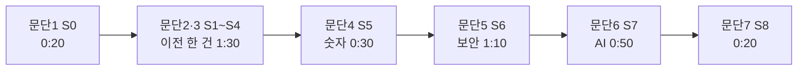

로드맵 위치: 결선 직전 / 최종 발표 5분 데모 콘티(장면 단위) / 본선 연결점: 완성도·데모 30 · 클라우드 활용 30 · AI 10 · 독창성 10 · 팀 개발 20

# 데모 콘티 5분판: 최종 발표 4:40 안에 필수 3장면

> 문서 상태: AI 초안(DRAFT) · 2026-10-31 17:40 UTC 작성, 17:45 UTC Z33 갱신(6절 불일치 13건 처리 열, 대체 규칙 15초/30초 명시, S4 롤백 창, S6 판 B를 Z18 실제 표로, 비용 【추정】) · 기준 코드: 통합본 `service-current.tgz` int4(17:15 UTC), 롤백 창은 17:27 UTC 판 확인 · 대본 짝: `parallel/Z26/docs/TALK-SCRIPT.md` 1절(문단 1~7) · 원본 8분 콘티 `parallel/Z24/docs/DEMO-STORYBOARD.md`는 손대지 않음(연습용) · 보안 표(Z18)·실제 LLM(Z22)·녹화 도구(Z27)는 진행 중 · 팀 검토 전 · 18:15 UTC 통합 2차 문서 묶음: S4 7초 전제에 `TRAFFIC_OBSERVE_SEC` 조건 · 18:20 UTC 2차 묶음: S6 보안 표 숫자

표시: 【사실】 코드·실측·대회 자료로 확인(출처 병기) / 【추정】 판단 / 【미확인】 아직 확인 못 함.

이 문서는 슬라이드가 아니다. 무대 화면은 설계 문서, 웹 화면, 큰 글씨 터미널 하나뿐이다【사실: 킥오프 p34-35 "슬라이드 자료는 금지, 설계 문서 + 데모 플레이"】.

---

## 그림: 5분 안의 흐름



- 이야기는 하나다. "AWS에서 돌던 앱 하나를 GCP로 옮긴다." 그 한 건 안에서 필수 3장면(이전 · 보안 시각화 · AI 샌드박스)을 차례로 꺼낸다【사실: 킥오프 p20-21, Z24 0절】.
- 장면 번호(S0~S8)는 8분 콘티와 같다. 5분판은 S2(비용)를 빼고, S3은 앞부분만, S5는 `numbers` 한 줄만 쓴다.
- 대본(말할 글)은 Z26 1절에 있다. 이 문서는 **화면·클릭·실패 시 대체**만 적는다. 문단 번호가 1:1로 맞는다.

## 왜 5분인가 (규정 원문)

- 【사실: 킥오프 자료 PDF(70쪽) p35, 한국어판】 "성과 발표 시간은 5분입니다 / 통역 부분은 제외하고 타이머로 측정합니다 / 시간을 초과할 경우, 강제로 종료될 수 있습니다 / 슬라이드 자료는 금지됩니다. 설계 문서 + 데모 플레이 형태로 발표해 주세요." 일본어판 p34도 같다("成果発表は5分 / 通訳部分は除いてタイマーで測定 / 強制的に終わらせる場合があります").
- 【사실: 같은 자료 p36-37】 흐름 **예시**: 개요·설계 문서 약 2분(테마 30초 / 왜 그 테마 30초 / 어필 포인트 30초~1분) + 데모 플레이 약 3분. "목업 부분이 있다면 목업임을 알 수 있도록 안내". 마지막 줄 "5분이 넘지 않도록 주의해주세요".
- 【추정】 p36-37은 "예시"라서 꼭 따를 필요는 없다. 이 콘티는 개요 0:20 + 데모 4:20으로, 예시보다 데모가 길다. 대신 STUB(흉내 값)을 장면마다 먼저 말해서 "목업은 목업이라고" 조건을 지킨다. "왜 이 테마" 한 줄을 넣을지는 CHANGES.md 제안 1.

---

## 1. 한눈에 보는 5분

| 시계 | Z26 문단 | 장면 | 필수 | 어디서 | 길이 | 녹화본 번호 |
|---|---|---|---|---|---|---|
| 0:00 | 1 한 줄 소개 | S0 | - | 설계 문서 | 0:20 | 없음(인쇄 그림) |
| 0:20 | 2 이전 시작과 계획 | S1 + S3 앞부분 | (a) 이전 | 웹 | 0:35 | `play.sh 1` 앞쪽 |
| 0:55 | 3 승인 → 실행 → 완료 | S4 | **(a) 이전** | 웹 | 0:55 | `play.sh 1` 뒤쪽 |
| 1:50 | 4 숫자 | S5 (`numbers`만) | (a) 이전 | 터미널 D | 0:30 | `play.sh 5` |
| 2:20 | 5 보안 시각화 | S6 컷 1·2·3 | **(b) 보안** | 웹 + 터미널 D | 1:10 | `play.sh 6` |
| 3:30 | 6 AI 에이전트 샌드박스 | S7 | **(c) AI** | 터미널 D | 0:50 | `play.sh 7` |
| 4:20 | 7 마무리 | S8 | - | 설계 문서 | 0:20 | 없음(말뿐) |
| 4:40 | - | 여유 | - | - | 0:20 | - |

- 【사실】 시각·길이는 Z26 1절 문단 머리 `[0:00–0:20]` ~ `[4:20–4:40]`과 같다. Z24 8절 5분판 배분(S0 0:20 · S1~S4 1:30 · S5 0:30 · S6 1:10 · S7 0:50 · S8 0:20)과도 같다.
- 【사실】 기계가 일하는 시간은 S4 약 7초뿐이다(W 3절 6.7~6.9초). 나머지는 말하는 시간이다. 단, 100% 관찰 수정 판부터는 워커 `.env`에 `TRAFFIC_OBSERVE_SEC=0.5`가 있어야 7초다. 없으면 S4가 약 38초가 되어 5분을 넘긴다(런북 2-5 주의).
- 【사실】 타이머는 통역 시간을 뺀다(p35). 그래도 화면 전환·클릭·고치는 시간은 들어간다【추정】.
- 녹화본 번호는 Z27 `tools/demo-record/play.sh <1|5|6|7>`의 인자다. 파일은 `~/Desktop/demo-fallback/`에 있다【사실: Z27 `lib.sh` 11줄, `play.sh` 4줄. Z27 진행 중이라 녹화본 자체는 【미확인】】.

## 2. 5분판 대체 규칙: 15초

대체 규칙은 판마다 다르다. **5분판(무대 기준) 15초, 8분판(연습·질문 대비) 30초.** 두 숫자는 런북 5-1(수정본 `parallel/Z33/docs/RUNBOOK-FINALS.md`)에 함께 적혀 있다. 5분판은 여유가 20초뿐이라 30초 규칙을 쓰면 한 번 막히는 순간 끝이 잘린다.

- DRAFT(ai): 5분판은 **15초**에 한 단계씩 내려간다. 1 그 자리 재시도 → 2 미리 잰 숫자 → 3 녹화본·캡처(`play.sh`) → 4 설계 문서로 말하기.
- 【추정】 15초 = 한 줄 명령 하나 치고 결과 보는 시간. 두 번째 명령이 필요하면 이미 늦었다.
- 필수 3장면(문단 3·5·6)은 내려가더라도 **빼지 않는다**. 녹화본이라도 튼다. 빠지는 순서는 문단 4(숫자) → 문단 2 넷째 줄 → 문단 7 셋째 줄이다(Z26 2절과 같은 순서에 문단 4를 앞에 더함).
- 녹화본을 틀 때 말은 Z8 6절 "녹화본·캡처로 넘어감" 줄 그대로: "실행 화면 녹화와 캡처로 보여 드리겠습니다. 끝나고 노트북에서 직접 다시 돌려 보여 드릴 수 있습니다."

---

## 3. 장면별 콘티

칸 순서: 화면에 보이는 것 / 클릭·명령 / 실패 시 대체(15초 규칙) / 진짜인가. 말할 글은 Z26 해당 문단을 그대로 읽는다.

### 문단 1 · S0. 한 줄 소개 (0:00 ~ 0:20)

| 칸 | 내용 |
|---|---|
| 화면 | 설계 문서 1절 아키텍처 그림(`parallel/Z7/docs/img/architecture.svg`) |
| 클릭·명령 | 없음. 그림 왼쪽(웹) → 가운데(제어판) → 오른쪽(클라우드 두 곳)을 한 번 훑는다 |
| 실패 시 대체 | 노트북이 안 켜짐 → 인쇄본 그림. 이후 전 장면 단계 4 |
| 진짜인가 | 그림은 지금 코드 구조와 같다【사실: Z7 1절】 |

### 문단 2 · S1 + S3 앞부분. 이전 시작과 계획 (0:20 ~ 0:55)

| 칸 | 내용 |
|---|---|
| 화면 | 웹. 환경 표 dev-aws(AWS)·dev-gcp(GCP) → 목록에 한 줄 → 진행 칸 1~3 초록, "명세 검토" 강조 → "승인 대기"와 계획서(계획 지문 64자, 단계 6줄) |
| 클릭·명령 | ① 출발 `dev-aws (aws)` → 도착 `dev-gcp (gcp)` → "새 이전 만들기" ② "명세 확정 → 사전 점검·계획 시작". 버튼 2번 |
| 실패 시 대체 | 상단 점 빨강 → 단계 1: 터미널 A `npm run dev:api`. "가져오기"에서 멈춤 → 단계 1: 터미널 B `npm run dev:worker`. 15초 넘으면 단계 3: `bash tools/demo-record/play.sh 1` |
| 진짜인가 | 상태 기계·감사·큐·계획 지문은 진짜. 출발 환경 읽기는 데모 원본을 돌려준다【사실: Z15 2-2】 |
| 뺀 것 | S3 뒷부분 `wronghash`(409)는 질문이 오면 보인다(Z26 7절) |

### 문단 3 · S4. 승인 → 실행 → 완료 (0:55 ~ 1:50) — 필수 (a)

| 칸 | 내용 |
|---|---|
| 화면 | 진행 칸이 자원 생성 · 앱 배포 · DB 복제 · 트래픽 이동 · DB 컷오버 · 롤백 가능 창 · 정리 순으로 초록, 15칸 모두 초록, "완료" |
| 클릭·명령 | "승인" → "실행 시작". 버튼 2번(문단 2와 합쳐 4번)【사실: Z16 4절】. 약 7초 동안 칸을 손으로 따라간다(워커 칸 0.7초, 사람 칸 1.5초마다 새로 읽음【사실: int4 `MigrationDetail.tsx` 22줄 `POLL_MS`】) |
| 실패 시 대체 | "DB 복제"에서 5초 넘게 멈춤 → `bash docs/demo/demo.sh why`. `DB-T5 target not empty`면 Z8 6절 "DB-T5" 줄을 말하고 문단 4를 `measure`로 바꾼다. 칸이 전혀 안 움직임 → 단계 1 `npm run dev:worker`. 15초 넘으면 단계 3: `play.sh 1`(뒤쪽) |
| 진짜인가 | DB 복제·컷오버·정리는 진짜. 자원 생성·앱 배포·트래픽 지표는 STUB(흉내 값)【사실: W 장면 6 표】. Z26 문단 3 다섯째 줄이 이걸 먼저 말한다 |
| 주의 | 롤백 가능 창은 운영 기본 3초다. 기본값은 `packages/core/src/advance.ts` 한 곳이고 워커도 같은 값을 쓴다【사실: 17:27 UTC 통합본 23줄】. 5분판에서는 워커에 `ROLLBACK_WINDOW_SEC`를 주지 않는다. 20초로 띄우면 이 칸에서 20초 머문다. 순식간에 지나가니 짚지 않는다 |

### 문단 4 · S5. 숫자 (1:50 ~ 2:20)

| 칸 | 내용 |
|---|---|
| 화면 | 터미널 D: `cutover_pause_ms` 수십 ms, 마지막 줄 `stub(가짜)였나: f` |
| 클릭·명령 | `bash docs/demo/demo.sh numbers` 한 줄 |
| 실패 시 대체 | `stub(가짜)였나: t` 또는 `850` → 첫 줄을 빼고 Z8 6절 "숫자가 STUB" 줄 + 단계 2 `bash docs/demo/demo.sh measure`. 15초 넘으면 단계 3: `play.sh 5`. 시간이 밀렸으면 이 문단은 통째로 빼고 문단 7에서 41ms만 말한다 |
| 진짜인가 | 41ms·실패 0은 같은 호스트 Postgres 두 대 실측【사실: W 2-2, Z16 4절】. 클라우드 사이는 안 쟀다【미확인】. Z26 문단 4 셋째 줄이 이걸 말한다 |
| 뺀 것 | `rows`(2,100행), `measure`(롤백 44ms 줄)는 질문이 오면 보인다 |

### 문단 5 · S6. 보안 시각화 (2:20 ~ 3:30) — 필수 (b), 빼지 않음

| 칸 | 내용 |
|---|---|
| 화면 | **컷 1 (0:30)** 같은 이전 상세를 아래로 내려 보안 표. **컷 2 (0:20)** 터미널 D `401` / `{"items":[]}` / `"code":"NOT_FOUND"`. **컷 3 (0:20)** 이번 이전의 감사 줄, `user:dev`·`worker`가 번갈아, 줄마다 해시 12자 |
| 클릭·명령 | 컷 1: 웹 스크롤. 컷 2: `bash docs/demo/demo.sh wall`. 컷 3: `bash docs/demo/demo.sh audit` |
| 판 A (int4 지금) | 【사실】 int4에는 보안 표 API·화면이 없다(`apps/api/src/routes`에 security 경로 없음, `demo.sh`에 `security` 없음). 컷 1을 건너뛰고 Z26 판 A 한 줄 → 컷 2로. 남는 0:30은 여유로 돌린다(4:10에 끝) |
| 판 B (Z18 합쳐진 뒤) | 컷 1을 한다. 영역 6개, AWS→GCP 24줄("해당 없음" 2줄은 기본 숨김), 요약 칩 "지켜짐 16 · 약점 5 · 위반 1 · 미구현 0"(완료된 이전, STUB)【사실, int5 2차 예정】. `STUB:` 글자는 없고 "미구현" 상태로 갈린다【사실: Z18 SECURITY-VIEW 3·4절, 17:40 판】. 말은 대본 판 B의 "위반 1, 약점 5, 미구현 0". 화면 숫자가 다르면 화면 값을 읽는다 |
| 실패 시 대체 | 보안 표가 비어 있음 → 판 A로 바로 바꾼다(재시도 안 함). `wall`·`audit` 실패 → 단계 1: API 다시 띄우기(Z8 4-4). 15초 넘으면 단계 3: `play.sh 6`(`S6-security-1.png` 표, `S6-security-2.png` 벽·감사) |
| 진짜인가 | 회사 벽(RLS)과 감사 해시 체인은 진짜【사실: Z7 5절, W 장면 8·9】. 판 B 보안 표는 권한 파일·장부·감사를 그 자리에서 읽어 판정한다. 2차 판에서 미구현은 0줄이고, 통제 12개 매트릭스가 위반 1줄로 찍힌다(원래 있던 약점이 보이게 된 것)【사실, int5 2차 예정】 |
| 지나가며 보이는 것 | 컷 1로 내리는 길에 비용 막대가 지나간다. GCP 막대 밑에 "미확인·가정 값: DB, 스토리지"가 찍혀 있다【사실: int4 `CostCompare.tsx` 163줄 + 4절 계산】. 손으로 짚지 않고 지나간다. 질문이 오면 Z26 추가 A |

### 문단 6 · S7. AI 에이전트 샌드박스 (3:30 ~ 4:20) — 필수 (c), 빼지 않음

| 칸 | 내용 |
|---|---|
| 화면 | 판 A: 터미널 D `ok 1`~`ok 5`, `# pass 5`, `# fail 0`(도구 정의 7개 · 정상 흐름 · 탈취된 에이전트 · 예산 상한 · 게이트)【사실: int4 `packages/agent/test/ai-loop.test.ts` 시험 5개】. 판 B: 실제 LLM이 k3d 일회용 네임스페이스에서 고치고 사람 승인 대기【미확인: Z22】 |
| 클릭·명령 | `bash docs/demo/demo.sh agent` |
| 실패 시 대체 | 시험이 안 돎(`npm install` 문제, Z8 4-8) → 바로 단계 3: `play.sh 7`. 판 B에서 인터넷이 안 됨 → 같은 명령, 판 A로 내려간다 |
| 진짜인가 | 루프·게이트·주입 방어는 진짜 코드. 판 A의 LLM은 대본, 샌드박스는 메모리【사실: Z15 2-5】. Z26 판 A 줄이 "대본으로 돌렸다"고 먼저 말한다 |

### 문단 7 · S8. 마무리 (4:20 ~ 4:40)

| 칸 | 내용 |
|---|---|
| 화면 | 설계 문서 7절 수치 표 |
| 클릭·명령 | 없음 |
| 말하는 숫자 | 41ms · 실패 0건 · 롤백 44ms · "계획과 다르면 실행 안 됨". **비용 숫자는 말하지 않는다**(4절) |
| 실패 시 대체 | 없음(말뿐). 4:30을 넘겼으면 Z26 문단 7 둘째·셋째 줄만 |

---

## 4. 5분판에서 $86.4를 말하지 않는 판단, 코드로 확인

Z26은 "GCP 단가가 샘플이라【미확인】이니 5분판에서 $86.4를 말하지 않는다"고 정했다. int4 코드로 그 비용 계산을 직접 돌려 봤다.

- 【사실】 실행: int4를 풀고 `npm ci` 뒤, `estimateCost(docs/demo/cost-request.json, loadCatalog())`. 이것은 API `POST /api/v1/cost/estimate`가 부르는 것과 같은 함수다(`apps/api/src/routes/cost.ts` 3·13줄).

| 환경 | 월 합계 | 내역 | 확인 안 된 칸(`unverified`) |
|---|---|---|---|
| AWS | $233.3 | 클러스터 73 + 노드 75.9 + DB 81.8 + 저장 2.6 | 없음 |
| GCP | $146.9 (크레딧 빼기 전 $219.9) | 클러스터 0(관리비 73 − 무료 크레딧 73) + 노드 62.8 + DB 80.7 + 저장 3.4 | DB, 저장 |
| 온프레 | $250 | 고정비 250 | 고정비, 노드 |
| 절약 | **월 $86.4** (그중 크레딧 몫 $73) 【추정, GCP 단가 57% 아이오와·크레딧 $73 포함】 | 결선 전 `prices:fetch` 후 수치 갱신 | |

판정:

| 주장 | 판정 | 근거 |
|---|---|---|
| "GCP 단가가 샘플 값이다" | 【사실】(일부) | `packages/cost/prices/gcp.json`의 `origin: "seed"`, note "API 호출 실패(GCP_BILLING_API_KEY 없음 → 캐시 사용). 샘플 가격표 값을 그대로 옮김". AWS 캐시는 `origin: "live"`(16:37 UTC, AWS 가격 CSV 4개) |
| "그래서 GCP $146.9가 확인 안 된 값이다" | 【사실】 | GCP 합계의 57%($84.1 = DB 80.7 + 저장 3.4)가 `evidence: unverified`다. 출처 줄이 "Cloud SQL **아이오와** 단가 … 서울 값 아님"이다. 노드 e2-medium $0.043/h는 `fact`로 찍혔지만 출처가 제3자 사이트(gcloud-compute.com)다 |
| "5분판에서 $86.4를 말하지 않는다" | 【사실】 근거 있음 → 판단 유지 | 위 두 줄. 화면도 GCP 막대 밑에 "미확인·가정 값"을 찍는다 |
| 새로 찾은 것: "$86.4의 대부분은 단가 차이가 아니다" | 【사실】 | $86.4 중 $73(84%)은 GKE 무료 크레딧(결제 계정당 존 클러스터 1개)이다. 크레딧을 빼면 $233.3 → $219.9, 차이 $13.4. 그래서 **가격을 실제로 받아도** "$86.4 절약"을 혼자 말하면 질문 하나에 무너진다【추정】 |
| 새로 찾은 것: 화면의 "가격 기준" 날짜 | 【사실】 | `priceAsOf`는 실제로 받아 온 가격 중 첫 번째 시각(AWS 16:37)을 쓴다(`sources/cache.ts` 86줄). GCP가 샘플이어도 화면에 "가격 기준 2026-10-31"이 찍히고 `priceStale: false`다. 거짓은 아니지만 GCP도 오늘 값처럼 읽힌다 |

- 결선 전날 `npm run prices:fetch -w @svc/cost`를 하면 GCP 줄이 Billing Catalog API 값으로 바뀌고 `evidence: "fact"`로 찍힌다【사실: `sources/gcp-catalog.ts` 97줄】. 키는 발급돼 있다(메모리). 그때도 5분판에 비용을 넣으려면 "크레딧 포함"을 함께 말하거나 크레딧 뺀 값을 말한다. 넣을 자리·문장은 CHANGES.md 제안 2.

---

## 5. 시작 전 상태 (T-2:00)

Z24 5절 그대로다. 다섯 가지가 참이어야 한다: 이전 목록 0건 · `REPL_` 7줄 · 출발 2000/100, 도착 0/0 · `measure-latest.txt` 있음 · "API 연결됨" 초록 점. 확인은 `bash docs/demo/demo.sh check`, 녹화본 다섯 개는 Z27 `bash tools/demo-record/stage-ready.sh`【미확인: Z27 진행 중】.

- 【사실】 리허설 뒤 `reset`을 안 하면 S4가 "DB 복제"에서 멈추고 다음 이전은 `409 ENV_BUSY`다(W 5절).
- 【추정】 무대는 개발 모드(`npm run dev:*`)로 띄운다. Z4 운영 이미지는 개발 헤더 로그인이 꺼져 있어서 `wall`의 `x-dev-tenant` 두 줄이 기대와 다르게 나올 수 있다(메모리: Z4 기본값). Z8 2-5 순서가 이미 개발 모드다.

---

## 6. 콘티 · 토크 스크립트 · 런북 불일치 표 (기준: Z16 GLOSSARY)

"기준" 열이 맞는 값이다. 무대 말에 걸리는 것부터 적었다. 13건 모두 Z33에서 처리했다(마지막 열). 건별 전/후는 `parallel/Z33/CHANGES.md`.

| # | 무엇 | Z24 콘티 | Z26 토크 | Z8 런북 | 코드(int4) | 기준(GLOSSARY 등) | 무대 영향 | Z33 처리 |
|---|---|---|---|---|---|---|---|---|
| 1 | 마무리에 비용 | S8 "월 86.4달러 절약" | 문단 7에 없음, 추가 A만 | - | - | 4절 판정: 5분판 말 안 함 | 큼. 5분판은 Z26 따름 | Z24 S8 비용 문장 삭제, 문단 7과 같게 |
| 2 | $86.4 표시 | S2 "GCP 샘플【미확인】" | AWS【사실】/GCP【미확인】 | 7절 "【사실】 W 장면 3" | GCP `unverified: db, storage` | GCP $146.9【미확인】 | 중간. 단계 4로 내려가면 Z8 7절을 보고 말한다 | Z8 7절·Z16 4절·Z24 S2·Z26 5절을 【추정, GCP 단가 57% 아이오와·크레딧 $73 포함】으로 |
| 3 | 화면의 확인 안 됨 문구 | "'미확인'으로 숨기지 않고" | 추가 A "확인 전으로 표시" | - | "미확인·가정 값" | 화면 문구 | 작음. 말을 "미확인 값으로 표시"로 | Z26 추가 A "미확인 값으로", Z24 S2 실패 칸도 |
| 4 | STUB 글자 | `stub(가짜)였나` 인용 | 같음 | 같음 | `demo.sh` 80줄 `stub(가짜)였나:` | "가짜"는 쓰지 않을 말, STUB(흉내 값) | 작음. 화면 글자라 말로는 "흉내 값" | Z16 STUB 줄·Z26 6절: 인용은 그대로, 말은 "흉내 값". 코드 안 바꿈 |
| 5 | 녹화본 이름 | `S6-security.png` 1장 | - | 5-1 단계 3 "L의 `docs/img/1~4` 또는 1-8로 찍은 것" | Z27: `S6-security-1.png`·`-2.png`, `~/Desktop/demo-fallback/`, `play.sh` | Z27 이름 | 중간. 막혔을 때 엉뚱한 파일을 찾는다 | Z8 5-1·Z24 4절·S6을 `play.sh`·`-1`/`-2`로 |
| 6 | 단계 3 이름 | "녹화본·캡처" | - | "캡처" | - | "녹화본·캡처" | 작음 | Z8 단계 3·6절을 "녹화본·캡처"로 |
| 7 | 장면 번호 | S0~S8 | S0~S8 + 문단 1~7 | 5-2 "장면 6", "장면 7 뒤"(W 번호) | - | S 번호 | 중간. 런북 "장면 6" = 콘티 S4 | Z8 5-2·4-8을 S 번호로 |
| 8 | 롤백 가능 창 길이 | "데모용으로 길게, TODO(human)" | - | 5-2 "지금 3초", 창 길이 TODO(human) | 워커 기본 3초, `core/advance.ts` 22줄 기본 120초 | GLOSSARY 3초. Z11 기본값 데모 20초는 미병합 | 작음(5분판은 롤백 버튼 안 씀). 코드 기본값 두 개가 다름 | 문서: 운영 3초/데모 20초(DRAFT(ai)). 코드: 기본값은 17:27 판에서 이미 한 곳(3초), 낡은 주석만 패치 |
| 9 | 상태 이름 웹 | - | - | - | `status.ts`: 일시 정지·롤백 중·롤백 완료 | GLOSSARY 확정과 같음. 단 GLOSSARY "지금 웹" 열은 옛 값(멈춤·되돌리는 중) | 없음. GLOSSARY 열만 낡음 | Z16 "지금 웹" 열 갱신 |
| 10 | 대체 시간 규칙 | 30초 | - | 30초 | - | 이 문서: 5분판 15초 DRAFT(ai) | 큼. 5분판 여유 20초 | Z8 5-1·Z24·Z27·Z26에 5분판 15초, 8분판 30초 |
| 11 | 최종 규정 인용 | 8절 "p28-37, 메모리" | p34-35 | 5-1 "다시 주지 않는다" | - | p35 원문 "강제로 종료될 수 있습니다" | 작음. "다시 주지 않는다"는 원문에 없다【미확인】 | Z8 5-1·Z24 8절을 p35 원문으로 |
| 12 | 비용 화면 말투 | - | - | - | `CostCompare.tsx` 179줄 "…확인 안 된 값이야."(반말) | 화면 문장은 존댓말이 안전【추정】 | 작음. S6 컷 1로 내릴 때 심사위원 눈에 보임 | 웹 패치 제안(비용 화면 3줄 존댓말, "아낌"→"절약") |
| 13 | 가격 기준 날짜 | - | - | - | `priceAsOf` = AWS 시각, GCP 샘플이어도 `priceStale: false` | 4절 | 작음. 질문이 오면 "AWS는 오늘 받은 값, GCP는 샘플" | 웹 패치 제안(가격 기준 옆에 "GCP 샘플 단가") + Z26 7절 답 한 줄 |

- 숫자 41ms(39~46, 5회) · 실패 0 / 4,338 · 롤백 44ms(41~52) · 버튼 4번 · 15칸 · 시험 5개 · 새로고침 0.7/1.5초는 세 문서와 int4가 모두 같다【사실: 직접 대조】.

---

## 7. 배점 대응 (30 / 30 / 10 / 10 / 20)

【사실】 결선 배점은 예선과 같다(킥오프 p40-41). 문단별 대응은 Z26 3절 표와 같다. 5분판에서 달라지는 점만 적는다.

- 완성도·데모 30, 클라우드 활용 30: 문단 3·4·5가 받친다. 2:35(55%).
- AI 10: 문단 6 하나뿐. 시간이 밀려도 0:50을 지킨다. 줄이는 것은 문단 4다.
- 독창성 10: 비용 손익분기(S2)와 지문 409(S3 뒤)를 뺐다. 남는 근거는 계획 지문(문단 2)과 탈취 가정 시험(문단 6). 질문 답으로 보충한다【추정】.
- 팀 개발 20: 대본보다 설계 문서·질문 답에서 받는다(Z26 3절).

---

## 핵심 결정 3개 (+대안)

| 결정 | 대안 | 고른 이유 |
|---|---|---|
| 5분판 대체 규칙을 15초로 줄인다 | 8분판·런북과 같은 30초 | 여유가 20초뿐이다. 30초 규칙이면 한 번 막혀도 마지막 문단이 강제 종료에 걸린다(p35). 대신 재시도 기회가 한 번으로 준다 |
| 판 A(보안 표 없음)에서는 컷 1을 건너뛰고 남는 30초를 여유로 둔다 | 남는 30초에 S2 비용이나 `rows`를 넣기 | 비용은 4절 판정상 말할 수 없는 숫자고, 여유가 50초가 되면 필수 장면 하나가 막혀도 녹화본으로 끝까지 간다 |
| 5분판에서 비용 숫자를 말하지 않는 Z26 판단을 유지한다 | $86.4를 마무리에 말하기(Z24 S8 원안) | GCP 합계 57%가 아이오와 단가【사실】, 절약의 84%가 크레딧【사실】. 가격을 실제로 받아도 크레딧 조건을 같이 말해야 한다 |

## 셀프 연습 1개

판 A로 5분판을 한 번 돌리면서, 문단 5 컷 2(`wall`)에서 일부러 API를 끈다(터미널 A에서 Ctrl+C). 15초 규칙대로 `npm run dev:api` → 안 되면 `play.sh 6`로 내려가 본다. 시계로 문단 5가 끝난 시각을 적고, 4:40 안에 끝났는지 3회 잰다.

## 검증 명령과 기대 출력

이 문서가 있는 폴더(`parallel/Z28/docs/`)에서 한 줄씩 실행한다.

```bash
grep -c '^### 문단' DEMO-STORYBOARD-5MIN.md
```

- 기대: `7` (Z26 1절 `### 문단` 7개와 같은 수).

```bash
grep -o '\[[0-9]:[0-9][0-9]–[0-9]:[0-9][0-9]\]' ../../Z26/docs/TALK-SCRIPT.md
```

- 기대: `[0:00–0:20]` `[0:20–0:55]` `[0:55–1:50]` `[1:50–2:20]` `[2:20–3:30]` `[3:30–4:20]` `[4:20–4:40]` 7줄. 이 문서 1절 표 "시계"·"길이"와 같아야 한다.

Service 폴더(int4)에서:

```bash
grep -n '"origin"\|"note"' packages/cost/prices/gcp.json
```

- 기대: `"origin": "seed"`와 "샘플 가격표 값을 그대로 옮김" note. 전날 `prices:fetch` 뒤에는 `"origin": "live"`로 바뀌어야 한다. 바뀌면 4절과 CHANGES.md 제안 2를 다시 본다.

```bash
bash docs/demo/demo.sh cost
```

- 기대: AWS 233.3, GCP 146.9, 절약 86.4(가격 받기 전). 숫자가 달라지면 1·2번 불일치 행을 새 값으로 다시 쓴다.
