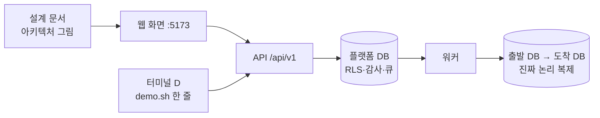
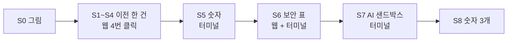

로드맵 위치: 결선 직전 / 라이브 데모 콘티(장면 단위) / 본선 연결점: 완성도·데모 30 · 클라우드 활용 30 · AI 10 · 독창성 10 · 팀 개발 20

# 데모 콘티: 8분 안에 필수 3장면을 한 이야기로

> 문서 상태: AI 초안(DRAFT) · 2026-10-31 17:30 UTC 작성, 17:45 UTC Z33 갱신(S2·S8 비용 말에 크레딧·미확인 조건, S6 컷 1을 Z18 실제 표 모양으로, 녹화본 `play.sh`·S6 2장, 롤백 창 3초/20초, 대체 규칙 8분판 30초·5분판 15초, 규정 인용 p35) · 기준 코드: 통합본 `service-current.tgz` int3(17:05 UTC), 일부 17:27 UTC 판 확인 · **8분판은 연습·질문 대비용. 무대 기준은 5분판 `DEMO-STORYBOARD-5MIN.md`** · 실제 LLM 에이전트(Z22)는 진행 중이라 "합쳐지면"으로 따로 적음 · 팀 검토 전 · 18:20 UTC 2차 묶음: S6·4절 보안 표 숫자

표시: 【사실】 코드·실측·대회 자료로 확인(출처 병기) / 【추정】 판단 / 【미확인】 아직 확인 못 함.

이 문서는 슬라이드가 아니다. 무대에서는 설계 문서(`parallel/Z7/docs/PRESENTATION.md`)와 노트북 화면(웹 + 터미널)만 쓴다【사실: 예선 규칙 "슬라이드 금지, 설계 문서 + 라이브 데모"】.

---

## 그림: 무대에서 보이는 것



- 심사위원 눈에 보이는 화면은 셋뿐이다: 설계 문서 그림, 웹 화면, 큰 글씨 터미널 하나.
- 이야기는 "AWS에서 돌던 앱을 GCP로 옮긴다" 한 건이다. 그 한 건 안에서 필수 3장면(이전 · 보안 시각화 · AI 샌드박스)을 차례로 꺼낸다【사실: 킥오프 p20-21】.
- 화면에 안 나오는 숫자(쓰기 멈춤 ms, 옮겨진 행 수)는 `bash docs/demo/demo.sh 명령` 한 줄로 꺼낸다【사실: `parallel/W/docs/demo/demo.sh`】.

## 이 문서와 다른 문서의 관계

| 문서 | 무엇을 | 이 문서에서 |
|---|---|---|
| `parallel/W/docs/DEMO-REHEARSAL.md` | 분 단위 리허설 대본, 준비 명령, 기대 출력 전체 | 명령·기대 출력은 거기를 가리킨다. 여기는 장면 단위로 줄였다 |
| `parallel/Z8/docs/RUNBOOK-FINALS.md` (수정본 `parallel/Z33/docs/`) | 전날 점검, 띄우는 순서, 장애 대응, 대체 규칙(8분판 30초, 5분판 15초) | 대체 경로 단계(0~4)는 Z8 5-1을 그대로 따른다 |
| `parallel/Z16/docs/GLOSSARY.md` | 확정 용어·숫자 | 모든 말과 숫자를 여기에 맞췄다 |
| `parallel/Z5/docs/JUDGE-QA.md` | 질문 30개와 답 | 장면마다 걸리는 질문 번호만 적는다 |
| `parallel/Z15/docs/JUDGING-GAP.md` | 심사 기준 대비 구멍 | 9절 배점 표의 근거 |

---

## 1. 한눈에 보는 8분

| 시계 | 장면 | 필수 장면 | 어디서 | 길이 |
|---|---|---|---|---|
| 0:00 | S0. 한 줄 소개 + 그림 | - | 설계 문서 | 0:30 |
| 0:30 | S1. 새 이전 만들기 → 명세 검토 | (a) 이전 | 웹 | 0:45 |
| 1:15 | S2. 비용 비교 | - | 웹 (대체: 터미널) | 0:40 |
| 1:55 | S3. 계획서와 지문 거부 | (a) 이전 | 웹 + 터미널 | 0:50 |
| 2:45 | S4. 승인 → 실행 → 완료 (진짜 복제) | (a) 이전 | 웹 | 1:10 |
| 3:55 | S5. 옮겨진 데이터와 쓰기 멈춤 시간 | (a) 이전 | 터미널 | 0:50 |
| 4:45 | S6. 보안 시각화 (보안 표 · 회사 벽 · 감사 체인) | **(b) 보안** | 웹 + 터미널 | 1:15 |
| 6:00 | S7. AI 에이전트 샌드박스 | (c) AI | 터미널 | 1:00 |
| 7:00 | S8. 마무리 숫자 3개 | - | 말 | 0:30 |
| 7:30 | 여유 (질문 하나 받거나, 밀린 시간 흡수) | - | - | 0:30 |

- 【사실】 기계가 일하는 시간은 다 합쳐 10초 안팎이다. 이전 한 건 화면 흐름 8.3 / 8.6 / 8.5초(W 7절). 나머지는 말하는 시간이다.
- 【추정】 한·일 통역이 붙으면 말이 1.5배쯤 길어진다. 그래서 여유 30초를 남겼고, 짧은 판(8절)을 따로 둔다.

---

## 2. 장면별 콘티

장면마다 같은 순서로 적는다: 화면에 보이는 것 / 말하는 한 줄 / 실행 명령 또는 클릭 / 실패 시 대체 / 소요 시간. 대체 경로의 단계 번호는 Z8 5-1을 따른다: 1 그 자리 재시도 → 2 미리 잰 숫자 → 3 녹화본·캡처 → 4 설계 문서로 말하기. 8분판은 한 장면에서 30초 안에 안 고쳐지면 다음 단계로 내려간다(5분판은 15초, 5분판 콘티 2절).

### S0. 한 줄 소개 + 그림 (0:00 ~ 0:30)

| 칸 | 내용 |
|---|---|
| 화면에 보이는 것 | 설계 문서 1절 아키텍처 그림(`parallel/Z7/docs/img/architecture.svg`) |
| 말하는 한 줄 | "이미 AWS에서 돌고 있는 서비스를 멈추지 않고 GCP로 옮기고, 그 과정을 승인·감사·롤백으로 감싸는 플랫폼입니다." |
| 실행 명령 / 클릭 | 없음. 그림의 왼쪽(웹) → 가운데(제어판) → 오른쪽(클라우드 두 곳)을 손가락으로 한 번 훑는다 |
| 실패 시 대체 | 노트북이 안 켜지면 인쇄본 그림(전날 출력). 이후 전 장면을 단계 4로 진행 |
| 소요 시간 | 0:30 |
| 진짜인가 | 그림은 지금 코드 구조와 같다【사실: Z7 1절】 |

### S1. 새 이전 만들기 → 명세 검토 (0:30 ~ 1:15)

| 칸 | 내용 |
|---|---|
| 화면에 보이는 것 | 웹 왼쪽 위 환경 표에 dev-aws(AWS), dev-gcp(GCP). 버튼을 누르면 목록에 한 줄이 생기고 진행 칸 1~3이 초록, "명세 검토"가 강조된다 |
| 말하는 한 줄 | "버튼 한 번에 상태 변경, 감사 기록, 다음 작업 예약이 한 트랜잭션으로 들어갔습니다." |
| 실행 명령 / 클릭 | "출발" `dev-aws (aws)` → "도착" `dev-gcp (gcp)` → "새 이전 만들기" 클릭. 1초 안에 명세 검토로 간다 |
| 실패 시 대체 | 화면 위 점이 빨강 → 단계 1: 터미널 A에서 `npm run dev:api`. "가져오기"에서 멈춤 → 단계 1: 터미널 B에서 `npm run dev:worker`(작업은 큐에 남아 이어 간다). 30초 넘으면 단계 3: `bash tools/demo-record/play.sh 1`(`S1-S4.mov`) |
| 소요 시간 | 0:45 (기계 시간 0.4~0.6초【사실: W 3절 447/557/427ms】) |
| 진짜인가 | 상태 기계·감사·큐는 진짜. 출발 환경 읽기(`discover`)는 데모 원본을 돌려준다【사실: Z15 2-2】 |
| 걸리는 질문 | Z5 Q1, Q2, Q3 |

### S2. 비용 비교 (1:15 ~ 1:55)

| 칸 | 내용 |
|---|---|
| 화면에 보이는 것 | 이전 상세의 비용 비교 막대(Z2). AWS 월 $233.3, GCP 월 $146.9, 온프레 $250, "월 $86.4 아낌"과 "그중 무료 크레딧 몫 $73". GCP 막대 밑 "미확인·가정 값: DB, 스토리지" |
| 말하는 한 줄 | 대본 Z26 추가 A 그대로: "같은 명세로 세 환경의 월 비용을 계산했습니다. 지금 트래픽이면 GCP가 AWS보다 월 86.4달러 쌉니다. 그중 73달러는 GKE 무료 크레딧입니다. 다만 GCP 단가는 아직 샘플 값이라, 화면에도 미확인 값으로 표시했습니다." 시간이 남으면: "190 rps를 넘으면 온프레가 더 쌉니다." |
| 실행 명령 / 클릭 | 화면을 아래로 내려 막대를 가리킨다. 화면에 안 보이면 터미널 D: `bash docs/demo/demo.sh cost` |
| 실패 시 대체 | 숫자가 $227.5 / $80.6으로 나오면 가격 캐시를 안 읽은 판이다【사실: Z16 4절】. 숫자를 말하지 말고 "가격 근거가 확인 안 된 칸은 화면에 미확인 값으로 표시합니다"만 말하고 넘어간다. 전날 `npm run prices:fetch -w @svc/cost`를 했는지 Z8 1-4로 확인 |
| 소요 시간 | 0:40 (응답 18~31ms【사실: W 장면 3】) |
| 진짜인가 | 계산은 진짜. $146.9·$86.4는 【추정, GCP 단가 57% 아이오와·크레딧 $73 포함】: GCP 가격 파일이 샘플 단가(`origin: seed`)다【사실: Z28 4절, Z29】. 온프레는 고정 가정치【추정】. 결선 전 `prices:fetch` 후 수치 갱신 |
| 걸리는 질문 | Z5 Q26 |

### S3. 계획서와 지문 거부 (1:55 ~ 2:45)

| 칸 | 내용 |
|---|---|
| 화면에 보이는 것 | "승인 대기" 상태와 계획서: 계획 지문(planHash) 64자, 만료 2시간, 롤백 기준(오류율 1% 초과 또는 p95 2배, 30초), 단계 6줄. 이어서 터미널 D에 `409 PLAN_HASH_MISMATCH`, "지금 상태: awaiting_approval" |
| 말하는 한 줄 | "사람이 본 계획과 실행할 계획을 지문 하나로 묶습니다. 옛 화면에서 승인하면 이렇게 409로 거부됩니다." |
| 실행 명령 / 클릭 | 웹 "명세 확정 → 사전 점검·계획 시작" 클릭(약 1.2초). 그다음 터미널 D: `bash docs/demo/demo.sh wronghash` |
| 실패 시 대체 | "사전 점검"에서 멈춤 → 단계 1: `bash docs/demo/demo.sh why`로 막은 이유를 읽어 준다. `wronghash`가 실패하면 그냥 건너뛴다(이전 상태를 바꾸지 않는 명령이라 다음 장면에 영향 없음) |
| 소요 시간 | 0:50 |
| 진짜인가 | 지문 계산·대조·409는 진짜【사실: W 장면 4·5】 |
| 걸리는 질문 | Z5 Q15, Q22 |

### S4. 승인 → 실행 → 완료, 진짜 복제 (2:45 ~ 3:55)

| 칸 | 내용 |
|---|---|
| 화면에 보이는 것 | 진행 칸이 한 칸씩 초록이 된다(워커 칸 0.7초, 사람 칸 1.5초마다 새로 읽음). 자원 생성 · 앱 배포 · DB 복제 · 트래픽 이동 · DB 컷오버 · 롤백 가능 창 · 정리 → 15칸 모두 초록, 오른쪽 위 "완료" |
| 말하는 한 줄 | "지금 DB 복제와 컷오버는 진짜 Postgres 두 대 사이에서 돌고 있습니다. 클라우드 자원 생성과 트래픽 지표는 아직 흉내 값이고, 화면에도 그렇게 적혀 있습니다." |
| 실행 명령 / 클릭 | "승인" 클릭 → "실행 시작" 클릭. 약 7초 동안 칸을 손으로 따라간다 |
| 실패 시 대체 | "DB 복제"에서 5초 넘게 멈춤 → `bash docs/demo/demo.sh why`. `DB-T5 target not empty`면 "도착 DB가 비어 있지 않으면 사전 점검이 막습니다. 안전장치가 동작한 겁니다"라고 말하고 S5를 단계 2(`measure`)로 바꾼다. 칸이 전혀 안 움직임 → 단계 1: `npm run dev:worker`. 30초 넘으면 단계 3: `bash tools/demo-record/play.sh 1`(`S1-S4.mov` 뒤쪽) |
| 소요 시간 | 1:10 (기계 시간 6.7~6.9초【사실: W 3절】) |
| 진짜인가 | DB 복제·컷오버·정리는 진짜. 자원 생성·앱 배포·트래픽 지표는 STUB(흉내 값)【사실: W 장면 6 표】. Cloudflare 가중치 실변경은 Z14 준비 중【미확인】 |
| 걸리는 질문 | Z5 Q9, Q11, Q12, Q16 |

### S5. 옮겨진 데이터와 쓰기 멈춤 시간 (3:55 ~ 4:45)

| 칸 | 내용 |
|---|---|
| 화면에 보이는 것 | 터미널 D에 출발·도착 둘 다 `orders 2000`, `customers 100`. 이어서 `cutover_pause_ms`(수십 ms)와 `stub(가짜)였나: f`. 마지막으로 미리 잰 6줄: 컷오버 중앙값 41ms, 롤백 중앙값 44ms, 쓰기 4,338건 실패 0 |
| 말하는 한 줄 | "도착 DB가 0행에서 2,100행이 됐습니다. 쓰기 8개를 계속 넣으며 다섯 번 재면 쓰기 멈춤 중앙값 41ms, 실패 0건, 롤백도 44ms입니다." |
| 실행 명령 / 클릭 | 터미널 D에서 한 줄씩: `bash docs/demo/demo.sh rows` → `bash docs/demo/demo.sh numbers` → `bash docs/demo/demo.sh measure` |
| 실패 시 대체 | `stub(가짜)였나: t` 또는 `cutover_pause_ms 850` → 워커가 복제 설정 없이 떠 있었다. 숫자는 말하지 않고 단계 2: `measure`만 보인다. 도커 `exec` 오류 → 단계 2: `measure`만 |
| 소요 시간 | 0:50 |
| 진짜인가 | 41ms·44ms·실패 0은 같은 호스트 Postgres 두 대 실측【사실: W 2-2, Z16 4절】. RDS → Cloud SQL처럼 클라우드 사이는 아직 안 쟀다【미확인】 |
| 롤백 장면 | 기본은 `measure`의 `rollback pause ms` 줄을 짚는다(런북 5-2 길 1). 롤백 버튼(Z11)은 17:27 UTC 통합본에 들어 있다【사실】. 버튼으로 보일 때는 워커를 `ROLLBACK_WINDOW_SEC=20`으로 띄우고 S4의 "롤백 가능 창" 칸에서 버튼 → "롤백 중" → "롤백 완료" → `rows`(런북 5-2 길 2). 창 길이: 운영 기본 3초, 데모·e2e 롤백 장면만 20초(DRAFT(ai)). 맥 실제 복제로는 아직 안 돌려 봄【미확인】 |
| 걸리는 질문 | Z5 Q8, Q10 |

### S6. 보안 시각화: 보안 표 · 회사 벽 · 감사 체인 (4:45 ~ 6:00) — 필수 장면

이 장면은 빠지면 안 된다. 킥오프가 "여러 환경의 보안·거버넌스 상태 시각화"를 데모 필수로 지정했다【사실: 킥오프 p20-21, Z15 0절】. 세 컷으로 나눈다.

| 칸 | 내용 |
|---|---|
| 화면에 보이는 것 | **컷 1 (0:35) 보안 표:** 이전 상세의 비용 비교 아래 보안 표. 영역 6개, 줄 22~24개(AWS→GCP 24줄, 기본 "해당 없음" 2줄 숨김). 요약 칩 "지켜짐 16 · 약점 5 · 위반 1 · 미구현 0"(완료된 이전, STUB)【사실, int5 2차 예정】. `STUB:` 글자는 없고 "미구현" 상태로 갈린다【사실: Z18 SECURITY-VIEW 17:40 판】. **컷 2 (0:20) 회사 벽:** 터미널에 `401` / `{"items":[]}` / `404 NOT_FOUND`. **컷 3 (0:20) 감사 체인:** 이번 이전의 감사 15줄, `user:dev`와 `worker`가 번갈아, 줄마다 해시 12자 |
| 말하는 한 줄 | 컷 1: "출발과 도착 환경의 보안 상태를 한 표로 봅니다. 여기 위반 1, 약점 5, 미구현 0. 위반 1건은 원래 있던 약점이 통제 매트릭스에 드러난 것입니다. 숨기지 않고 근거 번호와 파일 경로까지 같이 보여 줍니다." 컷 2: "다른 회사 번호로는 목록이 비고, 번호를 알아도 404입니다. 이 벽은 앱 코드가 아니라 DB 행 단위 규칙(RLS)이 칩니다." 컷 3: "상태가 바뀔 때마다 같은 트랜잭션에서 한 줄씩 남고, 줄마다 앞 줄 해시를 이어 붙여 중간을 고치면 드러납니다." |
| 실행 명령 / 클릭 | 컷 1: 웹에서 이전 상세를 비용 비교 아래로 내린다. 컷 2: `bash docs/demo/demo.sh wall`. 컷 3: `bash docs/demo/demo.sh audit` |
| 실패 시 대체 | 보안 표가 안 보이거나 비어 있음 → 단계 1: 같은 API를 터미널로(부록 A의 `demo.sh security` 제안을 넣었으면 `bash docs/demo/demo.sh security`). 그래도 안 되면 단계 3: `bash tools/demo-record/play.sh 6`(`S6-security-1.png` 표, `S6-security-2.png` 벽·감사). 컷 1이 통째로 안 돼도 컷 2·3은 지금 통합본에서 된다【사실: W 장면 8·9】. 이때 말: "환경별 표는 캡처로, 그 표를 받치는 두 장치는 지금 직접 보여 드리겠습니다" |
| 소요 시간 | 1:15 |
| 진짜인가 | 회사 벽(RLS, 우회 시험 14개 전부 막힘)과 감사 해시 체인은 진짜【사실: Z7 5절, Z15 2-2 "거버넌스"】. 보안 표에서 진짜로 계산하는 것: 감사 체인 무결, 와일드카드 0, 권한 경계 조건, 세션 정책 크기, 장부 상태, T27 회수, 평문 비밀값 0, DB 권한. 미구현: 통제 12개 매트릭스(수집기 STUB)【사실: Z18】 |
| 걸리는 질문 | Z5 Q17, Q18, Q19, Q20, Q21 |

### S7. AI 에이전트 샌드박스 (6:00 ~ 7:00) — 필수 장면

| 칸 | 내용 |
|---|---|
| 화면에 보이는 것 | **지금:** 터미널에 시험 5줄 `ok 1`~`ok 5`, `# pass 5`, `# fail 0` (도구 정의 7개, 정상 흐름, 탈취된 에이전트 차단, 예산 상한, 게이트) — 0.3초. **Z22가 합쳐지면:** 실제 LLM이 k3d 일회용 네임스페이스에서 문제를 찾고 수정안을 적용, 게이트 통과 결과와 사람 승인 대기【미확인】 |
| 말하는 한 줄 | "AI 에이전트는 샌드박스 안에서만 도구를 씁니다. 탈취돼도 허용 밖 도구는 실행되지 않고, Secret 추가·privileged 같은 위험한 변경은 게이트가 막습니다." 지금 판이면 한 줄 더: "이 시험은 LLM 대신 정해진 대본으로 돌렸습니다. 실제 모델 연결은 다음 단계입니다." |
| 실행 명령 / 클릭 | 터미널 D: `bash docs/demo/demo.sh agent` |
| 실패 시 대체 | `npm install`이 안 끝났거나 통합본이 바뀐 경우다【사실: Z8 4-8】. 단계 3: `bash tools/demo-record/play.sh 7`(`S7-agent.mov`). 실제 LLM 판에서 인터넷이 안 되면 대본 LLM 판으로 바로 내려간다(같은 명령, LLM 선택만 대본) |
| 소요 시간 | 1:00 |
| 진짜인가 | 루프·게이트·주입 방어는 진짜 코드. LLM은 대본, 샌드박스는 메모리【사실: Z15 2-5】. "목업"이라고 먼저 밝힌다 |
| 걸리는 질문 | Z5 Q23, Q24, Q25 |

### S8. 마무리 숫자 3개 (7:00 ~ 7:30)

| 칸 | 내용 |
|---|---|
| 화면에 보이는 것 | 설계 문서 7절 수치 표로 돌아간다 |
| 말하는 한 줄 | 5분판 대본 문단 7과 같게: "컷오버 쓰기 멈춤 41ms, 실패 0건. 롤백도 44ms입니다. 사람이 본 계획과 다르면 실행되지 않습니다." 비용 숫자는 마무리에 넣지 않는다(S2에서만, 크레딧·미확인 조건과 함께) |
| 실행 명령 / 클릭 | 없음 |
| 실패 시 대체 | 없음(말뿐) |
| 소요 시간 | 0:30 |

---

## 3. 화면 흐름 한 장



- 웹 → 터미널 → 웹 → 터미널로 오가는 횟수를 두 번으로 줄였다. 창 전환 한 번에 3~5초를 잃는다【추정】.
- S6 컷 1은 S4에서 끝난 같은 이전 상세 화면을 아래로 내리기만 하면 된다. 새 화면을 열지 않는다.

---

## 4. 녹화본·캡처 만들기 (대체 경로 단계 3의 재료)

라이브가 기본이고, 녹화본은 무대에서 막혔을 때만 튼다(8분판 30초, 5분판 15초). 찍는 법과 무대에서 띄우는 법은 Z27 `DEMO-RECORDINGS.md`. 무대에서는 `bash tools/demo-record/play.sh <1·5·6·7>` 한 줄이다.

| 파일 | 담는 장면 | 길이 | 만드는 때 |
|---|---|---|---|
| `S1-S4.mov` | 새 이전 → 명세 검토 → 계획서 → 승인 → 완료 | 약 40초 | 전날 리허설에서 맥 화면 녹화 |
| `S5-numbers.png` | `rows`·`numbers`·`measure` 출력 한 화면 | 캡처 1장 | 같은 리허설 |
| `S6-security-1.png`, `S6-security-2.png` | 1: 보안 표(Z18 `screenshots/z18-02-completed.png` 모양). 2: `wall` + `audit` | 캡처 2장 | 2는 같은 리허설, 1은 Z18이 합쳐진 뒤 |
| `S7-agent.mov` | `demo.sh agent` (실제 LLM 판이면 그 실행) | 약 20초 | 같은 리허설 |

- 맥 화면 녹화: `Cmd + Shift + 5`를 누르면 화면 아래에 녹화 막대가 뜬다. "선택 부분 기록"으로 브라우저 창만 잡는다. 캡처도 같은 막대에서 한다.
- 파일은 노트북 바탕화면 폴더 하나에 둔다. 인터넷 없이 열려야 한다【사실: Z8 5-1】.
- 녹화 전에 `.env`·계정 번호가 보이는 창은 닫는다. `cat .env`는 하지 않는다【사실: Z8 6절】.
- 녹화본을 틀 때 말: "실행 화면 녹화로 보여 드리겠습니다. 끝나고 노트북에서 직접 다시 돌려 보여 드릴 수 있습니다."

---

## 5. 시작 전 상태 (T-2:00)

준비 명령은 W 2절과 Z8 2절을 그대로 따른다. 콘티가 맞으려면 시작 직전 아래 다섯 가지가 참이어야 한다.

| 확인 | 기대 | 어떻게 |
|---|---|---|
| 이전 목록 | 0건 | `bash docs/demo/demo.sh check` |
| 복제 설정 | `REPL_` 7줄 | 같은 출력 |
| 출발·도착 DB | 출발 2000/100, 도착 0/0 | 같은 출력 |
| 미리 잰 숫자 | `measure-latest.txt` 있음 | `bash docs/demo/demo.sh measure` |
| 화면 | 브라우저 하나에 "API 연결됨" 초록 점, 터미널 D 글자 크게 | 눈으로 |

- 【사실】 리허설 뒤 `reset`을 안 하면 S4가 "DB 복제"에서 영원히 멈추고, 다음 이전은 승인에서 `409 ENV_BUSY`로 막힌다(W 5절). 리허설 한 번마다 `reset` → api·worker 다시 띄우기 → `check`.

---

## 6. 말할 때 지킬 것

- 용어는 Z16 표대로: "이전", "DB 컷오버", "트래픽 이동", "롤백 중/롤백 완료", "일시 정지", "쓰기 멈춤 시간", "계획 지문", "회사".
- 숫자는 Z16 4절 기준값만 쓴다: 컷오버 41ms, 롤백 44ms, 실패 0 / 4,338, 보안 표 위반 1 · 약점 5 · 미구현 0【사실, int5 2차 예정】. 비용 AWS $233.3 → GCP $146.9, 절약 $86.4는 【추정, GCP 단가 57% 아이오와·크레딧 $73 포함】이라 S2에서 조건 문장과 함께만 쓴다. 결선 전 `prices:fetch` 후 수치 갱신.
- STUB은 먼저 말한다. 심사위원이 묻기 전에 "여기는 흉내 값입니다"라고 하면 감점이 아니라 신뢰가 된다【추정】.
- 통역이 붙으니 한 문장에 한 가지만 말하고 끊는다.
- 고치는 동안 할 말은 Z8 6절 표를 그대로 쓴다. 침묵하며 타자 치지 않는다.

---

## 7. 배점 대응 표 (30 / 30 / 10 / 10 / 20)

【사실】 결선 배점 숫자는 예선과 같다: 완성도·데모 30 / 클라우드 활용 30 / 독창성 10 / AI 10 / 팀 개발 20(킥오프 p40-41, Z15 0절).

| 항목 (배점) | 본선 문구 요지 | 받치는 장면 | 보이는 증거 | 약한 곳 |
|---|---|---|---|---|
| 완성도·데모 (30) | 관리 플랫폼이 실제로 돌고, 이전이나 보안 시각화를 그 자리에서 | S1~S5, S6 | 15칸 완주, 2,100행 이동, 41ms·실패 0, 보안 표 | 자원 생성·배포 STUB, 가동 중 앱 요청 실패 수 숫자 없음(Z15 3절 3번) |
| 클라우드 활용 (30) | 여러 환경을 묶는 추상화, 무중단·롤백·권한 설계 | S2, S4, S5, S6 | 같은 명세로 3환경 비용, 쓰기 담당 교체, 롤백 44ms, 임시 역할·최소 권한, RLS | 실제 클라우드 호출 0(Cloudflare 가중치는 Z14 준비 중) |
| 독창성 (10) | 재미·대응 환경의 폭 | S2, S3 | 비용 손익분기(190 rps에 온프레 역전), 지문 409, 증적 리포트 | 온프레 k3d 맥 미검증 |
| AI (10) | 에이전트를 샌드박스에서 점검·수정 | S7 | 탈취 차단·게이트 시험 5/5 | 대본 LLM·메모리 샌드박스(Z22가 합쳐지면 실제 LLM + k3d) |
| 팀 개발 (20) | 설계 문서화, 대안·논의·고찰 | S0, S8, 질문 답 | 설계 문서 그림, 결정 49개, 장면마다 "버린 대안" 한 줄(Z5 답) | DRAFT(ai) 다수가 팀 확인 전 |

- 30점 두 항목은 S4~S6이 함께 받친다. 그래서 시간도 이 셋에 3:15(전체의 43%)를 줬다.
- AI 10점은 장면 하나(S7)로만 받친다. 시간이 밀리면 S2를 먼저 빼고 S7은 지킨다(8절).

---

## 8. 짧은 판

같은 장면 번호를 쓴다.

| 판 | 쓰는 장면 | 시간 |
|---|---|---|
| 8분 (리허설·질문 대비) | S0~S8 전부 | 7:30 + 여유 0:30 |
| 7분 (11/7 중간 보고, 설명 3분 + 데모 4분) | 설명 3분은 설계 문서. 데모 4분 = S1+S3 합침(0:50) · S4(1:00) · S5 `numbers`만(0:30) · S6(1:10) · S7(0:30) | 4:00 |
| 5분 (11/8 최종, 슬라이드 없음) | S0(0:20) · S1~S4 합침(1:30) · S5 `numbers`만(0:30) · S6(1:10) · S7(0:50) · S8(0:20) | 4:40 |

- 【사실】 최종 5분, 통역 시간 제외, "시간을 초과할 경우, 강제로 종료될 수 있습니다", 슬라이드 금지(킥오프 p35 원문). 중간 보고 7분(설명 3 + 데모 4)【사실: 킥오프 p28-37】.
- 5분판에서 뺀 S2(비용)·S3의 지문 거부는 질문이 오면 터미널 D 한 줄로 바로 보인다.
- 필수 3장면(S4·S6·S7)은 어느 판에서도 빼지 않는다.

---

## 9. 심사 Q&A로 이어지는 곳

답은 `parallel/Z5/docs/JUDGE-QA.md`에 있다. 여기서는 장면별 번호만 모은다. 질문을 받으면 해당 장면의 터미널 한 줄을 다시 보여 주며 답한다.

| 장면 | 예상 질문 (Z5 번호) | 바로 보여 줄 것 |
|---|---|---|
| S1 | Q1 한 문장, Q2 상태 기계 직접, Q3 pg-boss | `audit` 첫 줄 |
| S3 | Q15 승인한 계획 = 실행, Q22 본인 승인 | `wronghash` |
| S4 | Q9 컷오버 순서, Q11 동기화 판단, Q16 워커가 죽으면 | 터미널 B에서 워커를 끄고 다시 켜 이어지는 것 |
| S5 | Q8 얼마나 멈추나, Q10 되돌릴 수 있나 | `measure` |
| S6 | Q17~Q21 권한·회사 벽·감사 | `wall`, `audit` |
| S7 | Q23~Q25 에이전트·샌드박스 | `agent` |
| 전체 | Q29 STUB 솔직하게, Q30 무엇부터 진짜로 | Z15 3절 상위 5개 |

---

## 10. 합쳐지면 바꿀 곳

| 무엇이 합쳐지면 | 바꿀 장면 | 바꿀 내용 |
|---|---|---|
| Z18 보안 표 | S6 컷 1, 4절 | Z33에서 S6 "화면에 보이는 것"·"진짜인가"를 `SECURITY-VIEW.md` 4절대로 바꿨다. 합쳐지면 `record.sh 6`으로 `S6-security-1.png`를 새로 찍고, 요약 칩 숫자가 13·5·0·2와 다르면 화면 값으로 고친다 |
| Z22 실제 LLM + k3d 샌드박스 | S7 | 화면·말을 실제 판으로. 실행 시간을 재서 1:00 안에 드는지 확인(안 들면 미리 돌린 결과를 보인다). 맥에서 키·인터넷 필요 |
| Z11 롤백·취소 버튼 | S5 | 17:27 UTC 통합본에 들어옴. 롤백 장면을 화면 버튼으로 하려면 런북 5-2 길 2. 창 길이는 운영 3초 / 데모 20초(DRAFT(ai)) |
| Z14 Cloudflare 실가중치 | S4 | "트래픽 지표는 흉내"를 "가중치는 실제 Cloudflare"로. 대시보드 탭 하나 추가(창 전환 +1) |
| Z6 부하 테스트 | S5 | "가동 중 앱 요청 N건, 실패 0" 한 줄 추가 |
| 맥 리허설 | 1절, 2절 숫자 | 맥 실측으로 기계 시간·쓰기 멈춤 ms 교체(3~5회) |

---

## 부록 A. `demo.sh`에 보안 표 한 줄 추가 제안

**Z33 갱신:** 아래 원안 대신 Z18의 `patches/z18-demo-security.patch`를 쓴다(Z18 SECURITY-VIEW 4절). 요약 한 줄 + "해당 없음"을 뺀 줄을 `상태 ID 결과`로 찍고, 이전 번호를 둘째 인자로 줄 수 있다. 원안은 기록으로만 남긴다.

【추정】 S6 컷 1의 단계 1 대체용. Z18 경로가 `GET /api/v1/migrations/:id/security`로 정해졌다는 진행 기록 기준이다. `demo.sh`의 `case` 안, `wall)` 앞에 넣는다.

```bash
  security)
    MID="$(latest_mid)"
    curl -s "$API/api/v1/migrations/$MID/security" -H "x-dev-tenant: $TENANT" | python3 -m json.tool | head -40
    ;;
```

- `TENANT`는 데모용 고정 번호(시드 값)라 비밀값이 아니다【사실: demo.sh 9줄】.
- 마지막 `*)` 줄의 쓰는 법 안내에도 `security`를 더한다.

---

## 핵심 결정 3개 (+대안)

| 결정 | 대안 | 고른 이유 |
|---|---|---|
| 필수 3장면을 이전 한 건 안에 이어 붙인다(같은 이전의 상세 화면에서 보안 표를 연다) | 장면마다 따로 준비한 화면 | 이야기가 하나라 통역·심사위원이 따라가기 쉽다. 창을 새로 열지 않아 전환 시간이 준다. 대신 S4가 실패하면 S6 컷 1도 같이 흔들린다 → 컷 2·3은 독립 명령으로 둬서 막았다 |
| 시간 배분을 배점이 큰 S4~S6에 몰고(3:15), S2 비용은 먼저 빼는 장면으로 | 장면마다 고르게 50초씩 | 30점 두 항목과 보안 필수 장면이 여기 걸린다. 비용은 질문이 오면 한 줄로 보일 수 있다 |
| 대체 경로를 녹화본·캡처까지 미리 만든다 | 라이브만, 막히면 말로 | Z8 대체 규칙(8분판 30초, 5분판 15초)을 지키려면 단계 3의 재료가 있어야 한다. 대신 리허설 때 녹화 시간이 든다(4개, 약 10분) |

## 셀프 연습 1개

S6 보안 시각화를 화면 없이 해 본다.

1. 웹을 닫고 터미널 D만 남긴다.
2. `bash docs/demo/demo.sh wall`과 `bash docs/demo/demo.sh audit`만으로 1분 15초를 채운다.
3. "환경별 보안 표는 캡처로 보여 드리겠습니다" 다음에 무엇을 말할지 두 문장을 적는다.
4. 휴대폰 스톱워치로 재서 1:15 안에 끝나는지 3회 적는다.

## 검증 명령과 기대 출력

서비스 폴더에서 한 줄씩 실행한다(리허설 한 바퀴를 화면으로 끝낸 뒤).

```bash
bash docs/demo/demo.sh rows
bash docs/demo/demo.sh numbers
bash docs/demo/demo.sh wall
bash docs/demo/demo.sh agent
```

- `rows`: 출발·도착 둘 다 `orders|2000`, `customers|100`.
- `numbers`: `cutover_pause_ms`가 수십 ms, 마지막 줄 `stub(가짜)였나: f`.
- `wall`: `회사 헤더 없음 → 401`, `다른 회사 목록 → {"items":[]}`, 마지막 줄에 `"code":"NOT_FOUND"`.
- `agent`: `# pass 5`, `# fail 0`.
- 끝나면 다음 리허설 전에 `bash docs/demo/demo.sh reset`.
