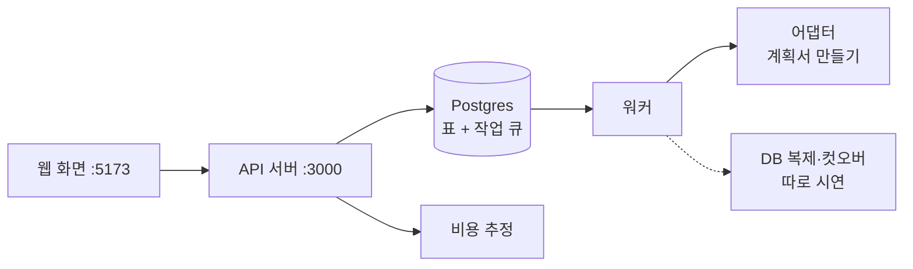
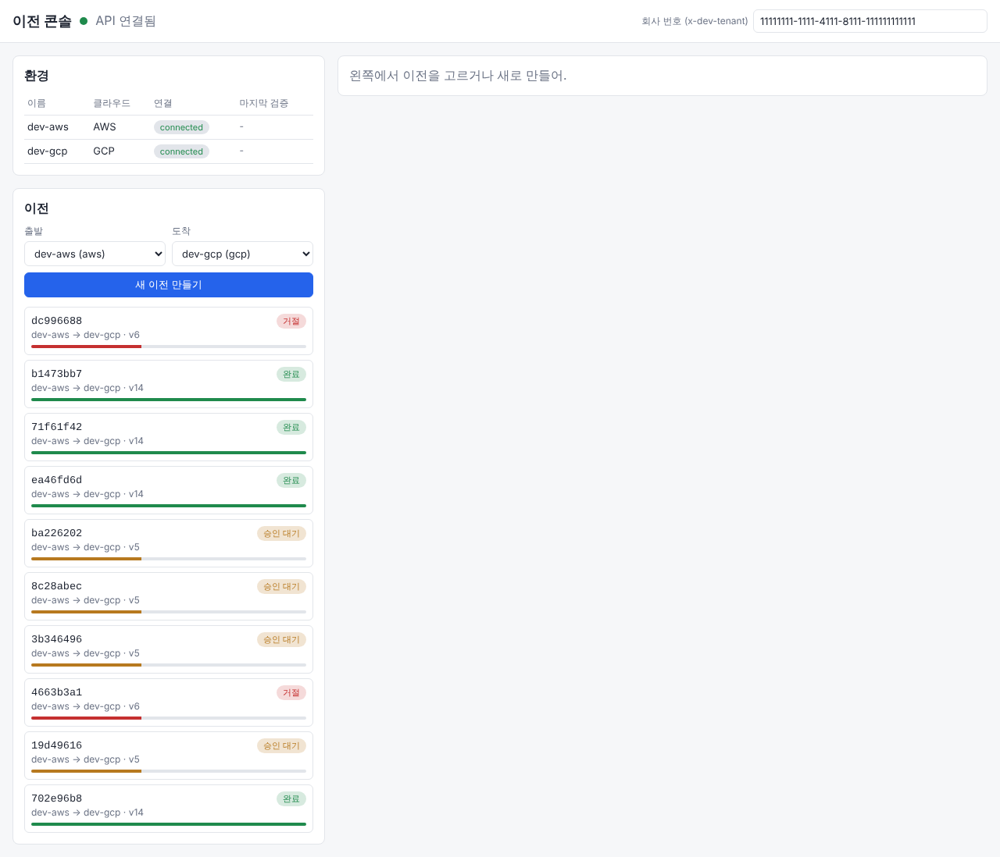
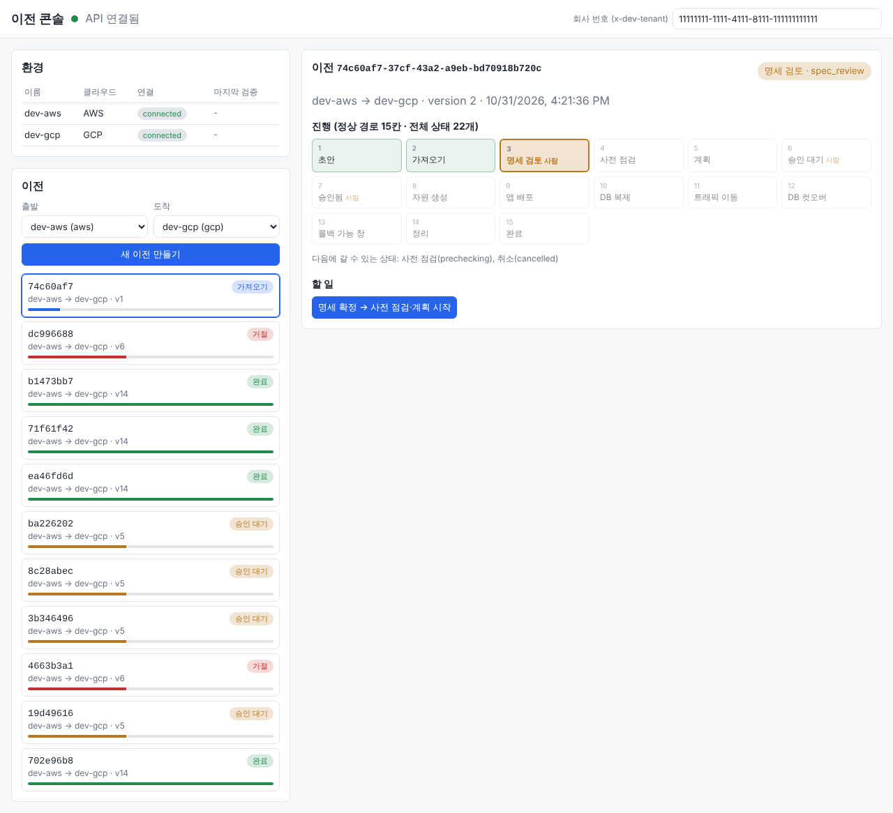
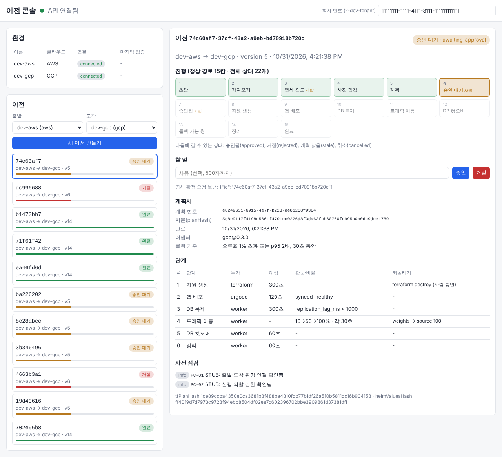
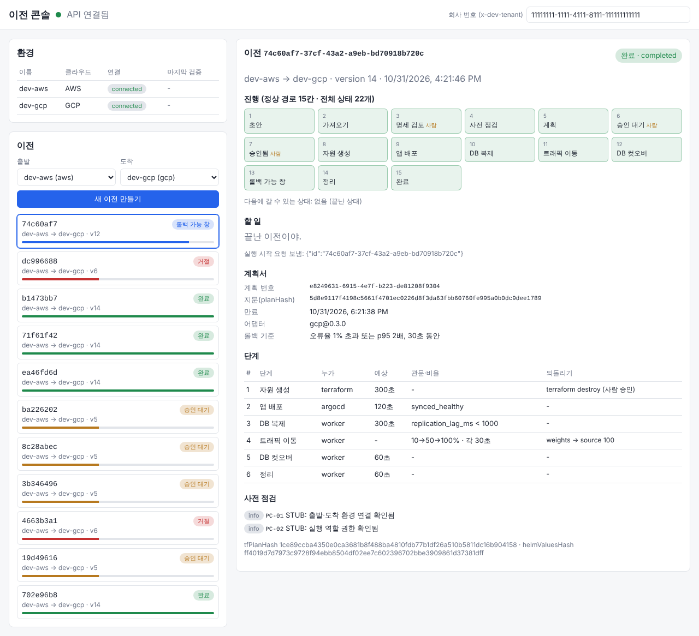

로드맵 위치: 본선 직전 / 스켈레톤 데모 시나리오 / 본선 연결점: 완성도·데모 30, 클라우드 활용 30

# 데모 시나리오: 이전 한 건을 화면에서 끝까지

> 문서 상태: AI 초안 · 2026-10-31 16:30 UTC 갱신(리전 서울 반영) · 기준 코드: 통합본 `service-current.tgz`(16:11 UTC, 리전은 16:27 UTC 판으로 확인) · 팀 검토 전

## 그림

웹 화면에서 버튼 세 번을 누르면, 이전 한 건이 22개 상태 중 정상 경로 15칸을 지나 "완료"까지 간다.



- 실선은 지금 화면 흐름에서 실제로 도는 길이다.
- 점선(DB 복제·컷오버)은 모듈은 완성됐지만 워커에 아직 안 붙었다. 그래서 별도 터미널에서 따로 보여 준다.

## 이 문서로 하는 것

- 맥에서 web → api → worker를 띄운다.
- 이전 한 건을 "초안"부터 "완료"까지 화면으로 돌린다.
- 그 사이에 비용 추정, 계획서, 승인 지문 검사, 회사 벽, 감사 기록, DB 컷오버를 보여 준다.
- 장면마다 무엇을 보여 주고, 무엇이 나오면 성공인지 적었다.

【사실】 아래 기대 출력은 클라우드 컨테이너에서 같은 통합본을 직접 돌려 얻은 값이다(2026-10-31 16:15~16:35 UTC). 맥 숫자와는 조금 다를 수 있다.

---

## 0. 준비 (데모 5분 전)

### 0-1. DB를 깨끗하게

```bash
cd ~/Softbank_final/Service
brew services stop postgresql@16
npm run db:reset
```

- 첫 줄: 서비스 폴더로 간다.
- 둘째 줄: 맥에 깔린 Postgres가 5432 포트를 잡고 있으면 끈다. 이미 꺼져 있으면 오류 없이 넘어간다.
- 셋째 줄: 도커 DB를 지우고 다시 만든다. 표 만들기와 개발용 씨앗 데이터(회사 1개, 환경 2개)가 다시 들어간다.
- 왜: 테스트를 돌리면 이전 목록에 지난 기록이 수십 줄 쌓인다. 데모 화면이 지저분해진다.
- 주의: 로컬 도커 DB의 데이터가 전부 지워진다. 로컬 개발용이라 괜찮다.

### 0-2. 세 개를 띄운다 (터미널 3개)

```bash
npm run dev:api
```

```bash
npm run dev:worker
```

```bash
npm run dev:web
```

- `dev:api`: 3000번에 API 서버. 파일을 고치면 저절로 다시 뜬다.
- `dev:worker`: 큐에서 작업을 꺼내 상태를 한 칸씩 옮기는 프로그램.
- `dev:web`: 5173번에 화면. 화면은 `/api/...`로 부르고, Vite가 `localhost:3000/api/v1/...`로 넘긴다.

기대 출력:

- 워커 터미널 마지막 줄: `worker ready: import, precheck, plan, apply, deploy, sync, shift, cutover, cleanup, rollback`
- 브라우저 http://localhost:5173 위쪽에 초록 점과 "API 연결됨"

### 0-3. 살아 있는지 확인

```bash
curl -s localhost:3000/healthz
curl -s localhost:3000/readyz
```

- `healthz`: 프로세스가 살아 있나. `readyz`: DB까지 붙나.
- 기대: 둘 다 `{"ok":true}`. 회사 헤더 없이도 열린다(쿠버네티스 점검용 예외).

---

## 1. 장면 요약

| # | 장면 | 보여 줄 곳 | 성공 기준 | 걸린 시간(실측) |
|---|---|---|---|---|
| 1 | 환경 두 개와 새 이전 | 화면 | dev-aws, dev-gcp가 `connected` | - |
| 2 | 가져오기 → 명세 검토 | 화면 | 상태 "명세 검토", 버튼 "명세 확정" | 만들기 후 0.2초 |
| 3 | 비용 추정 | 터미널 | gcp가 가장 싸고, aws 대비 월 $80.6 절약 | 응답 17~25ms |
| 4 | 점검·계획 → 계획서 | 화면 | 계획서 6단계, 지문(planHash), 만료 2시간 뒤 | 확정 후 약 1.2초 |
| 5 | 지문이 다르면 거부 | 터미널 | `409 PLAN_HASH_MISMATCH` | - |
| 6 | 승인 → 실행 → 완료 | 화면 | 15칸 모두 초록, "끝난 이전이야." | 시작 후 약 6.5초 |
| 7 | 감사 기록 | 터미널 | 상태가 바뀐 순서대로 한 줄씩 | - |
| 8 | 회사 벽 | 터미널 | 다른 회사 번호로는 404, 헤더 없으면 401 | - |
| 9 | DB 복제·컷오버 | 별도 터미널 | 컷오버 멈춤 수십 ms, 쓰기 실패 0 | 약 1분 |

- 화면으로 보여 주는 장면은 1·2·4·6이다. 나머지는 터미널이다.
- 비용 추정은 아직 화면에 없다. 그래서 터미널로 보여 준다.

---

## 2. 장면별 순서

### 장면 1. 환경과 새 이전



할 일:

- 왼쪽 위 "환경" 표에서 dev-aws(AWS), dev-gcp(GCP)를 가리킨다.
- "출발"에 `dev-aws (aws)`, "도착"에 `dev-gcp (gcp)`를 고른다.
- "새 이전 만들기"를 누른다.

말할 것:

- 환경은 "연결됨"이어야 이전을 시작할 수 있다. 이 검사는 상태를 옮기는 함수 안에 있다.
- 지금 환경은 씨앗 데이터다. 실제 계정 연결 화면은 아직 없다.

### 장면 2. 가져오기 → 명세 검토



무슨 일이 일어나나:

- API가 이전 한 줄을 만들고, 상태를 `draft → importing`으로 옮기고, `import` 작업을 큐에 넣는다. 셋이 한 트랜잭션이다.
- 워커가 작업을 꺼낸다. 출발 환경 어댑터가 공통 명세(AppSpec) 1판을 만든다.
- 상태가 `spec_review`(명세 검토)가 된다. 사람이 볼 차례라 "사람" 표시가 붙는다.

성공 기준:

- 진행 칸 1~3이 초록, 3번 "명세 검토"가 강조.
- 할 일에 "명세 확정 → 사전 점검·계획 시작" 버튼.

### 장면 3. 비용 추정 (터미널)

공통 명세 하나로 세 환경의 월 비용을 비교한다.

```bash
cd ~/Softbank_final/Service
curl -s -X POST localhost:3000/api/v1/cost/estimate -H 'content-type: application/json' -H 'x-dev-tenant: 11111111-1111-4111-8111-111111111111' -d @docs/demo/cost-request.json | python3 docs/demo/cost-summary.py
```

- `cost-request.json`: 데모 앱 명세 + "지금은 AWS" + 피크 10 rps + 노드 종류 3개로 제한.
- `cost-summary.py`: 긴 JSON 응답에서 볼 줄만 뽑는다.
- 두 파일은 이 문서 옆 `demo/` 폴더에 있다. 서비스 폴더의 `docs/demo/`로 복사해서 쓴다.

기대 출력:

```text
가격 기준일: 2026-10-31T00:00:00Z 낡음: False
피크 rps: 10 필요 vCPU: 0.6
aws     t3.medium 2대 월 $227.5  미확인=['storage']
gcp     e2-medium 2대 월 $146.9  미확인=['db', 'storage']
onprem  k3s-vm-2c8g 2대 월 $250  미확인=['fixed', 'node']
가장 싼 곳: gcp
절약: {'from': 'aws', 'to': 'gcp', 'monthlyUsd': 80.6, 'creditPortionUsd': 73}
추천 1 gcp basic 점수 0.479
추천 2 aws basic 점수 0.624
추천 3 onprem basic 점수 0.665
최저 환경이 바뀌는 지점: [{'fromRps': 0, 'cheapest': 'gcp', 'nodes': 2}, {'fromRps': 190, 'cheapest': 'onprem', 'nodes': 3}, {'fromRps': 911, 'cheapest': 'gcp', 'nodes': 9}]
```

말할 것:

- 가격은 내장 샘플 가격표(서울 리전 19줄)다. 줄마다 근거 등급이 있다. "미확인"은 근거가 추정인 덩어리다.
- 트래픽이 190 rps를 넘으면 온프레가 더 싸진다. 911 rps를 넘으면 다시 GCP다. 이런 "갈아타는 지점"을 계산해 보여 준다.
- 5회 응답 시간 17~25ms. 순수 계산이라 DB를 쓰지 않는다.

### 장면 4. 점검·계획 → 계획서



할 일:

- 화면에서 "명세 확정"을 누른다.

무슨 일이 일어나나:

- `spec_review → prechecking`. 사전 점검 작업이 돈다(지금 점검 2개는 STUB).
- 점검에서 막는 항목이 0개면 `planning`. 계획 작업이 어댑터로 Terraform 입력과 Helm 값을 만들고 지문을 낸다.
- `awaiting_approval`(승인 대기). 화면 아래에 계획서가 뜬다.

성공 기준:

- 계획서에 계획 번호, 지문(planHash, 64자), 만료(지금 + 2시간), 어댑터 `gcp@0.3.0`, 롤백 기준 "오류율 1% 초과 또는 p95 2배, 30초 동안".
- 단계 6줄: 자원 생성(terraform 300초) / 앱 배포(argocd) / DB 복제 / 트래픽 이동(10→50→100%, 각 30초) / DB 컷오버 / 정리.

말할 것:

- 지문은 계획서 내용 전체의 sha256이다. 같은 입력이면 같은 지문이 나온다.
- 사람이 본 계획과 실행할 계획이 같다는 걸 이 지문으로 묶는다.

### 장면 5. 지문이 다르면 거부 (터미널, 선택)

화면에 보이는 계획 번호를 `PLAN_ID` 자리에 넣는다.

```bash
curl -s -X POST localhost:3000/api/v1/plans/PLAN_ID/approvals -H 'content-type: application/json' -H 'x-dev-tenant: 11111111-1111-4111-8111-111111111111' -d '{"decision":"approve","planHash":"wrong"}'
```

- 일부러 틀린 지문으로 승인을 보낸다.
- 기대 출력: `{"status":409,"code":"PLAN_HASH_MISMATCH","message":"plan changed since you viewed it","requestId":"req-.."}`
- 상태는 그대로 "승인 대기"다. 화면에서 확인한다.

### 장면 6. 승인 → 실행 → 완료



할 일:

- "승인"을 누른다. 상태가 `approved`가 되고 "실행 시작 (Terraform)" 버튼이 나온다.
- "실행 시작"을 누른다.
- 진행 칸이 한 칸씩 초록으로 바뀌는 걸 지켜본다(화면은 1.5초마다 다시 읽는다).

무슨 일이 일어나나 (워커가 한 칸씩):

| 칸 | 상태 | 지금 하는 일 |
|---|---|---|
| 8 | 자원 생성 | STUB. 승인 지문 = 계획 지문 = 작업 지문을 다시 확인한 뒤 가짜 출력값 저장 |
| 9 | 앱 배포 | STUB. Argo CD "synced_healthy"를 흉내 |
| 10 | DB 복제 | STUB. 지연 120ms를 흉내 (진짜 모듈은 장면 9) |
| 11 | 트래픽 이동 | STUB. 10%, 50%, 100% 세 번 판정 "ok" |
| 12 | DB 컷오버 | STUB. 멈춤 850ms를 흉내 |
| 13 | 롤백 가능 창 | 3초 기다림 (`ROLLBACK_WINDOW_SEC`) |
| 14~15 | 정리 → 완료 | STUB. 정리 목록을 감사에 남김 |

성공 기준:

- 15칸 모두 초록, 오른쪽 위 "완료".
- 할 일 칸에 "끝난 이전이야."
- Playwright로 같은 순서를 돌렸을 때: 화면 열기 → 명세 검토 약 3.6초, 명세 확정 → 승인 대기 약 1.6초, 승인 → 완료 약 7초, 브라우저 콘솔 오류 0.

같은 흐름을 화면 없이 확인하려면:

```bash
npm run smoke
```

- 기대: 상태가 바뀔 때마다 한 줄씩 찍히고, 마지막 줄 `completed after 7xxx ms`.
- 【사실】 클라우드 3회: 7,862 / 8,193 / 7,791ms. 맥 기록: 8.2초.

### 장면 7. 감사 기록

```bash
docker compose exec db psql -U platform_owner -d platform -c "select seq, actor, action, result from audit_events order by seq desc limit 20"
```

- 도커 DB 안의 `psql`로 감사 표의 마지막 20줄을 본다.
- 기대: `user:dev`(사람)와 `worker`가 번갈아 나온다. 예: `migration.importing` → `migration.spec_review` → `migration.prechecking` → `precheck.planning` → `plan.awaiting_approval` → `plan.approved` → … → `cleanup.completed`.

말할 것:

- 상태가 바뀔 때마다 같은 트랜잭션에서 한 줄씩 남는다. 상태만 바뀌고 기록이 빠지는 일은 없다.
- 줄마다 앞 줄의 해시를 이어 붙인다(`prev_hash`, `hash`). 중간 줄을 고치면 뒤가 다 틀어진다.

### 장면 8. 회사 벽 (선택)

```bash
curl -s -o /dev/null -w "%{http_code}\n" localhost:3000/api/v1/migrations
curl -s localhost:3000/api/v1/migrations -H 'x-dev-tenant: 99999999-9999-4999-8999-999999999999'
```

- 첫 줄: 회사 헤더 없이 부른다. 기대 `401`.
- 둘째 줄: 다른 회사 번호로 목록을 본다. 기대 `{"items":[]}`. DB의 행 단위 규칙(RLS)이 막는다.
- 다른 회사 번호로 이전 하나를 `GET /migrations/:id` 하면 `404 NOT_FOUND`다. "없다"와 "남의 것"을 구별해 주지 않는다.

### 장면 9. DB 복제·컷오버 (별도 터미널)

진짜 Postgres 16 두 대 사이에서 복제 → 컷오버 → 롤백을 쓰기 부하 중에 돌린다.

```bash
cd ~/Softbank_final/Service/packages/replication
npm run db:up
npm run test:it
npm run measure
npm run db:down
```

- `db:up`: 도커로 Postgres 두 대를 띄운다. 55432가 출발(RDS 자리), 55433이 도착(Cloud SQL·CNPG 자리).
- `test:it`: 실제 복제 통합 테스트 4개.
- `measure`: 초기 복사, 지연, 컷오버 멈춤, 롤백 멈춤을 5번씩 잰다. 1분쯤 걸린다.
- `db:down`: 두 대를 지운다.

기대 출력 (클라우드 실측, 같은 호스트 Postgres 16.15 두 대):

```text
# pass 4
initial_copy_ms (100000 orders, 3회): 409, 306, 335 → min 306 / median 335 / max 409
sync gate: ready=true lags=2.9,1.8,1.5ms
cutover pause ms (5회, 부하 8 workers): 53, 45, 52, 43, 47 → min 43 / median 47 / max 53
rollback pause ms (5회): 48, 40, 42, 51, 52 → min 40 / median 48 / max 52
app writes ok=3667 fail=0 p50=14.5ms p99=68.5ms max=83ms errors={}
leftovers: []
```

말할 것:

- 컷오버 동안 앱 쓰기가 멈춘 시간은 중앙값 47ms다. 그동안 쓰기 3,667건 중 실패 0건.
- 롤백도 같은 방식으로 수십 ms다. 역방향 복제를 컷오버 직후에 미리 만들어 두기 때문이다.
- 끝난 뒤 양쪽 DB에 복제 슬롯·발행·구독이 하나도 안 남는다(`leftovers: []`).
- 【사실】 H 단독 측정(도커)은 컷오버 중앙 62ms, 쓰기 2,365건 실패 0이었다. 이번 값과 같은 자릿수다.
- 【추정】 RDS → Cloud SQL처럼 클라우드 사이라면 왕복 지연만큼 늘어난다. 실측 전이다.

---

## 3. 아직 화면에서 안 되는 것

데모 중에 질문이 나오면 이렇게 답한다.

| 질문 | 지금 상태 | 근거 |
|---|---|---|
| 롤백 버튼은? | API 경로가 없다. 워커의 rollback 처리기는 있다 | `rolling_back`으로 옮기는 경로·작업이 코드에 없음 |
| 멈춤·취소는? | API 경로가 없다 | `paused`는 청소 작업만 옮긴다 |
| 거절한 뒤에는? | 거절 상태에서 멈춘다. 다시 계획할 경로가 없다 | `rejected → planning` 길은 있지만 부르는 곳이 없음 |
| 비용이 계획서에 붙나? | 아직. 비용은 별도 API | 계획서 모양(PlanDoc)에 비용 칸 없음 |
| DB 복제가 화면 흐름에 들어가나? | 아직. 워커의 sync·cutover는 STUB | 모듈은 완성(장면 9), 연결은 통합 중 |
| AI 에이전트는? | 화면·API에 없다. 단위 테스트로만 보인다 | 아래 명령 |
| 리전은? | 서울이다. AWS `ap-northeast-2`, GCP `asia-northeast3` | 어댑터·Terraform·비용 기본값 |

AI 에이전트를 보여 줘야 하면:

```bash
node --import tsx --test packages/agent/test/ai-loop.test.ts
```

- 기대: `ok 1`~`ok 5`. 도구 7개 정의, 정상 흐름 7단계 뒤 finish, 탈취된 에이전트의 금지 동작 차단, 예산 초과 시 멈춤, 게이트가 Secret 추가·privileged·이미지 저장소 변경을 막음.
- LLM은 대본(가짜)이다.

### 알려진 차이

- 【사실】 웹 화면은 POST마다 `Idempotency-Key`를 붙인다. 하지만 지금 API 경로들은 이 키를 쓰지 않는다. 같은 키로 `POST /migrations`를 두 번 보내면 이전이 두 개 생긴다(클라우드에서 확인).
- 【사실】 기본 리전은 서울이다(10/31 결정). 비용 추정 `ap-northeast-2`, 어댑터·Terraform AWS `ap-northeast-2`, GCP `asia-northeast3`, Azure 흉내 `koreacentral`로 맞춰져 있다.

---

## 4. 문제가 생기면

| 증상 | 원인 | 고치기 |
|---|---|---|
| 화면 위 점이 빨강 | API가 안 떴다 | API 터미널 오류 확인 |
| API가 `ECONNREFUSED 5432` | 도커 DB가 안 떴다 | `npm run db:up` |
| DB 접속은 되는데 표가 없다 | 맥 Postgres가 5432를 잡았다 | `brew services stop postgresql@16` 후 `npm run db:reset` |
| 상태가 한 칸에서 안 움직인다 | 워커가 안 떴다 | 워커 터미널에 `worker ready` 줄 확인 |
| "롤백 가능 창"에서 3초 넘게 멈춘다 | 정상. 정리 작업이 창 끝에 깨어난다 | 3~4초 기다린다 |
| 복제 `db:up` 포트 충돌 | 55432/55433을 다른 게 쓴다 | `npm run db:down` 후 다시 |

---

## 5. 실측 숫자 모음

| 지표 | 값 | 조건 |
|---|---|---|
| typecheck 오류 | 0 | 클라우드 통합본 |
| 단위 테스트 | 75 통과, 16 건너뜀, 실패 0 | `npm test` |
| DB 테스트 | 21/21 | `npm run test:db` |
| smoke draft → completed | 7,862 / 8,193 / 7,791ms | 3회, `STUB_DELAY_MS=200` |
| 화면 완주(Playwright) | 만들기 → 완료 약 12초, 콘솔 오류 0 | 버튼 클릭 포함 1회 |
| 비용 추정 응답 | 17 / 18 / 20 / 20 / 25ms | 5회 |
| 복제 초기 복사 | 중앙 335ms | 10만 행, 3회 |
| 컷오버 쓰기 멈춤 | 중앙 47ms (43~53) | 쓰기 8개 계속, 5회 |
| 롤백 쓰기 멈춤 | 중앙 48ms (40~52) | 5회 |
| 쓰기 실패 | 0 / 3,667 | 컷오버·롤백 10번 동안 |

---

## 핵심 결정 3개 (+대안)

| 결정 | 대안 | 고른 이유 |
|---|---|---|
| 화면 흐름은 STUB 워커로 끝까지 돌리고, DB 컷오버는 진짜 모듈로 따로 보여 준다 | 복제를 워커에 붙인 뒤에만 데모 | 화면 완주와 진짜 숫자를 지금 둘 다 보여 줄 수 있다. 붙이면 장면 9가 장면 6 안으로 들어간다 |
| 비용은 터미널 `curl`로 보여 준다 | 화면에 비용 칸을 새로 만든다 | 화면 작업 없이 API·계산이 이미 돈다. 숫자 근거(미확인 표시)를 같이 읽어 줄 수 있다 |
| 데모 전에 `db:reset`으로 비운다 | 테스트 기록이 쌓인 DB 그대로 | 목록이 한 줄이어야 지금 보는 이전이 분명하다 |

## 셀프 연습 1개

1. 워커 터미널을 멈춘다(Ctrl+C).
2. 화면에서 새 이전을 만든다. 상태가 "가져오기"에서 멈추는지 본다.
3. `npm run dev:worker`로 다시 띄운다. 멈췄던 이전이 "명세 검토"로 넘어가는지 본다.
4. 왜 작업이 사라지지 않았는지 한 줄로 쓴다. 힌트: 작업은 같은 Postgres 안의 큐 표에 상태 변경과 같은 트랜잭션으로 들어간다.

## 검증 명령과 기대 출력

```bash
npm run typecheck
npm test
npm run test:db
npm run smoke
```

- `typecheck`: 출력에 오류 줄 없음.
- `npm test`: `# pass 75`, `# fail 0`, `# skipped 16`.
- `test:db`: `# pass 21`, `# fail 0`. 도커 DB만 떠 있으면 된다.
- `smoke`: 마지막 줄 `completed after 7xxx ms` (8초 안팎).
