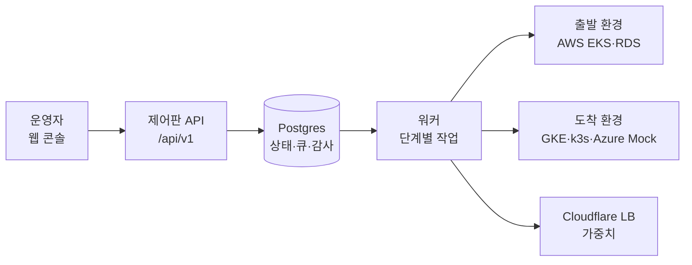
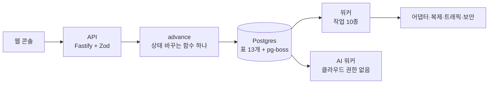
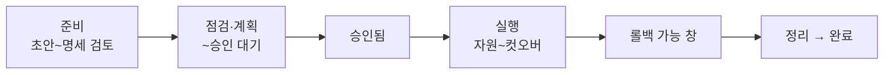
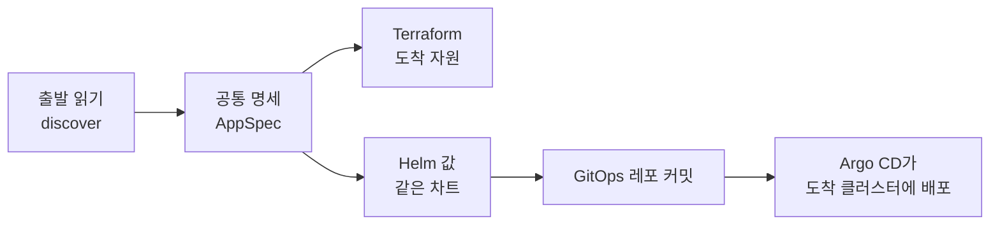
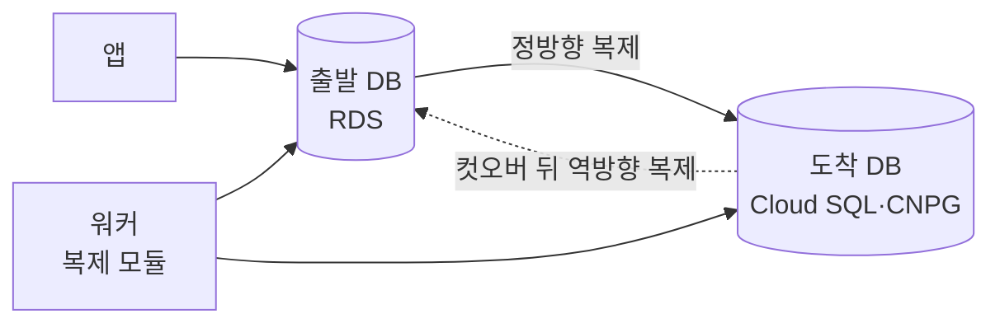
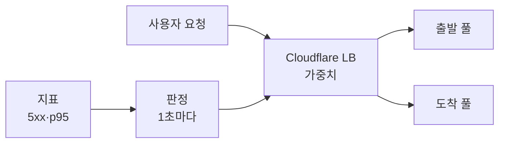
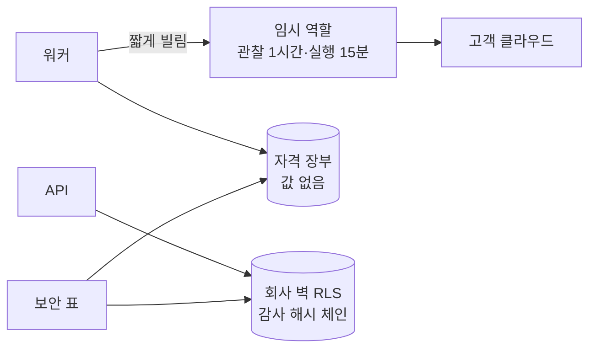
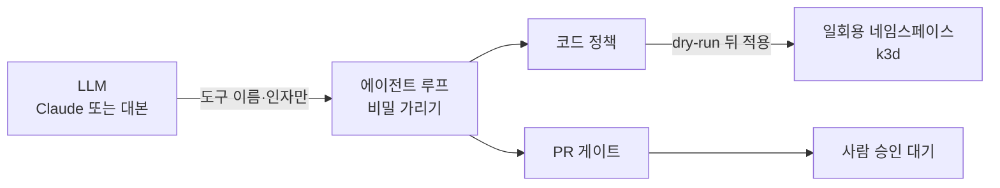

로드맵 위치: 본선 직전 / 결선 제출용 설계 문서 / 본선 연결점: 완성도·데모 30, 클라우드 활용 30, 독창성 10, AI 10, 팀 개발 20

# 운영 중인 앱을 클라우드 사이로 옮기는 제어판: 설계 문서

> 문서 상태: AI 초안 · 2026-10-31 · 기준 코드: 통합본 int5 1차(10/31 17:36 UTC 판). 코드와 한 줄씩 대조했고, 숫자는 이 판을 클라우드 사본(Postgres 16, Node 22)에서 직접 돌려 다시 쟀다. 보안 표는 통합됨. AI 점검의 실제 LLM·k3d 경로와 실패 처리 보강 수정본은 시험을 통과했지만 아직 통합 전이라 그렇게 표시했다. 팀 검토 전. · 18:15 UTC 통합 2차 문서 묶음: 검증 명령 smoke 줄에 `TRAFFIC_OBSERVE_SEC=0.5` · 18:20 UTC 2차 묶음: 9-3 보안 표 미구현 2건 구현 판 숫자(16·5·1·0·2)

표시 규칙. 【사실】은 코드를 읽거나 돌려서 확인한 것이다. 【추정】은 근거는 있지만 재지 않은 것이다. 【미확인】은 아직 모르는 것이다. 【미구현】은 설계에는 있지만 코드가 아직 흉내(STUB)만 내거나 없는 것이다. 숫자는 측정 조건을 같이 적는다.

---

## 1. 한 장 그림

이 시스템은 이전 한 건을 "사람 승인 → 자원 생성 → 앱 배포 → DB 복제 → 트래픽 이동 → DB 컷오버 → 정리" 순서로 끌고 간다.



- 사람은 웹 콘솔에서 버튼 4번을 누른다. 만들기, 명세 확정, 승인, 실행 시작이다. 비상 버튼(롤백, 취소)이 따로 있다.
- 상태, 작업 큐, 감사 기록이 모두 같은 Postgres 하나에 있다. 그래서 프로세스가 죽어도 "어디까지 했는지"가 DB에 남는다.
- 워커는 출발 환경과 도착 환경에 손을 대고, 사용자의 요청이 어느 쪽으로 갈지는 Cloudflare 부하 분산기(LB)의 가중치로 바꾼다.

---

## 2. 문제와 해법

### 2-1. 문제

- 회사는 이미 돌고 있는 3티어 앱(웹, API, 관리형 DB)을 다른 클라우드로 옮기고 싶다. 비용, 규제, 한 벤더 의존을 줄이려는 이유다.
- 옮기는 동안 서비스가 멈추면 안 된다. 잘못되면 바로 되돌릴 수 있어야 한다.
- 누가 무엇을 승인했고 어떤 권한으로 무엇을 바꿨는지 나중에 증명할 수 있어야 한다.
- 클라우드마다 이름과 API가 다르다. 사람이 클라우드마다 다른 절차를 외우면 실수가 난다.

### 2-2. 해법 한 줄

**앱은 같은 Helm 차트로 도착 클러스터에 다시 배포하고, DB는 논리 복제로 따라잡게 한 뒤, 트래픽을 단계적으로 옮기고 쓰기 담당을 바꾼다. 이 모든 단계를 승인·감사·롤백이 붙은 상태 기계 하나로 감싼다.**

- 이전 방식은 리플랫폼이다. 앱은 다시 배포하고, DB는 복제(CDC)로 옮긴다. 관리형 DB(RDS)를 다른 벤더(Cloud SQL, CloudNativePG)로 옮기는 길은 복제뿐이라서다. 디스크 통째 복사는 같은 벤더 안에서만 된다.
- 출발은 AWS(EKS + RDS)다. 도착은 GCP(GKE + Cloud SQL), 온프레(k3s + CloudNativePG), Azure(모양만 맞춘 Mock)다. 리전은 모두 서울이다.

### 2-3. 숫자로 본 지금 상태

| 무엇 | 값 | 조건 |
|---|---|---|
| 이전 한 건 끝까지 | 8.0 / 8.2 / 8.3초 (3회) | 【사실】 int5 smoke, 클라우드 작업은 대부분 STUB. 트래픽 판정 간격이 20ms라 "100%에서 30초 관찰"이 실제로는 0.6초다(5-2 참고) |
| 컷오버 쓰기 멈춤 | 중앙값 41ms (39~46ms, 5회) | 【사실】 같은 호스트 Postgres 16 두 대, 쓰기 8개 계속, 쓰기 4,338건 중 실패 0 |
| 롤백 쓰기 멈춤 | 중앙값 44ms (41~52ms, 5회) | 【사실】 같은 조건, 역방향 복제를 미리 만들어 둠 |
| 자동 롤백 판정 | 5xx > 1% 또는 p95 > 출발 × 2 | 【사실】 팀 결정. `packages/traffic/src/rule.ts` 기본값 |
| 비용 비교 | AWS 월 $233.3, GCP 월 $146.9 | 【추정】 GCP 단가가 샘플값이고 GKE 무료 크레딧 $73이 들어 있다. 10 rps 고정 |
| 시험 | 단위 226 통과·0 실패, DB 시험 122/122 | 【사실】 int5, 클라우드 사본. 맥 재검증은 【미확인】 |

---

## 3. 심사 항목 대응표

| 배점 | 심사 문구의 핵심 | 이 문서에서 다루는 곳 | 데모에서 보이는 것 |
|---|---|---|---|
| 완성도·데모 30 | 실제로 동작, 이전과 보안 상태를 그 자리에서 | 4장 제어판, 5장 상태 기계, 7장 DB 컷오버, 9장 보안 표, 12장 장애 복구 | 웹 콘솔 진행 막대, 컷오버 멈춤 ms, 보안 표 요약 칩 |
| 클라우드 활용 30 | 여러 환경을 묶는 관리면 추상화, 무중단·롤백·권한 | 6장 멀티클라우드, 7장 복제, 8장 트래픽, 9장 권한, 11장 비용, 13장 운영 | 같은 차트로 세 클러스터, Cloudflare 가중치, 임시 역할 장부 |
| 독창성 10 | 대응 환경의 폭, UX | 6장 네 환경, 9장 "미구현을 숨기지 않는 보안 표", 11장 손익 분기 | Azure Mock 카드, 비용 비교 화면 |
| AI 10 | 에이전트가 샌드박스에서 점검·코드 변경 | 10장 AI 점검 샌드박스 | 고장 난 매니페스트를 AI가 고치고 게이트 통과 (통합본에서는 대본 LLM + 메모리 샌드박스) |
| 팀 개발 20 | 대안·논의 과정·고찰과 함께 문서화 | 각 장 "정한 것과 버린 대안", 14장 진짜·흉내 구분 | 결정 기록, 코드 안 DECISION·TODO 표시 |

---

## 4. 제어판 구조

### 4-1. 부품



| 부품 | 하는 일 | 지금 |
|---|---|---|
| 웹 콘솔 | 목록, 진행 막대, 계획서, 승인, 비상 버튼(롤백·취소), 비용 비교, 보안 표 | 【사실】 동작 |
| API | 사람 요청을 받아 상태를 한 칸 옮기고 다음 작업을 넣는다 | 【사실】 업무 경로 17개, 문서 경로 4개(HTML 표, YAML, JSON, Swagger UI), 점검 경로 2개(`/healthz`, `/readyz`) |
| `advance()` | 상태를 바꾸는 유일한 함수. API와 워커 모두 이것만 부른다 | 【사실】 `packages/core/src/advance.ts` |
| Postgres | 상태, 큐(pg-boss), 감사, 잠금, 장부 | 【사실】 업무 표 13개 (회사 번호가 붙은 표 12개 + `tenants`) |
| 워커 | 큐 작업 처리, 잠금 청소 | 【사실】 작업 10종 + 예약 청소 2종(잠금 1분마다, 멱등 키 1시간마다) + 임시 자격 청소 1종(프로세스 안) |
| AI 워커 | AI 분석 작업만 처리한다. 클라우드 실행 권한이 없다 | 【사실】 |

### 4-2. `advance()`가 한 트랜잭션에서 하는 일

1. 이전 행을 잠그고(`FOR UPDATE`) 지금 상태가 기대한 상태인지 본다.
2. 갈 수 있는 길인지(`VALID` 표), 지금 가도 되는지(조건 검사)를 본다. 막히면 409 `GUARD_FAILED`다.
3. 승인 때 출발·도착 환경 잠금을 예약한다. 끝 상태, 낡음(승인 뒤 시작 못 함), 자원 생성 이하에서의 실패일 때 푼다.
4. 상태와 버전 번호를 고친다.
5. 다음 큐 작업을 넣는다. 같은 키 작업은 하나만 들어간다.
6. 감사 기록을 한 줄 쓴다. 각 줄은 앞 줄의 해시를 품는다.

- 같은 작업이 두 번 와도 "아직 그 상태면" 조건(`ifStill`) 때문에 한 번만 반영된다.

### 4-3. 워커 작업 하나의 모양

워커 작업은 짧은 구간 셋이다. ① 트랜잭션 안에서 DB 상태를 다시 읽는다(큐 내용은 믿지 않는다). ② 트랜잭션 밖에서 오래 걸리는 일(Terraform, 복제, 가중치 변경)을 한다. ③ 잰 값(증거)을 들고 `advance()`를 한 번 부른다. 오래 걸리는 일을 밖에 두어 DB 잠금을 짧게 유지하고, 증거는 감사에 남아 왜 넘어갔는지 나중에 볼 수 있다.

### 4-4. 정한 것과 버린 대안

| 정한 것 | 버린 대안 | 이유 |
|---|---|---|
| 상태 기계를 직접 만들고 `advance()` 하나로 | Step Functions, Temporal | 상태 변경·작업 예약·감사를 한 트랜잭션에 묶는다. 외부 오케스트레이터는 "상태는 바뀌었는데 작업이 없다"가 생길 수 있고, 서버가 하나 더 는다 |
| 큐를 같은 Postgres(pg-boss)에 | Redis, SQS | 작업 넣기가 상태 변경과 같은 트랜잭션이다. 조건 검사에 막히면 상태와 큐가 둘 다 그대로임을 DB 시험으로 확인한다(`packages/core/test/advance.db.test.ts` "조건 실패"). SQS는 AWS에 묶인다 |
| API 접두어 `/api/v1`, 점검 경로는 루트 | 접두어 없음 | 버전을 올릴 때 경로를 나란히 둘 수 있다 |

---

## 5. 상태 기계 (22상태)

### 5-1. 한눈에

이전 한 건은 정상 경로 15칸을 지난다. 나머지 7개는 사고 처리용이다.



| 항목 | 수 | 근거 |
|---|---|---|
| 상태 | 22 | 【사실】 `MIGRATION_STATUSES` (`packages/contracts/src/migration.ts`) |
| 갈 수 있는 길 | 53 | 【사실】 `VALID` 표 |
| 조건이 붙은 길 | 22 + 일시 정지 규칙 2 | 【사실】 `packages/core/src/guards.ts` |
| 끝 상태 | 3 (완료, 롤백 완료, 취소) | 【사실】 `TERMINAL` |
| 사람이 누르는 칸 | 4 (만들기, 명세 확정, 승인, 실행 시작) + 비상 버튼 2 (롤백, 취소) | 【사실】 |

### 5-2. 정상 경로 15칸

| 순서 | 상태 | 화면 이름 | 누가 옮기나 | 넘어가는 조건 (요약) |
|---|---|---|---|---|
| 1 | draft | 초안 | 사람: 만들기 | 출발·도착 환경 둘 다 연결됨 |
| 2 | importing | 가져오기 | 워커 | 명세가 저장됨 |
| 3 | spec_review | 명세 검토 | **사람: 명세 확정** | 검토 필요 칸 0개 |
| 4 | prechecking | 사전 점검 | 워커 | 막는 점검 결과 0개 (1개 이상이면 명세 검토로) |
| 5 | planning | 계획 | 워커 | 계획서가 있고 만료 전 |
| 6 | awaiting_approval | 승인 대기 | **사람: 승인** | 화면이 본 계획 지문 = 저장된 지문 |
| 7 | approved | 승인됨 | **사람: 실행 시작** | 두 환경 잠금을 쥐고 있음 |
| 8 | provisioning | 자원 생성 | 워커 | Terraform apply 성공 (워커 경로는 STUB) |
| 9 | deploying | 앱 배포 | 워커 | Argo CD 정상 + 보안 동등성 (두 증거 모두 STUB 상수) |
| 10 | syncing | DB 복제 | 워커 | 초기 복사 끝 + 마커 왕복 500ms 이하 |
| 11 | shifting | 트래픽 이동 | 워커 | 가중치 100% + 100%에서 정상 판정 30번 + 도착 로그 수신 |
| 12 | cutover | DB 컷오버 | 워커 | 컷오버 C1~C6 성공 |
| 13 | rollback_window | 롤백 가능 창 | 워커(창 끝에 깨어남) | 창이 끝남 + 정리 승인 |
| 14 | cleanup | 정리 | 워커 | 임시 자원 0개 + 실행 역할 회수 |
| 15 | completed | 완료 | 끝 | |

- 11번의 "30초 관찰"은 정상 판정 30번을 1초씩으로 센 값이다. 판정 간격은 Prometheus 주소가 있으면 1초, 없으면 20ms다. 그래서 STUB smoke에서는 실제로 약 0.6초만 관찰한다. 【미구현】 "도착 로그 수신"은 판정에 도착 표본이 있었는지로 대신한다.

### 5-3. 사고 처리 7개

| 상태 | 화면 이름 | 언제 들어오나 | 어디로 나가나 |
|---|---|---|---|
| rejected | 거절 | 승인 대기에서 사람이 거절 | 명세 검토, 계획, 취소 |
| stale | 계획 낡음 | 계획 만료(2시간) 또는 환경이 바뀜, 승인 뒤 잠금 기한이 지남 | 계획, 취소 |
| paused | 일시 정지 | 워커가 죽어 잠금 기한이 지남, Argo 배포 실패, 전환 전 LB 설정 점검 실패 | 멈추기 전 상태(규칙이 풀렸을 때만), 롤백 |
| failed | 실패 | 자원 생성 실패, 컷오버 되돌림 3번 실패 등 | 계획(자원 생성 이하에서 실패했을 때만), 취소(수동 정리 확인 뒤) |
| rolling_back | 롤백 중 | 사람이 롤백, 트래픽 지표 나쁨, 복제 2번 실패 | 롤백 완료, 실패 |
| rolled_back | 롤백 완료 | 출발 가중치 100% + 출발 정상 확인 | 끝 |
| cancelled | 취소 | 승인 전까지 사람이 취소, 또는 실패 뒤 수동 정리를 확인하고 취소 | 끝 |

- 롤백 가능 창이 끝나면 롤백도 닫힌다. 창은 "되돌릴 수 있다고 약속한 기간"이다. 서버도 409로 거부한다.
- 창 길이는 환경변수 하나(`ROLLBACK_WINDOW_SEC`)로 정한다. 코드 기본값은 3초(`DEFAULT_ROLLBACK_WINDOW_SEC`)이고, 롤백 장면을 보여 줄 때만 20초로 늘린다.

### 5-4. 정한 것과 버린 대안

| 정한 것 | 버린 대안 | 이유 |
|---|---|---|
| 조건 검사는 워커가 잰 "증거"를 받아 판단하고 감사에 남긴다 | 조건에 필요한 사실을 전부 표로 만든 뒤 검사 | 조건 모양을 먼저 고정할 수 있다. 흉내를 진짜로 바꿀 때 조건 코드는 그대로 두고 증거를 만드는 쪽만 바꾼다 |
| 복제 → 트래픽 이동 조건 = 초기 복사 끝 + 마커 왕복 500ms 이하 | 슬롯 지연 0바이트 + 행 수 일치 | 쓰기 부하 중에는 0바이트·행 수 일치가 나오지 않는다. 행 수 정확 비교는 쓰기를 막은 컷오버 C3에서 한다 |
| 본인이 만든 계획을 본인이 승인해도 된다. 대신 `self_approved`로 기록 | 두 사람 승인 | 해커톤 팀 규모에서 데모 흐름이 끊긴다. 감사에서 보이게 해 두었다 |

---

## 6. 멀티클라우드 이동 흐름

### 6-1. 흐름



- 어댑터가 클라우드마다 다른 것을 같은 모양으로 맞춘다. 출발을 읽어(discover) 공통 명세(AppSpec)로 바꾸고(normalize), 도착용 Terraform과 Helm 값을 만든다.
- 앱 배포는 EKS, GKE, k3s 모두 **같은 Helm 차트**다. 다른 것은 값 몇 칸(DB 주소, 서비스 계정, 노드 크기)뿐이다.
- 계획 단계에서 Terraform과 Helm 값의 지문(hash)을 계산해 계획서에 넣는다. 배포 직전에 값 지문이 다르면 멈춘다.

### 6-2. 네 환경

| 환경 | 컴퓨트 | DB | 인프라 코드 | 지금 |
|---|---|---|---|---|
| AWS (출발) | EKS | RDS Postgres | `infra/modules/aws` (env + app) | 【사실: 맥 실행】 plan 25자원, apply 1회 성공(EKS 8분 13초). kubectl 접속은 만든 계정 권한 설정 때문에 실패해 수정 중. 시간당 약 $0.27은 【추정】 |
| GCP (도착) | GKE | Cloud SQL | `infra/modules/gcp` (env + app) | 【사실: 맥 실행】 plan 14자원, apply 1회 성공(GKE 6분 9초), 노드 2개 Ready. 시간당 약 $0.2는 【추정】 |
| 온프레 (도착) | k3s (노트북에서는 k3d) | CloudNativePG, `wal_level=logical` | `infra/modules/onprem` + `deploy/onprem-demo/scripts` 00~05 | 【사실: 맥 실행】 00~04 통과. 이 환경으로의 실제 이전 실측은 【미확인】 |
| Azure (모양만) | Mock 실행기 | Mock | `infra/modules/azure` (app) | 【사실】 호출당 300ms 지연, 클라우드 호출 없음. 화면에 Mock이라고 표시 |

- 어댑터 계약은 함수 7개다(`packages/contracts/src/adapter.ts`). 기능 표, discover, normalize, 필요한 실행 권한 목록, toTerraform, toHelmValues, 이미지 주소.
- 출발 읽기(discover)는 지금 데모 원본을 돌려준다. 【미구현】 실계정 조회.
- 실클러스터 위에서 이전 1건을 끝까지 돌린 기록은 아직 없다. 【미확인】

### 6-3. 정한 것과 버린 대안

| 정한 것 | 버린 대안 | 이유 |
|---|---|---|
| AWS 컴퓨트 = EKS | ECS | ECS는 같은 Helm 차트를 못 쓴다. 세 클러스터가 같은 차트를 쓰면 배포 경로가 하나다 |
| GitOps(레포 커밋 → Argo CD) | 워커가 `helm upgrade`를 직접 | 클러스터에 무엇이 들어가 있는지 레포가 기록한다. 워커가 고객 클러스터 관리자 권한을 오래 들 필요가 없다 |
| Azure는 Mock | Azure 실계정 | 결선 전에 세 번째 클라우드의 계정·권한·비용 확인까지 검증할 수 없다. 모양(어댑터·Terraform 모듈·화면)을 맞춰 두어 실행기만 바꾸면 되게 했다 |

---

## 7. DB 논리 복제, 컷오버, 롤백

### 7-1. 그림



- 복제 모듈은 **접속 문자열만** 받는다. RDS, Cloud SQL, CloudNativePG, 로컬 Postgres 모두 같은 SQL(publication / subscription)로 다룬다. 클라우드 API는 부르지 않는다.
- 쓰기 담당이 어디인지는 DB 안에 남은 구독 위치로 판단한다. 워커가 죽었다 다시 떠도 같은 함수를 다시 부르면 이어서 한다.

### 7-2. 단계

| 단계 | 하는 일 |
|---|---|
| 복제 시작 | 복제 가능 점검(파라미터, 권한, 기본키) → 정방향 복제 만들기 → 초기 복사 |
| 따라잡기 판정 | 초기 복사 끝 + 마커 한 줄의 왕복 시간 500ms 이하 |
| C1 붙잡기 | 앱의 DB 연결을 잠깐 붙잡는다. 진행 중인 요청은 끝까지, 새 요청은 기다린다. 【미구현】 지금은 빈 함수라 C2에서 끊긴 앱 세션이 그대로 오류를 받는다 |
| C2 출발 울타리 | 앱 계정의 쓰기 권한을 회수(REVOKE)하고 남은 앱 세션을 끊는다 |
| C3 마지막 따라잡기 | 출발에 마커 한 줄을 쓰고 도착에 보일 때까지 기다린다. 이어서 표별 행 수가 정확히 같은지 본다 |
| C4 시퀀스 | 논리 복제가 옮기지 않는 시퀀스 값을 도착에서 최댓값 + 1000으로 올린다 |
| C5 방향 바꾸기 | 정방향 구독을 지우고, 도착에 역방향 발행과 슬롯을 **앱을 풀기 전에** 만든다 |
| C6 풀기 | 도착 울타리를 걷고 앱을 도착으로 풀어 준다. 옛 출발에 역방향 구독을 붙인다 |
| C6' 되돌림 | C3에서 시간 초과나 행 수 불일치가 나면 출발 울타리를 걷고 출발 그대로 다시 연다. 3번 실패하면 실패 상태로 보내 사람이 정한다 |

- 롤백은 같은 함수를 방향만 바꿔 부른다. 컷오버 중에 역방향 복제를 만들어 두기 때문에 롤백할 때 출발이 최신이다.
- 컷오버 전 롤백은 정방향 복제만 걷는다. 출발이 처음부터 쓰기 담당이라 데이터 손실이 없다.
- 복제가 2번 실패하면 자동으로 롤백한다. "일시 정지로 사람이 결정"은 버렸다. 잠금을 쥔 채 멈춰 같은 환경의 다음 이전이 막히기 때문이다. 통합 대기 중인 수정본은 5·15·45초 간격으로 3번 다시 한 뒤 롤백한다.
- 【사실】 알려진 구멍: C2~C4 사이에서 시간 초과가 아닌 예외(연결 끊김 등)가 나면 출발이 읽기 전용으로 남는다. C5 전이면 울타리를 걷고 실패로 보내는 수정본이 시험(복제 통합 시험 4개)을 통과했고 통합 대기다.

### 7-3. 측정

| 무엇 | 값 | 조건 |
|---|---|---|
| 컷오버 쓰기 멈춤 | 중앙값 41ms (39~46ms, 5회), 쓰기 4,338건 중 실패 0 | 【사실】 같은 호스트 Postgres 16 두 대, 쓰기 8개 계속 |
| 롤백 쓰기 멈춤 | 중앙값 44ms (41~52ms, 5회) | 【사실】 같은 조건 |
| C6' 되돌림 | 316ms (제한 300ms + 되돌림), 실패 0 | 【사실】 구독을 일부러 멈춤 |
| 정리 뒤 남은 복제 객체 | 0 | 【사실】 슬롯·발행·구독 양쪽 |
| 맥에서 실제 복제를 켠 smoke 안의 멈춤 | 81ms | 【사실】 조건이 달라 위 숫자와 섞지 않는다 |
| 클라우드 사이(RDS → Cloud SQL) | 【미확인】 | 【추정】 네트워크 왕복만큼 C3·C5가 길어진다 |

### 7-4. 정한 것과 버린 대안

| 정한 것 | 버린 대안 | 이유 |
|---|---|---|
| 논리 복제 | 물리 복제, pg_dump, AWS DMS | 물리 복제는 같은 벤더 파일 형식이 필요하고 관리형 DB가 막는다. pg_dump는 쓰기를 멈춰야 한다. DMS는 AWS에 묶이고 역방향을 따로 만들어야 한다 |
| C2 울타리 = 쓰기 권한 회수 + 세션 종료 | `read_only` 설정만 | 세션 단위로 우회할 수 있다. 권한 회수는 우회가 안 된다. `read_only`는 보조로 같이 건다 |
| C3 판정 = 마커 왕복 | LSN 비교 | 관리형 DB마다 LSN 읽기 권한이 다르다. 마커는 앱 계정 권한으로도 된다 |

---

## 8. 트래픽 전환 (Cloudflare LB 가중치)

### 8-1. 흐름



- 도착 비율을 10% → 50% → 100%로 올린다. 단계마다 도착과 출발의 5xx 비율과 p95 지연을 1초마다 본다. 10%·50%에서는 정상 판정 3번, 100%에서는 30번을 채워야 다음으로 간다.
- **5xx > 1% 또는 p95 > 출발 × 2가 이어지면 자동으로 출발 100%로 되돌린다.** 이 기준은 팀 결정이다.
- 가중치를 바꾼 뒤에는 다시 읽어서 정말 바뀌었는지 확인한다. 최대 3번 시도한다(사이 대기 0.5초, 1초). 롤백 증거를 거짓으로 남기지 않으려는 것이다.
- 전환 전에 LB 설정을 점검한다. 프록시가 켜져 있는지, 쿠키 고정이 꺼져 있는지, 예비 풀(fallback)이 출발인지 본다. 맞지 않으면 가중치를 건드리지 않고 일시 정지한다.

### 8-2. 오탐을 줄이는 보호 장치

| 장치 | 값 | 이유 |
|---|---|---|
| 표본 하한 | 도착 요청 100개 미만이면 판정 보류 | 요청 3개 중 1개 실패를 33%로 읽지 않게 |
| 5xx 개수 하한 | 3개 이상 | 같은 이유 |
| 출발 대비 | 도착 5xx 비율이 출발의 3배 넘을 때만 | 출발도 똑같이 나쁘면 도착 탓이 아니다 |
| 연속 판정 | 2번 연속 | 한 번 튄 값으로 되돌리지 않게 |
| 지름길 | 도착 5xx 20개 이상이고 50% 넘으면 바로 | 도착이 통째로 죽으면 기다리지 않는다 |

- 【사실, 설계 단계 PoC】 로컬 프록시 실험에서 전환 중 실패 0 / 27,005건, 100% 도달 41.8초, 장애 → 복귀 중앙값 4.0초, 보호 장치를 넣자 오탐 7.6% → 1.1%였다. 이 숫자는 지금 코드가 아니라 설계 검증용 PoC에서 잰 것이다.
- 【사실】 워커 안에서 나쁜 지표 → 롤백 중 0.42초, → 롤백 완료 0.32~0.42초(3회, 로컬 메모리 LB).

### 8-3. 지금

- 【사실】 Cloudflare, GCP 부하 분산기, AWS ALB 전환기가 코드로 있다(`packages/traffic/src/providers`). 기본은 Cloudflare다. 환경변수가 없으면 메모리 LB와 가짜 지표로 돈다.
- 【사실】 지표는 Prometheus 주소(`PROM_URL`)가 있으면 진짜로 읽는다. 실패 흉내(`err`, `slow`, `down`)로 롤백 장면을 재현할 수 있다.
- 【사실】 Cloudflare 계정 점검 명령(dry-run)은 맥에서 통과했다. 실제 계정으로 가중치를 바꾼 기록은 【미확인】이다.
- 【사실】 알려진 구멍 두 가지. Prometheus 조회가 한 번 예외를 내면 전환이 멈추고 가중치가 10~50%에 남는다. 사람 롤백이 가중치 변경 사이에 끼면 끝 가중치가 도착 쪽에 남을 수 있다. 둘 다 고친 수정본이 시험을 통과했고 통합 대기다.

### 8-4. 정한 것과 버린 대안

| 정한 것 | 버린 대안 | 이유 |
|---|---|---|
| Cloudflare LB 가중치 하나로 전환 | DNS 가중치, 클라우드별 LB | DNS는 TTL 때문에 초 단위 전환·롤백이 안 보인다. 진입점이 하나면 클라우드가 달라도 같은 방법이다 |
| 나쁜 지표면 전환 작업 안에서 바로 되돌림 | 롤백 작업이 큐를 거쳐 되돌림 | 큐를 한 번 거치는 동안 나쁜 도착으로 요청이 계속 간다 |
| 일시 정지 뒤 재개는 멈춘 비율부터 | 10%부터 다시 | 이미 검증한 비율을 다시 내릴 이유가 없다. 【미구현】 전환 함수는 시작 비율(`resumeFromPct`)을 받지만, 워커가 아직 넘기지 않고 재개 API도 없다 |

---

## 9. 보안과 권한

### 9-1. 그림



### 9-2. 다섯 가지 장치

| 장치 | 하는 일 | 지금 |
|---|---|---|
| 임시 역할 | 고객 키를 받지 않는다. 고객 계정에 역할을 만들게 하고 짧게 빌린다. 관찰 역할은 최대 1시간, 실행 역할은 15분(900초)이고 이전 한 건에 묶는다 | 【사실】 규칙·장부·발급 요청 모양은 진짜. 【미구현】 워커에는 Mock 발급기만 연결돼 있고, 이전 작업 단계가 아직 역할을 빌리지 않는다(이전 한 건의 장부가 비어 있다) |
| 최소 권한 검사 | 발급 전에 순수 함수로 검사한다. 와일드카드 거부, 관찰 역할에 쓰기 동작 거부, 천장 목록 밖 동작 거부. AWS는 단계별 세션 정책으로 더 좁힌다 | 【사실】 권한 파일 11개(`infra/permissions`), AWS 실행 역할 천장 동작 40개 중 와일드카드 0개. 다만 `Resource "*"` 쓰기 동작 19개가 리전 조건만 있다 |
| 회사 벽 | 회사 번호가 붙은 표 12개에 RLS를 켜고 표 주인에게도 강제(FORCE)한다. 트랜잭션마다 회사 번호를 설정한다. `tenants` 표는 RLS만 켠다 | 【사실】 다른 회사 줄 읽기·쓰기·고치기·지우기 시험 14개 모두 막힘(`packages/core/test/rls.db.test.ts`) |
| 감사 해시 체인 | 앱 계정은 감사 표에 넣기·읽기만 된다. 각 줄이 앞 줄의 해시를 품어 중간을 고치면 드러난다 | 【사실】 1만 줄 검증 42.9ms. 증적 리포트(json·md·html)가 체인을 처음부터 다시 검증한다 |
| 계획 지문 | 승인을 계획서 전체의 지문에 묶는다. 화면이 본 지문과 다르면 409, 실행 직전에 워커가 다시 대조한다 | 【사실】 |

- 자격 증명은 워커 메모리 보관함에만 두고 밖으로는 참조만 넘긴다. 장부 표에는 값 칸이 없다.
- 15분을 넘는 작업은 10분에 실행 역할을 다시 받고, 실패하면 일시 정지하기로 정했다. 【미구현】

### 9-3. 보안 표 (6영역)

보안 표는 새로 재는 장치가 아니다. 이미 있는 장부, 권한 파일, 차트, DB 권한을 그 자리에서 읽어 줄마다 판정한다(`GET /api/v1/migrations/:id/security`). 확인할 재료가 없으면 그 줄은 "미구현"으로 나온다. 재료 없이 "지켜짐"을 표시하지 않는다.

| 영역 | 무엇을 보나 |
|---|---|
| 임시 자격 | 장부 건수와 활성·회수 수, 실행 역할 수명 900초 이하, 끝난 뒤 전부 회수. 작업 단계(precheck·plan·apply·cleanup)가 역할을 빌리고 돌려준 기록(발급 5·회수 5, 발급기는 Mock)【사실, int5 2차 예정】 |
| 최소 권한 | AWS 와일드카드·권한 경계 조건·`Resource "*"` 쓰기 수·세션 정책 크기, GCP 커스텀 역할, 온프레 ClusterRole |
| 감사 기록 | 체인 해시 재계산, 이 이전의 감사 줄 수, 앱 계정이 감사를 못 고치는지 |
| 비밀값 | 감사·명세·계획서에 비밀값 모양 0건, 장부에 값 칸 없음, 차트가 비밀번호를 Secret 참조로만 받는지, 복제 접속 문자열의 비밀번호 유무 |
| 런타임 | 도착 Pod의 securityContext, 서비스 계정 토큰 자동 마운트 |
| 통제 매트릭스 | 보안 통제 12개 × 출발·도착. 레포 파일(Terraform·권한·차트)과 감사 체인을 읽어 칸마다 통과·위반·모름. 근거 없는 칸(MFA, 활성 위협, CVE)은 "모름"【사실, int5 2차 예정】 |

- 【사실】 AWS → GCP 이전 24줄 (int5, 클라우드 사본):

| 시점 | 지켜짐 | 약점 | 위반 | 미구현 | 해당 없음 |
|---|---|---|---|---|---|
| 이전을 만든 직후(명세 검토) | 13 | 5 | 0 | 2 | 4 |
| 이전이 끝난 뒤(완료) | 14 | 5 | 0 | 2 | 3 |
| 이전이 끝난 뒤(완료), 보안 표 미구현 2건 구현 판 | **16** | 5 | **1** | **0** | 2 |

- 【사실, int5 2차 예정】 마지막 줄이 2차 통합본 값이다(STUB, 3회 같음). 1차 판 두 줄은 비교용으로 남긴다.
- 응답 0.017~0.026초(완료된 이전, 5회). 2차 판은 0.016~0.035초(매트릭스 24칸이 붙어 응답 5.2KB → 15.4KB).
- 약점 5개는 화면에 그대로 나온다. 태그·이름 조건 없는 `Resource "*"` 쓰기 19개, AWS ExternalId 없음, 개발용 헤더 인증, 차트에 securityContext 없음, 서비스 계정 토큰 자동 마운트.
- 1차 판의 미구현 2개(통제 매트릭스, 작업 단계의 임시 역할 빌리기 기록)는 2차 판에서 0개가 된다.
- 위반 1건은 통제 12개 매트릭스(CT-MATRIX)다. 새 문제가 아니라 원래 있던 약점이 매트릭스로 보이게 된 것이다: 차트 설정(서비스 계정 토큰 자동 마운트, runAsNonRoot 없음), EKS 감사 로그 꺼짐, EKS·GKE API 공개 주소에 허용 대역 없음.
- 【사실】 권한 파일에 경계 조건을 더하자 "위반"이 "지켜짐"으로 바뀌었다. 표가 파일을 진짜로 읽는다는 증거다.

### 9-4. 가장 큰 구멍

- **로그인이다.** 지금은 회사 번호를 개발용 헤더로 받아 믿는다. 그래서 운영 이미지는 기본으로 이 인증을 끈다(`NODE_ENV=production`이면 업무 경로가 모두 401). 예외는 API 문서 경로(`/api/v1/docs` 아래)로, 회사 데이터가 없어 운영에서도 열려 있다. `DOCS_PUBLIC=false`로 닫는다.
- 계획은 GitHub OAuth + 세션 + 회사 소속 재확인이다. 인증 플러그인 파일 하나(`apps/api/src/plugins/auth.ts`)만 바뀌게 만들어 두었다. 【미구현】

### 9-5. 정한 것과 버린 대안

| 정한 것 | 버린 대안 | 이유 |
|---|---|---|
| 임시 역할 빌리기 | 고객 장기 키 보관 | 새어도 실행 역할은 최대 15분 뒤 만료된다. 키 보관·폐기 절차가 사라진다 |
| 없는 칸은 "미구현"으로 표에 넣는다 | 있는 칸만 보여 주기 | "통제 매트릭스는?"이라고 물으면 화면에 이미 답이 있어야 한다. 빼면 숨긴 것처럼 보인다 |
| 전체 지표는 합계만 돌려주는 함수 하나 | 앱 계정에 RLS 우회 권한 | 앱 계정이 회사 벽을 넘지 않는다 |

---

## 10. AI 점검 샌드박스

### 10-1. 그림 (통합 전 사본 기준)



### 10-2. AI가 하는 일 두 가지

| 일 | 무엇 | 지금 |
|---|---|---|
| 명세 초안 | 가져오기 결과에서 "검토 필요" 칸만 AI가 채운다. 이미지·환경변수·비밀 참조·진입점 칸은 손대지 못하게 막는다 | 【사실】 실제 모델 호출. 키가 없으면 같은 모양의 Mock. 【사실: 맥 실행】 실제 Claude로 3번 중 3번 성공, 한 번에 약 16초, 약 $0.055 |
| 점검·수정 | "계속 재시작하는 앱"을 샌드박스에서 보고, 매니페스트를 고쳐 적용해 본 뒤, 고친 것을 PR 후보로 넘긴다 | 【사실】 통합본은 대본 LLM + 메모리 샌드박스(정책 흉내) + 줄 단위 게이트 4개. 실제 Claude + k3d 경로는 통합 전 사본이고 가짜 kube API로만 시험했다. 진짜 k3d·진짜 Claude 실행은 【미확인】 |

- 기본 모델은 claude-sonnet-5-5다. 환경변수(`AGENT_MODEL`)로 claude-opus-5-5로 바꾼다.
- 【사실】 알려진 구멍: 통합본에서는 AI 초안 판이 저장되면 명세 확정이 409로 막힌다. 초안 판을 빼고 보게 고친 수정본이 시험을 통과했고 통합 대기다. 초안을 받아들이는 API는 아직 없다.

### 10-3. 실행 한 건의 흐름 (통합 전 사본)

1. 노드 이름이 샌드박스 클러스터 접두어로 시작하는지 본다. 아니면 아무것도 만들지 않는다(운영 클러스터 오접속 방지).
2. 일회용 네임스페이스를 만든다. PSS restricted, 자원 상한(파드 6, 메모리 합 2Gi), 밖으로 나가는 망 차단을 건다.
3. 고장 난 매니페스트를 그대로 적용해 문제를 재현한다. 여기서 쓰인 이미지만 이후에 쓸 수 있다.
4. LLM은 도구 이름과 인자만 낸다. 도구는 7개(객체 읽기, 로그, 적용, 레포 읽기, 수정, 검사, 끝)이고, 적용은 코드 정책 → 서버 dry-run → 진짜 적용 3단이다.
5. 검사 도구가 재시작 증가를 센 뒤, 성공이든 실패든 네임스페이스를 지운다. PR은 게이트를 통과한 제안만 플랫폼이 만든다.

### 10-4. 막는 것 (통합 전 사본)

| 위협 | 막는 곳 |
|---|---|
| 로그 글 안에 닫는 태그를 넣어 지시를 끼워 넣기 | 도구 결과의 `<`를 모두 바꿔 경계를 못 벗어나게 한다 |
| 평문 비밀이 LLM으로 | 로그·오류·매니페스트·객체에서 비밀을 가린다. Deployment 환경변수는 이름만 넘긴다 |
| 평문 비밀이 매니페스트·PR로 | 수정 도구, 적용 정책, PR 게이트 세 곳에서 거부 |
| 다른 네임스페이스, 금지 종류, 권한 상승, hostPath, 처음 보는 이미지 | 코드 정책(클러스터에 보내기 전) |
| 코드 정책을 통과한 위반 | 클러스터 PSS restricted가 dry-run에서 거부 |

- 방어 코드를 빼면 해당 시험이 실패하는 것까지 확인했다(`<` 바꾸기 → 3개 실패, 비밀 가리기 → 1개 실패).
- 에이전트는 클라우드 자격 증명을 모른다. AI 워커에는 클라우드 실행 권한이 없다. 이 두 가지는 통합본에서도 같다.
- 【사실】 아직 못 막는 것: 네임스페이스 격리라 커널은 같다. 다음 단계는 vCluster + gVisor다. 【미구현】

### 10-5. 정한 것과 버린 대안

| 정한 것 | 버린 대안 | 이유 |
|---|---|---|
| 적용을 코드 정책 → dry-run → 진짜 적용 3단으로 | dry-run만, 진짜 적용만 | dry-run만으로는 "재시작 0"을 확인 못 한다. 진짜 적용만이면 반쯤 적용된 상태가 남는다 |
| 샌드박스 클러스터를 운영과 따로 둠 | 온프레 클러스터 안 네임스페이스 | 에이전트 도구가 운영 클러스터 API에 닿는다 |
| 키가 없으면 같은 모양의 Mock | 키 없으면 실패 | 리허설과 CI가 키 없이 돈다 |

---

## 11. 비용 추정

### 11-1. 계산

같은 공통 명세(AppSpec)를 환경별 가격표에 대입해 월 비용을 낸다. 요청 처리 중에는 네트워크를 쓰지 않고, 미리 받아 둔 가격 캐시(`packages/cost/prices/*.json`)만 읽는다.

```text
필요 vCPU = max(0.5 + 0.01 × rps, 복제 수 × 요청 CPU)
노드 수 = max(2, 올림(vCPU / (노드 vCPU × 0.6)),
              올림(메모리 / (노드 메모리 × 0.6)))
월 비용 = 클러스터 × 730 − 크레딧
        + 노드 수 × 단가 × 730 + DB + 스토리지
```

- 노드 종류는 가격표에 있는 만큼 전부 계산해 가장 싼 조합을 고른다.
- 트래픽이 얼마일 때 어느 쪽이 싸지는지(손익 분기 rps)도 낸다.
- 네트워크 전송료는 넣지 않는다. 화면에도 그렇게 적는다.

### 11-2. 결과

| 환경 | 월 비용 | 근거 |
|---|---|---|
| AWS | $233.3 | 【사실】 AWS 공개 가격표(Bulk CSV, 10/31 16:37 UTC 받음) 캐시 |
| GCP | $146.9 (크레딧 빼기 전 $219.9) | 【추정】 가격 API로 받지 않은 샘플 단가(`origin: seed`) |
| 온프레 | $250 | 【추정】 고정 가정치 |
| Azure Mock | $146 | 【추정】 샘플 단가 |

- 조건: 10 rps, AWS는 t3.medium 2대 + EKS + RDS 상당, GCP는 e2-medium 2대.
- 출발 → 도착(AWS → GCP) 절약 월 $86.4는 【추정】이다. 그중 $73은 GKE 무료 크레딧이다. 실제 GCP 단가를 받으면 바뀐다.
- 화면의 "최저" 표시는 전체 환경 중 가장 싼 쪽에 붙어서 지금은 Azure Mock($146, 샘플 단가)에 붙는다.
- 【사실】 비용 계산이 고른 GCP 노드(e2-medium)와 Terraform 모듈 기본 노드(e2-standard-2)가 다르다. 실제로 만드는 클러스터 비용은 이 표보다 높다. 【추정】
- 응답 30~47ms(5회, 클라우드 사본). 이전 상세 화면의 비용 비교 칸에 나온다.
- 【미구현】 계획서에 비용이 붙지 않는다. 결과를 담을 표(`cost_estimates`)와 읽는 경로는 있지만 쓰는 코드가 없어서, 화면은 매번 지금 계산한 미리보기(`origin: preview`)를 보여 준다.

### 11-3. 정한 것과 버린 대안

| 정한 것 | 버린 대안 | 이유 |
|---|---|---|
| 가격은 하루 한 번 받아 캐시, 요청 중에는 캐시만 | 요청마다 가격 API | 가격 API가 느리거나 죽어도 화면이 돈다. 7일 넘으면 "오래됨" 경고 |
| 가격 줄마다 출처와 증거 수준(사실·미확인·가정·Mock) | 숫자만 | 어느 숫자를 믿을 수 있는지 화면과 문서가 같이 밝힌다 |

---

## 12. 장애 복구

### 12-1. 원리

- 환경 잠금을 쥔 워커는 30초마다 기한을 90초로 늘린다. 죽으면 늘리는 쪽이 없어 기한이 지난다.
- 청소 작업이 1분마다 기한 지난 잠금을 찾아 이전을 일시 정지나 실패로 옮긴다. 다른 워커가 몰래 이어받지 않는다. 이어서 할지는 사람이 정한다.

### 12-2. 일부러 낸 장애와 결과

| 장애 | 결과 | 숫자 |
|---|---|---|
| 워커가 일하다 강제 종료(SIGKILL) | 잠금 기한 뒤 청소가 일시 정지로. 사람이 롤백하면 빠져나온다. 상태가 두 번 넘어간 적 0번 | 【사실】 죽음 → 일시 정지 147초(잠금 90초 + 청소 주기), 롤백 → 완료 0.44~0.53초 |
| 같은 작업이 두 워커에 동시에 + 한 번 더 | 단계마다 상태 이동 정확히 1번 | 【사실】 7단계 × 3배달 0.6초 |
| 정상 종료(SIGTERM) | 하던 작업을 끝내고 잠금을 반납한 뒤 종료 | 【사실】 2.5초 |
| DB 연결이 서버 쪽에서 끊김 | 프로세스 안 죽음. 다음 요청이 새 연결로 | 【사실】 다음 호출 10~17ms |
| Postgres를 5·20·75초 멈췄다 켬 | API·워커 모두 생존, 이전 완료 | 【사실】 켜진 뒤 readyz 8~11ms 안에 회복 |
| 같은 멱등 키 요청 10개 동시 | 1번 처리, 9번 같은 응답 재생 | 【사실】 중앙값 27.8ms |

- 상태를 바꾸는 POST 6개(만들기, 명세 확정, 승인, 실행 시작, 롤백, 취소) 모두 `Idempotency-Key`를 받는다. 키 저장이 상태 변경과 같은 트랜잭션이다. 헤더가 없으면 키 없이 처리한다.

### 12-3. 남은 빈 곳

- 【미구현】 일시 정지에서 재개하는 API가 없다. 지금은 롤백·취소로만 빠져나온다.
- 【사실】 일부 실패 길에서 잠금 해제 사유가 엉뚱한 이름(`WORKER_LOST`)으로 남는다. 고칠 목록에 있다.
- 【사실】 재시도를 다 쓴 작업은 작업만 실패로 남고 이전은 그 상태에 머문다. 마지막 시도가 실패하면 이전을 실패나 일시 정지로 옮기는 수정본이 시험을 통과했고 통합 대기다.

### 12-4. 정한 것과 버린 대안

| 정한 것 | 버린 대안 | 이유 |
|---|---|---|
| 살아 있음 판단은 잠금 기한 한 곳 | 별도 하트비트 표 | 판단 기준이 둘이면 어긋난다 |
| 워커가 죽으면 자동으로 이어받지 않고 멈춤 | 다른 워커가 재시도 | 반쯤 만든 자원 위에서 다시 돌면 무엇이 됐는지 모른다. 사람이 롤백이나 재개를 고른다(재개는 【미구현】) |

---

## 13. 운영 (관측, CI, 이미지)

### 13-1. 관측

- 지표는 Prometheus 형식으로 별도 포트(API 9464, 워커 9465)에 낸다. 공개 터널로 나가지 않게 업무 포트와 나눴다.
- 주요 지표: 상태 이동 수, 상태에 머문 시간, 컷오버 멈춤, 큐 대기, 작업 시간, 잠금 수, HTTP 요청 수·지연.
- 이전 한 건의 타임라인(`GET /api/v1/migrations/:id/timeline`)과 증적 리포트(`GET /api/v1/migrations/:id/report`)를 API로 준다.
- 【사실: 맥 실행】 Prometheus + Grafana 묶음(`docker-compose.observability.yml`)을 맥에서 띄웠다.
- 【사실】 /metrics 수집 5.4~11.8ms(5회). 관측을 켜도 smoke 시간은 같다(8.10~8.26초 vs 8.15초).

### 13-2. CI와 이미지

- CI는 다섯 단계다. 타입 검사·단위 시험·웹 빌드 → DB 마이그레이션·DB 시험·smoke → helm lint·template·kubeconform → 이미지 빌드와 비루트 실행 확인 → 이미지 올리기(`.github/workflows/ci.yml`, `build.yml`).
- 이미지는 태그 대신 다이제스트로 GitOps 값에 넣는다. 같은 태그로 다른 이미지가 들어가는 일을 막는다.
- 서버 앱 3개는 한 파일로 묶어 Node 22 alpine에 넣는다. 우리 층 9~15MB, 소스만 바꾼 빌드 1.8~2.0초다.
- 운영 이미지는 기본 `NODE_ENV=production`이라 개발용 헤더 인증이 꺼진다. API는 SIGTERM에 정상 종료한다(10.2초 강제 종료 → 0.2초).

### 13-3. DB 마이그레이션과 API 문서

- 마이그레이션은 0001~0012, 앞으로만 간다. 실행기가 적용 기록(sha256)을 남기고 파일마다 트랜잭션을 건다. 동시에 두 번 돌려도 advisory lock으로 하나씩만 넣는다. 상태 칸에는 22개 값만 받는 검사(CHECK)를 걸었다.
- 감사 체인 머리 찾기를 인덱스로 203ms → 0.04ms로 줄였다(감사 39만 줄, 5회).
- API 문서는 네 경로다. `GET /api/v1/docs`(경로 표 HTML), `/docs/openapi.yaml`, `/docs/openapi.json`, `/docs/ui`(Swagger UI, 외부 CDN 없음).
- 업무 경로 17개 모두 OpenAPI 문서에 있다. 응답 모양은 3개가 경로 파일의 Zod, 12개가 생성기의 보충 표에서 오고, 2개(타임라인, 환경 상태)는 아직 응답 모양이 없다. `tools/openapi/conform.mjs`가 실제 응답을 이 문서로 검사한다.
- 【사실】 알려진 구멍: 운영 이미지로 띄우면 Swagger UI가 404다(클라우드 사본에서 재현, 수정 중). 개발 모드에서는 열린다.

---

## 14. 지금 진짜인 것과 흉내인 것

| 진짜로 도는 것 【사실】 | 흉내(STUB)이거나 없는 것 【미구현】 |
|---|---|
| 상태 기계, 조건 검사, 환경 잠금, 감사 체인, 회사 벽 | 워커의 Terraform apply (맥에서 사람이 직접 돌린 apply는 성공. Azure는 Mock 실행기) |
| 계획 지문, 멱등 키, 롤백·취소 API·버튼, 증적 리포트 | Argo CD 상태 읽기, 보안 동등성 증거 (GitOps 커밋은 설정 시 진짜) |
| DB 복제 모듈과 롤백 역전환 (복제 주소를 주면) | 컷오버 C1 앱 연결 붙잡기, 출발 읽기(discover)의 실계정 조회 |
| 트래픽 판정 규칙, Cloudflare·Prometheus 연결 코드 | Cloudflare 실계정 가중치 변경 기록, 도착 로그 수신, 재개 API |
| 임시 역할 규칙·장부·최소 권한 검사 | 실제 STS·WIF 발급, 작업 단계의 역할 빌리기 |
| 비용 계산, AWS 가격 캐시, 통제 매트릭스(레포 파일 판정) | GCP 실가격, 비용 결과 저장, 실제 클라우드 보안 스캔(Prowler·GuardDuty·SCC) |
| 명세 초안 AI, 보안 표 | 점검·수정의 실제 Claude + k3d 경로(통합 전), vCluster + gVisor 격리, 로그인 |

- 【사실】 int5 코드 표시 수: STUB 97, TODO(human) 55, DRAFT(ai) 175, DECISION(team) 8. 세는 법: 코드 파일(.ts .tsx .mjs .sql .sh .tf .yaml .yml)의 줄 수, `test`·`tests`·`e2e` 폴더와 node_modules 제외. 통합할 때마다 바뀐다.
- 조건 검사 자체는 진짜로 돈다. STUB은 "워커가 넘기는 증거 값이 상수"라는 뜻이다. 진짜로 바꿀 때 조건 코드는 그대로 두고 증거를 만드는 쪽만 바꾼다.

---

## 핵심 결정 3개 (+대안)

1. **상태·큐·감사를 같은 Postgres 한 트랜잭션에 묶는다.** 대안: Temporal 같은 외부 오케스트레이터 + Redis 큐. 버린 이유: "상태는 바뀌었는데 작업이 없다"가 생길 수 있고 움직이는 부품이 늘어난다. 측정: smoke 8.0~8.3초(3회), 같은 작업 3번 배달에도 상태 이동 1번.
2. **DB는 논리 복제로 옮기고, 컷오버 중에 역방향 복제를 미리 만든다.** 대안: pg_dump, AWS DMS. 버린 이유: 쓰기 멈춤이 길거나 한 벤더에 묶이고, 롤백 길을 따로 만들어야 한다. 측정: 컷오버 41ms, 롤백 44ms(각 5회 중앙값), 쓰기 실패 0.
3. **보이지 않는 것을 보이게 한다: 보안 표의 미구현, 비용의 추정 표시, 화면의 Mock 표시.** 대안: 초록불만 보여 주기. 버린 이유: 심사와 운영 모두 "믿을 수 있는 숫자인가"를 묻는다. 측정: 보안 표 24줄 중 완료된 이전 기준 지켜짐 16 · 약점 5 · 위반 1 · 미구현 0 · 해당 없음 2【사실, int5 2차 예정】. 미구현을 채우자 숨어 있던 위반 1건이 드러났다.

## 셀프 연습 1개

1. `packages/core/src/guards.ts`에서 `"shifting>cutover"` 조건의 `>= 30`을 `>= 60`으로 바꾼다.
2. 워커를 다시 켜고 `npm run smoke`를 돌린다.
3. 기대: 약 60초(smoke 제한 시간) 뒤 `stopped at shifting`으로 끝나고, 워커 로그에 `shifting -> cutover: observe >= 30s at 100%`가 찍힌다(오류 문장은 숫자를 안 바꿨으니 30 그대로). 전환 함수가 100%에서 정상 판정을 30번(`OBSERVE_AFTER_100`)만 채우기 때문이다.
4. 원래대로 되돌린다. 그리고 한 줄로 적는다: 관찰 횟수(`packages/traffic/src/controller.ts`), 조건(`guards.ts`), 계획서의 `holdSec: 30`이 세 곳에 따로 있어도 되나?

## 검증 명령과 기대 출력

서비스 폴더에서 아래를 차례로 돌린다. `smoke`는 API와 워커를 켠 뒤에 돌린다.

```bash
npm run typecheck
npm test
npm run test:db
npm run smoke
```

- `typecheck`: 오류 줄 없음.
- `npm test`: `# pass 226` `# fail 0` (int5, 클라우드 사본).
- `test:db`: `# tests 122` `# pass 122`. GitOps 환경변수는 스크립트가 스스로 끈다.
- `smoke`: 마지막 줄 `completed after 8xxx ms` 근처. 100%에서 실제로 30초를 관찰하는 수정이 통합되면 이 값이 약 37초로 늘어난다. 그 판에서 8초대로 보려면 워커 `.env`에 `TRAFFIC_OBSERVE_SEC=0.5`를 넣는다(감사에 `observeCompressed: true`가 남는다).

상태·길 수와 표시 수를 다시 세려면:

```bash
grep -c '"[a-z_]*>[a-z_]*":' packages/core/src/guards.ts
grep -rF 'STUB' --include=*.ts --include=*.tsx --include=*.mjs --include=*.sql --include=*.sh --include=*.tf --include=*.yaml --include=*.yml . --exclude-dir=node_modules --exclude-dir=test --exclude-dir=tests --exclude-dir=e2e | wc -l
```

- 기대: 첫 줄 `22` (조건이 붙은 길 수), 둘째 줄 `97`.
