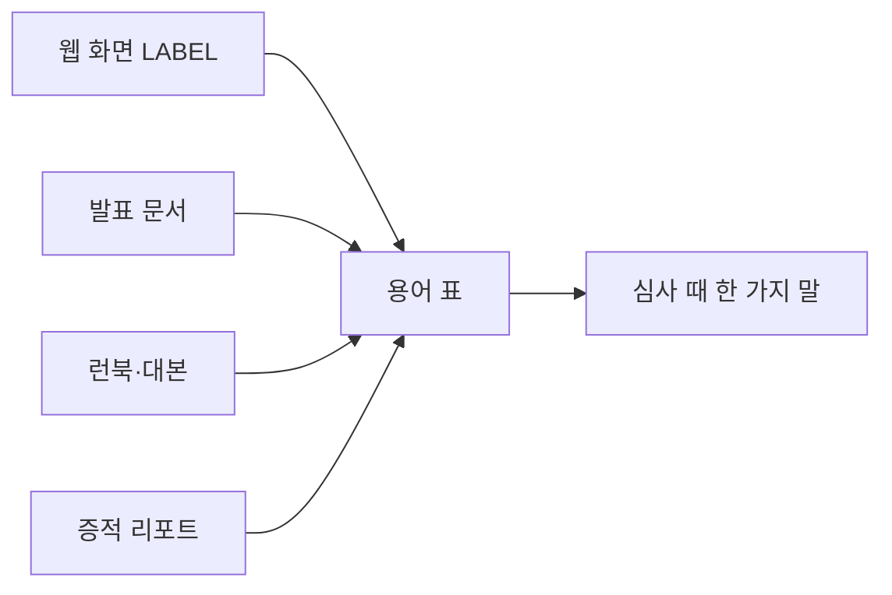

로드맵 위치: 결선 준비 / 웹·문서 용어 통일 / 본선 연결점: 완성도·데모 30(화면과 말이 같은 말을 쓴다) · 팀 개발 20

# 용어 표: 화면과 문서가 같은 말을 쓰게

> 문서 상태: AI 초안(DRAFT) · 2026-10-31 17:05 UTC 작성 · 17:45 UTC Z33 갱신: 2절 "지금 웹" 열을 통합본 값으로, 검사 조건 22개(Z29 패치 반영), 롤백 가능 창 3초/20초, 비용 표시 【추정】, 대체 규칙·녹화본 말 추가 · 기준 코드: 통합본 `service-current.tgz`(17:27 UTC 판) · 팀 검토 전

이 표는 웹 화면, 발표 설계 문서, 런북, 퀵스타트, 리허설 대본, 증적 리포트가 같은 말을 쓰도록 정한 기준이다. "한국어 확정" 열이 기준이다. 아직 팀이 정하지 않았으므로 확정은 DRAFT(ai)다. 불일치 목록과 고칠 곳은 같은 폴더의 `CHANGES.md`에 있다.

표시: 【사실】 코드나 문서에서 직접 확인 / 【추정】 제안 / 【미확인】 아직 못 확인.

---

## 1. 이 표를 왜 만들었나

이 표는 어디가 같은 말을 써야 하는지 보여 준다.



- 심사위원은 화면을 보면서 발표자의 말을 듣는다. 화면에 "되돌리는 중"이 뜨는데 발표자가 "롤백"이라고 하면, 둘이 같은 것인지 다시 생각해야 한다.
- 통역(한·일)이 붙으면 더 그렇다. 같은 것을 두 이름으로 부르면 통역도 두 번 옮긴다.
- 그래서 상태 이름은 웹 화면의 `LABEL` 표 하나를 기준으로 삼고, 문서가 그 이름을 따른다.

> **용어**
>
> | 용어 | 쉬운 뜻 |
> |---|---|
> | `LABEL` | 웹 코드 `apps/web/src/status.ts`에 있는 "영어 상태 → 한국어 이름" 표 |
> | DRAFT(ai) | AI가 고른 기본값. 팀이 확인하면 바꿀 수 있다 |

---

## 2. 상태 22개의 한국어 이름

【사실】 상태 22개, 길 53개, 끝난 상태 3개는 `packages/contracts/src/migration.ts`의 `VALID` 표와 맞다. 검사 조건은 int3부터 22개다(`packages/core/src/guards.ts`의 `GUARDS` 표, 직접 셌다). 22번째는 Z1이 더한 `rollback_window>rolling_back`(롤백 가능 창이 끝나면 롤백 금지)다.

| 영어(코드) | 한국어 확정 | 지금 웹 | 다른 곳에서 쓰는 말 | 쓰이는 곳 |
|---|---|---|---|---|
| `draft` | 초안 | 초안 | - | 웹, state-machine.md |
| `importing` | 가져오기 | 가져오기 | - | 웹, W, 리포트 |
| `spec_review` | 명세 검토 | 명세 검토 | - | 웹, W, Z7 |
| `prechecking` | 사전 점검 | 사전 점검 | - | 웹, Z7 |
| `planning` | 계획 | 계획 | - | 웹 |
| `awaiting_approval` | 승인 대기 | 승인 대기 | - | 웹, W |
| `approved` | 승인됨 | 승인됨 | - | 웹 |
| `provisioning` | 자원 생성 | 자원 생성 | - | 웹, 계획서 단계 |
| `deploying` | 앱 배포 | 앱 배포 | - | 웹, 계획서 단계 |
| `syncing` | DB 복제 | DB 복제 | - | 웹, W, Z7, Z8 |
| `shifting` | **트래픽 이동** | 트래픽 이동 | "전환"(Z7 3절 표) | 웹, 계획서 단계, state-machine.md, W |
| `cutover` | DB 컷오버 | DB 컷오버 | "컷오버"(줄임 허용) | 웹, 모든 문서 |
| `rollback_window` | 롤백 가능 창 | 롤백 가능 창 | - | 웹, W, Z8 |
| `cleanup` | 정리 | 정리 | - | 웹 |
| `completed` | 완료 | 완료 | 리포트는 `completed` 영어 | 웹, 리포트 |
| `paused` | **일시 정지** | 일시 정지 | "일시정지"(state-machine.md 그림) | 웹, state-machine.md |
| `rolling_back` | **롤백 중** | 롤백 중 | "롤백 중"(state-machine.md 그림) | 웹, state-machine.md |
| `rolled_back` | **롤백 완료** | 롤백 완료 | "롤백 끝"(그림), "되돌리기 끝"(표) | 웹, state-machine.md |
| `failed` | 실패 | 실패 | - | 웹 |
| `cancelled` | 취소 | 취소 | - | 웹, Z8 |
| `rejected` | 거절 | 거절 | - | 웹 |
| `stale` | 계획 낡음 | 계획 낡음 | - | 웹 |

굵은 글씨 4개만 바꾼다. 웹 쪽 변경은 `z16-web-terms.patch` 한 개다. 【사실】 int4부터 웹에 들어가 있다(`apps/web/src/status.ts` 9줄 `paused: "일시 정지", rolling_back: "롤백 중", rolled_back: "롤백 완료"`). 그래서 "지금 웹" 열과 "한국어 확정" 열이 이제 같다.

【추정】 고른 이유:
- **롤백 중 / 롤백 완료.** 문서 쪽은 "롤백"이 압도적이다(런북 15번, 발표 문서 8번, "되돌" 계열은 손에 꼽는다). state-machine.md 그림도 "롤백 중"이다. "끝" 대신 "완료"를 쓰면 `completed`(완료)와 짝이 맞는다.
- **일시 정지.** "멈춤"은 문서에서 "쓰기 멈춤 41ms"처럼 컷오버 수치에 이미 쓴다. 상태 이름까지 "멈춤"이면 "멈춤 41ms"가 상태인지 수치인지 헷갈린다.
- **트래픽 이동.** 코드(웹 `LABEL`, 계획서 단계 `PlanView`)와 계약 문서가 이미 이 말이다. "트래픽 전환"은 영역 이름(설계 가이드 9장 "트래픽 전환과 자동 롤백")으로만 남긴다.

> **용어**
>
> | 용어 | 쉬운 뜻 |
> |---|---|
> | 정상 경로 15칸 | 웹 진행 막대에 그리는 상태 15개. `draft`부터 `completed`까지 |
> | 끝난 상태 | 더 갈 곳이 없는 상태. 완료, 롤백 완료, 취소 셋 |

---

## 3. 자주 섞이는 말

| 영어 | 한국어 확정 | 쓰지 않을 말 | 메모 | 쓰이는 곳 |
|---|---|---|---|---|
| migration (이전 한 건) | 이전 | 마이그레이션 | "새 이전 만들기", "이전 번호" | 웹, 모든 문서 |
| DB schema migration | DB 스키마 마이그레이션 | 마이그레이션(혼자) | 표 만드는 SQL 파일 실행. 이전과 다른 것 | R 퀵스타트 |
| cutover | DB 컷오버 | 전환 | DB 쓰기 담당을 도착으로 바꾸는 순간 | 웹, 모든 문서 |
| traffic shifting (상태) | 트래픽 이동 | 전환(혼자) | 가중치 10 → 50 → 100% | 웹, 계획서 |
| traffic switch (영역) | 트래픽 전환 | - | 영역 이름. Cloudflare LB 가중치 기능 전체 | 설계 가이드 9장, Z7 그림 |
| rollback | 롤백 | 되돌리기(상태 이름으로) | 설명 문장에서 "되돌린다"는 괜찮다 | 웹, 모든 문서 |
| rollback window | 롤백 가능 창 | 되돌릴 수 있는 시간 | 운영 기본 3초. 데모·e2e 롤백 장면만 `ROLLBACK_WINDOW_SEC=20` | 웹, W, Z8 |
| rollback criteria | 롤백 기준 | - | 오류율 1% 초과 또는 p95 2배, 30초 동안 | 웹 계획서, W |
| write owner | 쓰기 담당 | 쓰기 주인 | DB에 쓰기를 받는 쪽 | 설계 가이드, Q, Z7 |
| write pause | 쓰기 멈춤 시간 | 멈춤(혼자) | 컷오버·롤백 때 쓰기가 막힌 ms | 모든 문서 |
| source / target | 출발 / 도착 | 소스·원본·대상·타깃 | 웹 버튼 "출발", "도착" | 웹, 모든 문서 |
| tenant | 회사 | 테넌트(처음 한 번만 괄호로) | 웹은 "회사 번호 (x-dev-tenant)" | 웹, Z7 |
| spec (common spec) | 공통 명세 / 명세 | 스펙 | 버튼 "명세 확정" | 웹, 모든 문서 |
| plan | 계획서 | 플랜 | 계획서 한 장에 단계 6줄 | 웹, W |
| planHash | 계획 지문(planHash) | 지문(혼자) | 승인할 때 보내는 sha256 64자 | 웹, Z7, W |
| audit hash chain | 감사 해시 체인 | 지문 | 감사 줄마다 앞 줄 hash를 이어 붙인 것 | Z7, Q 리포트 |
| report hash | 리포트 지문 | - | 리포트 전체의 sha256 | Q 리포트 |
| evidence report | 증적 리포트 | 보고서 | `GET .../report` | Q, Z7 |
| tamper-evident | 조작하면 드러나는 | 조작할 수 없는 | 해시 체인은 막지 못하고, 드러낸다 | Z7, Q |
| temporary role | 임시 역할 | - | 15분 빌리는 AWS 역할 같은 것 | Z7, Q |
| keyless temporary access | 키 없는 임시 권한 | - | 차별점 1의 이름. 안에 "임시 역할"이 들어 있다 | Z7, Q |
| state machine | 상태 기계 | 상태기계, 상태 머신 | 발표 문서 표기를 따른다 | Z7, Q, 설계 가이드, state-machine.md |
| guard | 검사 조건 | 가드 | 길마다 붙은 통과 조건. 22개(int3부터) | Z7 |
| guardrail | 가드레일 | - | 이상하면 이전을 일시 정지시키는 장치 | Z7 그림 |
| STUB | STUB(흉내 값) | 가짜 | 리포트·화면에도 그렇게 찍힌다. `demo.sh numbers`가 찍는 `stub(가짜)였나:` 글자는 화면 출력이라 문서 인용은 그대로 두고, 말로는 "흉내 값" | Z7, W, Z8 |
| fallback rule | 대체 규칙 | - | 막히면 한 단계씩 내려가는 시간. 5분판 15초, 8분판 30초 | Z8 5-1, Z24, Z28 |
| fallback recording | 녹화본·캡처 | 캡처(혼자) | 대체 단계 3. `play.sh <1·5·6·7>`로 띄운다 | Z8, Z27, Z28 |
| savings | 절약 | 아낌 | "월 $86.4 절약". 웹 비용 칸 "월 … 아낌"은 아직 남음(Z33 웹 패치 제안) | Z7, Q, W, Z2 웹 |
| control plane | 제어판 | 컨트롤 플레인 | API + 워커 + Postgres | Z7, Q |
| worker | 워커 | - | 상태를 한 칸씩 옮기는 프로세스 | 모든 곳 |
| on-prem | 온프레 | 온프레미스(혼자) | "온프레 k3s" | 웹, Z7 |

---

## 4. 숫자 기준값

문서마다 다른 숫자는 아래 값으로 맞춘다. 조건이 다른 측정은 조건을 같이 적는다.

| 무엇 | 기준값 | 조건 | 근거 | 지금 다른 값을 쓰는 곳 |
|---|---|---|---|---|
| AWS 월 비용 | $233.3 | 10 rps, t3.medium 2대 + EKS + RDS, 실제 가격 캐시 | 【사실】 V CHANGES 49줄 | W, Z8, Q, DEMO.md, slack-draft, cost README는 $227.5 |
| AWS → GCP 절약 | 월 $86.4 (크레딧 $73 빼면 $13.4) | 위와 같음 | 【추정, GCP 단가 57% 아이오와·크레딧 $73 포함】 계산식은 V CHANGES 53줄, Z2. 결선 전 `prices:fetch` 후 수치 갱신 | W, Z8, Q, DEMO.md는 $80.6 |
| GCP 월 비용 | $146.9 | 샘플 단가(`gcp.json` `origin: seed`). DB·저장($84.1, 57%)은 아이오와 단가 | 【추정, 샘플 단가】 Z28 4절, Z29 | 모두 같음 |
| 온프레 월 비용 | $250 | 고정 가정치 | 【추정】 | 모두 같음 |
| 컷오버 쓰기 멈춤 | 중앙값 41ms (39~46, 5회), 실패 0 / 4,338 | 쓰기 8개 계속, 같은 호스트 Postgres 두 대 | 【사실】 W 2-2(16:33~16:42 UTC) | Q는 62ms / 2,365건, DEMO.md는 47ms / 3,667건 |
| 롤백 쓰기 멈춤 | 중앙값 44ms (41~52, 5회) | 역방향 복제 미리 만듦 | 【사실】 W 2-2 | DEMO.md는 48ms |
| 화면 흐름 안 컷오버 | 27.5 / 45.3 / 28.8ms | 데모 데이터 2,100행 | 【사실】 W 7절 | 리포트 샘플은 STUB 850ms |
| 비용 계산 응답 | 18~31ms (5회) | `POST /api/v1/cost/estimate` | 【사실】 W 장면 3 | DEMO.md, slack-draft는 17~25ms |
| 화면 새로고침 | 워커 단계 0.7초, 사람 단계 1.5초, 끝나면 멈춤 | Y의 `POLL_MS` | 【사실】 Y `MigrationDetail.tsx` 20줄 | W, DEMO.md는 "1.5초마다" |
| 이전 한 건 기계 시간 | 8.3 / 8.6 / 8.5초 | API로 화면 흉내 | 【사실】 W 7절 | smoke(복제 끔) 7.9~8.2초는 조건이 다름 |
| 상태 / 길 / 검사 조건 | 22 / 53 / 22 | 코드 표 개수(int3부터) | 【사실】 직접 셈 | Z5 JUDGE-QA·SPEC-FROM-CODE는 21 |
| 정상 경로 칸 | 15칸 | 웹 진행 막대 | 【사실】 `status.ts` | 모두 같음 |
| 결정 수 | 49개 | 설계 가이드 v2.1 18장 | 【사실】 | 모두 같음 |
| 계획서 만료 | 2시간 | `PLAN_TTL_MS` | 【사실】 | 모두 같음 |
| 롤백 가능 창 | 운영 3초 / 데모·e2e 롤백 장면 20초 | env `ROLLBACK_WINDOW_SEC`, 기본값은 `packages/core/src/advance.ts` 한 곳(워커도 같은 값) | 【사실】 3초 한 곳(17:27 통합본, Z10 M3) / 20초는 DRAFT(ai) | Z33에서 Z8·Z24·Z28을 맞춤 |
| 대체 규칙 | 5분판 15초, 8분판 30초 | 한 장면이 안 고쳐질 때 | DRAFT(ai) 15초(Z28) | Z33에서 Z8·Z24·Z27을 맞춤 |
| 사람이 누르는 버튼 | 4번(만들기, 명세 확정, 승인, 실행 시작) | 웹 | 【사실】 | 모두 같음 |

【사실】 V가 합쳐진 int3부터 `POST /api/v1/cost/estimate`는 `loadCatalog()`로 $233.3 / $146.9 / 절약 $86.4를 낸다(Z28 4절에서 int4로 직접 돌림). $227.5 / $80.6이 나오면 가격 캐시를 안 읽은 옛 판이다.

【사실】 화면 "가격 기준" 날짜는 실제로 받은 가격 중 첫 시각(지금은 AWS)이다(`packages/cost/src/sources/cache.ts`). GCP가 샘플이어도 오늘 날짜가 찍힌다. 질문이 오면 "AWS는 받은 가격, GCP는 샘플 단가"라고 답한다.

---

## 핵심 결정 3개 (+대안)

| 결정 | 대안 | 고른 이유 |
|---|---|---|
| 상태 이름 기준은 웹 `LABEL` 하나. 문서가 따른다 | 문서마다 자유롭게 / state-machine.md 표를 기준 | 심사위원이 보는 것은 화면이다. 코드 한 곳만 고치면 화면이 바뀐다 |
| 롤백 계열은 "롤백"으로 통일(롤백 중, 롤백 완료, 롤백 방법) | "되돌리기"로 통일 | 문서 쪽 사용이 훨씬 많다. 일본어 통역도 "ロールバック" 그대로 옮긴다 【추정】 |
| 숫자 기준값은 가장 최근 측정(W 16:33~16:42 UTC, V 가격 캐시) | 처음 잰 H 단독 측정 62ms | 같은 통합본에서 다시 잰 값이다. 옛 값은 조건이 달라(도커, 쓰기 수) 바로 비교가 안 된다 |

## 셀프 연습 1개

- 웹 화면에서 `paused`가 뜨는 장면을 떠올리고, "일시 정지"와 "쓰기 멈춤 41ms"를 한 문장 안에 섞지 않고 30초 안에 설명해 본다.

## 검증 명령과 기대 출력

서비스 폴더에서 Z16 웹 패치를 넣은 뒤 돌린다.

```bash
grep -n 'rolling_back: ' apps/web/src/status.ts
grep -rn '되돌리기\|"멈춤"' apps/web/src
npm run typecheck
```

- 첫째: `paused: "일시 정지", rolling_back: "롤백 중", rolled_back: "롤백 완료"` 한 줄.
- 둘째: 출력 없음.
- 셋째: 오류 0.
