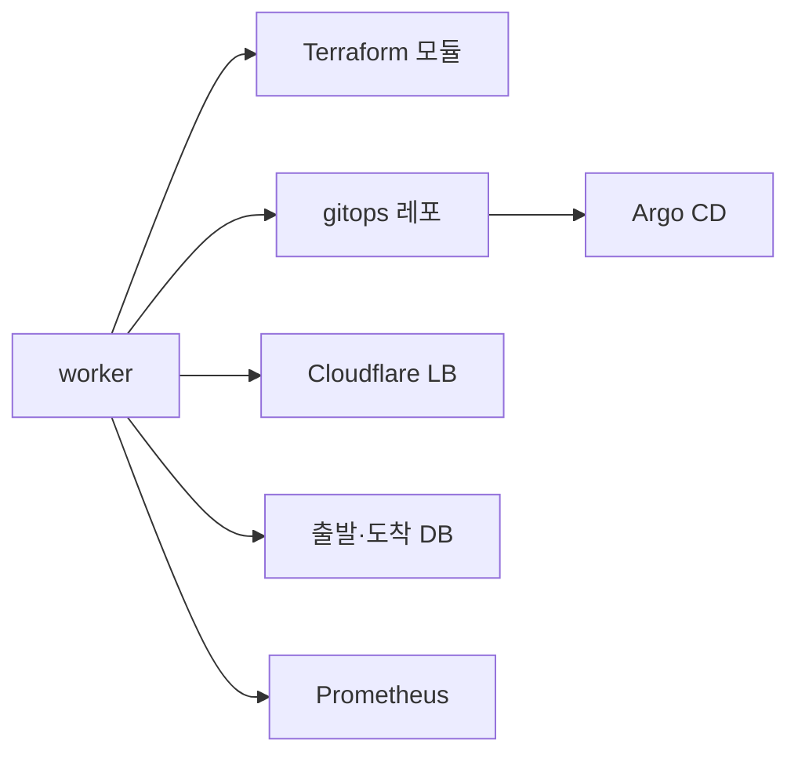

로드맵 위치: 본선 D-6 / 인프라 인터페이스 / 본선 연결점: 클라우드 활용 30, 팀 개발 20 (인프라와 코드가 같은 이름으로 맞물린다)

# 인프라 인터페이스: 코드와 인프라가 주고받는 값

상태: AI 초안

이 문서는 플랫폼 코드(api·worker)와 인프라(클라우드 계정, Terraform, gitops 레포, Argo CD, Cloudflare, DB)가 **무엇을 어떤 이름으로 주고받는지** 한곳에 모은 표다.
인프라를 맡은 사람은 이 표의 이름만 맞추면 코드를 안 읽어도 된다.
값(토큰, 비밀번호, 계정 번호)은 이 문서에 하나도 없다. 이름만 있다.

근거 코드는 Service 레포 main이다. 줄마다 근거 파일을 적었다.

## 0. 그림: 워커가 바깥과 닿는 곳

워커 하나가 다섯 군데에 닿는다. api는 DB만 본다.



- **Terraform 모듈**: 도착 환경에 DB·권한·네임스페이스를 만든다. 승인된 계획만.
- **gitops 레포**: 앱 배포 값을 커밋한다. Argo CD가 그걸 읽어 클러스터에 배포한다.
- **Cloudflare LB**: 출발·도착 사이 트래픽 가중치를 10→50→100%로 바꾼다.
- **출발·도착 DB**: 논리 복제(CDC)로 데이터를 따라가게 한 뒤 컷오버한다.
- **Prometheus**: 트래픽을 옮기는 동안 오류율·지연을 읽어 되돌릴지 정한다.

## 1. 포트

| 무엇 | 주소 | 정하는 곳 |
|---|---|---|
| Postgres (개발) | localhost:5432 | `docker-compose.yml` |
| API | localhost:3000 | `.env` `API_PORT`, 듣는 주소 `API_HOST`(기본 localhost) |
| API 지표 | localhost:9464/metrics | `.env` `METRICS_PORT` (0이면 끔) |
| 워커 지표 | localhost:9465/metrics | `.env` `WORKER_METRICS_PORT` |
| 웹 (개발) | localhost:5173 | `apps/web/vite.config.ts` |
| 웹 / API (이미지 모드) | 127.0.0.1:8080 / 127.0.0.1:3300 | `docker-compose.prod.yml` `WEB_HOST_PORT`, `API_HOST_PORT` |
| Prometheus / Grafana | 127.0.0.1:9090 / 127.0.0.1:3001 | `docker-compose.observability.yml` |
| DB 프록시 / 제어 | 6432 / 6480 | `DBPROXY_PORT`, `DBPROXY_CONTROL_PORT` (`packages/dbproxy`) |

- 이미지 모드와 관측 도구는 `127.0.0.1`에만 연다. 개발 헤더 인증이 켜진 API를 행사장 와이파이에 열지 않기 위해서다.

## 2. 이름 규칙: 회사·환경·앱

### 2-1. 시드 번호 (개발·시험용)

| 번호 | 무엇 | 넣는 곳 |
|---|---|---|
| `1111…` | 개발 회사 (smoke·e2e·리허설) | `db/migrations/0002` |
| `2222…` / `3333…` | 개발 회사의 AWS / GCP 환경 | `0002` |
| `4444…` | 개발 회사의 Azure Mock 환경 | `0008` |
| `5555…` | 개발 회사의 온프레(k3d) 환경 | `0016` |
| `6666…` | 실클라우드 회차 회사 | `0022` |
| `7777…` / `8888…` / `9999…` | 회차 회사의 온프레 / GCP / AWS 환경 | `0022` |

- 번호는 uuid 모양이다. 예: `11111111-1111-4111-8111-111111111111`.
- `0022`의 계정 칸은 자리표시 값이다. 실제 계정 번호는 회차 때 DB에서 바꾸고, 레포에는 넣지 않는다.

### 2-2. 이름을 만드는 규칙

| 이름 | 규칙 | 예 | 근거 |
|---|---|---|---|
| 회사 슬러그 | `t-` + 회사 uuid의 `-` 뺀 앞 8글자 | `t-11111111` | `apps/worker/src/gitops/bundle.ts` `tenantSlug` |
| 앱 네임스페이스 | `app-<앱>` | `app-shop` | `bundle.ts` `APP_NS_PREFIX`, Terraform `k8s_namespace` |
| 대상 클러스터 | `<슬러그>-<env 폴더>` (온프레는 없음) | `t-11111111-aws-eks` | `bundle.ts` `clusterName` |
| Argo 앱 이름 | `<슬러그>-<앱>-<env 폴더>` | `t-11111111-shop-gcp-gke` | `bundle.ts` `argoAppName` |
| env 폴더 | aws→`aws-eks`, gcp→`gcp-gke`, onprem→`onprem-k3s`, azure_mock→`azure-mock` | | `bundle.ts` `ENV_DIR` |
| Terraform 작업 폴더 | `TF_WORK_DIR`(기본 `~/.svc-tf`) `/<슬러그>/<이전 id>/` | | `packages/adapters/src/terraform/real-runner.ts` |
| GCP SA·시크릿 | `app-` 로 시작 (IAM 조건이 이 접두어로 막음) | | `packages/adapters/src/gcp/index.ts` |

- 회사 경계는 DB에서 `tenant_id` + RLS로, 클러스터에서는 회사 전용 클러스터 이름으로 나눈다.

## 3. 환경변수

`.env.example`에 이름과 설명이 다 있다. 여기서는 인프라와 닿는 것만 묶었다.
"없으면" 칸의 코드는 이전이 `paused` 또는 `failed`로 멈출 때 화면에 뜨는 실패 코드다.

### 3-1. 기본 (항상)

| 이름 | 용도 | 필수 |
|---|---|---|
| `DATABASE_URL` | 앱 DB 계정 (RLS 적용) | 예 |
| `OWNER_DATABASE_URL` | 표 구조를 바꾸는 계정. 앱은 안 씀 | 마이그레이션·시험 |
| `API_PORT`, `METRICS_PORT`, `WORKER_METRICS_PORT`, `LOG_LEVEL` | 포트·로그 | 기본값 있음 |
| `JWT_SECRET` | 로그인 토큰 서명 | 운영 예, 개발은 비우면 매번 새로 |
| `AWS_PROFILE` | 내 `~/.aws` 프로필 이름 | AWS 쓸 때 |
| `GCP_PROJECT` | GCP 프로젝트 | GCP 쓸 때 |

### 3-2. 도착 자원 (Terraform)

| 이름 | 용도 | 없으면 |
|---|---|---|
| `TF_BIN` | terraform 실행 파일 경로 | PATH에서 찾음. 없으면 `TF_BIN_MISSING` |
| `TF_WORK_DIR` | state·출력 작업 폴더 | `~/.svc-tf` |
| `TF_APPLY_TIMEOUT_SEC`, `TF_LOCK_TIMEOUT_SEC` | apply·잠금 기다리는 시간 | 기본값 |
| `TF_DESTROY_ON_FAIL` | 1 이면 apply 실패 즉시 destroy | 기본 0 (실패 질문 → 거절·롤백 때 target-destroy) |
| `TF_FACT_<키>` | env 모듈 출력·계정 사실. `<env:vpcId>` → `TF_FACT_VPC_ID` | 그 자리표시가 안 채워짐 |
| `DB_DISPOSABLE` | `1`이면 DB 삭제 보호·마지막 스냅샷을 끔 (그날 파기하는 데모 DB만) | 삭제 보호가 켜져 destroy가 막힘 |
| `ONPREM_KUBE_CONTEXT`, `ONPREM_REGISTRY_HOST` | 온프레 kubectl 컨텍스트·레지스트리 | 온프레 읽기·배포 실패 |
| `IMPORT_AWS_EKS_CLUSTER`, `IMPORT_AWS_DB_ID`, `IMPORT_GCP_GKE_CLUSTER`, `IMPORT_GCP_SQL_INSTANCE`, `IMPORT_APP`, `IMPORT_NAMESPACE` | 출발 환경에 후보가 여럿일 때 고르는 이름 | 하나뿐이면 자동 |

### 3-3. GitOps·Argo CD

| 이름 | 용도 | 없으면 |
|---|---|---|
| `GITOPS_REPO_URL` | gitops 레포 주소 (워커가 clone) | `GITOPS_REPO_DIR`도 없으면 `GITOPS_NOT_CONFIGURED` |
| `GITOPS_REPO_DIR` | 로컬 작업 복사본 | 임시 폴더 `platform-gitops` |
| `GITOPS_WRITE_TOKEN` | 워커 커밋·push 토큰 | push 실패 |
| `GITOPS_READ_TOKEN` | Argo CD 몫. 워커는 안 씀 | |
| `GITOPS_BRANCH` | 브랜치 | `main` |
| `GITOPS_PUSH` | `1`일 때만 원격 push | 기본 끔 |
| `GITOPS_DISABLE` | `1`이면 설정이 있어도 끔 | |
| `ARGOCD_URL` + `ARGOCD_TOKEN` | Argo CD REST로 반영 확인 | 아래 컨텍스트도 없으면 `ARGO_NOT_CONFIGURED` |
| `ARGO_KUBE_CONTEXT` | 허브 클러스터 Application CR을 kubectl로 읽기 | |
| `ARGO_SOURCE` | `auto`·`rest`·`k8s` | `auto` |
| `ARGO_WAIT_SEC`, `ARGO_TICK_MS` | 기다리는 시간·간격 | 기본값 |

- 옛 이름 `ARGOCD_SERVER`, `ARGOCD_AUTH_TOKEN`도 받는다.

### 3-4. 트래픽 전환 (Cloudflare)

| 이름 | 용도 |
|---|---|
| `TRAFFIC_PROVIDER` | `cloudflare`여야 실제 전환. 빈 값이면 일부러 끈 것 |
| `TRAFFIC_LB_ID` | Cloudflare 로드밸런서 id |
| `CLOUDFLARE_API_TOKEN` | 권한: Zone · Load Balancers: Edit |
| `CLOUDFLARE_ZONE_ID` 또는 `CLOUDFLARE_ZONE_NAME` | 존. 이름만 주면 한 번 조회해서 기억 |
| `CLOUDFLARE_SOURCE_POOL_ID`, `CLOUDFLARE_TARGET_POOL_ID` | 출발·도착 pool |
| `PROM_URL` | 지표를 읽는 Prometheus 주소 |
| `TRAFFIC_OBSERVE_SEC` | 단계마다 최소 관찰 초 (운영 30) |

- 하나라도 빠지면 shift가 `TRAFFIC_NOT_CONFIGURED`로 멈춘다.
- 옛 이름 `CF_API_TOKEN`, `CF_ZONE_ID`, `CF_SOURCE_POOL_ID`, `CF_TARGET_POOL_ID`도 받는다.

### 3-5. DB 복제

| 이름 | 용도 |
|---|---|
| `REPL_SOURCE_URL`, `REPL_TARGET_URL` | 워커가 붙는 출발·도착 DB 접속 문자열 |
| `REPL_SOURCE_PEER_URL`, `REPL_TARGET_PEER_URL` | 상대 DB가 이 DB를 보는 주소 (구독 연결용) |
| `REPL_SOURCE_PROVIDER`, `REPL_TARGET_PROVIDER` | 점검 메시지용 제공자 이름 |
| `REPL_CA_FILE`, `REPL_SSLMODE` | TLS CA 묶음 파일과 확인 수준 (`verify-full`·`verify-ca`) |
| `REPL_FACTS_FILES` | `{tf:키}`를 채울 0600 JSON 파일들 (쉼표) |

- 둘 중 하나라도 없으면 sync가 `REPL_NOT_CONFIGURED`로 멈춘다.

### 3-6. AI·온프레 Agent

| 이름 | 용도 | 없으면 |
|---|---|---|
| `ANTHROPIC_API_KEY` | 상용 LLM API | `LLM_KEY_MISSING`. `ANTHROPIC_AUTH_TOKEN`이 있으면 그게 키를 덮으니 두지 않는다 |
| `AGENT_MODEL`, `LLM_BUDGET_USD` | 모델·예산 | 기본값 |
| `SANDBOX_MODE`, `SANDBOX_KUBE_URL` | 에이전트 샌드박스 클러스터 | |
| `AGENT_REPORT_MASTER_KEY` | 온프레 Agent 보고 키의 원본 | 보고 경로 503 |

### 3-7. 시험 스위치 (실제 데모 `.env`에 두지 않는다)

`MOCK_SEED`, `MOCK_IAC`, `MOCK_ARGO`, `MOCK_PRECHECK`, `MOCK_CREDS`, `MOCK_REPL`, `MOCK_TRAFFIC`, `FAKE_LLM`, `DEV_AUTH`, `MOCK_SANDBOX`, `MOCK_SANDBOX_RESULT`.
켜면 해당 바깥 호출을 흉내 낸다. 시험·드릴에서는 명령줄에만 붙인다(`docs/START-DRILL.md` 4절).

## 4. 어댑터 계약

클라우드마다 어댑터 하나가 같은 함수 묶음을 구현한다. 계약은 `packages/contracts/src/adapter.ts`의 `EnvironmentAdapter`다.

| 함수 | 받는 것 | 넘기는 것 | 네트워크 |
|---|---|---|---|
| `capabilities()` | 없음 | 할 수 있는 일 목록 (예: `db.postgres.16`) | 아니오 |
| `discover(session, scope)` | 관찰 역할 세션, 읽을 범위 | 원본 자원 목록 `RawInventory` | **예 (유일)** |
| `normalize(raw)` | 원본 목록 | 공통 명세 조각 `AppSpec` + 필드 출처 | 아니오 |
| `requiredOperateActions(spec)` | 명세 | 실행 역할에 필요한 권한 이름 | 아니오 |
| `toTerraform(spec, target)` | 명세, 도착 환경 | 모듈 경로·지문 + Terraform 변수 | 아니오 |
| `toHelmValues(spec, out, target)` | 명세, Terraform 출력, 도착 환경 | Helm values | 아니오 |
| `imageRef(src, target)` | 원본 이미지 | 도착 레지스트리 이미지 (digest 유지) | 아니오 |

| 어댑터 | 버전 | 쓰는 모듈 |
|---|---|---|
| aws | `aws@0.5.0` | `infra/modules/aws/app` |
| gcp | `gcp@0.5.0` | `infra/modules/gcp/app` |
| onprem | `onprem@0.3.0` | `infra/modules/onprem/app` |
| azure_mock | `azure-mock@0.3.0` | `infra/modules/azure/app` (validate만, apply 안 함) |

- 버전은 계획 지문(planHash)에 들어간다. 어댑터를 바꾸면 버전을 올린다.
- `TargetEnv`의 선택 칸(`accountId`, `projectId`, `vpcId`, `subnetIds`, `clusterName` 등)이 비면 어댑터는 `<env:키>` 자리표시를 넣는다.
- Helm 값에는 apply 전이라 `<tf-output:키>` 자리표시가 들어간다.
- 워커는 apply 직전·배포 직전에 두 자리표시를 `TF_FACT_*` 환경변수와 Terraform 출력으로 채운다. 못 채우면 그 이름을 실패에 적고 멈춘다.

## 5. Terraform 모듈 입출력

규칙 두 개. 어댑터 변수는 평평한 값만 받으므로 목록은 `*_json` 문자열로 넘기고 모듈이 `jsondecode` 한다.
모듈을 고치면 `npm run gen:digests -w @svc/adapters`로 지문을 다시 만든다(안 하면 시험이 깨진다).

### 5-1. 환경 모듈 (사람이 한 번 apply)

| 모듈 | 입력 | 출력 |
|---|---|---|
| `aws/env` | `expected_account_id`, `region`, `name`, `cidr`, `k8s_version`, `operate_role_arn`, `admin_principal_arn`, `create_eks`, `node_instance_type` | `vpc_id`, `db_subnet_ids`, `public_subnet_ids`, `cluster_name`, `cluster_endpoint`, `cluster_oidc_issuer`, `app_role_boundary_arn`, `ecr_registry`, `kubectl_admin` |
| `gcp/env` | `project_id`, `region`, `zone`, `name`, `create_gke`, `node_machine_type` | `network_id`, `cluster_name`, `cluster_location`, `cluster_endpoint`, `registry_host` |
| `aws/demo-relay` | `region`, `name`, `vpc_id`, `public_subnet_id`, `ssh_public_key`, `ssh_cidrs_json`, `extra_pg_cidrs_json` | `public_ip`, `private_ip`, `ssh_user` |
| `infra/onprem/bootstrap.sh` | (스크립트) | k3s + CloudNativePG + ESO + 플랫폼 RBAC |

- 환경 모듈 출력은 워커에 `TF_FACT_*`로 넘긴다. 예: `vpc_id` → `TF_FACT_VPC_ID`, `cluster_name` → `TF_FACT_CLUSTER_NAME`.

### 5-2. 앱 모듈 (워커가 승인된 계획만 apply)

| 모듈 | 입력 (주요) | 출력 |
|---|---|---|
| `aws/app` | `expected_account_id`, `region`, `app_name`, `tenant_id`, `cluster_name`, `vpc_id`, `db_subnet_ids_json`, `k8s_namespace`, `app_role_boundary_arn`, `secret_names_json`, `db_enabled`, `db_engine_version`, `db_instance_class`, `db_public`, `db_peer_cidrs_json`, `db_deletion_protection` | `db_address`, `db_public`, `db_ca_cert_identifier`, `db_master_secret_arn`, `app_role_arn`, `namespace` |
| `gcp/app` | `project_id`, `region`, `app_name`, `tenant_id`, `k8s_namespace`, `network_id`, `cluster_name`, `cluster_location`, `secret_ids_json`, `db_enabled`, `db_version`, `db_tier`, `db_public`, `db_peer_cidrs_json`, `db_deletion_protection` | `db_private_ip`, `db_public_ip`, `db_outgoing_ip`, `db_connection_name`, `db_server_ca_cert`, `db_password_secret_id`, `app_gsa_email`, `namespace` |
| `onprem/app` | `kube_context`, `kubeconfig_path`, `app_name`, `tenant_id`, `k8s_namespace`, `quota_cpu_m`, `quota_memory_mi`, `db_enabled`, `db_storage_gb` | `namespace` |
| `azure/app` (Mock) | `location`, `app_name`, `tenant_id`, `k8s_namespace`, … | `app_identity_client_id`, `db_fqdn`, `key_vault_uri` |

### 5-3. 작업 폴더에 남는 파일

이전 하나마다 `TF_WORK_DIR/<슬러그>/<이전 id>/`에 남는다.

| 파일 | 내용 | 누가 읽나 |
|---|---|---|
| `outputs.json` | `terraform output` (비밀 아님) | 워커 배포·복제 |
| `db-secret.json` (0600) | 도착 DB 비밀번호 | 복제 `{tf:db_password}` |
| `imported.json` | 이미 있는 자원의 출력. 있으면 terraform을 안 부름 | 워커 apply |

- 상태 파일(state)은 레포에 올리지 않는다. 원격 백엔드 예시는 `infra/modules/*/env/backend.*.tf.example`.

## 6. gitops 레포

Argo CD가 읽는 레포는 Service와 **별도 레포**다. 워커는 `GITOPS_REPO_URL`을 clone 해서 아래만 쓴다.

### 6-1. 워커가 쓰는 파일

| 경로 | 내용 |
|---|---|
| `tenants/<슬러그>/apps/<앱>/<env 폴더>/values.yaml` | 자리표시를 채운 Helm values (JSON으로 씀) |
| `tenants/<슬러그>/apps/<앱>/<env 폴더>/plan.json` | 계획 요약 (`schema: platform-gitops/plan@1`, planHash, 승인 가중치, 대상 클러스터·네임스페이스) |
| `tenants/<슬러그>/apps/<앱>/<env 폴더>/manifests/` | 레포의 `tools/render.mjs`가 만든 렌더 결과 |
| `tenants/<슬러그>/argocd/appproject.yaml` | 회사 울타리(AppProject). 첫 배포 때 만듦 |

### 6-2. 워커가 읽기만 하는 파일

| 경로 | 왜 |
|---|---|
| `charts/app/Chart.yaml` | 차트 버전을 plan.json에 적음 |
| `platform/project-platform-root.yaml` | 울타리 기본 모양 |
| `tools/render.mjs`, `tools/validate.mjs` | 렌더·검사 (워커가 `node`로 실행) |

- 차트 원본은 gitops 레포 `charts/app` 하나다. Service의 `gitops/charts/app`은 CI 검사용 사본이다.
- 배포 방식: aws·gcp는 Argo CD가 밀어 넣음(`argocd-push`), 온프레는 Agent가 당겨 감(`agent-pull`), Azure는 Mock.
- 트래픽 단계마다 `values.yaml`의 `traffic` 칸(`role`, `weightPct`, `approvedSteps`)을 다시 커밋한다.
- 커밋은 한 프로세스 안에서 한 줄로 세운다. push 충돌이면 3번까지 다시 시도한다.
- git·render 자식 프로세스에는 토큰·DB 주소 같은 환경변수를 넘기지 않는다(경로·로캘·프록시·`GIT_*`만).

## 7. Argo CD 반영 확인

배포 커밋 뒤 워커는 Argo Application이 그 리비전으로 `Synced` + `Healthy`가 될 때까지 읽는다.

| 길 | 조건 | 읽는 것 |
|---|---|---|
| rest | `ARGOCD_URL` + `ARGOCD_TOKEN` | `GET {ARGOCD_URL}/api/v1/applications/{Argo 앱 이름}` |
| k8s | `ARGO_KUBE_CONTEXT` | 허브 클러스터 `argocd` 네임스페이스의 Application CR |

- 둘 다 없으면 `ARGO_NOT_CONFIGURED`로 멈춘다. 조용히 성공으로 넘기지 않는다.

## 8. Cloudflare 로드밸런서

| 항목 | 값 |
|---|---|
| 바꾸는 API | `PATCH /zones/{zone_id}/load_balancers/{lb_id}` |
| 바꾸는 칸 | `random_steering.pool_weights` (출발·도착 pool 두 개만) |
| 토큰 권한 | Zone · Load Balancers: Edit |
| 전환 전 조건 | LB 켜짐, proxied 모드, `session_affinity: none`, `fallback_pool` = 출발 |

- 조건이 틀리면 전환을 시작하지 않는다. DNS-only나 쿠키 고정이면 롤백이 늦어지기 때문이다.
- 근거: `packages/traffic/src/providers/cloudflare.ts`.

## 9. 복제 끝점

- 복제 SQL은 표준 Postgres와 같다. 클라우드가 달라도 접속 문자열만 바뀐다.
- 도착 DB 주소·비밀번호는 apply 뒤에야 생긴다. 그래서 `REPL_TARGET_URL`에 자리표시를 쓴다.

```text
postgres://{tf:db_username}:{tf:db_password}
  @{tf:db_address}:5432/shop
```

- 워커는 이전마다 작업 폴더의 `outputs.json`·`db-secret.json`에서 `{tf:키}`를 채운다.
- Terraform이 만들지 않은 끝점(온프레·이미 있던 DB)은 `REPL_FACTS_FILES`의 파일에서 채운다.
- 못 채우면 자리표시가 그대로 남아 접속 실패로 드러난다. 다른 DB로 조용히 붙지 않는다.
- 근거: `packages/replication/src/tf-facts.ts`, `endpoint.ts`.

## 핵심 결정 3개

1. **인프라 값은 환경변수 이름으로만 주고받는다.** 대안: 설정 파일(YAML) 하나에 모으기. 버린 이유: 비밀값이 섞인 파일이 하나 더 생기고, 컨테이너·CI·로컬이 같은 방식으로 읽기 어렵다.
2. **빠진 설정은 흉내 내지 않고 실패 코드로 멈춘다.** 대안: 설정이 없으면 가짜로 진행. 버린 이유: 실제 데모에서 가짜가 돌면 화면 숫자가 거짓이 된다. 흉내는 시험 스위치를 켤 때만 한다.
3. **도착 자원 값은 자리표시로 계획에 넣고, apply 뒤 채운다.** 대안: apply 뒤 어댑터를 다시 불러 값 계산. 버린 이유: 승인한 계획과 실제 배포가 달라질 수 있다. 자리표시만 바꾸면 승인 내용이 그대로 남는다.

## 셀프 연습

`apps/worker/src/gitops/bundle.ts`의 `tenantSlug`와 `argoAppName`으로, 회사 `6666…`의 앱 `shop`이 GCP로 갈 때 Argo 앱 이름과 gitops 폴더 경로를 손으로 만들어 본다. 그다음 6-1 표와 맞는지 본다.

## 검증 명령과 기대 출력

```bash
grep -c -E '^(MOCK_[A-Z_]+|FAKE_LLM|DEV_AUTH)=' .env
```

- 기대: `0` (실제 데모 `.env`에 시험 스위치 없음)

```bash
grep -c -E '^(REPL_SOURCE_URL|REPL_TARGET_URL)=.+' .env
```

- 기대: `2` (실제 복제를 쓸 때). 값은 안 나온다.

```bash
grep -E '^(variable|output) ' infra/modules/aws/app/main.tf | wc -l
```

- 기대: `26` (변수 20 + 출력 6). 5-2 표와 개수가 다르면 표를 고친다.
