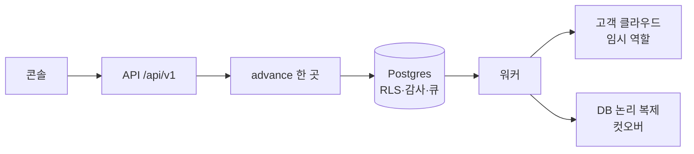

로드맵 위치: 본선 직전 / 심사 질의응답 대비 / 본선 연결점: 완성도·데모 30, 클라우드 활용 30, 팀 개발(대안 문서화) 20, AI 10

# 심사 예상 질문 30개와 짧은 답

> 문서 상태: AI 초안 · 2026-10-31 17:45 UTC · 기준 코드: 4차 통합본 `service-current.tgz` int4(17:15 UTC) · Z25 검증(불일치 12건·보완 6건) 반영 · 숫자는 Z16 용어·숫자 표(GLOSSARY) 기준 · 원본은 `parallel/Z5/docs/JUDGE-QA.md`(그대로 둠) · 팀 검토 전

## 그림: 질문이 걸리는 곳



- 사람 요청은 API로 들어온다. 상태를 바꾸는 곳은 `packages/core`의 `advance()` 하나다.
- 상태 변경, 다음 작업 넣기, 감사 기록이 같은 Postgres 트랜잭션 안에서 함께 된다.
- 워커가 고객 클라우드에 손댈 때는 짧게 빌린 임시 역할만 쓴다. DB는 논리 복제로 옮긴다.

## 읽는 법

| 표시 | 뜻 |
|---|---|
| 【사실】 | 코드나 실행 결과로 확인. 경로를 같이 적었다 |
| 【추정】 | 설계·문서로 판단. 실계정에서 확인 안 함 |
| 【미확인】 | 아직 코드가 없거나 STUB이라 확인 못 함 |

- 답은 "한 줄 답 → 근거 한두 줄" 순서다. 말로 할 때는 굵은 글씨 한 줄만 말하고, 되물으면 근거를 말한다.
- 모르는 것은 모른다고 말한다. 아래 "STUB" 절의 답이 그 연습이다.
- 용어는 Z16 표를 따른다: 상태 기계, 일시 정지(paused), 롤백(rolling_back·rolled_back), 트래픽 이동(shifting).

---

## 1. 전체 구조 (5문항)

**Q1. 한 문장으로 무엇을 만들었나?**
- **답: 운영 중인 3티어 앱을 다른 클라우드로 멈춤 거의 없이 옮기고, 그 과정을 승인·감사·롤백으로 감싸는 제어판이다.**
- 【사실】 이전 한 건이 22개 상태를 지난다. 정상 경로는 15칸이고, 사람이 누르는 칸은 3곳(명세 확정·승인·실행 시작)이다. 만들기까지 치면 버튼은 4번이다. `packages/contracts/src/migration.ts`의 `MIGRATION_STATUSES`, `VALID`, 사람 칸 `apps/web/src/status.ts`, 버튼 `apps/web/src/components/MigrationDetail.tsx`.

**Q2. 상태 기계를 왜 직접 만들었나? Step Functions·Temporal을 쓰면 되지 않나?**
- **답: 상태 변경·작업 예약·감사를 한 DB 트랜잭션에 묶으려고 했다. 외부 오케스트레이터를 쓰면 "상태는 바뀌었는데 작업이 없다"가 생길 수 있다.**
- 【사실】 `advance()`가 행 잠금 → 길·조건 검사 → 환경 잠금 → 상태 갱신 → pg-boss 작업 넣기 → 감사 한 줄을 한 트랜잭션에서 한다. `packages/core/src/advance.ts`.
- 【추정】 Temporal은 재시도·타이머가 강하지만 서버가 하나 더 늘고, 클라우드 3개에서 같은 방식으로 띄우기 어렵다.

**Q3. 큐를 왜 Redis·SQS가 아니라 Postgres(pg-boss)에 두었나?**
- **답: Q2와 같은 이유다. 작업 넣기가 상태 변경과 같은 트랜잭션이어야 하고, 움직이는 부품을 하나 줄인다.**
- 【사실】 pg-boss 12.38.0(`packages/core/package.json`)에서 같은 트랜잭션 클라이언트로 `send()`하면(`advance.ts`의 `db: asBossDb(tx)`) 롤백 때 작업도 사라지는 것을 실험으로 확인했다. 실험 기록은 설계 문서 `notes/architecture/api-orchestrator-v1.md`(실험 폴더 `notes/research/qa/verify-10/`)에 있다.
- 버린 대안: Redis(별도 서버, 트랜잭션 밖), SQS(AWS 종속, 멀티클라우드 주제와 어긋남).

**Q4. 상태가 22개면 너무 많지 않나?**
- **답: 정상 경로는 15칸이고 나머지 7개는 사고 처리용(거절·낡음·일시 정지·실패·롤백·취소)이다. 화면은 15칸 진행 막대에 지금 칸을 표시하고, 계획서는 이것을 6단계로 묶는다.**
- 【사실】 길 53개, 조건 붙은 길 22개 + 일시 정지 규칙 2개. `packages/core/src/guards.ts`. 22번째는 "롤백 가능 창이 끝나면 롤백 금지"(`rollback_window>rolling_back`)다. 진행 막대 `apps/web/src/components/Stepper.tsx`, 6단계 `apps/worker/src/jobs/plan.ts`.

**Q5. 지금 실제로 끝까지 도나? 얼마나 걸리나?**
- **답: 네. 이전 만들기부터 completed까지 smoke 한 바퀴가 약 8초다. 단, 클라우드 작업 대부분은 STUB이다(아래 7장).**
- 【사실】 `npm run smoke`: int4 클라우드 8.2초, int3 클라우드 8.1~8.7초, int3 맥 8.3초(Azure Mock 8.1초). `notes/skeleton/PROGRESS.md`.
- 화면 흉내(API로 버튼 순서대로 누르기) 숫자 8.3 / 8.6 / 8.5초는 조건이 달라 smoke와 따로 말한다.

## 2. 이전 방식과 DB (6문항)

**Q6. 왜 리플랫폼(앱 재배포 + DB 논리 복제)인가? 디스크 통째 복사(리호스트)는?**
- **답: 관리형 DB(RDS)를 다른 벤더(Cloud SQL·CloudNativePG)로 옮기는 길은 복제뿐이다. 디스크 복사는 같은 벤더 안에서만 된다.**
- 【사실】 결정 기록 `decisions/2026-10-31.md` "이전 방식 = 리플랫폼". 버린 대안: 리호스트, VMware HCX(VMware 종속), DB만 옮기기(프로덕션 이전이 아님).

**Q7. 왜 물리 복제나 pg_dump가 아니라 논리 복제인가?**
- **답: 물리 복제는 같은 메이저 버전·같은 벤더 파일 형식이 필요하고, 관리형 DB는 그 접근을 막는다. pg_dump는 덤프하는 동안 쓰기를 멈춰야 한다.**
- 【사실】 복제 모듈은 접속 문자열만 받고 같은 SQL(publication/subscription)로 RDS·Cloud SQL·CNPG·로컬을 다룬다. `packages/replication/README.md`.
- 【추정】 AWS DMS는 RDS→외부 이전에 쓸 수 있지만 AWS에 묶이고, 역방향(롤백)을 따로 만들어야 한다.

**Q8. 컷오버 때 앱이 얼마나 멈추나?**
- **답: 쓰기 멈춤이 수십 밀리초다. 실측 중앙값 41ms(39~46ms, 5회, 쓰기 8개 계속), 쓰기 4,338건 중 실패 0.**
- 【사실】 같은 호스트 Postgres 16 두 대, W 2-2 실측. 숫자는 Z16 표 4절.
- 【사실】 맥에서 실제 복제를 켠 smoke 한 바퀴 안의 멈춤은 81.4ms였다(`notes/skeleton/PROGRESS.md`). 조건(맥, smoke 안)이 달라 위 숫자와 섞지 않는다.
- 【미확인】 실제 RDS → Cloud SQL(리전 간 네트워크)에서는 아직 안 쟀다. 네트워크 왕복만큼 늘어난다고 본다(【추정】).

**Q9. 컷오버는 어떤 순서로 하나? 데이터가 빠지지 않는다는 근거는?**
- **답: 앱 붙잡기 → 출발 쓰기 막기 → 마커 한 줄이 도착에 보일 때까지 기다림 → 표별 행 수가 정확히 같은지 확인 → 시퀀스 올림 → 역방향 복제 준비 → 도착으로 풀기.**
- 【사실】 C1~C6 단계, `packages/replication/src/switchover.ts`. 마커가 안 오거나 행 수가 다르면 C6' 되돌림(출발을 그대로 다시 엶)으로 간다(`CATCHUP_TIMEOUT`, `ROW_COUNT_MISMATCH`).
- 행 수 비교는 내용 비교가 아니다. 내용까지 보려면 표별 체크섬이 필요하다(TODO).

**Q10. 컷오버 뒤 문제가 생기면 되돌릴 수 있나?**
- **답: 된다. 롤백 가능 창 안에서 사람이 `POST /api/v1/migrations/{id}/rollback`을 누르면 rolling_back → rolled_back으로 간다. 컷오버 중에 도착→출발 역방향 복제를 만들어 두기 때문에, 롤백할 때 출발이 최신이다.**
- 【사실】 경로 `apps/api/src/routes/control.ts`. 상태표가 허용하지 않는 상태(예: spec_review)에서는 409 `INVALID_TRANSITION`. 롤백 가능 창이 끝나면 409 `GUARD_FAILED`(`guards.ts`의 `rollback_window>rolling_back`). 창 길이는 기본 3초이고 `ROLLBACK_WINDOW_SEC`로 바꾼다(`apps/worker/src/jobs/cutover.ts`).
- 【사실】 복제 모듈 단독 롤백 쓰기 멈춤 중앙값 44ms(41~52ms, 5회, Z16 표).
- 【사실】 워커 롤백 처리기는 복제 설정(`REPL_SOURCE_URL`)이 있으면 진짜 역전환을 하고, 출발 DB에 앱 계정이 다시 쓸 수 있는지까지 본다. 없으면 STUB으로 돈다(`apps/worker/src/jobs/rollback.ts`).
- 【미확인】 실제 DB 두 대로 "API 버튼 → 복제 역전환"을 끝까지 잰 숫자는 아직 없다.

**Q11. 복제가 다 따라잡았다는 판단(동기화 → 트래픽 이동)은 무엇으로 하나?**
- **답: 초기 복사 완료 + 마커 왕복 500ms 이하다. 이 기준은 팀이 10/31에 확정했다.**
- 【사실】 상태 조건 T21: 스냅샷 완료 + 마커 왕복 ≤ `REPL_MAX_MARKER_RTT_MS`(500ms)(`packages/core/src/guards.ts`). 그 전에 복제 모듈 관문이 초기 복사 완료 + 마커 3번 연속 1,000ms 이하 + 슬롯 64MB 이하를 본다(`packages/replication/src/judge.ts`). 기준값은 `decisions/2026-10-31.md` "AI 기본값 일괄 확정" 표.
- 【사실】 지연 바이트(`replicationLagBytes`)와 행 수(`rowCountMatch`)는 판단에 쓰지 않고 감사에 기록만 한다. 쓰기 부하 중에는 0·일치가 안 나올 수 있어서다(`apps/worker/src/jobs/sync.ts`). 행 수 정확 비교는 컷오버 C3에서 쓰기를 막은 뒤 한다.

## 3. 트래픽·롤백·안전장치 (5문항)

**Q12. 트래픽은 어떻게 옮기나?**
- **답: 단계별 가중치(10→50→100%)로 옮기고, 각 단계에서 5xx 비율과 p95 지연을 본다. 5xx > 1% 또는 p95 > 출발 × 2가 30초 이어지면 자동으로 되돌린다.**
- 【사실】 규칙은 팀 결정(DECISION)으로 코드에 박혀 있다. `packages/traffic/src/rule.ts`, 단계 `packages/traffic/src/controller.ts`, 계획서 `rollbackCriteria`(`packages/contracts/src/plan.ts`).
- 【사실】 기본값은 메모리 LB + 가짜 지표다. 진짜 Cloudflare 전환기는 `TRAFFIC_PROVIDER=cloudflare`와 ID 3개로 켜지고(`packages/traffic/src/providers/index.ts`), 지표는 `PROM_URL`이 있으면 Prometheus를 읽는다(`apps/worker/src/platform.ts`). 실패 흉내는 `TRAFFIC_STUB_SCENARIO=err|slow|down`.
- 【미확인】 실제 Cloudflare 계정으로 가중치를 바꾼 기록은 아직 없다(맥에서 진행 예정).

**Q13. 같은 요청이 두 번 오면(버튼 두 번, 재시도) 어떻게 되나?**
- **답: `Idempotency-Key` 헤더를 붙이면 같은 키 두 번째 요청은 처리하지 않고 첫 응답을 그대로 돌려준다(같은 이전 번호, 응답 헤더 `Idempotent-Replayed: true`). 같은 키로 다른 요청을 보내면 409다.**
- 【사실】 상태를 바꾸는 POST 6개 모두 `req.idempotent()`를 부른다(`apps/api/src/routes/*.ts`). 키 저장은 상태 변경과 같은 트랜잭션(`packages/core/src/idempotency.ts`, 표 `idempotency_keys`). 같은 키 2번 → 같은 id·재생 헤더, 다른 본문 → 409 `IDEMPOTENCY_KEY_REUSED`를 3회 확인했다.
- 【사실】 헤더가 없으면 키 없이 처리한다(DRAFT(ai)). 화면·CLI가 늘 붙이게 되면 필수로 바꾼다.
- 워커 쪽 중복은 막힌다: 같은 작업이 두 번 와도 `advance(..., ifStill)`이 두 번째를 무시한다. 큐에는 `singletonKey`가 걸려 있다.

**Q14. 두 이전이 같은 환경을 동시에 건드리면?**
- **답: 승인할 때 출발·도착 환경 잠금을 같은 트랜잭션에서 예약한다. 이미 잡혀 있으면 409 `ENV_BUSY`다.**
- 【사실】 `packages/core/src/envlock.ts`, 표 `env_locks`(환경 번호가 기본키). 잠금은 기한(lease)이 있고, 워커가 죽으면 리퍼가 1분마다 정리한다.
- 【사실】 승인 뒤 단계에서는 공통 실행기 `runStep`이 잠금을 인수한다(P-3 수정, `apps/worker/src/jobs/_step.ts`의 `LOCKED_STAGES`). 스스로 멈춘 워커가 늦게 잠금을 연장하는 것도 버린다(P-1 수정, `apps/worker/src/lease/heartbeat.ts`).
- 【사실】 남은 빈 곳: 대기열이 없다. 같은 환경의 두 번째 이전은 줄 서지 않고 409로 끝난다(`envlock.ts` STUB).

**Q15. 승인한 계획과 실제로 실행되는 것이 같다는 보장은?**
- **답: 계획서 전체의 지문(planHash)에 승인을 묶는다. 화면이 본 지문과 저장된 지문이 다르면 409, 실행 직전에 워커가 다시 확인한다.**
- 【사실】 `POST /api/v1/plans/{id}/approvals`가 `PLAN_HASH_MISMATCH`·`PLAN_SUPERSEDED`·`PLAN_EXPIRED`를 낸다(`apps/api/src/routes/plans.ts`). apply 작업에 planHash를 실어 보낸다.
- 【사실】 남은 확인: Terraform plan 파일 sha256 비교는 TODO(human)(`apps/worker/src/jobs/apply.ts`).

**Q16. 워커가 중간에 죽으면?**
- **답: 상태는 DB에 있어 사라지지 않는다. 잠금 기한(기본 90초)이 지나면 리퍼가 이전을 failed(`WORKER_LOST`) 또는 일시 정지로 옮기고 큐 작업도 정리한다. 이어서 할지는 사람이 정한다.**
- 【사실】 자동으로 이어받지 않는다. failed면 사람이 다시 계획하고(provisioning 이전 실패만, `guards.ts`의 `failed>planning`), 일시 정지면 사람이 재개하거나 롤백한다(`apps/worker/src/lease/reaper.ts`). 기본값 기한 90초·연장 30초·스스로 멈춤 60초(`packages/core/src/envlock.ts`).
- 【사실】 데모 설정(기한 30초)에서 화면 표시 27.2~27.4초, failed 38.8~40.8초(3회). 결정 기록 "살아 있음 판단 = lease 한 곳", `decisions/2026-10-31.md`.

## 4. 권한·보안 (6문항)

**Q17. 고객 클라우드 권한은 어떻게 받나? 키를 받나?**
- **답: 키를 받지 않는다. 고객 계정에 역할을 만들게 하고, 그 역할을 짧게 빌려 쓴다(AWS AssumeRole, GCP 서비스 계정 가장). 관찰 역할은 최대 1시간, 실행 역할은 15분이다.**
- 【사실】 `packages/security/src/temp-role.ts`(요청 상한 3,600초). 실행 역할은 15분으로 잘린다(`packages/security/src/broker.ts`의 `OPERATE_MAX_TTL_SEC = 900`). 관찰(observe)과 실행(operate) 역할을 나누고, 실행 역할은 이전 한 건에 묶는다.
- 【미확인】 실제 STS·WIF 호출은 STUB이다. 지금은 메모리에서 흉내 낸다(`apps/worker/src/platform.ts`).

**Q18. "임시 역할"이 최소 권한이라는 근거는?**
- **답: 발급 전에 순수 함수로 검사한다. 와일드카드는 거부, 관찰 역할에 쓰기 동작이 있으면 거부, 천장 목록 밖 동작도 거부한다.**
- 【사실】 `checkLeastPrivilege()`, 오류 코드 `ROLE_WILDCARD`·`ROLE_OBSERVE_WRITE`·`ROLE_OUTSIDE_CEILING`. 권한 정책 파일을 시험으로 점검해 와일드카드 0개(`docs/THREAT-MODEL.md` 요약 5번). `infra/permissions/`는 int4에서 파일 11개다(AWS 5·GCP 3·EKS RBAC 1·온프레 2, G3가 더함). THREAT-MODEL의 "6개 점검"은 이전 판 기준이라, 되물으면 "int4 기준 11개"로 답한다.
- 【사실】 남은 과다 권한(태그 조건 없는 쓰기 19개, GCP setIamPolicy 2개)은 목록으로 고정해, 늘어나면 시험이 깨지게 했다.

**Q19. 한 회사가 다른 회사 데이터를 볼 수 있나?**
- **답: DB가 막는다. 모든 업무 표에 RLS를 켜고 표 주인에게도 강제했다. 앱은 트랜잭션마다 회사 번호를 설정하고, 그 줄만 보인다.**
- 【사실】 `packages/core/src/db.ts`의 `withTenant()`, `db/migrations/0001_init.sql`. 다른 회사 줄을 읽기·쓰기·고치기·지우기 하는 시험 14개 모두 막힘(3회 266~322ms, THREAT-MODEL 요약 2번).
- 남의 회사 자원은 404로 보인다. "없음"과 "남의 것"을 구별해 주지 않는다(외래 키 위반 23503 → 404, `apps/api/src/plugins/errors.ts`).
- 【사실】 예외 하나: 지표용 역할 `svc_metrics`만 회사 구분 없이 읽는다. 로그인 못 하는 역할이고, `SECURITY DEFINER` 함수가 합계 숫자만 돌려준다(`db/migrations/0010_observability.sql`). "/metrics는 전체를 어떻게 보나"에 대한 답이다.

**Q20. 그럼 가장 큰 보안 구멍은 무엇인가?**
- **답: 로그인이다. 지금은 회사 번호를 `x-dev-tenant` 헤더로 받아 그대로 믿는다. 그래서 공개 주소에 올리지 않는다.**
- 【사실】 `apps/api/src/plugins/auth.ts`. 계획은 GitHub OAuth + 세션 + 회사 소속 재확인이고, 이 파일 하나만 바뀌게 만들어 두었다.
- 【사실】 그 전까지의 안전장치 둘: 헤더 값이 uuid 모양이 아니면 401, `NODE_ENV=production`(또는 `AUTH_MODE=real`)이면 헤더 인증 자체를 꺼서 모든 업무 경로가 401.

**Q21. 누가 승인했는지 나중에 지울 수 있나?**
- **답: 앱 계정은 감사 표에 넣기·읽기만 된다. 각 줄은 앞 줄의 해시를 품는 사슬이라, 중간을 고치면 사슬이 깨져서 드러난다.**
- 【사실】 `packages/core/src/audit.ts`(회사별 advisory lock 후 `prev_hash`·`hash`). 고치기·지우기는 권한 오류로 시험했다.
- 【사실】 증적 리포트 `GET /api/v1/migrations/{id}/report`(json·md·html)가 사슬을 처음부터 다시 검증하고, 승인 지문과 저장된 계획 지문을 대조한다(`apps/api/src/report/`). 1만 줄 검증 42.9ms, 감사 596줄 리포트 중앙값 20.6ms(리포트 작업 기록 실측).
- 말할 때는 "고칠 수 없다"가 아니라 "조작하면 드러나는 감사 해시 체인"이라고 한다.

**Q22. 본인이 만든 계획을 본인이 승인해도 되나?**
- **답: 된다. 팀 결정으로 역할을 나누지 않았다. 대신 `self_approved`로 기록해 감사에서 보이게 했다.**
- 【사실】 DECISION(team) 주석, `apps/api/src/routes/plans.ts`. 대안(두 사람 승인)은 해커톤 팀 규모에서 데모 흐름을 끊어서 버렸다.

## 5. AI 에이전트 (3문항)

**Q23. AI 에이전트는 정확히 무엇을 하나?**
- **답: 두 가지다. 명세 초안은 진짜 Anthropic 모델이 쓰고 사람이 확인한다. 도착 환경의 배포 YAML을 점검·수정하는 루프는 샌드박스에서 돌려 본 뒤 사람이 PR을 합치는 구조인데, 이 루프는 아직 대본 LLM이다.**
- 【사실】 `llmFromEnv()`가 키가 있으면 진짜 모델을 고른다(`apps/agent-worker/src/main.ts`, `packages/agent/src/llm/anthropic.ts`·`select.ts`). 기본 모델 claude-sonnet-5-5, `AGENT_MODEL`로 바꾼다(10/31 팀 확정).
- 【사실】 장애 분석(remediate) 루프는 도구 7개(`packages/agent/src/ai/tools.ts`, `loop.ts`)를 쓰지만 대본 LLM(`scriptedLlm`) + 가짜 샌드박스다(`main.ts` STUB 주석, `apps/agent-worker/src/handle-agent-run.ts`).
- 【미확인】 이 루프에 실 LLM + k3d 샌드박스를 붙이는 작업은 진행 중이다.

**Q24. AI가 위험한 변경을 하면?**
- **답: 게이트가 막는다. deploy/ 밖 파일, 금지 종류, 권한 상승(privileged, root), 이미지 저장소 바꾸기를 거부한다. 에이전트는 클라우드 자격 증명을 모른다.**
- 【사실】 `packages/agent/src/ai/gate.ts` GATE-01~04. 설계의 GATE-01~12 중 4개만 줄 단위 간이 검사로 있다(STUB). 알려진 우회 4개는 "할 일 시험"으로 남김(THREAT-MODEL 요약 8번).

**Q25. 샌드박스는 진짜 격리인가?**
- **답: 아직 아니다. 지금은 메모리 샌드박스다. 계획은 vCluster + gVisor다.**
- 【미확인】 실제 격리는 구현 전. `packages/agent/src/ai/sandbox.ts`의 `stubSandbox`.

## 6. 비용·멀티클라우드 (3문항)

**Q26. 비용은 어떻게 비교하나?**
- **답: 같은 앱 명세(AppSpec)를 환경별 가격표에 대입해 월 비용을 낸다. 데모 요청(10 rps)에서 AWS $233.3, GCP $146.9로 월 $86.4 절약이다. 트래픽이 얼마일 때 어느 쪽이 싸지는지(손익 분기 rps)도 낸다.**
- 【사실】 `POST /api/v1/cost/estimate`가 `loadCatalog()`로 가격 캐시(`packages/cost/prices/*.json`)를 쓴다(`apps/api/src/routes/cost.ts`, `packages/cost/src/estimate.ts`). 데모 요청 `docs/demo/cost-request.json` 결과: AWS $233.3 / GCP $146.9 / 온프레 $250, 절약 $86.4(그중 $73은 GKE 무료 크레딧), 분기점 190·911 rps, 응답 18~31ms(5회). 숫자는 Z16 표.
- 【미확인】 AWS 실가격·GCP 가격은 확인 중이다. AWS는 AWS Price List에서 받은 캐시이고, GCP는 가격 API 키가 없어 샘플 값을 그대로 옮긴 상태다(`packages/cost/prices/gcp.json`의 `origin: seed`). 그래서 $146.9와 $86.4는 바뀔 수 있다.
- 【사실】 화면에도 나온다: `GET /api/v1/migrations/{id}/cost`(`apps/api/src/routes/migration-cost.ts`), 비용 비교 화면 `apps/web/src/components/CostCompare.tsx`. 계획서에는 아직 안 붙었다.

**Q27. 클라우드마다 다른 것은 어떻게 감추나?**
- **답: 어댑터 하나가 discover·normalize·toTerraform·toHelmValues 핵심 네 가지를 맞추고, 권한 목록·이미지 주소·기능 표까지 모두 7개 함수를 낸다. 앱 배포는 EKS·GKE·k3s 모두 같은 Helm 차트를 쓴다.**
- 【사실】 `packages/contracts/src/adapter.ts`(capabilities, discover, normalize, requiredOperateActions, toTerraform, toHelmValues, imageRef), `adapterFor(provider)`(`packages/adapters`). 결정 기록: AWS 컴퓨트 = EKS(ECS는 같은 차트를 못 씀). helm template 4/4 렌더.
- 【추정】 환경마다 다른 Helm 값은 6칸 이내로 본다. 코드로 세지는 않았다.
- 【미확인】 discover는 데모 원본을 돌려준다(STUB). 실계정 조회는 아직.

**Q28. 온프레와 Azure는?**
- **답: 온프레는 k3s + CloudNativePG로 실제로 띄워 시연한다(준비 중). Azure는 모양만 맞춘 Mock이다.**
- 【사실】 Provider 값 `onprem`, `azure_mock`(`packages/contracts/src/common.ts`). 리전 기본값은 서울(ap-northeast-2 / asia-northeast3 / koreacentral).
- 【미확인】 온프레 실제 이전 실측은 아직 없다.

## 7. 무엇이 STUB인가 (2문항)

**Q29. 지금 가짜(STUB)로 도는 것은 무엇인가? 솔직하게.**
- **답: 상태 기계·잠금·감사·회사 벽·계획 지문·멱등 키·롤백/취소 API·증적 리포트·비용 계산·DB 복제 모듈과 롤백 역전환·명세 초안의 실 LLM은 진짜다. 클라우드에 실제로 손대는 부분(자원 생성, Argo 배포, 보안 스캔, 임시 역할 발급)과 장애 분석 LLM 루프·AI 샌드박스는 STUB이다.**
- 【사실】 Cloudflare 전환기와 Prometheus 지표는 코드는 진짜이고 환경변수로 켜진다. 실계정 연결은 아직이다(Q12).
- 【사실】 코드 표시 STUB 97 · TODO(human) 44 · DRAFT(ai) 128 · DECISION(team) 8(int4, 테스트 제외 grep. 셀 명령은 맨 아래). 통합할 때마다 바뀌니 판 이름을 같이 말한다.
- 【사실】 DB 복제는 `REPL_SOURCE_URL`을 주면 워커가 진짜 모듈을 쓰고, 안 주면 STUB으로 한 바퀴 돈다(`apps/worker/src/jobs/sync.ts`).
- 조건 검사 자체는 진짜로 돈다. STUB은 "워커가 넘기는 증거 값"이 상수라는 뜻이다.

**Q30. 본선 3.5+4시간 안에 STUB을 무엇부터 진짜로 바꾸나?**
- **답: 데모 필수 장면 순서다. ① 실제 RDS→Cloud SQL 복제 숫자(API 버튼부터 끝까지) ② 보안 시각화 ③ 장애 분석 루프의 실 LLM + k3d 샌드박스 ④ Cloudflare 실가중치. 롤백·취소 API, 멱등 키, 환경 잠금 인수, 명세 초안 실 LLM은 이미 메웠다.**
- 【추정】 순서는 킥오프 문서의 데모 필수 3장면(실시간 이전, 보안 거버넌스 시각화, AI 샌드박스 점검)과 `docs/SPEC-FROM-CODE.md` 8장 "빈 곳"의 데모 영향 순서를 합친 것이다. 팀 확인 전.

---

## 부록 A. API 문서 위치

- OpenAPI 3.1: `docs/openapi.yaml`(같은 내용 JSON `docs/openapi.json`), 경로 19개·동작 21개. 코드에서 생성: `npm run openapi`. 코드와 어긋났는지 확인: `npm run openapi:check`.
- 서버가 떠 있으면 `GET /api/v1/docs`(표), `/api/v1/docs/openapi.yaml`, `/api/v1/docs/openapi.json`. int4 통합 검증에서 `/api/v1/docs` 200을 확인했다.
- 【사실】 실서버 응답을 문서 스키마로 대조하는 스크립트 `tools/openapi/conform.mjs`가 있다. 16:49 판(경로 18개)에서 40/40 일치를 3회 확인했고, int4에서는 아직 다시 돌리지 않았다.

## 핵심 결정 3개 (+대안)

| 결정 | 대안 | 고른 이유 |
|---|---|---|
| 상태 변경·작업·감사를 한 트랜잭션(`advance()` + pg-boss) | Temporal·Step Functions / Redis·SQS 큐 | "상태는 바뀌었는데 작업이 없다"를 구조로 없앰. 부품 하나 줄임 |
| DB는 논리 복제 + 역방향 복제로 롤백 | 리호스트 / 물리 복제 / pg_dump / DMS | 벤더 간 관리형 DB 이전이 되는 유일한 길. 쓰기 멈춤 중앙값 41ms, 롤백 44ms |
| 고객 권한 = 짧은 임시 역할(실행 15분) + 발급 전 최소 권한 검사 | 장기 액세스 키 보관 | 키가 새도 피해가 15분·이전 한 건으로 묶인다 |

## 셀프 연습 1개

같은 요청 두 번(Q13)을 손으로 확인한다.

1. 서비스 폴더에서 API와 워커를 띄운다(`npm run dev:api`, `npm run dev:worker`).
2. 아래 줄을 두 번 그대로 보낸다. 키 값만 처음에 한 번 바꿔 둔다.

```bash
curl -si -X POST localhost:3000/api/v1/migrations -H "content-type: application/json" -H "x-dev-tenant: 11111111-1111-4111-8111-111111111111" -H "Idempotency-Key: practice-0001" -d '{"sourceEnvId":"22222222-2222-4222-8222-222222222222","targetEnvId":"33333333-3333-4333-8333-333333333333"}'
```

3. 기대: 두 번 다 `202`, 본문 `{"id":"..."}`의 id가 같다. 두 번째 응답 헤더에 `idempotent-replayed: true`.
4. 이번엔 같은 키로 출발·도착을 서로 바꿔 보낸다. 기대: `409`, `IDEMPOTENCY_KEY_REUSED`.
5. 질문 하나에 답한다: 키가 없을 때도 막아야 하나(필수로 바꾸기), 아니면 화면이 늘 붙이면 충분한가? 답을 Q13 근거에 적는다.

## 검증 명령과 기대 출력

```bash
npm run openapi:check
node --import tsx --test apps/api/test/docs.test.ts
npm run smoke
grep -c '^  "[a-z_]*>[a-z_]*"' packages/core/src/guards.ts
grep -rhoE "STUB|TODO\(human\)|DRAFT\(ai\)|DECISION\(team\)" apps packages db infra --include=*.ts --include=*.tsx --include=*.sql --include=*.tf --include=*.sh --exclude-dir=node_modules --exclude-dir=test | sort | uniq -c
grep -n '"origin"' packages/cost/prices/gcp.json
```

- `openapi:check`: `docs/openapi.yaml up to date`.
- `docs.test.ts`: `# fail 0`.
- `smoke`: 마지막 줄 `completed after 8xxx ms` 근처(int4 클라우드 8.2초).
- 조건 붙은 길: `22`.
- 표시 개수: `8 DECISION(team)`, `128 DRAFT(ai)`, `97 STUB`, `44 TODO(human)` 근처(int4). 코드가 바뀌면 달라진다.
- GCP 가격 출처: `"origin": "seed"`(샘플). 가격 API 연결 뒤에는 바뀐다.
