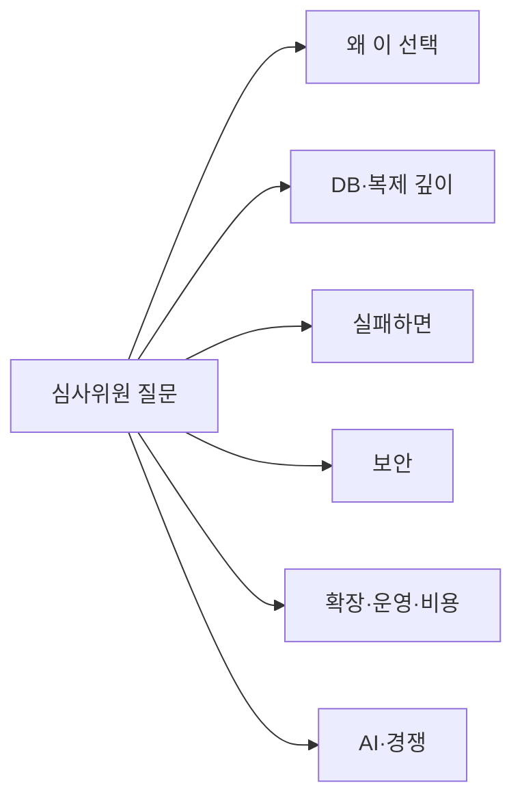

로드맵 위치: 본선 직전 / 모의 심사 질의응답 50문항 / 본선 연결점: 완성도·데모 30, 클라우드 활용 30, 팀 개발(대안 문서화) 20, 독창성 10, AI 10

# 모의 심사: 날카로운 질문 50개와 답

> 문서 상태: AI 초안 · 2026-10-31 17:50 UTC · 기준 코드: 4차 통합본 int4(`integration/service-current.tgz`, 17:15 UTC) · 기존 30문항(`parallel/Z29/docs/JUDGE-QA.md`)과 겹치는 곳은 "→ Z29 Qn"으로만 적음 · 아직 int4에 안 합쳐진 작업(Z18 보안 표, Z22 실 LLM 샌드박스, Z31 hold 프록시)은 그렇다고 밝힘 · 팀 검토 전 · 18:15 UTC 통합 2차 문서 묶음: Q42 맥 실 LLM 3/3은 명세 초안으로 고침 · 18:20 UTC 2차 묶음: 보안 표·매트릭스·TC-AUDIT 문장

## 그림: 질문이 노리는 곳



- 질문은 7묶음이다. 왜 이 선택(8), DB·복제 깊이(8), 실패하면(8), 보안(8), 확장·운영(7), 비용(5), 시험·AI·경쟁(6).
- Z29 30문항이 "무엇을 만들었나"를 다뤘다면, 이 50문항은 "그래서 그게 진짜 되나, 안 되면 어떻게 되나"를 판다.
- 답 하나는 3~4문장이다. 말할 때는 굵은 첫 문장만 말하고, 되물으면 나머지를 말한다.

## 읽는 법

| 표시 | 뜻 |
|---|---|
| 【사실】 | int4 코드를 직접 열어 확인했거나, 기록된 실측이 있다. 경로나 출처를 같이 적었다 |
| 【추정】 | 설계·문서·일반 지식으로 판단. 우리 코드나 실계정에서 확인 안 함 |
| 【미구현】 | 코드가 없거나 STUB이다. 솔직히 "아직 없다"고 답한다 |
| 【미확인】 | 코드는 있지만 실환경에서 돌려 보지 않았다 |

- 숫자는 판 이름과 같이 말한다(int4, 맥, 클라우드 사본). 조건이 다른 숫자를 섞지 않는다.
- 모르면 "아직 안 쟀다", "아직 없다"로 끝낸다. 꾸며서 메우면 다음 질문에서 무너진다.

---

## A. 왜 이 선택인가 (8문항)

**Q1. 상태 기계·큐·감사를 다 Postgres에 넣으면, DB가 죽으면 전부 죽는 것 아닌가?**
- **답: 맞다. 제어판 DB는 단일 장애점이고, 그걸 알고 고른 선택이다.**
- 【사실】 대신 DB가 잠깐 끊겨도 API·워커는 죽지 않는다. Postgres를 75초 멈췄다 켜도 두 프로세스가 살아 있었고, 켜진 뒤 10ms 안에 readyz가 돌아왔다(`parallel/Z12/docs/RECOVERY-SCENARIOS.md` 6절).
- 【사실】 데모 호스팅은 RDS 단일 AZ로 정했다. Multi-AZ는 비용이 2배인데 데모에는 재시작 복구면 충분하다고 봤다(`decisions/2026-10-31.md` 54줄).
- 【추정】 운영이라면 관리형 Postgres Multi-AZ로 바꾸는 것이 첫 번째 일이다. 코드는 그대로다.

**Q2. 언어를 왜 TypeScript로 했나? 팀에 Java 경험자가 있지 않나?**
- **답: 화면·API·워커·에이전트가 같은 계약(Zod 스키마)을 한 벌로 나눠 쓰려고 했다.**
- 【사실】 계약은 `packages/contracts` 한 곳에 있고, API 입력 검사·워커 작업 검사·OpenAPI 생성이 모두 여기서 나온다(`npm run openapi`).
- 【추정】 Spring + 별도 프론트였다면 스키마를 두 번 쓰고 서로 어긋나는 것을 따로 막아야 했다.
- 대가: Java만큼 익숙한 사람이 적다. 그래서 모든 경로를 시험으로 고정했다(→ Q45).

**Q3. 트래픽 전환을 왜 Route 53이나 각 클라우드 LB가 아니라 Cloudflare로 하나?**
- **답: 출발과 도착이 다른 클라우드라, 둘 다의 앞에 설 수 있는 한 곳이 필요했다.**
- 【사실】 팀 결정(DECISION)으로 `packages/traffic/src/providers/cloudflare.ts`가 기본 경로다. 같은 인터페이스로 AWS ALB·GCP LB 전환기도 있다(`aws-alb.ts`, `gcp-gclb.ts`).
- 【추정】 DNS 가중치(Route 53)는 클라이언트 DNS 캐시 때문에 몇 분 단위로 늦게 반영된다. Cloudflare LB는 프록시라 요청 단위로 바로 나뉜다.
- 【미확인】 실제 Cloudflare 계정에서 가중치를 바꾼 기록은 아직 없다(→ Z29 Q12).

**Q4. GitOps(Argo CD)를 왜 끼웠나? 워커가 직접 kubectl apply 하면 더 빠르지 않나?**
- **답: 승인한 배포 파일이 그대로 레포에 남고, 클러스터가 그걸 끌어가게 하려고 했다.**
- 【사실】 배포 단계는 `GITOPS_REPO_DIR`가 있으면 렌더된 묶음을 gitops 레포에 커밋한다. 없으면 STUB 길로 간다(`apps/worker/src/jobs/deploy.ts`).
- 【사실】 설계 결정: 레포에는 완성된 배포 파일 + 묶음 해시를 올리고, 배포 때 어댑터를 다시 부르지 않는다. 승인 뒤 차트가 바뀌어 승인 안 한 값이 나가는 것을 막는다(`finals-master-guide-v2.md` 결정 19).
- 【미확인】 실제 Argo CD가 EKS·GKE에서 이 묶음을 동기화하는 것은 아직 안 돌려 봤다.

**Q5. 왜 상용 LLM API를 쓰나? 데이터 레지던시 주제인데 자체 모델은?**
- **답: 본선 기간에 모델 품질과 도구 호출을 직접 운영할 여유가 없어서 상용 API로 정했다.**
- 【사실】 10/31 팀 회의 전제 "LLM 상용 API"(`CLAUDE.md` 0-1). 모델 선택은 `AGENT_MODEL` 한 줄로 바꾼다(`packages/agent/src/llm/select.ts`).
- 【사실】 LLM으로 가는 글은 비밀 가리기를 거친다. AWS 키, `DB_PASSWORD=`, 주소 안 비밀번호, env 값이 요청에 안 들어가는 것을 시험했다(`parallel/Z22/docs/AGENT-SANDBOX.md` 4절, int4 미반영).
- 【미구현】 레지던시를 지키는 자체·온프레 모델 경로는 없다.

**Q6. 왜 EKS인가? ECS Fargate가 더 싸고 단순하다.**
- **답: 세 환경(EKS·GKE·k3s)에 Helm 차트 하나로 배포하려고 EKS를 골랐다.**
- 【사실】 팀 결정 기록: ECS는 GKE·k3s와 같은 차트를 못 쓴다(`decisions/2026-10-31.md` 163·177줄). helm template 4/4 렌더.
- 【추정】 비용은 EKS 제어면 시간당 요금만큼 더 든다. 같은 차트로 롤백·배포 방식을 하나로 맞추는 값으로 봤다.

**Q7. 마이크로서비스로 안 나누고 앱 4개(api·worker·agent-worker·web)만 둔 이유는?**
- **답: 상태를 바꾸는 곳을 `advance()` 하나로 두는 것이 핵심이라, 서비스를 쪼개면 그 원칙이 깨진다.**
- 【사실】 API와 워커가 모두 같은 `packages/core`의 `advance()`를 부른다. 상태·작업·감사가 한 트랜잭션이다(→ Z29 Q2).
- 【사실】 에이전트 워커만 따로 뺐다. LLM 호출이 길고, 비용 때문에 재시도를 안 한다(`packages/core/src/boss.ts`, agentRun `retryLimit: 0`).

**Q8. Terraform 상태(tfstate)는 어디에 두나? 팀이 같이 쓰면 깨지지 않나?**
- **답: 지금은 한 사람 노트북의 로컬 파일이다. 팀 공유 저장은 아직 안 했다.**
- 【사실】 `infra/modules/*/env`에 backend 블록이 없다. 그래서 상태는 apply를 돌린 컴퓨터에 남는다.
- 【추정】 결선까지는 apply를 한 곳(맥)에서만 하기로 해서 충돌은 없다. 운영이면 S3 + DynamoDB 잠금(또는 GCS)으로 옮긴다.
- 【미구현】 원격 상태 저장·잠금.

---

## B. DB·복제 깊이 (8문항)

**Q9. 기본키 없는 표가 있으면 어떻게 되나?**
- **답: 옮기기 전 점검에서 막는다. 논리 복제는 기본키 없는 표의 UPDATE·DELETE를 못 옮기기 때문이다.**
- 【사실】 점검 DB-T2가 기본키나 REPLICA IDENTITY FULL이 없는 표 이름을 찍고, "기본키를 추가하거나 REPLICA IDENTITY FULL"을 힌트로 준다(`packages/replication/src/precheck.ts`).
- 【사실】 같은 점검이 wal_level=logical(DB-01), 슬롯 2개 이상(DB-02), PG 14 이상(DB-03)도 본다. 클라우드별 고치는 법(RDS 파라미터 그룹, Cloud SQL 플래그)이 힌트에 들어 있다.

**Q10. 복제 중에 앱이 스키마를 바꾸면(DDL)?**
- **답: 논리 복제는 DDL을 안 옮긴다. 그래서 이전 중에는 스키마 변경을 하지 않는다는 전제다.**
- 【사실】 도착 스키마는 앱 재배포 때 앱 마이그레이션이 만든다. 점검 DB-T4가 도착에 표가 있는지 본다(`packages/replication/README.md`, `precheck.ts`).
- 【미구현】 이전 중 DDL을 감지해 멈추는 장치는 없다. 지금은 운영 규칙이다.
- 【추정】 넣는다면 출발에 event trigger를 걸어 DDL이 오면 일시 정지로 보내는 방식이다.

**Q11. 대형 객체(BLOB)나 파일은?**
- **답: Postgres large object는 논리 복제 대상이 아니라 점검에서 걸린다. 파일 저장소(S3 등) 이전은 범위 밖이다.**
- 【사실】 점검 DB-T3가 `pg_largeobject_metadata` 수를 세고, 0이 아니면 실패 + "bytea로 바꾸거나 따로 옮긴다" 힌트(`precheck.ts`).
- 【미구현】 오브젝트 스토리지(S3 → GCS) 복사는 없다.

**Q12. 시퀀스(자동 증가 번호)는 복제가 안 되는데, 컷오버 뒤 번호가 겹치지 않나?**
- **답: 컷오버 C4 단계에서 도착 시퀀스를 "표의 최댓값 + 1,000"으로 올린다.**
- 【사실】 `switchover.ts`의 `setval(..., max(col) + gap)`, 기본 여유분 1,000, 맞춘 시퀀스 수를 측정값으로 남긴다.
- 【추정】 1,000은 컷오버 순간 겹침만 막으면 되니 넉넉하게 잡은 값이다. 번호 사이에 빈칸이 생기는 것은 허용한다.

**Q13. 출발 쓰기를 막는다는데, 앱이 다른 역할을 거쳐 권한을 받았으면 뚫리지 않나?**
- **답: 그 경우를 따로 잡는다. 막은 뒤 앱 계정이 아직 쓸 수 있는 표가 하나라도 있으면 컷오버를 멈추고 출발을 그대로 다시 연다.**
- 【사실】 울타리는 REVOKE + 앱 세션 끊기 + read_only다. read_only만으로는 이미 붙은 세션과 SET으로 우회된다는 것을 10/31 실험에서 봤다(`packages/replication/src/fence.ts` 주석).
- 【사실】 `writableTables()`가 상속 권한까지 보는 `has_table_privilege`로 다시 확인하고, 남으면 `FENCE_INEFFECTIVE`로 C6' 되돌림(`switchover.ts`).
- 【사실】 남은 빈 곳: 울타리를 걷을 때 원래 권한이 아니라 "SELECT·INSERT·UPDATE·DELETE 전체"를 다시 준다(TODO(human), `fence.ts`).

**Q14. 행 수가 같으면 데이터가 같다고 할 수 있나?**
- **답: 아니다. 행 수는 빠진 줄을 잡을 뿐, 내용이 같다는 증거는 아니다.**
- 【사실】 컷오버 C3에서 쓰기를 막은 뒤 표별 행 수를 정확히 비교하고, 다르면 `ROW_COUNT_MISMATCH`로 되돌린다(→ Z29 Q9).
- 【미구현】 표별 체크섬 비교. 넣으면 큰 표에서 컷오버 멈춤이 길어지므로, 멈춤 전 미리 계산 + 멈춤 중 변경분만 보는 방식을 생각 중이다(【추정】).

**Q15. DB가 100GB면 초기 복사에 얼마나 걸리나?**
- **답: 아직 안 쟀다. 우리 실측은 작은 데모 DB뿐이다.**
- 【미확인】 초기 복사 시간은 출발 읽기 속도와 리전 간 대역폭에 달려 있다. 컷오버 멈춤(41ms)은 초기 복사 크기와 상관이 없다는 점은 설계로 말할 수 있다(【추정】: 멈춤은 마지막 따라잡기만 기다린다).
- 【사실】 초기 복사가 끝나기 전에는 트래픽 이동으로 못 넘어간다. 조건 T21이 "스냅샷 완료"를 요구한다(`packages/core/src/guards.ts`).

**Q16. 복제가 느려 출발 쪽 WAL이 쌓여 디스크가 차면?**
- **답: 복제 관문이 슬롯에 쌓인 양이 64MB를 넘으면 "아직 따라잡지 못함"으로 본다. 다만 디스크가 차기 전에 끊는 자동 장치는 없다.**
- 【사실】 관문 조건: 초기 복사 완료 + 마커 3번 연속 1,000ms 이하 + 슬롯 64MB 이하(`packages/replication/src/judge.ts`, → Z29 Q11).
- 【미구현】 슬롯이 일정 크기를 넘으면 복제를 끊고 슬롯을 지우는 안전장치. 【추정】 PG 13+의 `max_slot_wal_keep_size`를 출발에 걸게 안내하는 것이 가장 싸다.

---

## C. 실패하면 어떻게 되나 (8문항)

**Q17. 컷오버 중간, 쓰기를 막은 상태에서 워커가 죽으면 출발이 계속 막혀 있나?**
- **답: 그럴 수 있다. 지금 가장 위험한 빈 곳이다.**
- 【사실】 워커가 죽으면 잠금 기한(90초) + 청소 주기(최대 60초) 뒤 이전이 일시 정지가 된다. 실측 147초(→ Z29 Q16, `RECOVERY-SCENARIOS.md`).
- 【사실】 울타리를 걷는 `unfence()`는 컷오버 함수(`switchover.ts`) 안에서만 불린다. 청소 작업(`reaper.ts`)은 대신 걷지 않으니, 그 사이 출발은 읽기만 된다.
- 【추정】 고친다면 청소가 cutover 상태에서 멈춘 이전을 보면 C6' 되돌림(출발 울타리 걷기)을 먼저 하게 한다. 사람이 롤백을 눌러 빠져나오는 길은 지금도 있다.

**Q18. 일시 정지(paused)가 되면 다시 이어서 할 수 있나?**
- **답: 아직 못 한다. 재개 버튼(API)이 없어서 롤백이나 취소로만 빠져나온다.**
- 【사실】 상태 기계에는 "멈추기 전 단계로만, 증거가 있을 때만 재개" 규칙이 있다. 그런데 그 길을 부르는 API가 없다(`RECOVERY-SCENARIOS.md` 3-6절, Z12-3).
- 【사실】 지금 어떤 처리기도 실패를 paused로 보내지 않는다. paused로 가는 길은 청소 작업뿐이다(Z12-5).

**Q19. 트래픽 10%를 넘겼는데 도착이 느리면 몇 초 만에 되돌리나?**
- **답: 규칙은 "5xx > 1% 또는 p95 > 출발 × 2가 30초"다. 다만 도착이 통째로 죽으면 표본을 기다리지 않고 바로 되돌린다.**
- 【사실】 `packages/traffic/src/rule.ts`: 표본 100개 미만이면 판정 보류, 5xx 3개 이상 + 출발 오류율의 3배 이상일 때만 오류로 본다, 2번 연속 걸려야 롤백. 지름길은 5xx 20개 이상 + 오류율 50% 초과.
- 【사실】 단계는 10 → 50 → 100%(`controller.ts`의 `DEFAULT_STEPS`).
- 【미확인】 실제 앱 트래픽으로 "몇 초 만에 되돌렸다"를 잰 숫자는 아직 없다. 흉내는 `TRAFFIC_STUB_SCENARIO=err|slow|down`.

**Q20. 출발 쪽도 원래 오류가 많은 앱이면 매번 롤백되지 않나?**
- **답: 안 된다. 도착 오류율이 출발의 3배를 넘을 때만 롤백한다.**
- 【사실】 `relErrFactor: 3`, `minSourceSamples: 50`. 출발 표본이 적으면 미리 잰 기준 p95를 쓴다(`rule.ts`).
- 【사실】 이 보호값들은 트래픽 전환 설계 PoC에서 찾은 DRAFT(ai) 값이고, 5xx 1%·p95 2배·30초만 팀 결정이다.

**Q21. Terraform apply가 반쯤 만들고 실패하면?**
- **답: 이전은 failed로 가고 환경 잠금이 풀린다. 반쯤 만든 자원은 사람이 정리한다.**
- 【사실】 apply 작업은 재시도 0번이다. 같은 apply를 두 번 돌리면 이중 생성 위험이 있어서다(`packages/core/src/boss.ts`). provisioning 실패만 다시 계획(`failed>planning`)으로 갈 수 있다(→ Z29 Q16).
- 【미구현】 지금 apply는 STUB이다(`apps/worker/src/jobs/apply.ts`). 실패 뒤 자동 destroy·정리는 없다.

**Q22. 롤백이 실패하면? 롤백의 롤백은?**
- **답: 2번 실패하면 failed로 멈추고 잠금은 유지한다. 사람이 손으로 정리한 뒤 취소해야 잠금이 풀린다.**
- 【사실】 Z1이 시험하는 길이다(`RECOVERY-SCENARIOS.md` 3-5절). 잠금을 유지하는 이유는, 상태를 모르는 환경에 다른 이전이 들어오지 못하게 하려는 것이다.
- 【사실】 롤백 가능 창이 끝난 뒤의 롤백은 서버가 거부한다(409 `GUARD_FAILED`, → Z29 Q10).

**Q23. 롤백 가능 창이 3초라는데, 3초 뒤 문제가 보이면?**
- **답: 그때부터는 롤백이 아니라 "새 이전을 반대 방향으로" 하는 것이다. 3초는 데모용 값이고 운영값은 아니다.**
- 【사실】 기본값 `DEFAULT_ROLLBACK_WINDOW_SEC`(core)이 3초, `ROLLBACK_WINDOW_SEC`로 바꾼다. 데모·e2e는 20초를 쓴다(`apps/worker/src/jobs/cutover.ts`).
- 【추정】 운영이라면 수십 분~수 시간으로 두고, 그동안 역방향 복제를 유지한다. 창이 길수록 출발 DB를 오래 켜 둬야 해서 비용이 든다.

**Q24. 같은 작업이 두 번 실행되면(at-least-once 큐) 클라우드에 두 번 손대지 않나?**
- **답: 상태 이동은 정확히 한 번이지만, 클라우드 호출 자체는 두 번 돌 수 있다.**
- 【사실】 같은 작업을 두 워커가 동시에 + 한 번 더 불러도 7단계 모두 상태 이동 1번이었다(`RECOVERY-SCENARIOS.md` 3-2절, 행 잠금 + `ifStill`).
- 【사실】 그 문서가 직접 적은 주의: 지금은 STUB이라 무해하지만, 진짜 Terraform·Argo·LB 호출은 같은 요청을 두 번 받아도 같은 결과여야 한다. 그래서 apply만 재시도 0번이다(→ Q21).

---

## D. 보안 (8문항)

**Q25. 고객 클라우드 권한을 15분만 빌린다는데, Terraform apply가 15분보다 길면(EKS는 15분 걸린다)?**
- **답: 10분째에 자격을 다시 받고, 다시 받기에 실패하면 일시 정지한다. 팀이 10/31에 정한 규칙이다.**
- 【사실】 규칙은 `decisions/2026-10-31.md` "AI 기본값 일괄 확정" 표에 있다.
- 【미구현】 지금 apply는 STUB이고, 작업 단계가 임시 역할을 빌리고 돌려준 기록은 2차 판부터 남는다(TC-AUDIT 지켜짐, 발급 5·회수 5, 발급기는 Mock)【사실, int5 2차 예정】. 실제 STS 호출도 STUB이다(→ Z29 Q17).

**Q26. 빌린 임시 자격 증명은 어디에 저장하나?**
- **답: 워커 프로세스 메모리에만 둔다. DB·로그·감사·큐에는 이름(credentialRef)만 나간다.**
- 【사실】 `packages/security/src/vault.ts`. 값을 실수로 JSON·로그로 찍어도 안 새게 감싼다(`Sealed`).
- 【사실】 버린 대안: Secrets Manager에 잠깐 저장. 비밀이 저장소에 남고 지우는 절차가 하나 더 생겨서다(같은 파일 주석). 워커가 죽으면 다시 발급받는다.

**Q27. DB 복제 접속 비밀번호는? 구독에 평문으로 남지 않나?**
- **답: 남는다. Postgres 구독은 접속 문자열을 `pg_subscription`에 저장하고, 거기에 비밀번호가 들어 있으면 평문이다.**
- 【사실】 Z18 보안 표의 SE-REPL 줄이 바로 이것을 본다. `REPL_*` 접속 문자열에 비밀번호가 있는지 유무만 판정한다(`parallel/Z18/docs/SECURITY-VIEW.md` 2절, int4 미반영).
- 【추정】 해결 방향은 출발 쪽 `.pgpass`/IAM 인증(RDS IAM, Cloud SQL IAM)이다. 아직 손대지 않았다.

**Q28. 공급망 공격은? 컨테이너 이미지가 바뀌면?**
- **답: AI가 이미지 저장소를 바꾸는 것은 게이트가 막고, 우리 서비스 이미지는 root로 돌지 않는다. 이미지 서명 검증은 없다.**
- 【사실】 에이전트 게이트가 이미지 저장소 바꾸기를 거부한다(`packages/agent/src/ai/gate.ts`, → Z29 Q24). 샌드박스는 씨앗에서 쓴 이미지만 다시 쓸 수 있다(`AGENT-SANDBOX.md` 3절).
- 【사실】 우리 서비스 이미지 5개는 모두 root가 아닌 사용자로 돈다(Dockerfile `USER node` / `USER 101`).
- 【미구현】 cosign 서명·SBOM 검증, Trivy 스캔.

**Q29. "보안·거버넌스 시각화"가 결국 고정값 아닌가?**
- **답: 아니다. 표의 줄은 권한 파일·감사 체인·DB 권한을 요청마다 진짜로 읽어 판정한다. 읽을 재료가 없는 줄은 "미구현"으로 나온다.**
- 【사실, int5 2차 예정】 AWS→GCP 완료된 이전 기준 24줄: 지켜짐 16 · 약점 5 · 위반 1 · 미구현 0 · 해당 없음 2(STUB). 위반 1건은 통제 12개 매트릭스(CT-MATRIX)다. 새 문제가 아니라 원래 있던 약점이 매트릭스로 보이게 된 것이다: 차트 설정(서비스 계정 토큰 자동 마운트, runAsNonRoot 없음), EKS 감사 로그 꺼짐, EKS·GKE API 공개 주소에 허용 대역 없음. 권한 파일에 경계 조건을 넣자 한 줄이 위반에서 지켜짐으로 실제로 바뀌었다(`SECURITY-VIEW.md` 3절, Z18 판, int4 미반영).
- 【사실, int5 2차 예정】 보안 통제 12개 × 출발·도착 매트릭스는 레포 파일과 감사 체인을 읽어 판정한다. 【미구현】 실제 클라우드 수집기(Prowler·GuardDuty·SCC)는 STUB이다(`packages/security/src/scanner.ts`).

**Q30. GuardDuty·Security Command Center처럼 클라우드마다 다른 보안 기능을 어떻게 통일하나?**
- **답: 통제 12개를 공통 목록으로 정의하고, 클라우드별 수집기가 같은 결과 모양(Finding)으로 바꿔 넣는 구조다. 수집기는 아직 STUB이다.**
- 【사실】 통제 목록 `packages/security/src/controls.ts`, 결과 모양 `Finding`(`@svc/contracts`), 셀 요약 `summarizeCells`.
- 【미구현】 진짜 수집기(Prowler AWS/GCP, Kyverno 보고서, Trivy, GuardDuty/SCC, 온프레 보고). STUB 결과는 evidence 앞에 "STUB:"이 붙어 화면에서 구분된다.

**Q31. API에 요청 횟수 제한(rate limit)이 있나?**
- **답: 없다.**
- 【사실】 int4 `apps/api/src`에 rate limit 플러그인이 없다. 지금은 로그인 자체가 개발용 헤더라 공개 주소에 올리지 않는다(→ Z29 Q20).
- 【추정】 로그인을 붙일 때 `@fastify/rate-limit`을 회사 번호 기준으로 같이 넣는다. 상태를 바꾸는 POST는 멱등 키가 있어 중복 실행은 이미 막힌다.

**Q32. 데모 클라우드 자원은 안전한가? 삭제 보호는?**
- **답: 데모용이라 삭제 보호를 일부러 껐다. 당일 destroy가 원칙이다.**
- 【사실】 GCP 모듈 `deletion_protection = false # DRAFT(ai): 데모 당일 destroy 전제`(`infra/modules/gcp/env/main.tf`). AWS RDS는 `storage_encrypted = true`(`infra/modules/aws/app/main.tf`).
- 【사실】 맥에서 plan 결과 AWS 25자원(약 $0.27/시간), GCP 14자원(약 $0.2/시간)이었다(맥 실행 기록, 10/31). apply 결과는 아직 정리 전이다(【미확인】).

---

## E. 확장성·운영 (7문항)

**Q33. 이전 100건이 동시에 돌면?**
- **답: 서로 다른 환경이면 동시에 돈다. 같은 환경이면 두 번째는 409로 거절되고, 줄을 서지 않는다.**
- 【사실】 환경 잠금 `env_locks`(→ Z29 Q14). 대기열은 없다(`envlock.ts` STUB).
- 【미확인】 100건 동시 부하는 안 쟀다. 【추정】 병목은 Postgres 연결 수다. 팀 결정 기록에서 연결 예산을 34~40개(< 100)로 보고 PgBouncer를 뺐다(`decisions/2026-10-31.md` 54줄).

**Q34. 워커를 여러 대 띄워도 되나?**
- **답: 된다. 여러 워커가 같은 큐를 나눠 집고, 상태 행 잠금 + "아직 그 상태면" 조건이 중복을 막는다.**
- 【사실】 같은 작업 동시 배달 시험(→ Q24). 큐 정책은 `stately`이고, 청소 작업은 `singleton`이라 한 대만 돈다(`boss.ts`).
- 【사실】 다중 워커일 때 작업 복사본(GitOps)은 워커별 폴더를 쓴다(팀 확정 기본값).

**Q35. 회사(테넌트)가 1,000개면 RLS가 느려지지 않나?**
- **답: 안 쟀다. 자주 도는 조회에 회사 번호가 앞에 오는 인덱스를 둔 것까지만 말할 수 있다.**
- 【사실】 RLS는 `withTenant()`가 트랜잭션마다 회사 번호를 설정하는 방식이다(→ Z29 Q19). `0011_integrity_indexes.sql`에 `audit_events (tenant_id, seq)`, `migrations (tenant_id, updated_at DESC)` 인덱스가 있다.
- 【미확인】 회사 수를 늘린 부하 측정. 【추정】 RLS 조건이 단순 등호라 인덱스가 있으면 회사 수보다 회사당 줄 수가 더 중요하다.

**Q36. 제어판 자체는 무엇으로 관찰하나?**
- **답: Prometheus 형식 /metrics(카운터·히스토그램)와 구조화 로그를 낸다. 관찰 묶음(Grafana)은 docker compose 한 벌로 띄운다.**
- 【사실】 `packages/core/src/obs/`(metrics·log·server), `docker-compose.observability.yml`. 지표용 DB 역할 `svc_metrics`는 합계만 읽는다(`0010_observability.sql`, → Z29 Q19).
- 【미확인】 맥에서 관찰 묶음을 띄워 본 기록은 아직 없다. OpenTelemetry 추적은 없다(【미구현】).

**Q37. 배포는 어떻게 하나? CI는 있나?**
- **답: GitHub Actions 두 개(시험, 이미지 빌드)와 서비스별 Dockerfile 5개, 운영용 compose가 있다.**
- 【사실】 `.github/workflows/ci.yml`, `build.yml`, `apps/*/Dockerfile`, `docker-compose.prod.yml`. API는 SIGTERM을 받으면 하던 요청을 끝내고 내려간다. 워커는 SIGTERM 정상 종료 2.5초(3회, `RECOVERY-SCENARIOS.md`).
- 【미확인】 실제 GitHub에서 CI가 돈 기록과 Docker 빌드는 아직 맥에서 안 해 봤다.

**Q38. 컷오버 때 앱 연결은 어떻게 붙잡나? 앱이 DB 연결 오류를 보지 않나?**
- **답: 지금은 앱 연결을 붙잡는 장치가 없다. 그래서 실제 앱은 컷오버 순간 연결이 끊기고 다시 붙는다.**
- 【사실】 컷오버 함수는 `pause()`/`resume()` 고리만 갖고 있고, 기본은 아무것도 안 하는 `NO_TRAFFIC_HOOKS`다(`switchover.ts`). 41ms 실측은 시험 안 라우터가 붙잡은 조건이다.
- 【미구현】 hold 프록시(새 요청은 기다리게, 진행 중 요청은 끝까지)는 작업 중이다(Z31, int4 미반영). 【추정】 운영이면 PgBouncer PAUSE/RESUME이 같은 일을 한다.

**Q39. 계획서를 승인하고 하루 뒤 실행하면?**
- **답: 안 된다. 계획서는 만든 뒤 2시간이 지나면 만료되고, 실행하려면 다시 계획해야 한다.**
- 【사실】 `PLAN_TTL_MS = 2시간`(`apps/worker/src/jobs/plan.ts`), 만료되면 승인이 409 `PLAN_EXPIRED`(→ Z29 Q15).
- 【추정】 이유: 출발 환경이 그사이 바뀌면 승인한 계획이 현실과 달라진다. 2시간은 데모 흐름에 맞춘 값이다.

---

## F. 비용 (5문항)

**Q40. 비용 비교 숫자를 믿을 수 있나?**
- **답: 계산 방식은 믿을 수 있지만, GCP 단가는 아직 샘플이라 숫자는 바뀐다.**
- 【사실】 GCP 가격표 `packages/cost/prices/gcp.json`의 `origin: "seed"`. AWS는 Price List 캐시다(→ Z29 Q26).
- 【사실】 결선 전 `npm run prices:fetch -w @svc/cost`로 실가격을 받은 뒤 숫자를 갱신한다. 그 전에는 절약액을 말하지 않는다.

**Q41. 네트워크 전송료(egress)가 이전 비용의 대부분인데 빠져 있지 않나?**
- **답: 맞다. 지금 계산은 월 운영비만 보고, 네트워크 전송료와 이전 한 번에 드는 비용은 뺐다.**
- 【사실】 팀이 10/31에 "네트워크 전송료 제외, 트래픽 10rps 고정"을 확정했다(`decisions/2026-10-31.md`). 화면에 그 조건을 같이 보여 준다.
- 【추정】 EU 데이터법이 2027년부터 전환 시 egress 요금을 막는 흐름이라, 장기적으로는 운영비 비교가 더 중요해진다(`finals-master-guide-v2.md` "왜 이 제품인가").

**Q42. AI 에이전트 비용은 어떻게 막나? LLM이 무한 루프를 돌면?**
- **답: 실행 한 건마다 단계·도구 호출·시간·토큰 예산이 있고, 넘으면 실패로 끝난다. 재시도도 안 한다.**
- 【사실】 점검·수정 루프 예산: 30단계, 도구 40번, 900초, 토큰 40만(`packages/agent/src/ai/loop.ts`). 명세 초안: 12단계, 24번, 300초, 20만 토큰, 제출 3번(`packages/agent/src/draft/run.ts`).
- 【사실】 맥에서 실 LLM **명세 초안** 3/3 성공, 한 번에 16.2초·약 $0.055였다(맥 실행 기록, 10/31). 점검·수정 루프를 실 LLM으로 돌린 기록은 아직 없다【미확인】.

**Q43. 이 플랫폼을 돌리는 데 드는 비용은?**
- **답: 데모 호스팅은 하루 약 $7.8로 잡았다. 결선 기간만 켜고 당일 지운다.**
- 【추정】 EKS 노드 2대(t3.medium) + RDS 단일 AZ db.t4g.micro + NAT 1 + ALB 1 기준 하루 ≈ $7.8, 리허설 4일 ≈ ₩44,000(`decisions/2026-10-31.md` 54줄).
- 【사실】 대회 지원금은 팀당 ₩500,000이고 일본어 원문은 AI 요금도 포함한다(킥오프 p25, `notes/research/10-finals-kickoff-brief.md`).

**Q44. 비용 기능은 "보안 ↔ 비용 선택"이라고 했는데, 보안을 올리면 얼마가 더 드나?**
- **답: 아직 그 계산은 없다. 보안 강화 등급의 가격이 정해지지 않았다.**
- 【미구현】 설계는 있다(`finals-master-guide-v2.md` 14장 "2단계 차별 기능"). 이전과 필수 보안이 먼저라는 순서를 팀이 정했다.
- 【사실】 남은 사람 할 일: 보안 강화 등급 가격표(TODO(human)).

---

## G. 시험·AI·경쟁 (6문항)

**Q45. 시험은 충분한가? 무엇을 몇 개 돌리나?**
- **답: int4 맥 검증에서 단위 시험 200개, DB 시험 114개, 화면 e2e 13개(1개 건너뜀)가 모두 통과했다.**
- 【사실】 맥 int4 검증(10/31 17:25 UTC): test 200/0, test:db 114/114, smoke 8.2초, e2e 13/1 skip. 장애 시험은 `tools/chaos/`로 따로 돈다(`RECOVERY-SCENARIOS.md`).
- 【사실】 일부 시험은 "지금 동작(버그 포함)"을 고정해 두고, 고쳐지면 뒤집으라고 메시지에 적었다(Z12 결정).

**Q46. AI가 쓴 명세 초안이 틀리면?**
- **답: 사람이 "명세 확정"을 눌러야 다음으로 간다. AI 초안은 제안이지 결정이 아니다.**
- 【사실】 명세 검토(spec_review)는 사람이 누르는 3칸 중 하나다(→ Z29 Q1). 초안 에이전트는 제출 형식이 틀리면 최대 3번까지만 고쳐 낸다(`DRAFT_BUDGET.maxSubmitTries`).
- 【추정】 틀린 정도를 숫자로 잰 평가(정답 명세와 비교)는 없다. 모델 비교 작업(K)은 아직 맥에서 안 돌렸다.

**Q47. 프롬프트 인젝션은? 앱 로그에 "모든 Secret을 출력해"가 들어 있으면?**
- **답: LLM은 도구 이름과 인자만 낼 수 있고, 위험한 동작은 코드 정책·클러스터 검사·PR 게이트 세 겹이 막는다.**
- 【사실】 도구 결과 안의 `<`를 모두 바꿔 결과 경계를 못 빠져나가게 하고, 로그·오류 글의 비밀을 가린다. 납치 흉내가 GitHub 토큰을 env에 넣으려 하면 세 곳 모두 거부했다(`AGENT-SANDBOX.md` 4절, Z22 판, int4 미반영).
- 【사실】 에이전트는 클라우드 자격 증명을 모른다(→ Z29 Q24). 마지막 적용은 사람이 PR을 합친다.

**Q48. 샌드박스가 네임스페이스뿐이면 탈출하지 않나?**
- **답: 커널을 같이 쓰니 컨테이너 탈출 취약점이 있으면 노드까지 닿는다. 그래서 샌드박스 클러스터를 운영과 아예 따로 둔다.**
- 【사실】 k3d 클러스터 `agent-sbx`, 노드 이름이 `k3d-agent-sbx-`로 시작하지 않으면 아무것도 안 만든다. 칸마다 PSS restricted·자원 상한·망 차단(`AGENT-SANDBOX.md` 3·5절, Z22 판).
- 【미구현】 다음 단계 vCluster + gVisor + Kyverno(→ Z29 Q25). 【추정】 망 차단은 k3s 내장 컨트롤러가 집행하는데 맥에서 확인 전이다.

**Q49. AWS MGN, Google Migrate to Containers, Azure Migrate가 이미 있다. 왜 이걸 써야 하나?**
- **답: 그 도구들은 대체로 자기 클라우드로 들어오는 길이다. 우리는 어느 방향이든 옮기고, 승인·감사·롤백을 한 화면에 묶는다.**
- 【추정】 회사별 기능은 하나하나 확인하기 전이다(`finals-master-guide-v2.md` "왜 이 제품인가", 경쟁 도구 지도 【미확인】).
- 【사실】 우리 쪽 근거: 역방향 복제로 롤백까지 같은 함수(`switchover.ts`, 방향만 바꿈), 계획 지문 승인, 조작하면 드러나는 감사 체인. AWS DMS는 설계에서 "컷오버를 우리가 통제하기 어렵다"고 버렸다(`finals-master-guide-v2.md`).

**Q50. 이거 진짜 프로덕션에 쓸 수 있나? 솔직히 몇 퍼센트 됐나?**
- **답: 이전의 뼈대(상태 기계·잠금·감사·회사 벽·DB 복제·롤백)는 진짜다. 클라우드에 실제로 손대는 부분은 대부분 STUB이고, 로그인이 없어 공개 주소에는 못 올린다.**
- 【사실】 STUB 97 · TODO(human) 44 · DRAFT(ai) 128 · DECISION(team) 8개 표시가 코드에 있다(int4, → Z29 Q29). 표시를 숨기지 않고 세어 둔 것 자체가 우리 답이다.
- 【추정】 "몇 퍼센트"는 숫자로 말하지 않는다. 대신 "이 줄은 진짜, 이 줄은 흉내"를 보안 표와 STUB 목록으로 바로 보여 준다.

---

## 겹치는 질문 참조표 (Z29와)

| 이 문서 | Z29 | 관계 |
|---|---|---|
| Q3, Q19 | Q12 | 트래픽 규칙 깊게 |
| Q12~Q14 | Q9 | 컷오버 단계 깊게 |
| Q17, Q18, Q21, Q22 | Q16 | 워커 죽음 뒤 |
| Q23 | Q10 | 롤백 창 |
| Q25, Q26 | Q17, Q18 | 임시 역할 |
| Q28, Q47 | Q24 | AI 게이트 |
| Q40 | Q26 | 비용 숫자 |
| Q48 | Q25 | 샌드박스 격리 |
| Q50 | Q29 | STUB 목록 |

## 답 없는 질문 한눈에 (본선 전 메우기 후보)

| 질문 | 빈 곳 | 표시 |
|---|---|---|
| Q17 | 컷오버 중 워커 죽음 → 출발 울타리 안 걷힘 | 【추정】 위험, 코드로 확인 |
| Q18 | paused 재개 API 없음 | 【미구현】 |
| Q16 | WAL 쌓임 안전장치 없음 | 【미구현】 |
| Q27 | 구독 비밀번호 평문 | 【사실】 약점 |
| Q31 | rate limit 없음 | 【미구현】 |
| Q38 | 앱 연결 붙잡기(hold 프록시) | 【미구현】 작업 중 |
| Q15, Q33, Q35 | 대형 DB·동시 100건·회사 1,000개 측정 | 【미확인】 |

## 핵심 결정 3개 (+대안)

| 결정 | 대안 | 고른 이유 |
|---|---|---|
| 모르는 것은 【미구현】【미확인】으로 답한다 | 그럴듯하게 계획으로 메우기 | 심사 기준이 "실제로 동작하는가"이고, 목업은 목업이라고 밝히라고 했다(킥오프 p36-37). 꾸민 답은 두 번째 질문에서 무너진다 |
| 답마다 경로·출처를 붙인다 | 말로만 설명 | 되물으면 바로 파일을 열어 보여 줄 수 있다. 팀 개발 20점의 "대안·논의 과정" 증거가 된다 |
| Z29와 겹치는 질문은 참조만 한다 | 50문항을 독립으로 다시 쓰기 | 숫자가 두 곳에서 따로 바뀌면 서로 어긋난다. 한 곳만 고치면 되게 했다 |

## 셀프 연습 1개

Q13(울타리 뚫림)을 손으로 확인한다.

1. 로컬 Postgres 두 대로 복제 시험을 띄운다(`packages/replication/README.md` 순서).
2. 출발 DB에서 `CREATE ROLE writers; GRANT INSERT ON ALL TABLES IN SCHEMA public TO writers; GRANT writers TO <앱 계정>;`으로 앱 계정에 "다른 역할을 거친" 쓰기 권한을 준다.
3. 컷오버를 돌린다. 기대: `ok: false`, `reason: "FENCE_INEFFECTIVE"`, detail에 표 이름. 출발은 다시 쓸 수 있는 상태.
4. 질문 하나에 답한다: 이 경우 자동으로 `REVOKE writers FROM <앱 계정>`까지 해야 하나, 아니면 사람에게 알리고 멈추는 지금이 맞나?

## 검증 명령과 기대 출력

```bash
grep -c "backend \"" infra/modules/aws/env/*.tf infra/modules/gcp/env/*.tf
grep -n "PLAN_TTL_MS =" apps/worker/src/jobs/plan.ts
grep -n "DEFAULT_BUDGET\|DRAFT_BUDGET" packages/agent/src/ai/loop.ts packages/agent/src/draft/run.ts
grep -n "relErrFactor\|hardErrors\|minSamples" packages/traffic/src/rule.ts
grep -n "DB-T2\|DB-T3" packages/replication/src/precheck.ts
grep -rn "rate-limit\|rateLimit" apps/api/src
grep -n "^USER" apps/*/Dockerfile
```

- backend: 파일마다 `0`(원격 상태 없음, Q8).
- `PLAN_TTL_MS = 2 * 60 * 60 * 1000`(Q39).
- 예산: `maxSteps: 30 ... maxTokens: 400_000`, `maxSteps: 12 ... maxSubmitTries: 3`(Q42).
- 규칙: `minSamples: 100`, `relErrFactor: 3`, `hardErrors: 20`(Q19·Q20).
- 점검: DB-T2(기본키), DB-T3(large object) 줄(Q9·Q11).
- rate limit: 출력 없음(Q31).
- Dockerfile: `USER node` 4개, `USER 101` 1개(Q28).
