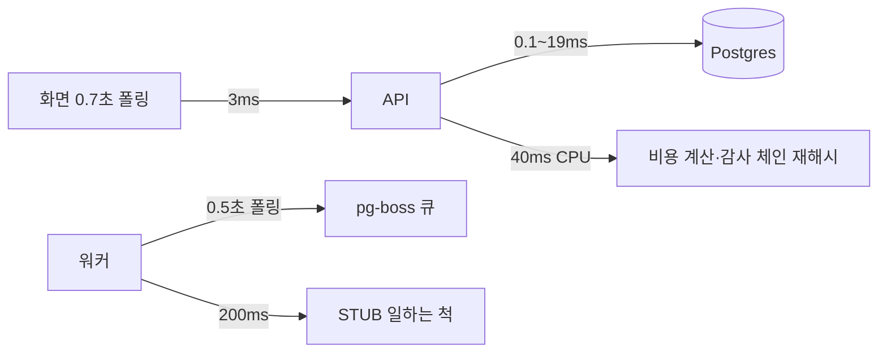

로드맵 위치: 본선 D-7 / 성능 튜닝 (작업 Z49: API·워커 프로파일링) / 본선 연결점: 완성도·데모 30, 클라우드 활용 30("왜 이렇게 했나"를 숫자로), 심사 질문 "어디가 느린가"

# 제어판 성능: 어디서 시간을 쓰나

상태: AI 초안 (팀 검토 전) · 2026-10-31 18:30Z · 기준: 통합본 int5 1차(17:36Z) + Z20 패치 · 클라우드 사본(STUB 모드, Postgres 16, Node 22, 워커 1개) · 맥 재측정 【미확인】

## 0. 한 장 요약

| 질문 | 답 | 근거 |
|---|---|---|
| 이전 1건(smoke 8초)은 어디서 시간을 쓰나 | 롤백 창 3초 + STUB 지연 1.8초 + **큐 대기 2.2초** + 관찰 0.6초. **DB는 0.04초(0.5%)** | 1절 |
| 큐 대기를 줄일 수 있나 | 폴링 0.5초가 pg-boss 최소값. 대신 **NOTIFY로 깨우면 단계마다 300ms → 15ms, smoke 8.29 → 5.90초** | 2절 |
| 느린 API는 | 목록·상세·타임라인·계획은 2~4ms. **비용·보안 표·리포트만 35~46ms** (전부 CPU) | 3절 |
| 비용은 왜 느렸나 | 0~2000 rps를 1씩 올리며 환경 4개를 매번 다시 계산(8천 번). **60초 기억으로 45.7 → 5.1ms** | 3절 |
| 보안 표·리포트는 | 회사 감사 줄 전체를 매 요청 다시 해시. **줄 수에 비례**: 810줄 39ms → 4725줄 162ms. 동시 10개면 1.6초 | 3절 |
| 빠진 인덱스는 | 하나: 보안 표의 임시 자격 장부 읽기. **0014로 1.89만 줄에서 4.17 → 0.15ms** | 4절 |
| 웹 새로고침 0.7초는 | **폴링 간격** 때문. 응답은 3ms. 화면은 평균 0.35초, 최악 0.7초 늦게 본다 | 5절 |
| 메모리·연결 | api 130MB(쉴 때) → 281MB(동시 10개). 연결은 프로세스당 풀 10개가 동시 10개에서 꽉 찬다 | 6절 |

바꾼 것은 전부 **기본값이면 예전과 같은 동작**이다(비용 기억만 기본 켜짐, 결과는 같은 값). 아래 7절.

## 1. 이전 1건 단계별 분해 (smoke, 관찰 0.5초)

재는 법: pg-boss 작업 표의 시각 3개(들어옴 created_on → 집힘 started_on → 끝 completed_on). `tools/perf/stages.sql`. 5회 평균.

| 큐 작업 | 대기 ms (전) | 처리 ms | 처리 안 내용 |
|---|---|---|---|
| import | 349 | 24 | 명세 읽기 |
| precheck | 421 | 222 | STUB 지연 200 + DB |
| plan | 301 | 226 | STUB 200 + 계획서 저장 |
| apply | 210 | 231 | STUB 200 |
| deploy | 280 | 226 | STUB 200 (GITOPS_DISABLE) |
| sync | 297 | 225 | STUB 200 |
| shift | 245 | 866 | 가짜 지표 판정 + 100% 관찰 0.5초 |
| cutover | 193 | 223 | STUB 200 |
| cleanup | 3298 | 241 | **대기 = 롤백 창 3초**(시작 시각을 3초 뒤로 넣음) |

- 대기가 300ms 근처로 일정한 이유: 워커가 앞 단계를 끝낸 뒤 "0.5초 − 처리 시간"만큼 쉬고 다음을 집는다. 앞 단계가 다음 작업을 넣는 순간 워커는 쉬는 중이다.
- 같은 smoke 1건 동안 DB 실행 시간 합 **41ms**, 문장 수 약 1000개(그중 절반은 쉬는 동안 큐 확인). 상태 한 칸(advance) = 문장 8~9개, 0.5ms 안팎.
- 기본값(관찰 30초, Z20 M7)이면 smoke **38.0초**. 늘어난 30초는 성능 문제가 아니라 안전 규칙(100%에서 30초 지켜보기)이다.

## 2. 큐 대기: NOTIFY로 깨우기 (BOSS_LISTEN_NOTIFY=1)

pg-boss 12는 작업을 넣는 트랜잭션에서 `pg_notify`를 같이 보내고, 워커가 LISTEN 하다가 바로 깨는 기능이 있다. 폴링은 그대로 돌아서(같은 0.5초) 알림을 놓쳐도 예전보다 늦지 않다.

| 측정 (5회) | 꺼짐 (기본) | 켬 |
|---|---|---|
| smoke, 관찰 0.5초 | 7.96 / 8.25 / 8.29 / 8.30 / 8.43초 (중앙 8.29) | 5.86 / 5.87 / 5.90 / 6.14 / 6.22초 (중앙 5.90, **−29%**) |
| smoke, 관찰 30초(기본) 1회 | 38.0초 | 35.7초 |
| 단계 사이 대기 (cleanup 제외) | 193~421ms | **11~17ms** |
| 쉴 때 큐 확인 문장 | 초당 21개 | 초당 21개 (같음) |
| DB 연결 | 프로세스당 +0 | 프로세스당 **+1** (LISTEN 전용) |
| 50흐름 동시(워커 3) 전체 p50 | 15.6초 | 13.9초 |
| test:db | 128/0 | 4회 중 3회 128/0, 1회 1건 실패(아래) |

- 왜 기본 꺼짐: 실제 클라우드(맥)에서 한 번도 안 돌려 봤다. PgBouncer transaction 모드 뒤에서는 LISTEN이 안 된다(그때는 경고 후 폴링만).
- 함정 하나를 찾아 막았다: NOTIFY 큐를 다른 옵션으로 `boss.work` 하면 pg-boss가 백업 폴링을 **30초**로 늘린다. 시작 시각이 미래인 cleanup이 30초 늦게 집혀 시험 9개가 시간 초과로 실패했다. 그래서 (1) `workOptions()`가 백업 폴링도 0.5초로 고정, (2) NOTIFY는 이전 단계 큐 10개만, (3) 시험 2개(plans.it, report.it)도 `workOptions()`를 쓰게 바꿨다.
- 남은 1건: 켠 상태 test:db 첫 회에 `plans.it` "정상: 승인 1번으로 draft → completed" 1건 실패. 같은 파일 단독 3회, 전체 3회 다시 돌려 재현 안 됨. 원인 【미확인】. 그래서 켜기 전에 맥에서 test:db 3회를 권한다.
- 화면 쪽 영향: 단계가 빨리 지나가 0.7초 폴링으로는 못 보고 지나가는 칸이 늘어난다(5절). 데모에서 칸을 보여 주고 싶으면 `STUB_DELAY_MS`를 늘린다.

## 3. API 경로별 응답 시간

재는 법: `npx tsx tools/perf/api-bench.ts` (경로당 300번, 데우기 20번, 끝난 이전 1건 기준). 이전 53건, 감사 810줄.

| 경로 | 동시 1 p50 / p95 ms | 동시 10 p50 / p95 ms | 무엇이 시간을 쓰나 |
|---|---|---|---|
| 목록 GET /migrations | 4.1 / 5.6 | 16.3 / 24.9 | 인덱스(tenant_id, updated_at) 50줄 |
| 상세 GET /migrations/:id | 3.0 / 4.7 | 9.3 / 17.3 | 기본 키 |
| 타임라인 | 4.1 / 5.3 | 14.8 / 23.5 | 인덱스(target, seq) |
| 계획 | 3.7 / 5.2 | 11.7 / 22.8 | 인덱스 |
| 환경 목록 | 3.8 / 5.5 | 14.4 / 22.0 | 600줄도 0.7ms |
| **비용** 전 | 45.7 / 70.5 | 432.9 / 592.4 | CPU: estimateCost 손익분기 찾기 |
| **비용** 후 (60초 기억) | **5.1 / 7.2** | **23.1 / 32.1** | 기억된 값 복사 + 가격 출처 요약 |
| 보안 표 | 38.8 / 53.2 | 249.3 / 328.9 | CPU: 회사 감사 체인 전체 재해시 |
| 리포트 | 35.6 / 48.3 | 290.6 / 469.4 | 같음 |

CPU 프로파일(`node --cpu-prof`, 보안·비용·리포트 300번씩): packages/cost 19%, 지문 만들기(canonical) 10%, sha256 4%, pg 줄 해석 4%. DB 기다림은 작다.

### 감사 줄이 늘면 (보안 표·리포트)

같은 회사 감사 줄을 50흐름·200흐름 부하로 늘려 다시 쟀다.

| 회사 감사 줄 | 보안 표 p50 (동시 1) | 리포트 p50 (동시 1) | 보안 표 p50 (동시 10) | DB 읽기만 |
|---|---|---|---|---|
| 810 | 38.8ms | 35.6ms | 249ms | 【미측정】 |
| 4725 | 162.1ms | 168.0ms | — | 18.6ms (표 훑기 + 디스크 정렬 2.6MB) |
| 6961 | — | — | **1570ms** (api 메모리 423MB) | — |

- 줄당 약 34µs. 상한(REPORT_CHAIN_LIMIT 20000줄)까지 가면 한 번에 0.7초 정도 【추정, 선형 외삽】.
- **데모 영향**: 리허설·부하 시험을 데모 DB에서 돌리면 보안 표(화면이 5초마다 다시 읽음)가 느려진다. 결선 전 `npm run db:reset` 또는 부하 시험은 다른 DB에서. → `proposals/audit-chain-checkpoint.md`
- 지금 고치지 않은 이유: "매번 처음부터 확인"이 변조 탐지 장면의 근거다. 결과를 기억하면 고친 줄을 몇 초 늦게 잡는다. 체크포인트 표를 두는 안을 제안으로만 남겼다.

## 4. 인덱스 점검 (EXPLAIN, 앱 계정 + 회사 표시)

`tools/perf/explain.sql`. 감사 4725줄, 이전 313건에서.

| 조회 (쓰는 곳) | 계획 | 실행 ms | 판단 |
|---|---|---|---|
| 목록 ORDER BY updated_at LIMIT 50 | Index Scan migrations_tenant_updated | 0.08 | 됨 |
| 감사 꼬리 (writeAudit) | Index Scan Backward pkey | 0.07 | 됨 |
| 한 이전 감사 줄 (타임라인·리포트) | Bitmap audit_events_target_seq | 0.13 | 됨 |
| 실패 횟수 (failedAttempts) | Bitmap target_seq + action 거르기 | 0.05 | 됨 (줄 15개) |
| 회사 체인 전체 (보안·리포트) | Seq Scan + 정렬 | 18.6 | 회사 줄 전부를 읽으니 훑기가 맞다. 인덱스로 안 줄어듦 |
| 체인 줄 수 count | Seq Scan | 3.7 | 같음 |
| **임시 자격 장부 (보안 표)** | Seq Scan (0009 부분 인덱스는 status ≠ revoked 만) | **4.17 → 0.15** (1.89만 줄) | **0014 추가** |

0014: `temp_credentials (tenant_id, migration_id, issued_at)`. 장부 1.89만 줄(이전당 60줄, 대부분 회수됨)을 트랜잭션 안에서 넣고 쟀다가 되돌렸다(`ROLLBACK`). 0013은 작업 Z39 몫이라 0013이 들어오기 전에는 `tools/db-lint.sh` S1(빈 번호)이 실패한다. 자리표시 0013을 잠깐 넣고 돌린 db-lint는 PASS(D1~D8, D9 경고는 원래 있던 것).

## 5. 웹 새로고침 0.7초

| 항목 | 값 |
|---|---|
| 폴링 간격 (`MigrationDetail.tsx` POLL_MS) | 워커 칸 700ms, 사람 칸 1500ms, 끝나면 멈춤 |
| 상세 응답 (GET /migrations/:id) | p50 3.0ms, p95 4.7ms |
| 상태가 바뀐 뒤 화면에 보이기까지 | 평균 약 0.35초, 최악 약 0.7초 (= 폴링 간격) |
| 결론 | **폴링 간격**이 원인. 응답이 아니다 |

칸이 화면에 한 번이라도 잡힐 확률(칸 머무는 시간 ÷ 0.7초, 1 넘으면 100%). smoke 1건 감사 시각 기준:

| 칸 | 머문 시간 (NOTIFY 꺼짐) | 잡힐 확률 |
|---|---|---|
| importing | 139ms | 20% |
| prechecking / planning | 593 / 539ms | 85% / 77% |
| provisioning / deploying / syncing | 315 / 429 / 497ms | 45% / 61% / 71% |
| shifting | 1186ms (관찰 30초면 30초+) | 100% |
| cutover / cleanup | 349 / 217ms | 50% / 31% |
| rollback_window | 3297ms | 100% |

NOTIFY를 켜면 단계마다 약 230ms라 잡힐 확률이 30%대로 내려간다. 서버는 이미 상태가 바뀔 때마다 `pg_notify('migration_events')`를 보내고 있어서, SSE로 바꾸면 0.7초 → 수십 ms가 된다 → `proposals/web-poll.md`. 화면 코드는 작업 Z46(웹 리팩토링)과 겹쳐 이번엔 안 고쳤다.

## 6. 메모리·연결

| 항목 | 쉴 때 | 부하 중 최대 | 조건 |
|---|---|---|---|
| api 메모리(RSS) | 130MB | 281MB | 읽기 경로 동시 10개 |
| api 메모리(RSS) | 132MB | 423MB | 같음, 감사 6961줄 (보안 표·리포트가 큰 배열을 만든다) |
| worker 메모리(RSS) | 103MB | 113MB | |
| 앱 계정 DB 연결 | 11 (pg-boss 7+4, 앱 풀은 10초 쉬면 닫힘) | 18~19, **active 10** | 동시 10개 = 앱 풀 상한 10에 닿음 |
| 같음, NOTIFY 켬 | 13 (+LISTEN 2) | 19 | |
| 50흐름 동시, 워커 3 | — | 54~57 / max_connections 100 | 잠금 대기 대부분 감사 자문 잠금 (Z6-4와 같음) |

- 프로세스 하나가 쓰는 연결 상한 ≈ 앱 풀 10 + pg-boss 10 + 생존 신호 1 (+ NOTIFY 1) = 21~22. api 1 + 워커 3 + 에이전트 워커 1이면 최대 110 → 기본 max_connections 100을 넘을 수 있다 【추정】. 풀 상한을 `DB_POOL_MAX`로 바꿀 수 있게 했다(기본 10 그대로).

## 7. 바꾼 것 (전/후)

| 무엇 | 기본값 | 바꾸면 | 전 → 후 |
|---|---|---|---|
| 비용 계산 기억 `COST_CACHE_TTL_MS` | 60000 (켜짐) | 0 = 예전처럼 매번 계산 | /cost p50 45.7 → 5.1ms, 동시 10 p50 432.9 → 23.1ms. 결과 값은 같음(시험) |
| NOTIFY 깨우기 `BOSS_LISTEN_NOTIFY` | 꺼짐 | 1 | smoke 8.29 → 5.90초, 단계 대기 300 → 15ms |
| 워커 폴링 간격 `WORKER_POLL_SEC` | 0.5 (예전 값) | ≥ 0.5 (pg-boss 최소) | 늘리면 쉴 때 큐 확인이 준다(초당 21개 ÷ 배수) |
| 앱 연결 풀 `DB_POOL_MAX` | 10 (예전 값) | 1 이상 | 측정 안 함 (CPU가 먼저 막힘) |
| 인덱스 0014 | — | — | 장부 1.89만 줄 4.17 → 0.15ms |

버린 안:
- 가격표 색인(rowsFor를 Map으로): 결과는 같지만 /cost가 45.7 → 41.9ms(8%)밖에 안 줄어 되돌렸다. 느린 건 줄 찾기가 아니라 계산 횟수(8천 번)였다.
- 폴링 0.1초: pg-boss가 0.5초 미만을 거부한다.
- 감사 체인 확인 결과 기억: 변조를 늦게 잡는다(3절).

## 핵심 결정 3개 (+대안)

1. **큐 대기는 폴링을 줄이지 말고 알림으로 깨운다** (대안: 폴링 간격 줄이기 → 최소 0.5초라 불가 / 단계를 한 작업으로 합치기 → 재시도·잠금 설계가 깨짐). 기본은 꺼 두고 맥 검증 뒤 켠다.
2. **비용은 결과 기억(60초)** (대안: 계산 알고리즘 고치기 → packages/cost 범위라 제안으로 / 가격표 색인 → 8%뿐).
3. **감사 체인은 매번 처음부터 확인을 유지하고, 데모 DB를 작게 둔다** (대안: 결과 기억 → 변조 탐지가 늦어짐 / 체크포인트 표 → 설계·마이그레이션이 필요해 제안으로).

## 셀프 연습 1개

`BOSS_LISTEN_NOTIFY=1`로 api·워커를 띄우고 smoke를 한 번 돌린 뒤 `tools/perf/stages.sql`로 대기를 본다. 그다음 워커 시작 옵션에서 `notifyPollingIntervalSeconds`를 지우고(pg-boss 기본 30초로 돌아감) 다시 돌려 cleanup 대기가 어떻게 바뀌는지 보고, 왜 그런지 한 줄로 적어 본다.

## 검증 명령과 기대 출력

맥 Service 폴더에서. 앞에 api·워커가 떠 있어야 하는 것은 smoke·bench·stages.

| 명령 | 기대 |
|---|---|
| `npm run typecheck` | 오류 0 |
| `npm test` | 241 pass / 0 fail (클라우드 사본 기준, 121 skip·5 todo) |
| `npm run test:db` | 128 pass / 0 fail / 1 skip (복제 Postgres 없으면) |
| `BOSS_LISTEN_NOTIFY=1 npm run test:db` (3회) | 3회 모두 0 fail이면 켜도 된다 |
| `TRAFFIC_OBSERVE_SEC=0.5` 로 띄우고 `npm run smoke` | 끄면 약 8.3초, `BOSS_LISTEN_NOTIFY=1`이면 약 5.9초 |
| `npx tsx tools/perf/api-bench.ts` | 비용 p50 10ms 아래, 나머지 표 3절과 비슷 |
| `psql "$OWNER_DATABASE_URL" -v n=5 -f tools/perf/stages.sql` | NOTIFY 켜면 cleanup 말고 대기 20ms 아래 |
