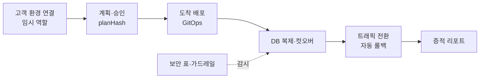

로드맵 위치: 결선 준비 / 발표 뼈대 / 중간 보고 7분 + 최종 발표 5분(슬라이드 없음, 설계 문서 + 라이브 데모)

# 발표 뼈대: 멈추지 않고 옮기고, 증명한다

상태: AI 초안

이 문서는 결선 발표에서 **무슨 순서로 무엇을 말하고 보여 줄지**의 뼈대다. 대본이 아니다. 숫자는 출처 표시를 달았다. 리허설에서 다시 잰 값으로 바꿔 넣는다.

표시: 【사실】 대회 자료·코드·팀 결정 / 【실측】 우리가 로컬·클라우드 컨테이너에서 잰 값 / 【추정】 제안이나 해석 / 【미확인】 아직 아무도 확인 못 함.

## 0. 한 장 그림 (발표 내내 이 그림으로 돌아온다)

이전 한 건이 지나가는 길과, 그 길을 남기는 증적이다.



- 왼쪽에서 오른쪽으로 상태 기계가 한 칸씩 옮긴다. 상태 22개, 바꾸는 길은 함수 하나뿐이다 【사실: 코드 `packages/core/src/advance.ts`】.
- 맨 오른쪽 증적 리포트는 위 모든 단계가 감사 기록에 남긴 것을 모아 한 장으로 보여 준다 【사실: 코드 `GET /api/v1/migrations/:id/report`】.

## 1. 문제 (30초)

- 본선 주제는 "Beyond Lock-In"이다. 이미 실사용자가 있는 시스템을 **멈추지 않고, 안전하게** 다른 클라우드로 옮기고 지킬 수 있는지 묻는다 【사실: 킥오프 자료 14쪽】.
- 고객 입장의 진짜 걱정은 세 가지다.
  - 옮기는 동안 요청이 실패하지 않나.
  - 옮기는 회사에 내 계정 키를 줘야 하나.
  - 끝나고 나서 "정말 계획대로 했는지" 어떻게 믿나.
- 우리 답: 무중단 이전 + 키 없는 임시 권한 + **조작할 수 없는 증적**.

## 2. 아키텍처 (설계 문서 화면, 1분)

맨 위 그림 하나로 설명한다. 세부는 설계 문서 2장 그림으로 넘긴다.

| 층 | 무엇 | 근거 |
|---|---|---|
| 입력 | 웹 콘솔, 회사(테넌트) 격리, 고객 환경 연결은 임시 역할 | 【사실: 설계 가이드 v2.1 2장】 |
| 제어판 | API(Fastify) + 워커(pg-boss) + Postgres. 회사 벽 = tenant_id + RLS | 【사실: 코드】 |
| 이전 | 리플랫폼. 앱은 도착에 새로 배포, DB는 논리 복제 뒤 컷오버 | 【사실: 10/31 팀 회의】 |
| 환경 | AWS(EKS, 서울)와 GCP(서울) 필수, 온프레 k3s + CloudNativePG 시연, Azure는 모양 + Mock | 【사실: 10/31 팀 회의·결정】 |
| 전환 | Cloudflare 가중치 10 → 50 → 100%, 나쁘면 자동 롤백 | 【사실: 명세 v4 FR-MIG-04·05】 |
| AI | 상용 LLM API. 에이전트는 샌드박스에서만 손대고 사람이 승인 | 【사실: 명세 v4 FR-AGT-02·06】 |

말할 것 한 줄: "같은 공통 명세를 환경별 어댑터가 번역한다. 환경을 하나 더 붙이는 비용은 어댑터 하나, 모듈 하나, values 하나다" 【사실: 명세 v4 NFR-15, Helm 값 차이 3~5칸 실측】.

## 3. 라이브 데모 흐름 (3분)

이야기 하나로 잇는다. "AWS에서 돌고 있는 3티어 앱을 GCP로 옮긴다."

| 순서 | 화면 | 말할 것 | 보여 줄 숫자 |
|---|---|---|---|
| 1 | 환경 목록. 앱이 AWS에서 돌고 부하가 계속 들어온다 | 출발점은 이미 돌고 있는 서비스다 | 초당 요청 수, 에러 0 |
| 2 | 비용 비교 | 옮길 이유를 숫자로. 가격표 비교가 아니라 실제 구성 + 트래픽으로 계산 | GCP 월 $146.9, AWS $227.5, 절약 $80.6 【실측: 샘플 가격표 기준, DEMO.md 장면 3】. 가격 근거 일부 【미확인】 |
| 3 | 계획서 + 승인 | 사람이 본 계획의 지문(planHash)과 실행할 계획 지문이 다르면 거부된다 | 거부 409 한 번 |
| 4 | 이전 시작 → 복제 → 전환 | 상태가 한 칸씩 넘어간다. 가중치 10 → 50 → 100% | 실패 요청 0, 복제 지연 ms |
| 5 | 컷오버 | DB 쓰기 담당이 넘어가는 순간 쓰기가 멈추는 시간 | 중앙값 **62ms**(55~69, 5회), 쓰기 2,365건 중 실패 0 【실측: 같은 호스트 Postgres 두 대】. 워커에 연결한 뒤 43~50ms 【실측】. 클라우드 사이(RDS → Cloud SQL)는 왕복 지연만큼 늘어난다 【추정】 |
| 6 | 온프레 | 같은 차트가 k3s + CloudNativePG에도 올라간다. 보안 표에 세 환경이 같은 기준으로 | 통제 12개 × 환경 3개 빈칸 0 【실측: 설계 단계 검증】 |
| 7 | 증적 리포트 | "끝났다"가 아니라 "증명한다". 감사 기록을 처음부터 다시 계산해 일치함을 보여 준다 | 감사 N줄 일치, 승인 지문 일치, 컷오버 ms |

시간이 남으면 넣을 장면 (선택):

- 도착에 장애를 넣어 자동 롤백. 이상 감지 → 출발 100% 복귀 중앙값 4.0초 【실측: 로컬 시뮬레이션】, 목표 60초 이내.
- 감사 기록 한 줄을 일부러 고치고 리포트를 다시 열면 그 seq에서 "깨짐"이 뜬다 【실측: 통합 시험 `report.it.ts`】.

## 4. 차별점 (1분, 데모 중간중간에 한 줄씩)

1. **키 없는 임시 권한, 최소 권한.**
   - 고객 계정 키를 받지 않는다. 읽기용·변경용 역할 두 개를 15분씩 빌린다 【사실: 설계 가이드 v2.1 2장】.
   - 변경용 역할은 이전 번호 없이는 빌릴 수 없고, 와일드카드 권한은 코드가 거부한다 【사실: 코드 `packages/security/src/temp-role.ts`】.
2. **두 번 눌러도 한 번만.**
   - 상태를 바꾸는 POST는 멱등 키로 첫 응답을 저장하고 같은 키에는 그대로 돌려준다 【사실: 코드 `apps/api/src/plugins/idempotency.ts`】.
   - 큐 작업도 같은 작업 키를 붙여 중복 실행을 막는다. 워커는 작업 내용을 믿지 않고 DB에서 다시 읽는다 【사실: 코드 `advance.ts`, CLAUDE.md 5-3】.
3. **증적: 조작하면 드러나는 기록.**
   - 모든 상태 전이·승인·거부가 감사 해시 체인에 남는다. 각 줄이 앞 줄 지문을 품고 있어 한 줄만 고쳐도 그 뒤가 다 틀어진다 【사실: 코드 `packages/core/src/audit.ts`】.
   - 리포트는 체인을 처음부터 다시 계산하고, 승인한 계획 지문과 저장된 계획 지문을 대조하고, 측정값을 모은다. 비어 있는 것은 "비어 있다"고 적는다 【사실: 코드 `apps/api/src/report/`】.

심사 항목과의 연결 【사실: 예선 배점, 킥오프 자료 40~43쪽 문구】:

| 심사 항목 | 우리가 보여 주는 것 |
|---|---|
| 완성도·데모 30 | 데모 4~5 장면의 그 자리 숫자, 증적 리포트 |
| 클라우드 활용 30 | 어댑터 추상화, 무중단·롤백, 임시 역할·최소 권한 |
| 팀 개발 20 | 결정 49개에 대안·버린 이유·측정값 (설계 문서 18장) |
| 독창성 10 | 증적 리포트, 보안을 고려한 비용 비교, 온프레 재현 |
| AI 10 | 샌드박스 안 에이전트, 사람 승인 |

## 5. 한계와 다음 단계 (30초, 숨기지 않는다)

- 교차 클라우드 실측이 아직 없다. 컷오버 62ms는 같은 호스트 측정이다 【미확인: RDS → Cloud SQL】.
- 지금 워커의 여러 단계(가져오기, 배포, 트래픽 판정)는 가짜 구현(STUB)이다. 리포트에도 "일부 STUB 값"이 그대로 찍힌다 【사실: 샘플 리포트 gaps】.
- 비용은 샘플 가격표 기준이고 일부 단가 근거가 미확인이다. 가격 API 연동 중 【사실: 코드 `loadSampleCatalog` STUB 주석】.
- 감사 체인 검증은 데모 규모(회사당 수천 줄)를 전제로 처음부터 다시 계산한다. 규모가 커지면 구간별 서명(체크포인트)이 필요하다 【추정】.
- 다음 단계: 클라우드 사이 컷오버 실측 5회, 리허설 5회 중 5회 성공(NFR-14), 증적 리포트를 화면 버튼 하나로.

## 6. 중간 보고(7분)와 최종 발표(5분) 나누기

【사실: 킥오프 자료 28~37쪽】 중간 보고는 7분(3 + 4, 설계 문서 + 아키텍처 그림), 최종은 5분이고 슬라이드가 없다.

| | 중간 보고 7분 【추정: 배분안】 | 최종 5분 【추정: 배분안】 |
|---|---|---|
| 문제 | 0:30 | 0:20 |
| 아키텍처 | 2:00 (그림 + 결정 3개) | 0:40 |
| 데모 | 2:30 (동작하는 뼈대 + 리포트) | 3:00 (위 3장 전체) |
| 차별점 | 1:00 | 0:40 (데모 중 한 줄씩) |
| 한계·다음 | 1:00 | 0:20 |

## 핵심 결정 3개 (+대안)

| 결정 | 대안 | 고른 이유 |
|---|---|---|
| 발표의 끝을 "완료 화면"이 아니라 **증적 리포트**로 맺는다 | 상태 화면 캡처, 로그 스크롤 | 심사위원이 "정말 그랬나"를 그 자리에서 확인할 수 있다. 감사 체인 재계산이라 숫자를 꾸밀 수 없다 |
| 데모 숫자는 **실측과 추정을 화면에서 구분**한다 | 목표치만 말하기 | 팀 개발 20점이 "대안·측정값 문서화"를 본다. 미확인을 숨기면 질의응답에서 무너진다 |
| 차별점은 **세 개로 고정**(임시 권한, 멱등성, 증적) | 기능 목록 전부 나열 | 5분 안에 기억에 남는 수는 셋 안팎이다 【추정】 |

## 셀프 연습 1개

- 증적 리포트에서 "감사 기록 무결성" 줄 하나만 가리고, 이 줄이 왜 위조를 막는지 30초 안에 말해 본다. 막히면 `apps/api/src/report/chain.ts`를 한 줄씩 읽는다.

## 검증 명령과 기대 출력

통합본에 Q 파일을 넣고 `main.ts`에 라우트를 등록한 뒤:

```bash
npm run typecheck
npm test
npm run test:db
```

기대: 타입 오류 0, `npm test`에 fail 0, `npm run test:db`에 `# pass 24`·`# fail 0`.

api·worker를 띄운 상태에서 끝난 이전 하나로:

```bash
curl -s -H "x-dev-tenant: 11111111-1111-4111-8111-111111111111" "http://localhost:3000/api/v1/migrations/<이전번호>/report?format=md"
```

기대: `# 이전 증적 리포트`로 시작하고 `감사 기록 무결성: 통과`가 보인다.
