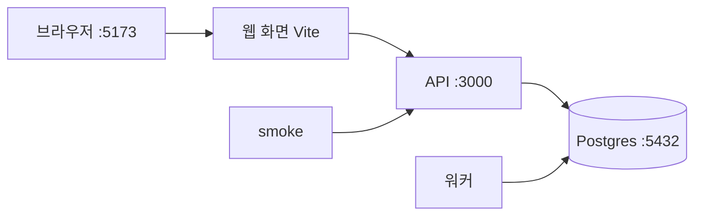

로드맵 위치: 본선 D-7 / 스켈레톤 로컬 실행 / 본선 연결점: 완성도·데모 30점 (누구 노트북에서나 같은 데모가 돈다)

# QUICKSTART: 내 노트북에서 10분 안에 스켈레톤 띄우기

상태: AI 초안. 리눅스(x86_64)에서 Node 22·24 로 처음부터 따라 해 검증함. 맥은 Jeong 의 Intel 맥에서 같은 순서로 돈 기록이 있음. Apple Silicon 은 아직 직접 돌려 보지 않음.

## 무엇이 뜨나

DB 하나와 프로그램 셋이 뜬다. smoke 는 마지막에 "이전 1건"을 끝까지 돌려 보는 확인용 프로그램이다.



- **Postgres**: 데이터베이스. 도커 컨테이너로 뜬다. 내 컴퓨터에 따로 설치하지 않는다.
- **워커**: DB 안의 작업 줄(큐)에서 일을 꺼내 이전 상태를 한 칸씩 넘긴다.
- **API**: 요청을 받아 DB 에 쓰고, 워커에게 일을 넣는다.
- **웹 화면**: 브라우저에서 이전 진행 상황을 본다. `/api` 요청은 Vite 가 API 로 넘겨 준다.
- **smoke**: 이전 1건을 만들고 승인까지 눌러서 `completed` 가 되는지 본다.

API 와 워커는 서로 직접 부르지 않는다. 둘 다 DB 만 본다. 그래서 띄우는 순서는 **DB 먼저**다.

## 1. 준비물 (처음 한 번)

| 도구 | 버전 | 확인 명령 |
|---|---|---|
| Node.js | 22 이상, 24 LTS 권장 | `node -v` |
| npm | Node 에 딸려 옴 | `npm -v` |
| Docker + compose v2 | Docker Desktop 최신 | `docker compose version` |
| curl | 기본 설치 | `curl --version` |

먼저 이미 깔려 있는지 본다. 위 확인 명령이 버전을 찍으면 그 도구는 건너뛴다.

**맥 (Intel·Apple Silicon 공통)**

- Node: nodejs.org 에서 LTS(24) 설치 파일(.pkg)을 받는다. 칩 종류를 알아서 고른다.
- Docker: Docker Desktop 을 받는다. 다운로드 버튼이 **Apple Silicon** 과 **Intel** 두 개다. 내 칩은 아래 명령으로 본다.

```bash
uname -m
```

- `arm64` 가 나오면 Apple Silicon, `x86_64` 가 나오면 Intel 이다.
- Intel 맥에서 `brew install node` 는 소스에서 빌드하느라 오래 걸릴 수 있다. 설치 파일(.pkg)이 빠르다.
- 설치 후 Docker Desktop 앱을 한 번 켠다. 메뉴 막대의 고래 아이콘이 멈추면 준비 끝이다.

**리눅스 (Ubuntu 기준)**

- Node: nodejs.org 의 안내대로 nvm 이나 NodeSource 로 24 를 깐다.
- Docker: Docker Engine 과 `docker-compose-plugin` 을 깐다.
- `sudo` 없이 docker 를 쓰려면 내 계정을 docker 그룹에 넣고 다시 로그인한다.

```bash
sudo usermod -aG docker $USER
```

- `usermod -aG docker $USER`: 지금 계정을 docker 그룹에 추가한다.

**윈도우**: WSL2 안의 Ubuntu 에서 리눅스 안내를 따른다. Docker Desktop 의 WSL 연동을 켠다.

## 2. 한 번에 띄우기 (스크립트)

Service 폴더(`package.json` 이 있는 곳)로 들어간다. 아래 명령은 전부 이 폴더에서 친다.

```bash
cd Service
```

- 폴더 이름은 내가 받은 위치에 맞게 바꾼다.

### 2-1. .env 만들기

```bash
cp .env.example .env
```

- `.env.example` 을 복사해 `.env` 를 만든다.
- `.env` 에는 DB 주소와 API 포트가 들어 있다. 개발용 값이라 그대로 써도 된다.
- `.env` 는 git 에 올리지 않는다. 실제 클라우드 키를 여기에 넣게 되면 더더욱 그렇다.

### 2-2. 점검

```bash
bash scripts/dev-check.sh
```

- 도구 버전, docker 엔진, `.env`, 포트 5432·3000·5173 을 본다.
- 아무것도 설치하거나 지우지 않는다. 읽기만 한다.
- `[실패]` 줄이 있으면 바로 아래 `->` 안내대로 고치고 다시 친다.
- 마지막 줄이 `결과: 실패 0` 이면 다음으로 간다.

### 2-3. 띄우기

```bash
bash scripts/dev-up.sh
```

- 점검, `npm install`(처음 한 번), DB, 워커, API, 웹, smoke 순서로 돈다.
- 각 단계 로그는 `.dev-logs/` 폴더에 남는다.
- 띄운 프로그램은 스크립트가 끝나도 계속 돈다.

마지막에 이렇게 나오면 성공이다.

```text
        completed after 8173 ms

[ 17s] 끝. 모두 떠 있음
  화면    : http://localhost:5173
```

브라우저로 http://localhost:5173 을 연다. 방금 smoke 가 만든 이전이 `completed` 로 보인다.

### 2-4. 상태·로그·끄기

```bash
bash scripts/dev-up.sh status
```

- DB·워커·API·웹이 떠 있는지 한 줄씩 보여 준다.

```bash
bash scripts/dev-up.sh logs
```

- 각 로그의 끝 10줄을 보여 준다.

```bash
bash scripts/dev-up.sh stop
```

- 스크립트가 띄운 워커·API·웹을 끈다. DB 는 남겨 둔다.

```bash
npm run db:down
```

- DB 컨테이너를 끈다. 데이터는 남는다.

## 3. 손으로 띄우기 (터미널 4개)

스크립트가 하는 일을 직접 해 보는 방법이다. 코드를 고치면서 로그를 바로 보고 싶을 때 이쪽이 편하다. 터미널 창을 4개 연다. 모두 Service 폴더에서 시작한다.

**처음 한 번**

```bash
npm install
```

- `package.json` 에 적힌 라이브러리를 `node_modules/` 에 받는다. 1~3분 걸린다.
- 워크스페이스(apps·packages 아래 폴더들)를 한 번에 설치한다.

**터미널 1: DB**

```bash
npm run db:up
```

- `docker compose up -d db` 를 실행한다. Postgres 16 컨테이너가 뒤에서 뜬다.
- DB 가 처음 만들어질 때 `db/migrations/*.sql` 이 순서대로 돈다. 표와 계정 `app_user` 가 이때 생긴다.

```bash
docker compose ps
```

- STATUS 에 `(healthy)` 가 보이면 DB 준비 끝이다. 보통 3~10초.

**터미널 2: 워커**

```bash
npm run dev:worker
```

- 기대 출력: `worker ready: import, precheck, plan, ...`
- 코드를 저장하면 알아서 다시 뜬다(`tsx watch`).

**터미널 3: API**

```bash
npm run dev:api
```

- 3000 포트에서 API 가 뜬다. 다른 터미널에서 확인한다.

```bash
curl -s localhost:3000/readyz
```

- 기대 출력: `{"ok":true}`. API 가 DB 까지 붙었다는 뜻이다.

**터미널 4: 웹 화면**

```bash
npm run dev:web
```

- 기대 출력: `Local: http://localhost:5173/`

**아무 터미널: smoke**

```bash
npm run smoke
```

- 이전 1건을 만들고, 계획을 세우고, 승인하고, 끝까지 돌린다.
- 상태가 바뀔 때마다 한 줄씩 찍힌다. 마지막 줄이 `completed after 8000 ms` 근처면 성공이다.

끌 때는 각 터미널에서 `Ctrl+C`, DB 는 `npm run db:down`.

## 4. 자주 나는 오류

| 증상 | 원인 | 해결 |
|---|---|---|
| `dev-check` 가 `5432 를 다른 Postgres 가 잡고 있음` | 맥 Homebrew 의 postgresql 이 켜져 있음 | `brew services list` 로 이름 확인 후 `brew services stop postgresql@16`. 재부팅하면 다시 켜질 수 있음 |
| 위와 같은데 리눅스 | 시스템 Postgres 서비스 | `sudo systemctl stop postgresql` |
| `dev-check` 가 `.env 없음`, 또는 실행하자마자 `node: ../../.env: not found` | `.env` 를 안 만들었음 | `cp .env.example .env` |
| API 로그에 `EADDRINUSE ... 3000` | 3000 포트를 다른 개발 서버가 씀 | 그 서버를 끄거나 `.env` 의 `API_PORT=3001` 로 바꿈. `dev-up.sh` 는 웹·smoke 에도 자동 반영. 손으로 띄울 땐 아래 표 밑 참고 |
| 워커·API 가 `password authentication failed for user "app_user"` | 예전에 만든 DB 볼륨이 남아서 마이그레이션이 다시 안 돎 | `docker compose down -v` 후 다시 띄움. **DB 데이터가 지워진다** |
| DB 가 healthy 가 안 되고 로그에 `initdb.d ... Permission denied` | 리눅스에서 tgz 를 풀어 파일 권한이 600 | `chmod -R a+rX db` 후 `docker compose down -v`, 다시 띄움 |
| `npm run db:up` 이 `429 Too Many Requests` | Docker Hub 내려받기 횟수 제한 | 아래 두 줄로 거울 저장소에서 받기 |
| `Cannot connect to the Docker daemon` | Docker 엔진이 꺼짐 | 맥은 Docker Desktop 켜기, 리눅스는 `sudo systemctl start docker` |
| 워커·API 가 `ECONNREFUSED 127.0.0.1:5432` | DB 보다 먼저 띄움 | DB 가 healthy 가 된 뒤 그 터미널에서 파일 하나 저장하거나 `Ctrl+C` 후 다시 실행 |
| smoke 가 `fetch failed ... 3000` | API 가 안 떠 있음 | 터미널 3 확인, `curl -s localhost:3000/readyz` |

API 포트를 바꿔서 손으로 띄울 때는 웹과 smoke 에도 알려 줘야 한다. 둘은 `.env` 를 읽지 않기 때문이다.

```bash
API_URL=http://localhost:3001 npm run dev:web
```

- 웹 화면의 프록시가 3001 로 넘기게 한다.

```bash
API_PORT=3001 npm run smoke
```

- smoke 가 3001 로 요청하게 한다.

Docker Hub 429 가 날 때:

```bash
docker pull mirror.gcr.io/library/postgres:16-alpine
```

- 구글이 운영하는 Docker Hub 거울에서 같은 이미지를 받는다.

```bash
docker tag mirror.gcr.io/library/postgres:16-alpine postgres:16-alpine
```

- 받은 이미지에 `postgres:16-alpine` 이라는 이름을 하나 더 붙인다. 그러면 compose 가 내려받지 않고 이걸 쓴다.

## 5. 측정값

【사실, 이 가이드 검증 환경: 리눅스 x86_64, Docker 29, Node 22.23·24.22】

| 항목 | 값 |
|---|---|
| smoke 시작부터 `completed` 까지 | 7,872 / 7,931 / 8,089 / 8,160 / 8,238 ms (5회) |
| `dev-up.sh` 전체, 의존성·이미지 이미 있음 | 15~18초 |
| DB 컨테이너 시작부터 healthy 까지 | 약 3초 |

- 【추정】 처음 하는 노트북은 `npm install` 1~3분, Postgres 이미지 내려받기(약 120MB) 1분 정도가 더 든다. 그래도 10분 안이다.
- 【미확인】 Apple Silicon 맥에서는 아직 재 보지 않았다. 재면 이 표에 더한다.

## 핵심 결정 3개

1. **DB 는 도커 컨테이너로 띄운다.** 대안: 각자 Homebrew·apt 로 Postgres 설치. 버린 이유: 버전·계정·포트가 사람마다 달라지고, 마이그레이션 자동 실행(`docker-entrypoint-initdb.d`)을 못 쓴다.
2. **스크립트는 점검(`dev-check`)과 실행(`dev-up`)을 나눈다.** 대안: 스크립트 하나가 알아서 다 고침. 버린 이유: 남의 노트북에서 Postgres 를 끄거나 볼륨을 지우는 일은 본인이 판단해야 한다. 점검은 읽기만 하고, 지우는 명령은 안내만 한다.
3. **띄우는 순서는 DB, 워커, API, 웹, smoke.** 대안: 아무 순서로 띄우고 재시도에 맡김. 버린 이유: 지금 워커·API 는 DB 연결에 실패하면 죽고, `tsx watch` 는 파일이 바뀔 때까지 다시 띄우지 않는다. 순서를 지키는 쪽이 빠르다.

## 셀프 체크 질문 5개

1. API 와 워커는 서로 어떻게 일을 주고받나? 둘 중 하나만 띄우면 smoke 는 어디서 멈출까?
2. `docker compose down` 과 `docker compose down -v` 는 무엇이 다른가? `app_user` 오류에 왜 `-v` 가 필요한가?
3. 앱은 `app_user` 로, 마이그레이션은 `platform_owner` 로 DB 에 붙는다. 계정을 둘로 나눈 이유는?
4. 웹 화면은 왜 `localhost:3000` 이 아니라 `/api` 로 요청하나? 이렇게 하면 무엇이 필요 없어지나?
5. 3000 포트가 막혀 `API_PORT=3001` 로 바꿨다. 손으로 띄울 때 바꿔 줘야 하는 곳 두 군데는?

## 셀프 연습 1개

DB 를 일부러 늦게 띄워 본다. `npm run db:down` 으로 DB 를 끈 채 `npm run dev:worker` 를 실행하고 오류를 읽는다. 그다음 `npm run db:up` 을 하고, 워커가 다시 붙게 만드는 가장 짧은 방법을 찾는다.

## 검증 명령과 기대 출력

```bash
bash scripts/dev-check.sh
```

- 기대: 마지막 줄 `결과: 실패 0, 주의 N. 띄울 준비 됨.`

```bash
bash scripts/dev-up.sh
```

- 기대: `completed after 약 8000 ms` 와 `끝. 모두 떠 있음`

```bash
curl -s localhost:3000/readyz
```

- 기대: `{"ok":true}`

```bash
bash scripts/dev-up.sh status
```

- 기대: `db : running healthy`, 워커·API·웹 `실행 중`, `API readyz: ok`
