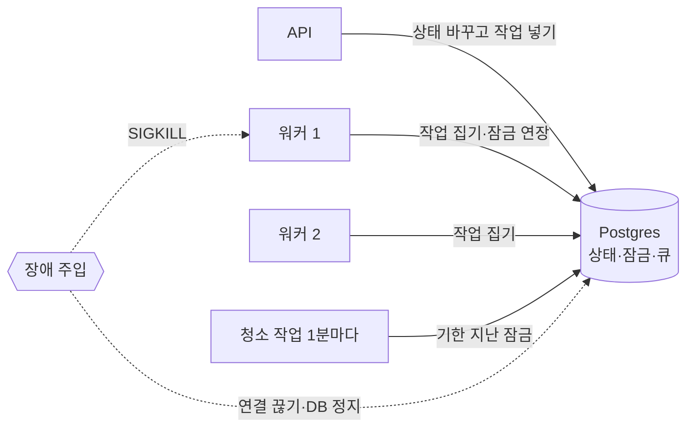
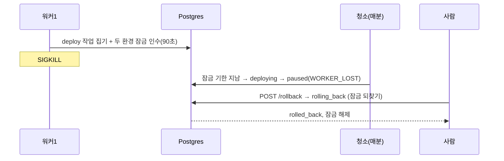

로드맵 위치: 본선 D-7 / 제어판 장애 복구 시나리오 (작업 Z12) / 본선 연결점: 완성도·데모 30 (장애를 일부러 내고 숫자로 보여 줌), 팀 개발 20

# 장애 복구 시나리오: 워커가 죽거나 DB가 끊기면 이전은 어떻게 되나

상태: AI 초안 (팀 검토 전) · 2026-10-31 · 기준 코드 `integration/service-current.tgz` int3 (17:05Z, Z1 잠금 포함). 시나리오 ②③은 int2에서도 같은 결과.

## 1. 한눈에 (그림 먼저)



제어판은 API, 워커, Postgres 셋으로 돈다. 이전(migration) 하나의 상태, 환경 잠금(env lock), 작업 큐(pg-boss)가 전부 Postgres 안에 있다. 그래서 프로세스가 죽어도 "어디까지 했는지"는 DB에 남는다. 이 문서는 일부러 장애를 내고 그 기록이 맞게 남는지, 누가 이어받는지를 잰 결과다.

이 문서에서 정한 것:
- 장애 시험은 두 종류로 나눴다. 빠르고 서로 안 건드리는 것은 `test:db`(13+5개), 진짜 프로세스를 죽이는 것은 `tools/chaos/`(따로 실행).
- 기다리는 시간(잠금 90초, pg-boss 만료 15분)은 DB 시각을 과거로 당겨서 줄였다. 한 번은 실제 시간으로도 쟀다.
- 찾은 문제는 고치지 않고 번호(Z12-1~7)를 붙여 CHANGES.md에 적었다.

## 2. 결과 요약

| # | 시나리오 | 결과 | 숫자 |
|---|---|---|---|
| ① | 워커가 일하다 SIGKILL로 죽음 | 다른 워커가 **이어받지 않는다**. 잠금 기한(90초) 뒤 청소가 `paused`(WORKER_LOST)로 멈춘다. 사람이 롤백하면 빠져나온다. 상태가 두 번 넘어간 적은 0번 | 죽음→paused 실제 147초, 롤백→rolled_back 0.5초 |
| ①-b | 같은 작업이 두 워커에 동시에 + 늦게 한 번 더 | 단계마다 상태 이동 정확히 1번 | 7단계 ×3배달 0.6초, version +7 |
| ①-c | SIGTERM(정상 종료) | 하던 작업을 끝내고 잠금을 반납한 뒤 종료 | 2.5초(=작업 길이) |
| ② | DB 연결이 서버 쪽에서 끊김 | 프로세스 안 죽음. 다음 요청이 새 연결로 붙음 | 다음 호출 11.5ms, 10개 동시 끊김 뒤 10/10 성공 15ms |
| ②-b | Postgres를 5초·20초·75초 멈췄다 켬 | API·워커 모두 생존. 켜진 뒤 readyz 즉시 회복, 이전 completed | readyz 9~11ms 뒤 회복, completed 4.7~4.9초 뒤 |
| ③ | 같은 Idempotency-Key 요청 동시 2개·10개 | 정확히 1번 처리, 나머지는 같은 응답 재생 | 10개 동시 중앙값 27.8ms |
| ④ | 실패 시 env_lock | Z1이 고친 길(apply·sync·롤백 실패)은 맞게 해제. 그 밖의 길에서 잠금이 엉뚱한 이름·이유로 남는 문제 2개 | — |
| ⑤ | 실패 코드 → paused | 장치(runStep·전이 조건)는 맞게 동작. 하지만 **지금 어떤 처리기도 실패를 paused로 보내지 않고**, paused에서 재개하는 API도 없다 | — |

## 3. 시나리오별 설명

### 3-1. 워커가 일하다 죽으면 (①)



- 잠금을 쥔 워커는 30초마다 기한을 90초로 늘린다. 죽으면 늘리는 사람이 없어 90초 뒤 기한이 지난다.
- 청소 작업이 1분마다 기한 지난 잠금을 찾는다. `deploying`·`syncing`·`shifting`·`cleanup`은 `failed`로 갈 길이 없어서 `paused`로 보낸다. `provisioning`은 `failed`로 보내고 잠금을 푼다(Z1).
- 다른 워커는 자동으로 이어받지 않는다. 15분 뒤 pg-boss가 죽은 작업을 만료시켜 다시 주지만, 그때는 상태가 `paused`라 아무것도 안 하고 끝난다(감사 `job.rejected` 1줄).
- 빠져나오는 길은 롤백(또는 취소)뿐이다. 재개 버튼(API)이 없다 → Z12-3.
- 실제 시간으로 재면 죽은 뒤 paused까지 147초 걸렸다(잠금 90초 + 청소 주기 최대 60초).
- int2(Z1 전)에서는 단계가 잠금을 안 쥐어서, 죽은 뒤 15분(pg-boss 만료) + 최대 1분 뒤에 다른 워커가 재시도로 이어받았다(completed까지 갔음). apply는 재시도 0번이라 이어받지 못했다(Z12-1).

### 3-2. 같은 작업이 두 번 배달되면 (①-b)

워커가 ③(상태 이동) COMMIT 직후, pg-boss에 "끝" 보고 전에 죽으면 같은 작업이 다시 온다. 시험은 단계마다 같은 작업을 두 워커가 동시에 부르고, 끝난 뒤 한 번 더 부른다.
- 결과: 7단계 모두 `advanced` 1번, 나머지는 `skipped`. 막는 장치는 상태 행 `FOR UPDATE` + "아직 그 상태면" 조건(ifStill)이다.
- 주의: ② 일(어댑터 호출) 자체는 두 번 돈다. 지금은 STUB이라 무해하지만, 진짜 Terraform·Argo·LB 호출은 같은 요청을 두 번 받아도 같은 결과여야 한다(멱등).

### 3-3. DB 연결이 끊기면 (②)

- 쉬는 연결이 끊기면 pg 풀이 `error` 이벤트를 낸다. 처리기가 없으면 Node 프로세스가 죽는다(대조군 시험으로 확인). `packages/core/src/db.ts`에 처리기가 있어 로그 한 줄만 남는다.
- 빌린 연결이 트랜잭션 중에 끊기면 그 요청만 오류(57P01)로 끝나고 연결은 버려진다. 다음 요청은 새 연결.
- 진짜 API·워커가 도는 중에 그 프로세스들의 연결을 3번 다 끊어도 이전은 completed까지 갔다. 상태 중복 0.
- Postgres를 75초 멈춰도 두 프로세스는 살아 있었다. 멈춘 동안 `/readyz`는 500, 켜진 뒤 10ms 안에 200.

### 3-4. 같은 키 요청이 동시에 오면 (③)

- 키 줄을 트랜잭션 맨 앞에서 INSERT 한다. 두 번째 요청의 INSERT는 첫 번째가 COMMIT 할 때까지 기다린 뒤 "이미 있음"을 보고 첫 응답을 그대로 돌려준다.
- 확인한 것: POST /migrations 2개·10개(×5회), 같은 키 다른 본문(→ 409 IDEMPOTENCY_KEY_REUSED), 다른 회사 같은 키(→ 따로 처리), 승인 2개(승인 기록 1줄), start 2개(apply 작업 1개). 키 없는 start 2개도 상태기계가 하나를 409로 막는다.

### 3-5. 실패할 때 잠금 (④, int3 기준)

Z1이 이미 시험하는 길(apply 실패 → failed·해제, sync 2번 실패 → 자동 롤백·해제, 롤백 2번 실패 → failed·유지 → 수동 정리 후 취소에서 해제)은 다시 안 했다. 그 밖의 길:

| 실패 모양 | 상태 | 잠금 | 문제 |
|---|---|---|---|
| onError 없는 단계(deploy·shift·cutover·cleanup)에서 예외 | 그대로(재시도 뒤에도) | reserved로 반납, 10분 뒤 청소 → paused | 실패 사유가 `JOB_NOT_PICKED`로 남음 (Z12-6) |
| ③에서 전이 조건 실패 | 그대로 | 반납이 같이 취소돼 `worker:<pid>`로 남음, 90초 뒤 청소 → paused | 워커가 살아 있는데 `WORKER_LOST` (Z12-7) |
| 워커 죽음 | paused/failed | paused 유지, provisioning 실패는 해제 | 죽은 큐 작업이 15분 active로 남음 (Z12-4) |

### 3-6. 실패 코드 → paused (⑤)

- 장치는 맞다: 처리기가 `{ to: "paused", failureCode }`를 돌려주면 paused로 가고 `paused_from`·`failure_code`·감사가 남는다. 실패 코드가 없으면 T30 조건이 막는다. 재개는 멈추기 전 단계로만, `ruleCleared` 증거가 있어야 한다.
- 하지만 지금 STUB 실패 스위치는 모두 다른 곳으로 간다: `APPLY_STUB_FAIL=1` → failed, `SYNC_STUB_FAIL=1` → 자동 롤백, `TRAFFIC_STUB_SCENARIO=err` → rolling_back. paused로 가는 길은 청소 작업뿐이다 (Z12-5).
- paused에서 다시 시작하는 API가 없다. 화면에 "멈춤"은 뜨지만 누를 버튼은 롤백·취소뿐이다 (Z12-3).

## 4. 재현 절차 (사람이 맥에서 직접)

자동 시험 말고 눈으로 보고 싶을 때. 터미널 3개.

1. DB를 띄운다.
```
docker compose up -d db
```
2. 터미널 1에서 워커, 터미널 2에서 API를 띄운다.
```
npm run dev:worker
```
```
npm run dev:api
```
3. 터미널 3에서 smoke를 돌리고, `status=deploying`이 찍히면 터미널 1을 강제로 죽인다(Ctrl+C가 아니라 kill -9).
```
npm run smoke
```
```
pkill -9 -f "apps/worker/src/main.ts"
```
4. 워커를 다시 띄우고 2~3분 기다리면 smoke 화면이 `paused`에서 멈춘다(SMOKE_TIMEOUT_MS를 200000으로 늘려야 볼 수 있다). 화면(localhost:5173)에서도 "멈춤"으로 보인다.
5. 롤백으로 빠져나온다. `<id>`는 smoke 첫 줄의 번호.
```
curl -s -X POST localhost:3000/api/v1/migrations/<id>/rollback -H 'content-type: application/json' -H 'x-dev-tenant: 11111111-1111-4111-8111-111111111111' -d '{}'
```
6. DB 잠깐 끊기: smoke 도중 DB를 5초 멈췄다 켠다. 워커·API 터미널에 오류 줄은 찍히지만 프로세스는 안 죽고 smoke는 completed로 끝나야 한다.
```
docker compose stop db
```
```
docker compose start db
```

## 5. 핵심 결정 3개 (+대안)

| 선택 | 대안 | 이유 |
|---|---|---|
| 진짜 프로세스 시험은 `tools/chaos/`로 분리, test:db에 안 넣음 | test:db에 같이 넣기 | test:db는 파일을 병렬로 돌린다. 자식 워커가 다른 시험의 작업을 집고, 연결 끊기가 다른 시험을 깨뜨린다. 분리하니 test:db 127/127 3회 흔들림 0 |
| 긴 기다림은 DB 시각을 과거로 당김 (잠금 기한, pg-boss started_on) | 실제로 2~16분 기다리기 / 소스에 가짜 시계 넣기 | 코드를 안 고치고 1분 안에 끝남. 대신 한 번은 실제 시간으로 재서 당긴 결과와 같은지 확인 |
| 버그는 "지금 동작"을 단언하는 시험으로 고정 (메시지에 "고쳐지면 뒤집기") | todo 시험 / 문서만 | 고치는 쪽이 어떤 줄을 바꿔야 하는지 바로 보인다. P의 todo 방식과 달리 지금 모습이 초록으로 고정됨 |

## 6. 측정값 (클라우드 사본, Postgres 16, Node 22)

(아래 표는 CHANGES.md와 같다. 반복 횟수는 표에)

| 항목 | 값 |
|---|---|
| test:db 3회 | 132/132, 31.2 / 30.9 / 30.7초 |
| 워커 SIGKILL → paused (실제 시간) | 147.0초 |
| 워커 SIGKILL → paused (잠금 기한 당김) | 3.7초 |
| paused → rolled_back | 0.44 / 0.53초 |
| SIGTERM 정상 종료 | 2.52~2.57초 (3회) |
| 중복 배달 7단계×3 | 606~679ms (7회) |
| 트랜잭션 중 연결 끊김 → 다음 호출 | 10.2~17.2ms (6회) |
| 쉬는 연결 10개 끊김 → 동시 10건 | 10/10, 13.9~19.7ms (6회) |
| API·워커 연결 전부 끊기 ×3 | completed 6.6~7.0초 (4회), 중복 0 |
| Postgres 정지 5 / 20 / 75초 | 생존, 시작 뒤 readyz 8~11ms, completed 4.7~5.0초 뒤 |
| 같은 키 동시 10개 | 중앙값 27.5~27.8ms, 처리 1 + 재생 9 |

## 7. 셀프 연습 1개

`packages/core/src/db.ts`에서 `pool.on("error", ...)` 한 줄을 지우고 `node --env-file=.env --import tsx --test packages/core/test/pool-recovery.db.test.ts`를 돌린다. 첫 시험("쉬는 연결이 끊김")이 프로세스째 죽는지 본다. 다시 넣어 5/5로 되돌린다.

## 8. 검증 명령과 기대 출력

```
npm run test:db
```
기대: `# tests 132` `# pass 132` `# fail 0`

```
node --env-file=.env --import tsx --test --test-concurrency=1 tools/chaos/crash-takeover.chaos.ts tools/chaos/db-blip.chaos.ts
```
기대: `# pass 5`, `# skipped 1` (DB 정지 시험은 아래 변수가 있을 때만). 맥 도커에서 DB 정지까지:
```
CHAOS_PG_STOP="docker compose stop db" CHAOS_PG_START="docker compose start db" node --env-file=.env --import tsx --test --test-concurrency=1 tools/chaos/db-blip.chaos.ts
```
기대: `# pass 2`, 로그 `[z12] blip-B ... readyz back ... ms after start`.
