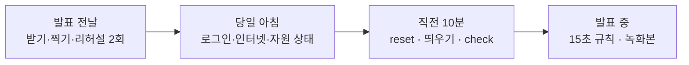

로드맵 위치: 결선 직전 / 리허설·당일 점검 체크리스트 / 본선 연결점: 완성도·데모 30 · 클라우드 활용 30 · AI 10

# 결선 리허설 체크리스트: 전날부터 발표 중까지

> 문서 상태: AI 초안(DRAFT) · 2026-10-31 17:45 UTC · 바탕: 5분 콘티(`parallel/Z28/docs/DEMO-STORYBOARD-5MIN.md`), 8분 콘티(`Z24`), 토크 스크립트(`Z26`), 녹화본(`Z27`), 당일 런북(`Z8`), Cloudflare 검증(`Z14`), AI 샌드박스(`Z22`) · 17:45 UTC Z33 갱신: P-11·M-06 터널 칸을 맥 실측으로 채움. 장애 복구 시나리오는 `parallel/Z12/docs/RECOVERY-SCENARIOS.md`, 요약은 런북 수정본(`parallel/Z33/docs/RUNBOOK-FINALS.md`) 4-9. 콘티·런북·대본은 Z33 수정본이 최신 · 맥에서 아직 한 번도 따라 해 보지 않음 · 팀 검토 전 · 18:15 UTC 통합 2차 문서 묶음: T-05에 `TRAFFIC_OBSERVE_SEC` 확인 한 줄

표시: 【사실】 문서·코드로 확인(출처 병기) / 【추정】 판단 / 【미확인】 아직 확인 못 함.

---

## 그림: 네 구간



- 위 구간이 다 초록이어야 다음 구간으로 간다. 하나라도 빨강이면 그 항목의 "실패 시" 줄을 먼저 한다.
- 전날에 할 수 있는 일은 전날 끝낸다. 당일 아침에는 "그대로 살아 있나"만 본다.
- 발표 중에는 새 명령을 만들지 않는다. 이 문서와 런북에 있는 줄만 친다【사실: Z8 5-1】.

## 이 문서 읽는 법

- 명령은 전부 맥의 서비스 폴더에서 친다. 먼저 한 번 `cd ~/Softbank_final/Service`.
- 터미널은 4개다. A = API, B = 워커, C = 웹, D = 시연·점검용【사실: Z8 0절】. 이 문서의 명령은 따로 적지 않으면 터미널 D에서 친다.
- 항목마다 **확인 명령 1줄 → 기대 → 실패 시** 순서다. 명령 블록 안에는 설명을 넣지 않았다. 그대로 복사해 붙여도 된다.
- 비밀값(키·토큰·계정 번호)은 화면에 찍지 않는다. `.env`는 줄 수만 센다. `cat .env`는 금지다【사실: Z8 1-5·6절】.
- "확인 명령: 눈으로"는 명령으로 볼 방법이 없는 항목이다.
- 항목 번호: 전날 = P, 당일 아침 = M, 직전 10분 = T, 발표 중 = S.

## 0. 처음 보는 말

- **reset**: 플랫폼 DB를 지우고 다시 만들고, 출발·도착 DB를 데모 시작 상태로 되돌린다. 리허설·녹화를 한 번 할 때마다, 그리고 발표 직전에 꼭 한다. 안 하면 S4가 "DB 복제"에서 멈추고 다음 이전은 `409 ENV_BUSY`다【사실: W 5절, Z8 4-1】.
- **녹화본**: 무대에서 막혔을 때 대신 트는 영상·캡처 4개(`S1-S4.mov`, `S5-numbers.png`, `S6-security-1/-2.png`, `S7-agent.mov`). 위치는 `~/Desktop/demo-fallback/`【사실: Z27 1·2절】.
- **15초 규칙**: 5분판에서 한 장면이 15초 안에 안 고쳐지면 한 단계 내려간다. 1 그 자리 재시도 → 2 미리 잰 숫자 → 3 녹화본(`play.sh`) → 4 설계 문서로 말하기【사실: Z28 2절, DRAFT(ai)】.
- **판 A / 판 B**: 판 A = 지금 통합본(보안 표 없음, AI는 대본 LLM). 판 B = 보안 표(Z18)와 실제 LLM(Z22)이 합쳐진 뒤. 리허설에서 어느 판으로 갈지 하나 고른다【사실: Z26·Z28】.
- **cloudflared 터널**: 서버가 바깥에서 들어오는 포트를 열지 않고, 서버 쪽에서 Cloudflare로 먼저 연결을 거는 길. Cloudflare LB는 이 터널들을 뒷단으로 쓴다【사실: 마스터 가이드 v2 1106줄, Z14 0절】.

---

## 1. 발표 전날 (P, 18개)

집이나 숙소의 안정된 인터넷에서 한다. 이미지·가격·녹화본을 여기서 다 만들어 두면 당일 행사장 네트워크와 상관없어진다.

### P-01 최신 통합본 설치와 시험

```bash
npm install && npm run typecheck && npm test
```

- 기대: typecheck 출력 없음, test 끝부분 `# fail 0`.
- 실패 시: 실패한 시험 이름을 적고 통합 쪽에 넘긴다. 무대는 마지막으로 통과한 통합본으로 간다.

### P-02 demo 도우미·녹화 스크립트가 서비스 폴더에 있음

```bash
ls docs/demo/demo.sh tools/demo-record/play.sh tools/demo-record/stage-ready.sh
```

- 기대: 세 경로가 그대로 찍힘.
- 실패 시: 공유 폴더 `parallel/W/docs/demo/`, `parallel/Z27/tools/demo-record/`에서 맥으로 옮긴다(맥에는 공유 폴더가 없다)【사실: Z8 1-2, Z27 3-1】.

### P-03 도커 이미지 미리 받기

```bash
docker image ls --format '{{.Repository}}:{{.Tag}}' | grep -cE 'postgres:16-alpine|postgres:16$|prometheus|grafana'
```

- 기대: `4`.
- 실패 시: Z8 1-3의 `docker pull` 4줄. `429 Too Many Requests`면 같은 절의 `mirror.gcr.io` 두 줄.

### P-04 가격표 받기

```bash
npm run prices:fetch -w @svc/cost && grep -c '"origin": "live"' packages/cost/prices/gcp.json
```

- 기대: 비교표가 찍히고 마지막에 `1`.
- 실패 시: `0`이면 GCP 가격이 아직 샘플이다. 5분판은 원래 비용 숫자를 말하지 않으니 무대 영향은 없다【사실: Z28 4절】. 질문 답에서만 "GCP는 샘플 가격"이라고 말한다.

### P-05 `.env` 키가 있는지 (줄 수만)

```bash
grep -cE '^(ANTHROPIC_API_KEY|CLOUDFLARE_API_TOKEN|CLOUDFLARE_ZONE_NAME|DATABASE_URL|OWNER_DATABASE_URL|API_PORT)=.+' .env
```

- 기대: `6`.
- 실패 시: 빠진 이름을 하나씩 `grep -c '^이름=.\+' .env`로 찾아 채운다. 값은 화면에 띄우지 않는다.

### P-06 실 LLM 키가 살아 있음

```bash
sh -c 'set -a; . ./.env; curl -s -o /dev/null -w "%{http_code}\n" https://api.anthropic.com/v1/models -H "x-api-key: $ANTHROPIC_API_KEY" -H "anthropic-version: 2023-06-01"'
```

- 무엇: `.env`를 읽은 작은 셸 안에서 모델 목록만 물어본다. 키는 화면에 안 나오고 응답 코드 숫자만 찍힌다. 토큰을 쓰지 않아 돈이 들지 않는다【추정】.
- 기대: `200`.
- 실패 시: `401`이면 키가 틀리거나 폐기됐다. 콘솔에서 새 키를 받아 `.env`만 고친다. 판 B를 못 쓰면 판 A로 간다.

### P-07 실 LLM 잔액 (판 B를 쓸 때만)

```bash
cd apps/agent-worker && AGENT_LLM=real npx tsx --env-file=../../.env scripts/remediate-demo.ts; cd ../..
```

- 무엇: 실제 LLM으로 점검·수정 한 건을 돌린다. 돈이 조금 든다【사실: Z22 CHANGES 3-4 "키 필요, 돈 듦"】.
- 기대: 실행이 끝나고 제안이 게이트를 통과.
- 실패 시: 오류에 `credit balance`가 보이면 잔액이 바닥이다【추정: Anthropic API 오류 문구】. Anthropic 콘솔의 결제(Billing) 화면에서 잔액을 채우거나, 판 A로 정한다. 잔액 숫자 자체는 콘솔 화면에서만 볼 수 있다【추정】.

### P-08 클라우드 로그인

```bash
aws sts get-caller-identity --profile finals > /dev/null && gcloud auth application-default print-access-token > /dev/null && echo cloud-ok
```

- 기대: `cloud-ok`.
- 실패 시: `aws configure sso` 또는 `gcloud auth application-default login`. 둘 다 브라우저 승인이 필요하니 전날 한다【사실: Z8 1-6】.

### P-09 클라우드 자원이 남아 있는지 (AWS)

```bash
aws eks list-clusters --profile finals --region ap-northeast-2 --query 'clusters' --output text
```

- 무엇: 서울 리전에 EKS 클러스터가 몇 개 있는지 이름만 찍는다.
- 기대: 실제 실행 뒤 "유지"로 정했으면 그 클러스터 이름, "destroy"로 정했으면 빈 줄【미확인: 맥 실제 실행 뒤 결정 대기】.
- 실패 시: 지웠어야 하는데 남아 있으면 비용이 계속 나간다. 맥 원격 세션에서 승인 창을 거쳐 destroy한다(이 문서에서 직접 하지 않는다).

### P-10 클라우드 자원이 남아 있는지 (GCP)

```bash
gcloud container clusters list --project finals-demo --format='value(name,status)'
```

- 기대: P-09와 같은 기준. 남겨 둔 클러스터면 `RUNNING`.
- 실패 시: P-09와 같다.

### P-11 Cloudflare 토큰·LB·터널 읽기 (dry-run)

```bash
npm run cf:check
```

- 무엇: 아무것도 만들지 않고 토큰 확인, zone 찾기, 모니터·pool·LB·터널 목록 읽기만 한다【사실: Z14 2절】.
- 기대: 1~3단계 `OK`, 마지막 줄 `API 호출 6번, 전부 GET`. 3단계에 `터널 <이름> (<상태>) → 오리진 주소 후보 <UUID>.cfargotunnel.com` 줄이 터널마다 하나씩.
- 터널 개수: **5개, 맥 dry-run에서 5개 전부 `down`**【사실: 맥 `cf:check` 출력, 10/31】. 5개는 따로 정한 목록이 아니라 Cloudflare 계정에 있는 터널 전부다. `cf:check`는 계정의 터널을 지워지지 않은 것까지 모두 읽는다(`scripts/cf-check.ts` 107줄 `cfd_tunnel?is_deleted=false`). 이름은 그 출력 줄 그대로 본다. 이 문서에는 적지 않았다.
- `down`의 뜻: 그 터널에 붙은 `cloudflared` 프로그램이 지금 아무 데서도 안 돌고 있다【추정: Cloudflare 터널 상태 값】. 계정·토큰 문제가 아니다. 무대 기본은 노트북 `localhost:5173`이라(Z8 2-7) `down`이어도 데모는 돈다. 심사위원 기기로 열어야 할 때만 런북 4-6의 임시 터널을 쓴다.
- 리허설 때 적을 칸: 개수 `5개` / `down` 개수 `____개` (터널을 띄운 날이면 `healthy`가 늘어야 한다).
- 실패 시: `HTTP 403`이면 토큰 권한 부족(Z14 4절). 터널이 모자라면 무대는 노트북 `localhost:5173`으로 간다(Z8 2-7 기본값). 5분판에는 Cloudflare 장면이 없다.

### P-12 Cloudflare LB 실가중치 (LB를 무대에 쓸 때만)

```bash
npm run cf:check -- --apply --hold-sec=70
```

- 무엇: 검증용 LB를 만들고 90/10 → 50/50 → 0/100 → 100/0으로 바꾼 뒤 지운다. 약 5분【사실: Z14 4절】.
- 기대: 4단계 모두 `OK … 확인`, 정리 4줄 `OK`.
- 실패 시: 중간에 끊겼으면 `npm run cf:check -- --cleanup --apply`로 남은 것을 지운다. 계속 실패하면 무대에서 "트래픽 지표는 흉내"라고 말하는 판으로 간다【사실: Z24 10절】.

### P-13 AI 샌드박스 k3d (판 B만)

```bash
kubectl get nodes --context k3d-agent-sbx --no-headers | grep -c ' Ready '
```

- 기대: 1 이상.
- 실패 시: `k3d cluster start agent-sbx`. 그래도 안 되면 판 A(대본 + 메모리)로 정한다.

### P-14 녹화 도구 점검

```bash
bash tools/demo-record/check-tools.sh --test-record
```

- 기대: 마지막 줄 `결과: 실패 0`, 열린 2초 시험 영상에 창이 보임.
- 실패 시: 화면 기록 권한을 켜고 터미널을 껐다 켠다. 안 되면 `Cmd + Shift + 5`로 손 녹화(Z27 3-5).

### P-15 녹화 전 reset

```bash
bash tools/demo-record/reset-before-record.sh
```

- 무엇: reset → 사람이 워커·API를 다시 띄우고 Enter → 숫자 확인 → 화면 정리 목록 확인【사실: Z27 3-3】.
- 기대: 멈추지 않고 끝까지 감(이전 0건, `REPL_` 7줄, 도착 `orders` 0행, `measure-latest.txt` 있음).
- 실패 시: `measure-latest.txt`가 없다고 하면 `bash docs/demo/demo.sh prep` 후 다시.

### P-16 녹화본 4개 찍기

```bash
REC_BASE=int5 bash tools/demo-record/record.sh 1
```

- 같은 줄을 끝 숫자만 `5`, `6`, `7`로 바꿔 이어서 세 번 더 친다. 순서를 지킨다. 5·6은 1에서 만든 이전을 읽는다【사실: Z27 3-4】. `REC_BASE`는 그때 쓰는 통합본 이름으로 바꾼다.
- 기대: 각각 "무대용으로 쓸까?"에 `y`. 판 A면 6번 첫 장(보안 표)은 `n`.
- 실패 시: 영상이 짧게 끊기면 손 녹화(Z27 3-5) 후 `promote.sh`.

### P-17 녹화본 눈으로 보기

```bash
ls ~/Desktop/demo-fallback/
```

- 기대: `S1-S4.mov  S5-numbers.png  S6-security-1.png  S6-security-2.png  S7-agent.mov`와 `takes` 폴더. 판 A면 `S6-security-1.png`는 없어도 된다.
- 확인: 각 파일을 열어 키·계정 번호·알림 팝업이 안 찍혔는지, 1번 끝이 "완료"인지, 7번 끝이 `# fail 0`인지 본다.
- 실패 시: 문제 있는 번호만 P-15부터 다시 찍는다.

### P-18 리허설 2회 + 마지막 reset

```bash
bash docs/demo/demo.sh reset
```

- 무엇: 녹화로 생긴 이전을 지우고, 2절 표대로 5분판을 두 번 돌린다. **한 번 돌 때마다** 이 reset → 터미널 B·A에서 `Ctrl+C` 후 다시 띄우기 → `bash docs/demo/demo.sh check`.
- 기대: 2절 표 두 줄이 다 채워지고 합계가 4:40 이하.
- 실패 시: 4:40을 넘으면 Z28 2절 순서대로 줄인다(문단 4 숫자 → 문단 2 넷째 줄 → 문단 7 셋째 줄). 필수 3장면(문단 3·5·6)은 빼지 않는다.

---

## 2. 리허설 2회 타이밍 기록

스톱워치를 문단 1 첫 마디에 누르고, 문단이 바뀔 때마다 "랩"을 누른다. 통역 시간은 타이머에서 뺀다【사실: 킥오프 p35】. 리허설에서는 통역 없이 재므로 그대로 적는다.

### 2-1. 문단별

| 문단 · 장면 | 계획 시작 | 계획 길이 | 1회 시작 | 1회 길이 | 1회 대체 단계(0~4) | 2회 시작 | 2회 길이 | 2회 대체 단계(0~4) | 메모 |
|---|---|---|---|---|---|---|---|---|---|
| 1 · S0 한 줄 소개 | 0:00 | 0:20 | | | | | | | |
| 2 · S1+S3 이전 시작과 계획 | 0:20 | 0:35 | | | | | | | |
| 3 · S4 승인 → 실행 → 완료 (필수 a) | 0:55 | 0:55 | | | | | | | |
| 4 · S5 숫자 | 1:50 | 0:30 | | | | | | | |
| 5 · S6 보안 시각화 (필수 b) | 2:20 | 1:10 | | | | | | | |
| 6 · S7 AI 샌드박스 (필수 c) | 3:30 | 0:50 | | | | | | | |
| 7 · S8 마무리 | 4:20 | 0:20 | | | | | | | |
| 합계 | | 4:40 | | | | | | | 5:00 넘으면 강제 종료 |

- 계획 값은 Z26 1절 문단 머리, Z28 1절 표와 같다【사실】.
- 대체 단계 칸: 0 = 그대로, 1 = 재시도, 2 = 미리 잰 숫자, 3 = 녹화본, 4 = 설계 문서.

### 2-2. 회차 정보

| 회차 | 판(A/B) | 통합본 이름 | reset 했나 | 막힌 곳 | 녹화본 띄우기까지 걸린 초 | 줄일 문장 |
|---|---|---|---|---|---|---|
| 1회 | | | | | | |
| 2회 | | | | | | |

- "녹화본 띄우기까지 걸린 초"는 `play.sh` 줄을 치기 시작해서 화면이 뜰 때까지다. 목표 3초【추정: Z27 4-2】.

---

## 3. 당일 아침 (M, 9개)

행사장에 도착해서, 발표 노트북을 무대 화면에 연결하기 전에 한다.

### M-01 배터리·충전기

```bash
pmset -g batt | grep -o '[0-9]*%'
```

- 기대: 충전기를 꽂은 상태에서 숫자가 오르거나 100%.
- 실패 시: 충전기·콘센트를 바꾼다. 콘센트가 없으면 전원 절약을 끄고 밝기를 줄인다.

### M-02 외부 화면 연결

```bash
system_profiler SPDisplaysDataType | grep -c Resolution
```

- 기대: `2`(노트북 + 무대 화면).
- 실패 시: HDMI 젠더·케이블을 바꾼다. 무대 화면이 안 되면 인쇄본 그림(문단 1)과 노트북 화면을 심사위원 쪽으로 돌린다【추정】.

### M-03 인터넷

```bash
curl -s -o /dev/null -w '%{http_code}\n' --max-time 5 https://api.cloudflare.com/client/v4
```

- 기대: `000`이 아닌 숫자(보통 `4xx`). 숫자가 오면 바깥까지 길이 열린 것이다.
- 실패 시: `000`이면 인터넷이 끊겼다. 휴대폰 핫스팟으로 바꾼다. 그래도 안 되면 판 A로 간다. 로컬 데모(DB·워커·API·웹)는 인터넷 없이 돈다【추정: Z8 4-6】. 인터넷이 필요한 것은 실 LLM, 클라우드, 터널, Cloudflare뿐이다.

### M-04 클라우드 로그인이 아직 살아 있음

```bash
aws sts get-caller-identity --profile finals > /dev/null && gcloud auth application-default print-access-token > /dev/null && echo cloud-ok
```

- 기대: `cloud-ok`.
- 실패 시: SSO 세션은 4시간짜리일 수 있다【사실: Z8 1-6】. 다시 로그인한다. 5분판 무대에는 클라우드 호출이 없으니, 시간이 없으면 넘어간다【사실: Z28 3절, 자원 생성·앱 배포는 STUB】.

### M-05 클라우드 자원 상태 (밤사이 바뀐 것 없나)

```bash
aws eks list-clusters --profile finals --region ap-northeast-2 --query 'clusters' --output text
```

- 기대: 전날 P-09에서 본 것과 같음. GCP도 P-10 줄을 한 번 친다.
- 실패 시: 다르면 발표 뒤에 정리한다. 발표 전에 지우거나 만들지 않는다.

### M-06 Cloudflare 읽기

```bash
npm run cf:check
```

- 기대: 전날 P-11과 같은 출력, 터널 5개. 무대용으로 터널을 안 띄웠으면 5개 모두 `down`이 정상이다.
- 실패 시: 터널이 빠졌으면 무대는 `localhost:5173`으로 간다. 고치지 않는다.

### M-07 실 LLM 키 (판 B만)

```bash
sh -c 'set -a; . ./.env; curl -s -o /dev/null -w "%{http_code}\n" https://api.anthropic.com/v1/models -H "x-api-key: $ANTHROPIC_API_KEY" -H "anthropic-version: 2023-06-01"'
```

- 기대: `200`.
- 실패 시: 판 A로 바꾼다. 대본에서 판 A 줄을 쓴다(Z26 문단 6).

### M-08 맥 Postgres 끄기 (5432 비우기)

```bash
brew services stop postgresql@16
```

- 기대: `Stopping` 또는 이미 꺼져 있다는 줄. 재부팅하면 다시 켜지니 매번 친다【사실: Z8 2-2】.
- 실패 시: `lsof -nP -iTCP:5432 -sTCP:LISTEN`으로 누가 잡았는지 보고 Z8 4-2.

### M-09 디스크·메모리 여유

```bash
df -h ~ | tail -1
```

- 기대: 남은 칸(`Avail`)이 10GB 이상【추정】.
- 실패 시: `~/Desktop/demo-fallback/takes/`에서 안 쓰는 take를 지운다. 무대용 고정 이름 파일은 지우지 않는다.

---

## 4. 직전 10분 (T, 13개)

순서대로 한다. 앞 칸이 기대와 다르면 다음 칸으로 가지 않는다. 띄우는 순서는 Z8 2절 그대로다.

### T-01 도커

```bash
docker info --format '{{.ServerVersion}}'
```

- 기대: 버전 숫자 한 줄.
- 실패 시: Docker Desktop을 켜고 고래 아이콘이 멈출 때까지 기다린다.

### T-02 전체 점검

```bash
bash scripts/dev-check.sh
```

- 기대: 마지막 줄 `결과: 실패 0`.
- 실패 시: 찍힌 실패 줄을 보고 Z8 4절 해당 칸.

### T-03 복제 DB와 미리 잰 숫자

```bash
ls docs/demo/measure-latest.txt && grep -c '^REPL_' .env
```

- 기대: 파일 경로 한 줄, 그다음 `7`.
- 실패 시: `bash docs/demo/demo.sh enable-repl` 후 `bash docs/demo/demo.sh prep`(약 13초)【사실: W 2-2】.

### T-04 DB 초기화

```bash
bash docs/demo/demo.sh reset
```

- 기대: 오류 없이 끝남. 10~20초【추정: Z8 2-4】.
- 실패 시: `docker compose ps db`가 `(healthy)`가 아니면 Z8 4-5 표.

### T-05 워커 → API → 웹을 새로 띄우기

```bash
npm run dev:worker
```

- 터미널 B에서 친다. 이어서 터미널 A에서 `npm run dev:api`, 터미널 C에서 `npm run dev:web`. reset 뒤에는 이미 떠 있어도 `Ctrl+C` 후 다시 띄운다【사실: Z8 2-5】.
- 기대: B 마지막 줄 `worker ready: import, precheck, plan, apply, deploy, sync, shift, cutover, cleanup, rollback`, C에 `Local: http://localhost:5173/`.
- 실패 시: `EADDRINUSE`면 Z8 4-4.
- 확인: `.env`에 `TRAFFIC_OBSERVE_SEC=0.5`가 있다. 없으면 100% 관찰 수정 판에서 S4가 약 38초 걸린다(런북 2-5 주의).

### T-06 데모 시작 상태

```bash
bash docs/demo/demo.sh check
```

- 기대: healthz·readyz `{"ok":true}`, REPL `7`, 이전 목록 `0`, 출발 `orders|2000` `customers|100`, 도착 0행【사실: Z8 2-8】.
- 실패 시: 하나라도 다르면 T-04부터 다시.

### T-07 멈춘 작업 없음

```bash
bash docs/demo/demo.sh why
```

- 기대: 아무 줄 없음.
- 실패 시: `DB-T5`가 보이면 T-04부터 다시【사실: Z8 4-1】.

### T-08 웹이 뜸

```bash
curl -s -o /dev/null -w '%{http_code}\n' localhost:5173
```

- 기대: `200`. 브라우저 위쪽에 초록 점과 "API 연결됨".
- 실패 시: 터미널 C에서 `npm run dev:web`.

### T-09 녹화본 미리 열어 두기

```bash
bash tools/demo-record/stage-ready.sh
```

- 기대: 마지막 줄 `결과: 없음 0`. 영상 2개가 QuickTime에 뒤로 열림【사실: Z27 4-1】.
- 실패 시: 빠진 파일 번호는 무대에서 단계 3을 못 쓴다. 그 장면은 단계 2 → 단계 4로 바로 간다.

### T-10 브라우저 탭 순서

```bash
osascript -e 'tell application "Google Chrome" to get URL of tabs of front window'
```

- 무엇: 크롬 맨 앞 창의 탭 주소를 왼쪽부터 찍는다. 읽기만 한다.
- 기대(DRAFT(ai)): 탭 1 = 설계 문서(1절 아키텍처 그림이 보이는 위치), 탭 2 = `http://localhost:5173/`. 그 밖의 탭은 없다. Cloudflare 실가중치 판을 쓸 때만 탭 3 = Cloudflare LB 화면【사실: Z24 10절 "대시보드 탭 하나 추가"】. 이유: 5분판 화면 이동이 설계 문서 → 웹 → 터미널 → 설계 문서 순이라 `Cmd+1`, `Cmd+2`로 바로 간다【사실: Z28 1절 "어디서" 열】.
- 실패 시: 남는 탭을 닫는다. 콘솔·`.env`·계정 번호가 보이는 탭이 있으면 반드시 닫는다. 사파리면 `"Google Chrome"`을 `"Safari"`로 바꾼다.

### T-11 화면 정리

```bash
pgrep -x caffeinate || caffeinate -d &
```

- 무엇: 맥이 잠들지 않게 하는 `caffeinate`가 떠 있는지 보고, 없으면 뒤에서 켠다【사실: Z8 2-8】.
- 기대: 숫자(PID) 한 줄.
- 눈으로 함께: 방해 금지(집중 모드) 켜기, 즐겨찾기 막대 숨김, 브라우저 확대 125%, 터미널 D 글자 크게(`Cmd + +` 두세 번) 후 `Cmd+K`【사실: Z27 3-3】.
- 실패 시: 시스템 설정 → 잠금 화면에서 화면 끄기 시간을 "안 함"으로.

### T-12 막혔을 때 칠 줄을 손에 익히기

```bash
fc -l -30 | grep -c play.sh
```

- 무엇: 터미널 D 최근 명령 30줄에 `play.sh`가 몇 번 있었는지 센다. 있으면 무대에서 위 화살표(↑)로 바로 부를 수 있다【사실: Z27 4-2】.
- 기대: 1 이상.
- 실패 시: `bash tools/demo-record/play.sh 1`을 한 번 쳐서 열고 Esc → Cmd+W로 닫는다. 그다음 `Cmd+K`.

### T-13 스톱워치·인쇄본

- 확인 명령: 눈으로.
- 기대: 휴대폰 스톱워치가 0:00, 인쇄본 아키텍처 그림 1장이 손에 있음, 대본(Z26 1절)이 노트북 화면이 아닌 곳에 있음.
- 실패 시: 인쇄본이 없으면 노트북이 꺼졌을 때 쓸 길이 없다. 휴대폰에 그림 사진이라도 띄워 둔다.

---

## 5. 발표 중 (S, 10개)

여기는 명령보다 판단 규칙이다. 칠 명령은 전부 직전 10분에 한 번씩 쳐 본 것뿐이다.

| # | 상황 | 확인 명령 1줄 | 대체 행동 |
|---|---|---|---|
| S-01 | 한 장면이 막힘 | 없음(스톱워치) | 15초에 한 단계씩 내려간다. 1 재시도 → 2 미리 잰 숫자 → 3 녹화본 → 4 설계 문서【사실: Z28 2절】 |
| S-02 | 화면 위 점이 빨강(API 죽음) | `curl -s localhost:3000/healthz` | 터미널 A `npm run dev:api`. 15초 넘으면 `bash tools/demo-record/play.sh 1` |
| S-03 | 진행 칸이 안 움직임(워커) | `bash docs/demo/demo.sh why` | 터미널 B `npm run dev:worker`. 하던 작업은 큐에서 이어진다【사실: Z8 4-3】 |
| S-04 | "DB 복제"에서 5초 넘게 멈춤 | `bash docs/demo/demo.sh why` | `DB-T5`면 reset하지 않는다. Z8 6절 "DB-T5" 줄을 말하고 문단 4를 `bash docs/demo/demo.sh measure`로 바꾼다【사실: Z28 문단 3】 |
| S-05 | 숫자가 흉내 값(`stub(가짜)였나: t` 또는 `850`) | `bash docs/demo/demo.sh numbers` | 숫자를 말하지 않고 `bash docs/demo/demo.sh measure`. 15초 넘으면 `play.sh 5` |
| S-06 | 보안 표가 비어 있음(판 B) | 없음(눈으로) | 재시도 없이 판 A로 바로 바꾼다. 컷 1을 건너뛰고 `bash docs/demo/demo.sh wall`【사실: Z28 문단 5】 |
| S-07 | 인터넷이 끊김 | `curl -s -o /dev/null -w '%{http_code}\n' --max-time 3 https://api.cloudflare.com/client/v4` | `000`이면 판 B의 S7은 판 A(`bash docs/demo/demo.sh agent`)로 내려간다. 웹·DB 장면은 그대로 간다 |
| S-08 | 터널·Cloudflare가 안 됨 | 없음(브라우저 오류 화면) | 노트북 `localhost:5173` 탭(탭 2)으로 간다. 말: "외부 주소 대신 이 노트북 화면으로 보여 드리겠습니다"【사실: Z8 6절】 |
| S-09 | 녹화본으로 넘어감 | `bash tools/demo-record/play.sh 7` | 숫자만 막힌 장면 번호(1·5·6·7)로 바꿔 친다. 말: "실행 화면 녹화로 보여 드리겠습니다"【사실: Z27 4-3】. 끝나면 Esc → Cmd+W, 다음 장면은 라이브 |
| S-10 | 시계가 4:30을 넘음 | 없음(스톱워치) | 문단 7은 둘째·셋째 줄만. 5:00을 넘으면 강제 종료될 수 있다【사실: 킥오프 p35】. 비용 숫자는 어떤 경우에도 말하지 않는다【사실: Z28 4절】 |

- 고치는 동안 할 말은 Z8 6절 표를 그대로 쓴다. 침묵하며 타자 치지 않는다.
- 필수 3장면(문단 3·5·6)은 녹화본으로라도 반드시 보인다. 빠지는 순서는 문단 4 → 문단 2 넷째 줄 → 문단 7 셋째 줄이다【사실: Z28 2절】.

---

## 6. 항목 수

| 구간 | 항목 수 |
|---|---|
| 발표 전날 (P) | 18 |
| 당일 아침 (M) | 9 |
| 직전 10분 (T) | 13 |
| 발표 중 (S) | 10 |
| 합계 | 50 |

---

## 핵심 결정 3개 (+대안)

| 결정 | 대안 | 고른 이유 |
|---|---|---|
| 녹화·가격 받기·실 LLM 시험·Cloudflare 실가중치는 전부 전날에 끝내고, 당일 아침은 "그대로 살아 있나"만 읽는다 | 당일 아침에 다시 찍고 다시 받기 | 행사장 네트워크는 믿을 수 없다【사실: 마스터 가이드 v2 2086줄】. 녹화는 당일 찍지 않는다고 이미 정했다【사실: Z27 5절】 |
| 발표 중 구간은 명령 목록이 아니라 상황 → 대체 행동 표로 쓰고, 칠 명령은 직전 10분에 한 번씩 미리 쳐 둔다 | 장애마다 고치는 명령을 길게 적기 | 15초 안에 칠 수 있는 것은 이미 손에 익은 한 줄뿐이다【사실: Z28 2절 "두 번째 명령이 필요하면 이미 늦었다"】 |
| 브라우저 탭은 설계 문서·웹 두 개(필요할 때만 Cloudflare 하나 더)로 고정한다. DRAFT(ai) | 탭을 여러 개 열어 두고 찾기 | 5분판 화면 이동이 설계 문서 → 웹 → 터미널 → 설계 문서뿐이라 `Cmd+1`·`Cmd+2`로 끝난다. 남는 탭은 비밀값이 비칠 위험만 늘린다 |

## 셀프 연습 1개

리허설 2회차에서 문단 5(보안) 중간에 터미널 A를 `Ctrl+C`로 끈다. S-02 줄대로 `curl` 한 줄 → `npm run dev:api` → 15초가 넘으면 `play.sh 6`까지 간다. 2-2 표의 "녹화본 띄우기까지 걸린 초"에 적고, 그 회차 합계가 4:40 안에 들었는지 본다. 3초를 넘으면 T-12(↑로 부르기)를 했는지부터 확인한다.

## 검증 명령과 기대 출력

이 문서가 있는 폴더(`parallel/Z34/docs/`)에서 한 줄씩 실행한다.

```bash
grep -cE '^### [PMT]-[0-9]+' REHEARSAL-CHECKLIST.md
```

- 기대: `40` (전날 18 + 아침 9 + 직전 13).

```bash
grep -cE '^\| S-[0-9]+ ' REHEARSAL-CHECKLIST.md
```

- 기대: `10`.

```bash
awk '/^```bash/{f=1;next} /^```/{f=0} f && / [#] /' REHEARSAL-CHECKLIST.md | wc -l
```

- 기대: `0`. 명령 블록 안에 `#` 주석이 없다는 뜻이다(붙여 넣을 때 zsh가 깨지지 않게).
