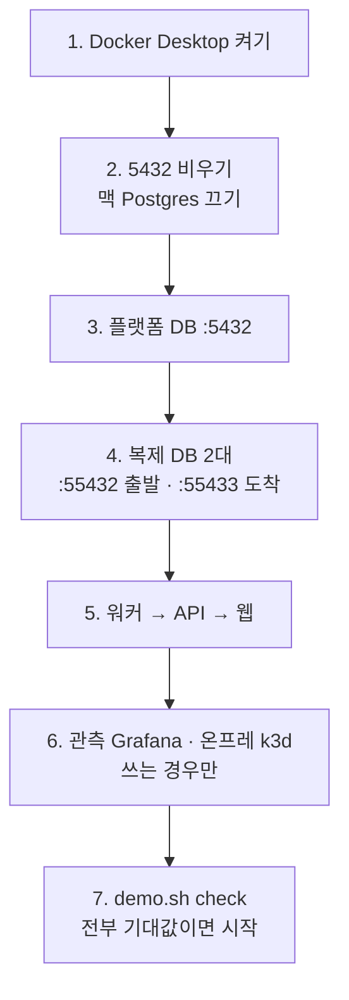

로드맵 위치: 본선 직전 / 결선 당일 런북(전날 점검 · 띄우는 순서 · 장애 대응) / 본선 연결점: 완성도·데모 30, 클라우드 활용 30(운영·롤백)

# 결선 당일 런북: 전날 점검부터 무대 위 복구까지

> 문서 상태: AI 초안 · 2026-10-31 16:55 UTC, 17:20 UTC 용어·수치 통일, 17:45 UTC 콘티·대본과 불일치 정리(Z33: Z12 장애 복구 요약 4-9, 워커 재시작 설명 고침, 대체 규칙 15초/30초, 녹화본 `play.sh`, S 장면 번호, 롤백 창 3초/20초, 비용 표시 【추정】, Terraform 상태 파일) · 기준 코드: 통합본 `service-current.tgz`(17:27 UTC 판, Z11 롤백 버튼 포함, Z18 보안 표 미포함) · 바탕: W 리허설 대본, R 퀵스타트, T 관측성, N2 gitops, V 가격표, O 온프레(작성 중), 계정 세팅표 · 팀 검토 전 · 맥에서 아직 처음부터 끝까지 따라 해 보지 않음 · 18:15 UTC 통합 2차 문서 묶음: 2-5에 100% 관찰·`TRAFFIC_OBSERVE_SEC` 주의, 7절 smoke 줄, 1-10 온프레 스크립트 실제 경로 · 18:20 UTC 2차 묶음: 2-5 `.env` 직접 넣기

## 그림: 띄우는 순서

위에서 아래로 한 칸씩 띄운다. 앞 칸이 초록이 아니면 다음 칸으로 가지 않는다.



- 이유: API와 워커는 서로 직접 부르지 않고 DB만 본다. 그래서 DB가 먼저다. 지금 워커·API는 DB 연결에 실패하면 죽고, 저절로 다시 붙지 않는다【사실, R 퀵스타트 결정 3】.
- 워커는 `.env`를 시작할 때 한 번만 읽는다. 복제 설정(REPL_ 7줄)을 넣은 **뒤에** 띄워야 진짜 복제가 돈다【사실, W 2-4】.

## 이 문서로 하는 것

- 1절: 결선 전날 한 번 하는 점검. 이미지 받기, 가격표 받기, 키가 있는지 줄 수로만 확인.
- 2절: 당일 띄우는 순서. 명령은 한 줄씩, 설명은 명령 밖에.
- 3절: 칸마다 "떠 있나" 확인 명령과 기대 출력.
- 4절: 장애가 났을 때 증상 → 원인 → 고치는 명령. 제어판(워커·DB) 장애가 이전 상태에 주는 영향은 4-9(Z12 장애 복구 시나리오 요약).
- 5절: 무대 위에서 일이 틀어졌을 때 되돌리는 단계와 롤백 장면.
- 6절: 고치는 동안 할 말.

## 0. 알아 둘 것 (처음 보는 사람용)

- **서비스 폴더**: `~/Softbank_final/Service`. 아래 명령은 전부 이 폴더에서 친다.
- **Terraform 상태가 맥 로컬 `*.tfstate`에만 있다. 결선이 끝나고 destroy를 마칠 때까지 Service 폴더를 지우거나 옮기지 않는다.** 원격 저장(S3 backend)이 없다(`infra/`의 `.tf`에 `backend` 블록 없음【사실】, DRAFT(ai): 결선까지 로컬 유지). 폴더를 지우면 만든 클라우드 자원을 Terraform이 잊고, destroy로 지울 수 없게 된다. git에도 안 올라간다(`.gitignore`의 `*.tfstate`).
- **GKE kubectl**: 맥에 `gke-gcloud-auth-plugin` 이 있어야 한다. `gcloud components install gke-gcloud-auth-plugin` 을 치고, gcloud SDK 의 bin 폴더를 PATH 앞쪽에 둔다【사실, 맥 실환경 확인】.
- **EKS kubectl**: apply 한 IAM 사용자는 기본으로 클러스터 관리자다(`bootstrap_cluster_creator_admin_permissions`). 다른 사람이 보려면 `-var admin_principal_arn=<그 사람 ARN>` 으로 apply 한다. 이 값은 클러스터를 다시 만들어야 바뀐다.
- **워커 여러 개**: 워커 지표 포트는 `METRICS_PORT`가 아니라 `WORKER_METRICS_PORT`(기본 9465)다. 두 번째 워커부터는 `WORKER_METRICS_PORT=9466 npm run dev:worker`처럼 다른 값을 주거나 `0`(지표 끔)으로 띄운다. int5 1차 판은 같은 값이면 포트 충돌로 두 번째 워커가 바로 죽었다【사실, 맥 실측】. int5 2차부터는 차 있으면 다음 포트(최대 10개)로 넘어가고, 다 차면 지표만 끄고 계속 돈다(Z36). 그래도 포트를 명시하는 게 지표 수집 설정과 맞추기 쉽다.
- **터미널 4개**: A = API, B = 워커, C = 웹, D = 시연·점검용. W 리허설 대본과 같은 배치다.
- **demo.sh**: W가 만든 도우미 스크립트. 서비스 폴더의 `docs/demo/demo.sh`에 있어야 한다. 원본은 공유 폴더 `parallel/W/docs/demo/`. zsh에서도 `bash docs/demo/demo.sh 명령` 모양으로 부른다.
- **reset**: 플랫폼 DB를 지우고 다시 만든다. 리허설 기록, 멈춘 이전, 환경 잠금이 다 사라진다. 데모 직전에는 항상 한다.
- **통합 대기 기능**: 관측(T), 가격표 받기(V), 롤백·취소 API(Z1), gitops 배포(N2)는 int3(17:05 UTC) 통합본에 들어왔다. 온프레 데모 스크립트(O)는 int4부터 `deploy/onprem-demo/`에 있다. 들어왔는지 확인하는 명령을 각 칸에 적었다. 없으면 그 칸은 건너뛴다.

---

## 1. 전날 점검 (T-1)

맥에서, 서비스 폴더에서. 체크 칸은 다 채울 때까지 반복한다.

| # | 할 일 | 통과 기준 |
|---|---|---|
| 1-1 | 최신 통합본이 풀려 있고 설치 끝 | typecheck 출력 없음, test `# fail 0` |
| 1-2 | demo 도우미 3개 복사 | `ls docs/demo` 에 3개 |
| 1-3 | 도커 이미지 미리 받기 | 아래 이미지 전부 `docker image ls` 에 보임 |
| 1-4 | 가격표 받기 | `priceStale` 가 false, `gcp.json`이 `"origin": "live"` |
| 1-5 | `.env` 키가 있는지 (줄 수로만) | 기대 숫자와 같음 |
| 1-6 | 클라우드 로그인 살아 있나 | `aws-ok`, `gcp-ok` |
| 1-7 | helm 있음 (gitops 배포를 켤 때) | 버전이 찍힘 |
| 1-8 | Playwright 크로뮴 (화면 시험·캡처를 쓸 때) | 설치 끝 메시지 |
| 1-9 | 관측 화면 한 번 띄워 보기 | Grafana 200 |
| 1-10 | 온프레 k3d 클러스터 한 번 띄워 보기 (온프레 장면을 쓸 때) | 노드 Ready |
| 1-11 | 리허설 1회 끝까지 + reset | W 7절 기록표 한 줄 |
| 1-12 | 노트북 준비 | 충전기, HDMI 젠더, 알림 끄기, 휴대폰 핫스팟 이름·비번 확인 |

### 1-1. 설치와 기본 시험

```bash
cd ~/Softbank_final/Service
npm install
npm run typecheck
npm test
```

- `npm install`: 라이브러리를 받는다. 통합본이 바뀌었을 때만 필요하다.
- `npm run typecheck`: 타입 오류 검사. 기대 출력은 아무것도 없음.
- `npm test`: 단위 시험. 끝부분에 `# fail 0`.

### 1-2. demo 도우미 복사

```bash
ls docs/demo
```

- 기대: `cost-request.json  cost-summary.py  demo.sh`
- 없으면 공유 폴더 `parallel/W/docs/demo/`의 세 파일을 서비스 폴더 `docs/demo/`로 복사한다. 맥에는 `/mnt/project-files`가 없으니 첨부로 받거나 원격 세션으로 옮긴다.

### 1-3. 도커 이미지 미리 받기

행사장 와이파이는 느리거나 Docker Hub가 `429 Too Many Requests`로 막을 수 있다. 전날 집에서 다 받아 둔다.

```bash
docker pull postgres:16-alpine
docker pull postgres:16
docker pull prom/prometheus:v3.15.1
docker pull grafana/grafana:13.2.5
```

- 첫째: 플랫폼 DB(`docker-compose.yml`)【사실】.
- 둘째: 복제용 출발·도착 DB(`packages/replication/docker-compose.test.yml`)【사실】.
- 셋째·넷째: 관측(T의 `docker-compose.observability.yml`)【사실】.
- 온프레 쪽 이미지(k3s 노드, CloudNativePG 오퍼레이터, podinfo)는 O의 스크립트가 정한다. O가 끝나면 그 README의 이미지 목록을 여기에 더한다【미확인】. 그 전까지는 1-10에서 클러스터를 한 번 띄워 두면 이미지가 맥에 남는다.

429가 나면 구글 거울에서 받고 이름을 붙인다(R 퀵스타트 4절과 같음).

```bash
docker pull mirror.gcr.io/library/postgres:16-alpine
docker tag mirror.gcr.io/library/postgres:16-alpine postgres:16-alpine
```

```bash
docker image ls --format '{{.Repository}}:{{.Tag}}' | grep -E 'postgres|prometheus|grafana'
```

- 기대: 위에서 받은 4개가 다 보인다.

### 1-4. 가격표 받기

먼저 이 명령이 들어왔는지 본다.

```bash
npm run -w @svc/cost
```

- `npm run` 뒤에 스크립트 이름을 안 주면 쓸 수 있는 스크립트 목록을 보여 준다.
- 목록에 `prices:fetch`가 있으면 아래를 친다. 없으면 V가 아직 안 합쳐진 것이다. 비용 장면은 들어 있는 값으로 돌고, 기준일이 낡았다고 나올 수 있다.

```bash
npm run prices:fetch -w @svc/cost
```

- AWS·GCP 공개 가격을 받아 캐시 파일에 쓰고 비교표를 찍는다. 클라우드 실측 5.5~7.0초【사실, V CHANGES】.
- 네트워크가 끊겨 있으면 예전 캐시를 그대로 쓴다. 그래서 전날 받아 두면 당일 와이파이와 상관없다.
- GCP 쪽은 `.env`의 `GCP_BILLING_API_KEY`가 있어야 새로 받는다. 키는 계정 세팅 때 만들어 `.env`에 넣었다【사용자: 계정 세팅 7개 완료】. 받기에 실패하면 GCP는 샘플 단가 캐시(`origin: seed`)로 남는다.
- 받은 뒤 확인: `grep -n '"origin"' packages/cost/prices/gcp.json`. 기대 `"origin": "live"`. `seed`면 GCP $146.9·절약 $86.4는 그대로 【추정, 샘플 단가】다.
- **결선 전 `prices:fetch` 뒤 7절 비용 줄과 콘티·대본의 비용 숫자를 새 값으로 갱신한다.** 그때도 "크레딧 포함"을 함께 적는다(Z28 4절).
- 캐시가 7일을 넘으면 `priceStale` 경고가 뜬다【사실, V】. 전날 받으면 당일엔 안 뜬다.

### 1-5. `.env` 키가 있는지, 줄 수로만

키 값은 화면에 절대 띄우지 않는다. 화면 공유·녹화·채팅에 남을 수 있다. "그 이름의 줄이 있고 값이 비어 있지 않은가"만 센다.

```bash
grep -cE '^(ANTHROPIC_API_KEY|GITOPS_REPO_URL|GITOPS_WRITE_TOKEN|GITOPS_READ_TOKEN)=.+' .env
grep -c '^REPL_' .env
grep -cE '^(DATABASE_URL|OWNER_DATABASE_URL|API_PORT)=.+' .env
```

- 첫째 기대: `4`. LLM 키 1개 + gitops 3개.
- 둘째 기대: `7`. 복제 설정. 0이면 `bash docs/demo/demo.sh enable-repl` 로 넣는다(2-3절).
- 셋째 기대: `3`. DB 주소 2개 + API 포트.
- `-c`: 맞는 줄의 **수**만 찍는다. `.+`: 등호 뒤가 비어 있으면 세지 않는다.
- Cloudflare를 쓰면 `CLOUDFLARE_API_TOKEN`, `CLOUDFLARE_ZONE_NAME` 두 줄도 센다. 기대 `2`. 계정 세팅은 끝났다【사용자: 계정 세팅 7개 완료】.

### 1-6. 클라우드 로그인 확인 (값은 안 찍음)

```bash
aws sts get-caller-identity --profile finals > /dev/null && echo aws-ok
gcloud auth application-default print-access-token > /dev/null && echo gcp-ok
```

- 첫째: AWS 프로필 `finals`로 내가 누구인지 묻는다. 출력(계정 번호 포함)은 버리고 성공 여부만 찍는다.
- 둘째: GCP ADC(내 구글 로그인) 토큰을 하나 받아 본다. 토큰은 버린다.
- 실패하면 `aws configure sso` 또는 `gcloud auth application-default login`을 다시 한다. 둘 다 브라우저 승인이 필요하니 **전날** 해 둔다.
- 【미확인】 SSO 세션이 결선 당일까지 유지되는지. 계정 세팅표의 권한 세트 세션은 4시간이다. 당일 아침에 한 번 더 확인한다.

### 1-7. helm (gitops 배포를 켤 때만)

```bash
helm version --short
```

- 기대: `v3.` 으로 시작하는 버전.
- 없으면 `brew install helm`. N2의 gitops 배포는 워커 PATH에 git, node, helm이 있어야 돈다【사실, N2 CHANGES 2절】.
- `.env`에 `GITOPS_REPO_URL`이 있으면 워커는 gitops 길로 간다. 데모를 로컬만으로 돌릴 거면 이 줄을 주석 처리해 STUB 길로 둔다【사실, N2: 둘 다 없으면 예전 STUB】. 어느 쪽으로 갈지는 팀이 정한다(TODO(human)).

### 1-8. Playwright 크로뮴 (화면 시험·캡처를 쓸 때만)

```bash
npx playwright install chromium
```

- 화면 자동 시험(S)과 대체 캡처를 만들 때 쓰는 브라우저를 받는다. 약 100MB【추정】.

### 1-9. 관측 화면 한 번 띄워 보기 (T가 합쳐졌을 때)

```bash
ls docker-compose.observability.yml
docker compose -f docker-compose.observability.yml up -d
curl -s -o /dev/null -w '%{http_code}\n' localhost:3001/api/health
```

- 첫째: 파일이 없으면 T가 아직 안 합쳐진 것이다. 이 칸은 건너뛴다.
- 둘째: Prometheus(9090)와 Grafana(3001)를 띄운다.
- 셋째 기대: `200`. 브라우저로 http://localhost:3001 → "이전 관측 (Service)" 대시보드(로그인 없이 보기)【사실, T CHANGES】.
- 【미확인】 T는 도커가 없는 곳에서 만들어 실제 기동은 아직 아무도 안 해 봤다. 전날 꼭 한 번 띄운다.

### 1-10. 온프레 k3d 한 번 띄워 보기 (온프레 장면을 쓸 때만)

스크립트는 `deploy/onprem-demo/scripts/`에 있다: `00-preflight.sh` → `01-cluster-up.sh` → `02-cnpg-install.sh` → `03-app-deploy.sh` → `04-db-check.sh`, 정리는 `99-cleanup.sh`【사실, 폴더 목록】. 맥에서 00~04가 exit 0으로 끝났다【사실, 맥 실행 기록 10/31】. 순서는 `deploy/onprem-demo/README.md`를 그대로 따른다. 먼저 도구가 있는지만 본다.

```bash
k3d version
k3d cluster list
kubectl get nodes
```

- 첫째 기대: `k3d version v5.9.0`【사실, 계정 세팅표 6번】.
- 둘째: 만들어 둔 클러스터 목록.
- 셋째 기대: 노드 줄의 STATUS가 `Ready`.
- 도커 메모리는 12.5GB다【사실】. k3d + Postgres 3대 + Grafana를 다 켜면 빠듯할 수 있다【추정】. 온프레 장면이 끝나면 `k3d cluster stop <클러스터 이름>`으로 멈춘다.

### 1-11. 리허설 1회 + reset

W 리허설 대본 2절~4절을 한 번 끝까지 돈다. 끝나면 2-4 reset을 다시 한다. 리허설을 돌린 뒤 reset 없이 데모하면 5-1의 함정에 걸린다.

---

## 2. 당일 띄우는 순서 (T-0)

데모 15분 전에 시작한다. 실측으로는 10분 안에 끝난다【추정, 각 칸 실측의 합 + 사람 손】.

### 2-1. 도커 켜기 (터미널 D)

Docker Desktop 앱을 켜고 고래 아이콘이 멈출 때까지 기다린다.

```bash
docker info --format '{{.ServerVersion}}'
```

- 기대: 버전 숫자 한 줄. `Cannot connect to the Docker daemon`이면 아직 안 켜진 것이다.

### 2-2. 5432 비우기, 점검

```bash
cd ~/Softbank_final/Service
brew services stop postgresql@16
bash scripts/dev-check.sh
```

- 둘째: 맥에 Homebrew로 깐 Postgres가 5432를 잡고 있으면 끈다. 이미 꺼져 있으면 아무 일도 안 한다. 재부팅하면 다시 켜질 수 있어 매번 친다【사실, R 퀵스타트 4절】.
- 셋째: 도구·도커·`.env`·포트를 읽기만 하며 점검한다. 기대 마지막 줄: `결과: 실패 0`. `scripts/dev-check.sh`가 없으면 R이 아직 안 합쳐진 것이다. 공유 폴더 `parallel/R/scripts/`에서 복사하거나 이 줄을 건너뛰고 3절 표로 확인한다.

### 2-3. 복제 켜기, 복제 DB 띄우기, 미리 재기

```bash
bash docs/demo/demo.sh enable-repl
grep -c '^REPL_' .env
bash docs/demo/demo.sh prep
```

- 첫째: `.env`에 복제 설정 7줄을 붙인다. 이미 있으면 아무것도 안 한다. 비밀번호는 로컬 도커 DB 전용 값이다.
- 둘째 기대: `7`.
- 셋째: 출발(55432)·도착(55433) DB를 띄우고, 쓰기 부하 중 컷오버·롤백을 5번씩 재서 `docs/demo/measure-latest.txt`에 남기고, 데모 데이터(주문 2000, 고객 100)를 넣는다. 클라우드 실측 13초【사실, W 2-2】.
- 기대 마지막 줄: `seeded: source orders/customers, target empty schema`.

### 2-4. 플랫폼 DB 깨끗하게

```bash
bash docs/demo/demo.sh reset
docker compose ps db
```

- 첫째: 플랫폼 DB를 지우고 다시 만든다(표 + 씨앗 데이터: 회사 1, 환경 2). 출발·도착 DB도 데모 시작 상태로 되돌린다. 【추정】 10~20초.
- 둘째 기대: STATUS에 `(healthy)`.

### 2-5. 워커 → API → 웹 (터미널 B, A, C)

터미널 B:

```bash
npm run dev:worker
```

- 기대 마지막 줄: `worker ready: import, precheck, plan, apply, deploy, sync, shift, cutover, cleanup, rollback`
- 【주의】 100% 관찰 수정(int5 2차부터 들어감)이 있는 판에서는 워커가 100%에서 실제 시계로 30초를 지켜본다. `.env`에 `TRAFFIC_OBSERVE_SEC=0.5`가 없으면 이전 한 건이 약 38초 걸린다. 그 이전 판(int5 1차)은 "30초 관찰"을 판정 30번(20ms 간격)으로 세서 실제로는 약 0.6초였다【사실, 코드 `packages/traffic/src/controller.ts`·설계 문서 5-2】. 줄여 돌리면 감사 기록에 `observeCompressed: true`가 남는다. **맥 `.env`에 `TRAFFIC_OBSERVE_SEC=0.5`를 직접 넣어 둔다**(`.env.example`엔 주석일 수 있음). 확인은 `grep TRAFFIC_OBSERVE_SEC .env` → 앞에 `#` 없는 `TRAFFIC_OBSERVE_SEC=0.5` 한 줄. 콘티 S4가 약 7초라는 전제가 이 값이다. 방법은 기동 드릴 A-4.

터미널 A:

```bash
npm run dev:api
```

- 기대: 3000 포트에서 듣기 시작했다는 로그 줄.

터미널 C:

```bash
npm run dev:web
```

- 기대: `Local: http://localhost:5173/`

- 2-4 reset 뒤에는 워커·API를 **반드시 새로** 띄운다. 이미 떠 있었다면 그 터미널에서 `Ctrl+C` 후 같은 명령을 다시 친다.
- `bash scripts/dev-up.sh` 한 방으로 띄우는 길도 있지만, 끝에 smoke가 이전 1건을 만들어 버린다. 데모 직전엔 쓰지 않는다. 쓰면 2-4를 다시 한다.

### 2-6. 관측·온프레 (쓰는 경우만, 터미널 D)

```bash
docker compose -f docker-compose.observability.yml up -d
k3d cluster start --all
```

- 첫째: Grafana(3001)·Prometheus(9090). 1-9를 통과했을 때만.
- 둘째: 전날 만들어 둔 k3d 클러스터를 전부 깨운다(`--all`). 하나만 깨우려면 `--all` 대신 이름을 쓴다. 1-10을 통과했을 때만.
- 관측은 2-4 reset **뒤에** 띄운다. reset은 기본 compose 파일 기준으로 지우므로 관측 컨테이너는 안 지우지만, "orphan containers" 경고가 뜰 수 있다【추정】. 경고는 무시해도 된다.

### 2-7. 들어오는 길 (터널, 쓰기로 했을 때만)

들어오는 길 기본값은 cloudflared 터널이다【사실, 10/31 결정】. Cloudflare 계정 세팅은 아직 진행 중이고, 온프레 데모 값은 터널을 끈 상태(`ingress.mode: none`)다【사실, O demo-overrides.yaml】. 무대 데모는 발표 노트북의 `localhost:5173`을 화면에 띄우는 것을 기본으로 한다. 심사위원이 자기 기기로 열어야 할 때만 터널을 쓴다. 명령은 4-6절.

### 2-8. 마지막 점검 (T-2:00)

```bash
bash docs/demo/demo.sh check
```

- 기대 출력은 W 2-5와 같다: healthz·readyz `{"ok":true}`, REPL 줄 `7`, 이전 목록 `0`, 출발 `orders|2000` `customers|100`, 도착 0행.
- 하나라도 다르면 2-4부터 다시.
- 브라우저 http://localhost:5173 위쪽에 초록 점과 "API 연결됨"이 보이면 시작.
- 터미널 D 글자를 키운다(Cmd + `+` 두세 번). 맥이 잠들지 않게 해 둔다(시스템 설정 → 잠금 화면, 또는 터미널 하나에서 `caffeinate -d`).

---

## 3. 칸마다 "떠 있나" 확인

터미널 D에서 친다. 장애가 의심되면 이 표를 위에서부터 내려온다. 위 칸이 죽으면 아래 칸은 다 죽은 것처럼 보인다.

| 칸 | 확인 명령 | 기대 출력 | 아니면 |
|---|---|---|---|
| 도커 | `docker info --format '{{.ServerVersion}}'` | 버전 숫자 | Docker Desktop 켜기 |
| 5432 주인 | `lsof -nP -iTCP:5432 -sTCP:LISTEN` | COMMAND가 도커 쪽(`com.docke` 등, 【추정】) | 4-2 |
| 플랫폼 DB | `docker compose ps db` | `(healthy)` | `npm run db:up` 후 다시 |
| 복제 DB 2대 | `docker compose -f packages/replication/docker-compose.test.yml ps` | src, dst 둘 다 `(healthy)` | `bash docs/demo/demo.sh prep` |
| API 살아 있음 | `curl -s localhost:3000/healthz` | `{"ok":true}` | 4-4 |
| API ↔ DB | `curl -s localhost:3000/readyz` | `{"ok":true}` | DB 칸부터 |
| 워커 | 터미널 B 마지막 줄 | `worker ready: ...rollback` | 4-3 |
| 워커 지표 (T 합친 뒤) | `curl -s localhost:9465/metrics \| grep -c '^svc_job'` | 1 이상 | 워커 다시 띄우기 |
| 웹 | `curl -s -o /dev/null -w '%{http_code}\n' localhost:5173` | `200` | 터미널 C `npm run dev:web` |
| 복제가 진짜인가 | `grep -c '^REPL_' .env` | `7` | 4-3의 "STUB 숫자" |
| 남은 작업·실패 | `bash docs/demo/demo.sh why` | 아무 줄 없음 | 4-1 |
| Prometheus | `curl -s localhost:9090/-/ready` | `Prometheus Server is Ready.` | 4-7 |
| Grafana | `curl -s -o /dev/null -w '%{http_code}\n' localhost:3001/api/health` | `200` | 4-7 |
| k3d 노드 | `kubectl get nodes` | `Ready` | `k3d cluster start --all` |
| 터널 | `curl -s -o /dev/null -w '%{http_code}\n' https://<터널 주소>/` | `200` | 4-6 |

- 【사실】 healthz·readyz·worker ready·5173 기대값은 R·W 실측. 【미확인】 Prometheus·Grafana·k3d 줄은 맥에서 아직 안 돌려 봤다.
- 표 안 `\|`는 표 칸을 나누지 않으려고 쓴 것이다. 칠 때는 그냥 `|`.

---

## 4. 장애 대응: 증상 → 원인 → 명령

### 4-1. 이전이 "DB 복제"에서 안 움직임, 새 이전은 승인에서 `409 ENV_BUSY`

- 원인【사실, W 5절】: 도착 DB를 비우지 않고 다시 돌렸다. 복제 사전 점검이 `DB-T5 target not empty`로 막고, 작업은 1번 재시도 뒤 `failed`가 된다. 이전은 화면에서 "DB 복제"에 영원히 머문다. 그 이전이 출발·도착 환경 잠금을 쥐고 있어서, 다음 이전은 승인 순간 `ENV_BUSY`로 막힌다.
- 확인:

```bash
bash docs/demo/demo.sh why
```

- 기대: `sync` 줄에 `DB-T5` 가 보인다.
- 고치는 길은 지금 reset 하나뿐이다. 무대 위에서 하면 약 1분【추정】.

```bash
bash docs/demo/demo.sh reset
```

- 그다음 터미널 B·A에서 `Ctrl+C` 후 `npm run dev:worker`, `npm run dev:api`.
- 다시 `bash docs/demo/demo.sh check`.
- 무대 위라면: reset을 하지 말고 5절 2단계(미리 잰 숫자)로 넘어간다. reset은 다음 장면이 이전을 새로 만들어야 할 때만 한다.
- Z1(롤백·취소 API + 환경 잠금 정리)이 합쳐지면 "취소"로 잠금을 풀 수 있게 된다【미확인, Z1 진행 중】. 합쳐지면 이 칸을 고친다.

### 4-2. 5432를 다른 Postgres가 잡고 있음

- 증상: `npm run db:up`이 `port is already allocated`, 또는 `dev-check`가 "5432 를 다른 Postgres 가 잡고 있음", 또는 워커·API가 `password authentication failed for user "app_user"`.
- 원인【사실, 메모·R 4절】: 맥의 Homebrew `postgresql@16`이 켜져 있다. 재부팅하면 다시 켜진다.

```bash
lsof -nP -iTCP:5432 -sTCP:LISTEN
brew services list
brew services stop postgresql@16
npm run db:up
```

- 첫째: 5432를 누가 잡았는지 본다. COMMAND가 `postgres`면 맥 Postgres다.
- 둘째: Homebrew 서비스 이름을 확인한다. `postgresql@16`이 `started`면 맞다.
- 셋째: 끈다.
- 넷째: 도커 DB를 다시 띄운다. 그다음 워커·API를 다시 띄운다.
- `app_user` 비번 오류가 맥 Postgres를 끈 뒤에도 남으면, 예전 DB 볼륨이 남은 것이다. `docker compose down -v` 후 `npm run db:up`. **플랫폼 DB 데이터가 지워진다**(데모 전이면 상관없음).

### 4-3. 워커가 죽었음, 또는 숫자가 STUB(흉내 값)

- 증상: 진행 칸이 전혀 안 움직임. 터미널 B에 오류 후 프롬프트가 돌아와 있음.
- 고치기 (터미널 B):

```bash
npm run dev:worker
```

- 워커가 죽기 전에 이전이 아직 시작 전이거나(승인 대기 등) 단계 사이였다면, 다시 띄운 워커가 큐에 남은 작업을 이어서 간다【사실, W 장면 6】.
- 단계를 **하던 중에** 죽었으면 이어받지 않는다. 죽은 워커가 쥔 환경 잠금(90초)이 풀린 뒤 청소가 이전을 "일시 정지"(`WORKER_LOST`)로 옮긴다. 실측 147초【사실, Z12 3-1, int3】. 빠져나오는 길은 롤백·취소뿐이다(4-9). 무대 위라면 기다리지 말고 5-1 다음 단계로 간다.
- `Ctrl+C`(SIGINT)가 SIGTERM처럼 하던 작업을 끝내고 잠금을 반납하는지는 확인 안 했다【미확인, 워커는 SIGTERM만 따로 처리: `apps/worker/src/main.ts` 23줄】.
- `ECONNREFUSED 127.0.0.1:5432`로 바로 죽으면 DB가 먼저 죽은 것이다. 3절 표의 DB 칸부터.
- 워커가 잠금 연장을 못 해 스스로 멈추는 경우도 있다(잠금 연장 60초 끊김)【사실, T 지표 설명】. 로그에 그 줄이 있으면 똑같이 다시 띄운다.

STUB 숫자:

- 증상: `bash docs/demo/demo.sh numbers`가 `cutover_pause_ms 850`, `stub(가짜)였나: t`.
- 원인【사실, W 장면 7】: 워커가 REPL_ 7줄 없이, 또는 넣기 전에 떠 있었다.
- 고치기: 무대 위면 숫자는 말하지 말고 `bash docs/demo/demo.sh measure`(미리 잰 값)를 보여 준다. 끝나고 터미널 B에서 `Ctrl+C` → `npm run dev:worker`.

### 4-4. API가 죽었음, 또는 3000이 막힘

- 증상: 화면 위 점이 빨강. smoke·demo.sh가 `fetch failed ... 3000`.
- 고치기 (터미널 A):

```bash
npm run dev:api
```

- `EADDRINUSE ... 3000`이면 3000을 다른 프로그램이 잡고 있다.

```bash
lsof -nP -iTCP:3000 -sTCP:LISTEN
kill <PID>
npm run dev:api
```

- 첫째: 잡은 프로그램과 PID를 본다. 둘째: `<PID>` 자리에 그 숫자를 넣어 끈다. 예전에 띄운 API가 남아 있는 경우가 대부분이다【추정】.
- 웹(5173)도 같은 방법이다.

### 4-5. 도커·이미지 문제

| 증상 | 명령 |
|---|---|
| `Cannot connect to the Docker daemon` | Docker Desktop 켜기, 고래 아이콘 멈출 때까지 |
| `429 Too Many Requests` | 1-3의 거울 두 줄 |
| DB가 healthy가 안 되고 `initdb.d ... Permission denied` | `chmod -R a+rX db` 후 `docker compose down -v`, `npm run db:up` |
| 복제 DB `port is already allocated` | `cd packages/replication && npm run db:down && cd ../..` 후 `bash docs/demo/demo.sh prep` |
| 전체가 느려짐 | `docker stats --no-stream` 으로 메모리 큰 것 확인, 안 쓰는 k3d 클러스터 `k3d cluster stop <이름>` |

### 4-6. 터널이 끊김

- 기본 대응: 터널을 버리고 발표 노트북의 `localhost:5173`을 화면에 띄운다. 무대 데모는 이걸로 충분하다.
- 행사장 와이파이 자체가 끊겼으면: 휴대폰 핫스팟으로 바꾼다. 로컬 데모(DB·워커·API·웹)는 인터넷이 없어도 돈다【추정, 전부 로컬 컨테이너·프로세스. 가격표는 캐시 사용】. 인터넷이 필요한 건 클라우드 실배포, LLM 호출, gitops push, 터널이다.
- 심사위원 기기에서 꼭 열어야 하면, 계정 없이 쓰는 임시 터널을 연다.

```bash
cloudflared --version
cloudflared tunnel --url http://localhost:5173
```

- 첫째: 맥에 cloudflared가 있는지 본다【미확인, 설치 여부】. 없으면 `brew install cloudflared`(전날 미리).
- 둘째: `https://<임의 이름>.trycloudflare.com` 주소를 찍어 준다. 이 주소를 연다. Cloudflare의 "Quick Tunnel"이며 시험용이고 보장이 없다【사실, Cloudflare 문서】.
- 【추정】 Vite 개발 서버가 모르는 호스트 이름을 막을 수 있다(`Blocked request. This host is not allowed`). 그러면 웹 설정의 `server.allowedHosts`에 `.trycloudflare.com`을 넣어야 한다. 전날 한 번 시험한다.
- 정식 터널(내 도메인)은 Cloudflare 세팅이 끝나면 그 토큰으로 띄운다. 명령과 `.env` 이름은 그때 이 칸에 더한다【미확인】.

### 4-7. 관측 화면이 비어 있음

- Grafana가 떴는데 그래프가 비어 있으면, Prometheus가 api(9464)·worker(9465)를 못 읽는 것이다.

```bash
curl -s localhost:9464/metrics | head -3
curl -s localhost:9465/metrics | head -3
```

- 둘 다 `# HELP` 줄이 나와야 한다. 안 나오면 T가 API·워커에 아직 안 붙은 것이다(통합 대기)【미확인】.
- 나오는데도 비어 있으면 http://localhost:9090/targets 에서 빨간 줄을 본다. 도커 안 Prometheus는 맥을 `host.docker.internal`로 부른다【사실, T compose 설정】.
- 관측은 데모 필수 장면이 아니다. 3분 안에 안 고쳐지면 버린다.

### 4-8. AI 에이전트 장면이 실패

- 지금 AI 장면(콘티 S7, W 대본에서는 장면 10)은 LLM 없이 정해진 대본으로 돌린 시험이다【사실, W 장면 10】. 인터넷·키와 상관없다.
- 실패하면 `npm install`이 안 끝났거나 통합본이 바뀐 것이다. 무대 위면 건너뛰고 말로만 한다.
- 진짜 에이전트 워커(K)가 합쳐져 LLM을 부르게 되면, 키(1-5)와 인터넷이 필요해진다. 그때 이 칸을 고친다.

---

### 4-9. 제어판 장애가 이전에 주는 영향 (Z12 요약)

원문과 재현 절차는 `parallel/Z12/docs/RECOVERY-SCENARIOS.md`(2절 결과 요약, 4절 맥 재현 절차)에 있다. 기준 int3. 무대에서 쓸 것만 줄였다.

| 일어난 일 | 이전은 어떻게 되나 | 숫자【사실, Z12 2절】 | 할 일 |
|---|---|---|---|
| 워커가 단계 도중 죽음(강제 종료) | 다른 워커가 이어받지 않는다. 잠금 90초 + 청소 주기 뒤 "일시 정지"(`WORKER_LOST`) | 죽음 → 일시 정지 147초, 롤백 → 롤백 완료 0.5초 | 화면 롤백 버튼(또는 `POST .../rollback`). 데모 직전이면 2-4 reset |
| 워커 정상 종료(SIGTERM) | 하던 작업을 끝내고 잠금을 반납한 뒤 꺼진다 | 2.5초(작업 길이) | 다시 띄우면 다음 단계부터 간다 |
| 같은 작업이 두 번 배달됨 | 상태는 단계마다 정확히 한 번만 넘어간다 | 7단계 × 3번 배달, 넘어감 7번 | 없음 |
| DB 연결이 끊김 | API·워커 둘 다 안 죽는다. 다음 요청이 새 연결로 붙는다 | 다음 호출 11.5ms | 없음 |
| Postgres를 5·20·75초 멈췄다 켬 | 멈춘 동안 `/readyz` 500, 켜지면 바로 200. 이전은 끝까지 감 | 켜진 뒤 9~11ms에 회복 | 3절 표의 DB 칸 확인 |
| 같은 `Idempotency-Key` 요청이 동시에 옴 | 한 번만 처리, 나머지는 같은 응답 | 10개 동시 중앙값 27.8ms | 없음 |

- 【사실, Z12 3-6】 "일시 정지"에서 다시 시작하는 API·버튼은 아직 없다. 나가는 길은 롤백·취소뿐이다.
- 【사실, Z12 3-5】 일부 실패 길에서 잠금이 엉뚱한 이유(`JOB_NOT_PICKED`, 살아 있는데 `WORKER_LOST`)로 남는다. 고치는 일은 Z12·Z32 쪽이다. 무대에서는 reset으로 푼다(4-1).
- 질문이 오면 쓸 말: "워커가 일하다 죽으면 다른 워커가 몰래 이어받지 않습니다. 반쯤 바뀐 상태를 사람이 보고 롤백하게 멈춥니다."

## 5. 무대 위에서 틀어졌을 때 되돌리기

### 5-1. 규칙: 5분판 15초, 8분판 30초

- 한 장면이 정해진 시간 안에 안 고쳐지면 다음 단계로 내려간다.
  - **5분판(11/8 최종 발표, 무대 기준): 15초.** DRAFT(ai). 여유가 20초뿐이라 30초 규칙이면 한 번 막혀도 마지막 문단이 잘린다(Z28 콘티 2절).
  - **8분판(연습·질문 대비, 7분 중간 보고 포함): 30초.**
- 최종 발표는 5분이다. 통역 시간은 빼고 타이머로 잰다. 원문은 "시간을 초과할 경우, 강제로 종료될 수 있습니다"다【사실, 킥오프 p35】. 중간 보고는 7분(설명 3분 + 데모 4분)이다【사실, Z24 8절】.
- 고치는 명령은 4절 그대로 친다. 처음 보는 명령을 무대에서 만들지 않는다.

| 단계 | 언제 | 무엇을 |
|---|---|---|
| 0. 그대로 | 정상 | 콘티 그대로(5분판 `DEMO-STORYBOARD-5MIN.md`, 8분판 `DEMO-STORYBOARD.md`) |
| 1. 그 자리 재시도 | 한 프로세스가 죽음 | 4-3·4-4 한 줄로 다시 띄움. 작업은 큐에서 이어진다 |
| 2. 미리 잰 숫자 | 복제·컷오버가 막힘, 숫자가 STUB | `bash docs/demo/demo.sh measure`, `audit`, `rows` 중 되는 것 |
| 3. 녹화본·캡처 | 화면 자체가 안 뜸, 또는 시간 규칙을 넘김 | 터미널 D에서 `bash tools/demo-record/play.sh <번호>`. S1~S4 → `1`, S5 → `5`, S6 → `6`, S7 → `7`. 파일은 `~/Desktop/demo-fallback/`(Z27 녹화본 문서 4-2) |
| 4. 설계 문서 | 노트북이 안 됨 | 설계 문서 그림을 짚으며 말로. 숫자는 이 문서 7절 |

- 단계 3을 쓰려면 전날 Z27 녹화본 문서 3절대로 무대용 파일 5개(`S1-S4.mov`, `S5-numbers.png`, `S6-security-1.png`, `S6-security-2.png`, `S7-agent.mov`)를 만들고, T-2:00에 `bash tools/demo-record/stage-ready.sh`를 돌린다. 인터넷 없이 열려야 한다.
- `tools/demo-record/`가 서비스 폴더에 없으면 공유 폴더 `parallel/Z27/tools/demo-record/`를 옮겨 둔다(아직 통합 전).

### 5-2. 롤백 장면 (8분판·질문 대비. 5분판 무대에서는 안 함)

지금 있는 것과 없는 것을 먼저 분명히 한다.

- 【사실】 워커의 롤백 처리기와 복제 롤백 함수는 있다. 부하 중 롤백 쓰기 멈춤 시간 중앙값 44ms(41~52ms, 5회)를 `prep`이 미리 잰다【사실, W 2-2】.
- 【사실】 API `POST /api/v1/migrations/:id/rollback`, `.../cancel`이 있다(`apps/api/src/routes/control.ts`). 화면의 롤백·취소 버튼(Z11)은 17:27 UTC 통합본에 들어 있다(`apps/web/src/components/EmergencyActions.tsx`). 맥에서 실제 복제로 버튼 롤백은 아직 안 돌려 봤다【미확인】.
- **롤백 가능 창 길이.** 기본값은 한 곳이다: `packages/core/src/advance.ts`의 `DEFAULT_ROLLBACK_WINDOW_SEC`, 비우면 3초. 워커도 이 값을 쓴다【사실, 17:27 통합본】. DRAFT(ai): 운영 기본 3초. 데모·e2e에서 롤백 버튼을 보여 줄 때만 워커를 `ROLLBACK_WINDOW_SEC=20`으로 띄운다.
- 5분판 무대에서는 `ROLLBACK_WINDOW_SEC`를 주지 않는다. 20초로 띄우면 S4가 "롤백 가능 창" 칸에서 20초 머물러 문단 3이 늦게 끝난다【추정】. 녹화본 1(`S1-S4.mov`)도 3초 창으로 찍는다.

#### 길 1. 버튼 없이 (5분판 질문 대비, 8분판 기본)

1. S5 뒤(8분판 추가 C 자리), 터미널 D:

```bash
bash docs/demo/demo.sh measure
```

2. `rollback pause ms` 줄을 짚는다.
3. 말한다: "컷오버 직후에 역방향 복제를 미리 만들어 둡니다. 그래서 되돌릴 때도 쓰기가 멈추는 시간이 수십 ms입니다. 방금 그 값을 다섯 번 잰 것입니다."

#### 길 2. 화면 버튼 (8분판, 워커를 20초 창으로 띄운 날만)

터미널 B에서 워커를 이렇게 띄운다.

```bash
ROLLBACK_WINDOW_SEC=20 npm run dev:worker
```

- 셸에서 준 값이 `.env`보다 앞선다(워커의 `--env-file`은 이미 있는 값을 덮지 않음)【사실, Z11 제안 문서】.

1. S4에서 진행 칸이 "롤백 가능 창"이 되면, 상세 화면 비상 버튼의 롤백 → 확인 상자 → "롤백 확인".
2. 상태 칩이 "롤백 중" → "롤백 완료"로 바뀐다. 버튼에서 화면 "롤백 완료"까지 중앙값 1038ms(602~1193ms, 5회)【사실, Z11 클라우드 VM, STUB 복제】. 이것은 쓰기 멈춤 44ms와 다른 숫자다. 섞어 말하지 않는다.
3. `bash docs/demo/demo.sh rows`로 출발 DB가 다시 쓰기 담당인지, `audit`로 `rolling_back` 줄이 남았는지 보인다.
4. 창이 이미 끝났으면 버튼이 꺼지고 "롤백 가능 창이 끝났어"가 보인다. 그때는 길 1로 간다.

### 5-3. 데모가 끝난 뒤

- 다음 발표(같은 날 재시연, 다음 날 최종) 전에 2-4 → 2-5 → 2-8을 다시 한다.
- 클라우드 자원을 실제로 만들었다면, 그날 지운다(프로젝트 규칙: AWS를 쓴 날 당일 destroy). 지금 데모 흐름의 자원 생성은 STUB이라 클라우드에 남는 것이 없다【사실, W 5절】.
- destroy는 맥 Service 폴더의 로컬 `*.tfstate`로만 할 수 있다. destroy를 마치기 전에는 Service 폴더를 지우거나 옮기지 않는다(0절).

---

## 6. 고치는 동안 할 말

짧게, 한 문장씩. 통역이 붙으니 문장을 끊는다. 고치는 일 자체가 "운영 설계"를 보여 주는 장면이 되게 말한다.

| 상황 | 할 말 |
|---|---|
| 워커를 다시 띄움 (4-3) | "작업 처리기를 다시 띄우겠습니다. 상태는 전부 DB에 있어서 사라지지 않습니다." 하던 단계 중에 죽었으면 덧붙임: "단계 도중에 죽은 작업은 자동으로 이어받지 않고 일시 정지로 멈춥니다. 사람이 롤백할지 정하게 한 설계입니다." |
| API를 다시 띄움 (4-4) | "API 프로세스를 다시 띄웁니다. API는 상태를 들고 있지 않습니다. 모든 상태는 DB에 있습니다." |
| 복제가 DB-T5로 막힘 (4-1) | "도착 DB가 비어 있지 않아서 사전 점검이 막았습니다. 남의 데이터를 덮어쓰지 않게 하는 안전장치입니다." |
| ENV_BUSY (4-1) | "앞 이전이 환경 잠금을 쥐고 있습니다. 한 환경에 이전이 두 개 동시에 들어가지 못하게 막은 겁니다." |
| 숫자가 STUB (4-3) | "이 숫자는 흉내 값이라 말씀드리지 않겠습니다. 실제로 부하를 걸고 잰 값을 보여 드리겠습니다." |
| 미리 잰 숫자로 넘어감 (5-1 단계 2) | "같은 코드로 데모 직전에 다섯 번 잰 결과입니다." |
| 녹화본·캡처로 넘어감 (5-1 단계 3) | "실행 화면 녹화와 캡처로 보여 드리겠습니다. 끝나고 노트북에서 직접 다시 돌려 보여 드릴 수 있습니다." |
| 터널이 끊김 (4-6) | "외부 주소 대신 이 노트북 화면으로 보여 드리겠습니다. 데모 자체는 전부 이 노트북 안에서 돕니다." |
| 질문 중 모르는 것 | "지금 구현에는 없습니다. 설계 문서 몇 절에 대안과 버린 이유를 적어 두었습니다." |

- 하지 말 것: 침묵하며 타자 치기, "원래는 됐는데요", 키·계정 번호가 보이는 화면 띄우기(`cat .env` 금지).

---

## 7. 숫자 모음 (단계 4에서 말로 쓸 것)

| 무엇 | 값 | 근거 |
|---|---|---|
| smoke(이전 1건 끝까지) | 7.9~8.2초(복제 끔), 맥 복제 켬 9.4초. 100% 관찰 수정 판에서 `TRAFFIC_OBSERVE_SEC` 없이 돌리면 약 38초 | 【사실】 R 5절, 메모, 2-5 주의 |
| 화면 흐름 기계 시간 | 8.3 / 8.6 / 8.5초 | 【사실】 W 7절 |
| 컷오버 쓰기 멈춤(부하 중 5회) | 중앙값 41ms, 39~46ms, 쓰기 4,338건 실패 0 | 【사실】 W 2-2 |
| 롤백 쓰기 멈춤(5회) | 중앙값 44ms, 41~52ms | 【사실】 W 2-2 |
| 비용 비교 | GCP가 AWS보다 월 $86.4 절약(AWS $233.3 → GCP $146.9, 크레딧 $73 포함, 크레딧 빼면 $13.4), 190 rps 넘으면 온프레 | 【추정, GCP 단가 57% 아이오와·크레딧 $73 포함】 GCP 가격 파일이 샘플 단가(`origin: seed`)다【사실, Z28 4절·Z29】. AWS $233.3만 실제 가격. 5분판에서는 말하지 않는다. 결선 전 `prices:fetch` 후 수치 갱신 |
| 관측 지표 수집 | 5~12ms | 【사실】 T |
| gitops 커밋+push | 0.86~1.0초 | 【사실】 N2(로컬 bare 레포) |

---

## 핵심 결정 3개 (+대안)

| 결정 | 대안 | 고른 이유 |
|---|---|---|
| 데모 직전엔 `dev-up.sh` 대신 터미널 4개로 손으로 띄운다 | `dev-up.sh` 한 방 | `dev-up.sh`는 끝에 smoke가 이전 1건을 만든다. 그러면 reset을 한 번 더 해야 하고, 로그를 바로 못 본다. 죽은 칸을 보고 그 칸만 다시 띄우는 게 무대에서 빠르다 |
| 무대 기본 화면은 노트북 `localhost:5173`, 터널은 필요할 때만 | 처음부터 터널 주소로 시연 | 행사장 네트워크가 끊겨도 데모가 돈다. 터널은 Cloudflare 세팅이 아직 안 끝났다. 터널이 쓰는 3000은 관측 지표를 일부러 안 둔 포트라 노출 범위도 작다 |
| 막히면 5분판 15초, 8분판 30초 안에 "미리 잰 숫자 → 녹화본·캡처 → 설계 문서" 순으로 내려간다 | 무대에서 끝까지 고친다 | 최종 발표는 5분을 넘기면 강제로 종료될 수 있다(킥오프 p35). reset + 재시작은 약 1분이라 5분판에서 다른 장면을 다 잃는다. 미리 잰 숫자는 같은 코드로 잰 진짜 값이라 설명력이 같다 |

## 셀프 연습 1개

4-2를 일부러 만들고 빠져나온다.

1. 데모 상태로 다 띄운다(2절).
2. 터미널 D에서 `brew services start postgresql@16`을 친다. 그다음 `npm run db:down`, `npm run db:up`.
3. 무슨 오류가 어디(db·워커·API 중)에 먼저 나는지 적는다.
4. 3절 표를 위에서부터 내려오며 원인을 찾는다. 몇 번째 줄에서 찾았는지 적는다.
5. 4-2로 고치고 2-8 `check`까지 걸린 시간을 3번 잰다.
6. 한 줄로 쓴다: 왜 이 오류는 워커·API 로그에 "포트" 대신 "비밀번호"로 보일 수 있나. 힌트: 5432에 붙은 건 누구의 Postgres인가.

## 검증 명령과 기대 출력

서비스 폴더에서 한 줄씩:

```bash
bash scripts/dev-check.sh
grep -c '^REPL_' .env
bash docs/demo/demo.sh check
bash docs/demo/demo.sh why
```

- `dev-check`: 마지막 줄 `결과: 실패 0`.
- `grep`: `7`.
- `check`: healthz·readyz `{"ok":true}`, 이전 목록 `0`, 출발 `orders|2000` `customers|100`, 도착 0행.
- `why`: 줄 없음(멈춘 작업 없음).
