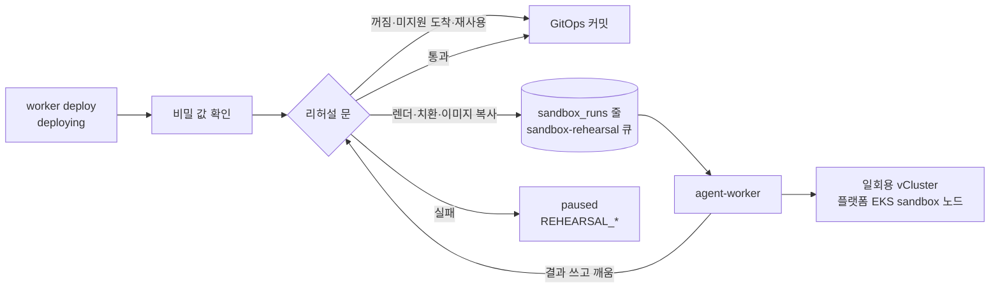

로드맵 위치: 결선 준비 / 배포 직전 vCluster 리허설과 실제 EKS 최종 시험 / 본선 연결점: 완성도·데모 30, 클라우드 활용 30

# vCluster 배포 리허설

상태: AI 초안. 코드 기준은 main(#194·#198·#201·#204·#206)과 #207(agent-worker 백엔드, 머지 직전). 실제 EKS 에서는 아직 돌리지 않았다 (2026-11-04).

## 0. 한눈에 보기



- 리허설은 GitOps 에 커밋할 바로 그 렌더 결과를 플랫폼 EKS 의 일회용 가상 클러스터(vCluster)에 먼저 올려 본다. 통과해야 커밋한다.
- 실패하면 커밋하지 않고 이전이 `deploying → paused` 로 멈춘다. 실패 코드는 `REHEARSAL_*` 이고, 고객 클러스터에는 아무것도 들어가지 않았다.
- 워커는 줄을 만들고 상태를 옮긴다(`advance()`). agent-worker 는 샌드박스를 만들고, 검사하고, 지우고, 결과를 쓴다. 리허설은 LLM 을 쓰지 않는 결정 코드다.
- 기록은 `sandbox_runs` 표(db `0046`)에 남는다. 이전이 `deploying` 에 들어올 때마다 줄이 하나 생긴다. 리허설을 안 돌린 경우도 `skipped` 줄이 남는다.

화면과 발표에 쓰는 문장 (승인된 문구, 바꾸지 않는다):

> 리허설은 플랫폼 안의 일회용 가상 클러스터에서 돕니다. 전용 노드에 한 번에 한 회사만 올라가고, 인터넷·클라우드 메타데이터·플랫폼 DB에 닿지 못하며, 고객 자격 증명은 들어가지 않습니다.

이 문장이 맞지 않는 틈은 3-2절에 적었다.

## 1. 흐름

### 1-1. 워커: 리허설 문

리허설 문은 `apps/worker/src/rehearsal/gate.ts` 다. 비밀 값 확인(`SECRET_VALUES_MISSING`) 뒤, GitOps 커밋 바로 앞에 있다. 이번 차례의 줄 하나가 무엇이냐로 갈린다. 차례(epoch)는 이전이 `deploying` 에 들어올 때의 `migrations.version` 이라서, 재개하면 새 차례가 된다.

| 이번 차례 줄 | 워커가 하는 일 |
|---|---|
| 없음, `SANDBOX_REHEARSAL` 이 `on` 이 아님 | `skipped`(`disabled`) 줄을 넣고 커밋 |
| 없음, 도착이 EKS·GKE·온프레 k3s 가 아님 | `skipped`(`unsupported_target`) 줄을 넣고 커밋 |
| 없음, 같은 이전·같은 계획·같은 지문의 통과 줄이 24시간 안에 있음 | 재사용 줄(`passed`, `reused_from`)을 넣고 커밋 |
| 없음, 치환 표에 없는 종류가 묶음에 있음 | `failed`(`REHEARSAL_UNSUPPORTED_KIND`) → paused |
| 없음, 이미지 복사 실패 | `error`(`REHEARSAL_IMAGE_MIRROR_FAILED`) → paused |
| 없음, 그 밖 | `queued` 줄과 `sandbox-rehearsal` 작업을 한 트랜잭션에 넣고 기다림 |
| `queued`·`running`, 기한 전 | 다시 기다림 (`REHEARSAL_POLL_SEC` 또는 남은 기한 중 짧은 쪽) |
| `queued`·`running`, 기한 지남 | `error`(`REHEARSAL_TIMEOUT`) → paused |
| `passed` | 그 지문으로 커밋. 커밋 직전 렌더 지문이 다르면 `REHEARSAL_BUNDLE_MISMATCH` → paused |
| `failed`·`error` | paused (줄의 실패 코드) |
| `skipped` | 커밋 |

- 기다리는 동안 deploy 작업을 붙잡지 않는다. agent-worker 가 결과를 쓰면서 core `wakeQueued` 로 deploy 작업을 깨운다.
- 다른 길에서 남는 `skipped` 줄도 있다. ECS·Cloud Run·VM 도착은 `non_k8s`, 클러스터 없이 만든 이전은 `no_cluster`, GitOps 설정 없이 `MOCK_ARGO=1` 로 흉내 낸 배포는 `mock` 이다.
- 같은 차례에 작업이 두 번 와도 줄은 하나다. 넣기는 `ON CONFLICT DO NOTHING`, 상태 바꾸기는 조건부 `UPDATE` 다 (`apps/worker/src/rehearsal/store.ts`).

### 1-2. 워커: 이미지 복사

샌드박스에는 고객 자격을 넣지 않는다. 그래서 워커가 고객 이미지를 다이제스트 그대로 플랫폼 ECR 로 복사해 둔다 (`apps/worker/src/rehearsal/image-mirror.ts`).

- 복사 자리: `<SANDBOX_IMAGE_REGISTRY>/<회사 id>/<원본 마지막 경로 조각>@sha256:<다이제스트>`. 예: `<계정>.dkr.ecr.ap-northeast-2.amazonaws.com/sandbox/<회사 id>/web@sha256:…`
- 태그로는 복사하지 않는다. 렌더 주소와 명세 원본이 둘 다 같은 `@sha256` 이어야 한다. 아니면 `not_by_digest`.
- 출발 레지스트리는 공개 이미지와 ECR 만 받는다. GCP Artifact Registry·온프레 레지스트리는 `unsupported_registry` 다.
- 출발 ECR 을 읽을 때는 출발 관찰 역할을 15분 빌린다 (단계 역할 `image_mirror`). 플랫폼 ECR 에 쓸 때는 워커 자기 신원을 쓴다. 클러스터 안이면 Pod Identity `platform-worker`, 맥이면 그 셸의 AWS 프로필이다.
- 쓰는 도구는 `crane` 과 `aws` CLI 다. 저장소는 처음 쓸 때 워커가 만든다 (태그 못 바꿈, 올릴 때 스캔).
- 복사 한 번의 시간 예산은 600초다. 넘으면 `budget_exceeded`.
- 이미지 복사 실패 이유는 `registry_unset`·`not_by_digest`·`unsupported_registry`·`role_denied`·`tool_missing`·`auth_failed`·`copy_failed`·`digest_mismatch`·`budget_exceeded` 중 하나다. paused 이유 글에 들어간다.

### 1-3. 워커: 원본과 치환본

리허설 입력(`RehearsalInput`)에는 매니페스트가 두 벌 들어간다.

- 원본(`original`): 렌더 결과 그대로. 서버 dry-run 에만 쓴다.
- 치환본(`apply`): 아래 표대로 바꾼 사본. 실제로 적용한다. 표에 없는 바꿈은 없다 (`apps/worker/src/rehearsal/substitute.ts`).

| 원본 | 리허설 | 충실도 항목 |
|---|---|---|
| 복제 수 2 이상 (HPA 최소 포함) | 1 | `replicas` |
| 요청량 | 상한 cpu `100m`, memory `128Mi`. 한도는 그대로 | `requests` |
| nodeSelector·affinity·tolerations·topologySpread·priorityClass | 지움 | `scheduling` |
| LoadBalancer·NodePort Service | ClusterIP | `service_type` |
| PVC | emptyDir | `storage` |
| ExternalSecret | 같은 이름·같은 키의 Secret, 가짜 값 | `secrets` |
| 관리형 DB (RDS, Cloud SQL), CNPG Cluster | agent-worker 가 만드는 빈 Postgres 대체물 | `database` |
| Ingress | 적용 안 함. 백엔드 Service 를 직접 확인 | `ingress` |
| IRSA·GKE Workload Identity 주석 | 지움 | `cloud_identity` |
| 이미지 주소 | 플랫폼 ECR 샌드박스 자리, 같은 다이제스트 | `images` |

치환 표가 아는 종류는 ServiceAccount, ConfigMap, Secret, PersistentVolumeClaim, Deployment, StatefulSet, DaemonSet, Job, CronJob, Service, HorizontalPodAutoscaler, PodDisruptionBudget, ExternalSecret(`external-secrets.io`), Ingress, Cluster(`postgresql.cnpg.io`) 다. 그 밖의 종류가 하나라도 있으면 `REHEARSAL_UNSUPPORTED_KIND` 로 닫는다.

### 1-4. agent-worker: 검사 순서

`sandbox-rehearsal` 큐 한 건을 받으면 `packages/agent/src/rehearsal/run.ts` 순서대로 돈다. 필수 검사가 하나라도 실패하면 그 단계의 코드로 멈춘다. 지우기는 언제나 한다.

1. 순수 검사. 지원 종류, DB 대체물 판(Postgres 15·16·17), 도착 네임스페이스 한도(원본 한도 합)를 본다. sandbox 노드 자리(CPU 1930m, 메모리 3400Mi)에 들어가는지도 미리 센다.
2. 샌드박스 만들기. 지금 실행이 아닌 리허설 네임스페이스를 먼저 지운다. 그다음 `sbx-rehearsal-<실행 번호 앞 12자>` 네임스페이스, RoleBinding `sbx-operator`, NetworkPolicy `sbx-default-deny`, vCluster 차트를 차례로 만든다. `/readyz` 가 200 이 될 때까지 최대 180초 기다린다.
3. 가상 앱 네임스페이스를 만든다. enforce 는 `baseline`, warn·audit 는 `restricted` 다. 원본에 필요한 CRD(ExternalSecret, CNPG Cluster)를 넣는다.
4. 원본 서버 dry-run (`REHEARSAL_DRY_RUN_REJECTED`).
5. 도착 파드 보안. 파드 틀마다 도착 수준 네임스페이스에 dry-run 한다. 온프레 k3s 는 `baseline`, EKS·GKE 는 라벨이 없어(`privileged`) 건너뛴다 (`REHEARSAL_TARGET_POLICY_DENIED`).
6. DB 대체물을 적용하고 준비를 기다린다. 그다음 치환본을 적용한다.
7. 롤아웃·잡이 끝나길 기다린다. 기본 300초, 매니페스트에 `progressDeadlineSeconds`·`activeDeadlineSeconds` 가 있으면 그 값(최대 600초).
8. 60초 동안 재시작이 늘었는지 본다 (`REHEARSAL_CRASHLOOP`). 그다음 Ready 를 본다 (`REHEARSAL_NOT_READY`).
9. 검사 파드(curl) 하나에서 Service 와 서비스 사이 연결(edges)마다 요청을 한 번 보낸다. 4xx 도 "닿았다"로 본다 (`REHEARSAL_CONNECTIVITY_FAILED`).
10. 지우기. port-forward 를 닫고, `helm uninstall`, 네임스페이스 삭제. 못 지우면 경고를 남기고 만료 청소가 마무리한다.

- 판정: 코드 없음이면 `passed`, 코드의 갈래가 `platform` 이면 `error`, 그 밖은 `failed` 다.
- 가상 쿠버네티스 판은 도착 마이너를 따른다 (apply 출력 `cluster_version`). 모르면 1.35 다. 표에 있는 마이너는 1.33~1.36 이다.
- 만료 청소: agent-worker 가 시작할 때와 5분마다, `platform.svc/expires-at` 이 지난 `sbx-*` 네임스페이스를 지운다 (`apps/agent-worker/src/sweeper.ts`).

## 2. 켜는 법: 프로세스마다 스위치

| 어디 | 이름 | 값 | 기본 | 뜻 |
|---|---|---|---|---|
| worker | `SANDBOX_REHEARSAL` | `off` \| `on` | `off` | 리허설 문을 켠다. 꺼지면 `skipped`(`disabled`) 줄만 남기고 커밋 |
| worker | `REHEARSAL_TIMEOUT_SEC` | 정수, 120 이상 | 1200 | 줄을 만든 때부터 결과까지 기한. 넘으면 `REHEARSAL_TIMEOUT` |
| worker | `REHEARSAL_POLL_SEC` | 정수, 5 이상 | 60 | 깨우기가 안 왔을 때 다시 보는 간격 |
| worker | `SANDBOX_IMAGE_REGISTRY` | `<호스트>/<접두어>` | 없음 | 이미지 복사 자리. `on` 이면 꼭 있어야 하고, 없으면 워커가 뜨지 않는다 |
| agent-worker | `SANDBOX_KUBE_URL` | 주소 | 없음 | 있으면 플랫폼 클러스터 밖 실행. 가상 API 는 `kubectl port-forward` 로 닿는다. 없으면 클러스터 안 서비스 계정 |
| agent-worker | `SANDBOX_KUBE_TOKEN_FILE` | 파일 경로 | 클러스터 안이면 SA 토큰 | 호스트 API 토큰. 요청마다 다시 읽는다 |
| agent-worker | `SANDBOX_KUBE_CA_FILE` | 파일 경로 | 클러스터 안이면 SA CA | 호스트 API CA |
| agent-worker | `SANDBOX_HELM_BIN`, `SANDBOX_KUBECTL_BIN` | 실행 파일 경로 | PATH 의 `helm`·`kubectl` | vCluster 차트 설치, 클러스터 밖 port-forward |
| agent-worker | `SANDBOX_VCLUSTER_CHART` | `.tgz` 경로 | `/app/vendor/vcluster-0.37.6.tgz` | 차트 묶음. CRD 는 옆 폴더 `crds/` 에서 읽는다 |
| agent-worker | `SANDBOX_TTL_SEC` | 정수, 300 이상 | 1800 | 호스트 `sbx-*` 네임스페이스 만료 (청소 기준) |
| agent-worker | `SANDBOX_RUNTIME_CLASS` | RuntimeClass 이름 | 없음 | gVisor 스위치. 수정 고리만 쓴다. 리허설은 보지 않는다 |
| worker, agent-worker | `MOCK_SANDBOX` | `1` | 없음 | 시험 전용. 워커는 이미지를 복사하지 않고, agent-worker 는 클러스터 없이 정해진 결과를 낸다 |
| agent-worker | `MOCK_SANDBOX_RESULT` | `pass` \| `fail` | `pass` | `MOCK_SANDBOX=1` 일 때만. `fail` 이면 `REHEARSAL_CRASHLOOP` |
| api | 없음 | | | `GET /api/v1/migrations/:id/rehearsal` 는 늘 켜져 있다. 줄이 없으면 `run: null` |
| 플랫폼 차트 | `sandbox.enabled` | `true` \| `false` | `false` | agent-worker 호스트 권한, VAP 6개, StorageClass |
| 플랫폼 차트 | `sandbox.imageRegistry` | `<계정>.dkr.ecr.<리전>.amazonaws.com/<접두어>` | 없음 | `SANDBOX_IMAGE_REGISTRY` 와 같은 값. 켜면 꼭 있어야 한다 |
| 플랫폼 차트 | `sandbox.gvisor.enabled` | `true` \| `false` | `false` | RuntimeClass `gvisor`. 수정 고리만 쓴다 |
| Terraform `aws/platform` | 출력 `sandbox_image_registry` | | | 위 두 값의 원본 |
| Terraform `aws/platform` | `sandbox_gvisor_enabled` | `true` \| `false` | `false` | sandbox 노드에 runsc 설치. 수정 고리만 쓴다 |

- 리허설은 `SANDBOX_MODE` 를 보지 않는다. `SANDBOX_MODE` 는 수정 고리(`agent-run` 큐)의 샌드박스를 고른다. `vcluster` 로 두면 수정 고리도 vCluster 로 가는데, gVisor 가 꺼져 있으면 그 파드는 `sbx-runtimeclass-guard` 에 막힌다.
- agent-worker 에 호스트 접속 설정이 없으면(`SANDBOX_KUBE_URL` 없음, 클러스터 밖) 리허설마다 `REHEARSAL_SANDBOX_UNAVAILABLE` 이다. 조용히 통과하는 길은 없다.
- `MOCK_SANDBOX`·`MOCK_SANDBOX_RESULT` 는 시험 스위치다. `DEMO_MODE=1` 이면 하나라도 켜져 있을 때 서비스가 뜨지 않는다. `MOCK_SANDBOX_RESULT` 만 있고 `MOCK_SANDBOX=1` 이 없으면 agent-worker 가 뜨지 않는다.
- 맥에서 돌릴 때는 `SANDBOX_VCLUSTER_CHART`·토큰·CA 경로를 절대 경로로 쓴다. `npm run dev -w @svc/agent-worker` 는 `apps/agent-worker` 폴더에서 돌아서 상대 경로가 어긋난다.
- 차트 묶음 `vcluster-0.37.6.tgz` 는 git 에 없다 (`*.tgz` 무시). 받는 법은 5-2절.

## 3. 격리 층

### 3-1. 무엇이 무엇을 막나

| 막는 것 | 어떻게 | 어디서 |
|---|---|---|
| 다른 회사와 한 노드에 같이 올라감 | 리허설 큐는 동시에 1건 (pg-boss `singleton`, 키 `sandbox-node`). 시작 전 남은 리허설 네임스페이스를 지운다 | `packages/core/src/boss.ts`, `vcluster.ts` `leftoverRehearsal` |
| 고객 파드가 플랫폼 노드에 뜸 | 노드 그룹 `sandbox`(taint `dedicated=sandbox:NoSchedule`). 동기화가 `pool=sandbox` 를 붙이고, `sbx-pod-guard` 가 그 선택자 없는 파드와 `nodeName` 을 거부 | `infra/modules/aws/platform/main.tf`, `vclusterValues`, `sandbox-vap.yaml` |
| 호스트 권한 탈출 (privileged, hostNetwork·PID·IPC, hostPath, hostPort) | 호스트 네임스페이스 PSA `baseline` + `sbx-pod-guard`. 가상 앱 네임스페이스도 enforce `baseline` | `sandbox-vap.yaml`, `run.ts` `prepare` |
| 다른 회사 이미지·플랫폼 앱 이미지 받기 | `sbx-pod-guard`: 이 계정 ECR 이미지는 `<sandbox.imageRegistry>/<네임스페이스 라벨 platform.svc/tenant>/` 아래만. 테넌트 라벨은 누구도 바꾸거나 지울 수 없다 (`sbx-namespace-guard`) | `sandbox-vap.yaml` |
| 바깥에 열림 | `sbx-service-guard`(ClusterIP 만, externalIPs 금지), `sbx-ingress-guard`(Ingress·Gateway 류 금지), 가상 quota `services.loadbalancers: 0`·`services.nodeports: 0` | `sandbox-vap.yaml`, `vclusterValues` |
| 파드에서 인터넷·IMDS·플랫폼 DB·호스트 API 로 나감 | NetworkPolicy `sbx-default-deny`(나가기 모두 거부) + 차트 `vc-work-<이름>`(가상 안쪽과 가상 DNS 만). `publicEgress` 끔, NetworkPolicy 동기화 끔. `app=vcluster-snapshot` 라벨로 차트 정책을 빌리는 파드는 VAP 가 거부 | `vcluster.ts`, `sandbox-vap.yaml` |
| 노드 역할 자격 (IMDS) | launch template IMDSv2 필수, hop limit 1 | `infra/modules/aws/platform/main.tf` |
| 플랫폼 DB | DB 보안 그룹은 general·cred 노드 보안 그룹에서만 5432 를 받는다 | `main.tf` `db_from_nodes` |
| agent-worker 권한이 넓어짐 | ClusterRole `sbx-provisioner`(네임스페이스 읽기·만들기·지우기, RoleBinding 만들기, `sbx-operator` 묶기만), `sbx-operator` 는 `sbx-*` 안 RoleBinding 으로만. `sbx-namespace-guard`·`sbx-rolebinding-guard` 가 이름·라벨·묶음 모양을 본다 | `agent-worker-rbac.yaml`, `sandbox-vap.yaml` |
| 고객 자격·비밀 값이 샌드박스에 들어감 | 이미지는 워커가 미리 복사. 비밀은 같은 이름·키의 가짜 값. 관리형 DB 는 빈 Postgres 대체물 | `image-mirror.ts`, `substitute.ts`, `stand-in.ts` |
| 샌드박스가 남음 | 끝나면 지우고, 못 지우면 만료 라벨로 5분마다 청소 | `run.ts`, `sweeper.ts` |
| 커널 공유 | 리허설은 runc (노드와 같은 커널). 노드에는 그 순간 한 회사만. gVisor + `restricted` 는 수정 고리만 | contracts `sandboxIsolation` |

### 3-2. 남은 위험 (말로 밝힌다)

- DNS 터널링. 가상 CoreDNS 가 호스트 kube-dns 로 이름을 넘기는 길은 열려 있다. 받아들인 위험이다.
- 노드 단 인터넷 출구. sandbox 노드에는 클러스터 보안 그룹(나가기 0.0.0.0/0)이 붙어 있고 NAT 로 나간다. 노드 프로세스(kubelet, containerd)는 인터넷에 닿는다. 고객 파드는 파드 단 정책이 막는다. 노드 단 차단은 #212.
- 새 파드가 뜬 직후. EKS VPC CNI 기본(standard) 모드는 정책 적용이 끝날 때까지 새 파드를 "모두 허용"으로 시작한다 ([AWS 문서](https://docs.aws.amazon.com/eks/latest/userguide/cni-network-policy-configure.html)). 창의 길이는 문서에 없다. kind 측정에서는 20초 안에 막혔다 (#212 댓글). EKS 길이는 7-7절에서 잰다. `NETWORK_POLICY_ENFORCING_MODE=strict` 는 vpc-cni 전체 설정이라 시연 전에는 켜지 않는다.
- vCluster 제어판 파드(`vc-cp-<이름>`)는 443·8443·6443 으로 어디든 나간다. 플랫폼이 고정한 이미지만 돌지만 겹이 하나다 (#212).
- 앱 파드가 `k8s-app=vcluster-kube-dns` 라벨을 달면 호스트 kube-dns 로 나갈 수 있다. 새로 열리는 길은 없다고 보지만 시험하지 않았다 (#212).
- 리허설은 runc 라서 컨테이너 탈출 취약점이 있으면 sandbox 노드까지 닿는다. 그 노드에는 그 순간 리허설 한 회사만 있다.
- "한 번에 한 회사"는 리허설 큐가 지킨다. 수정 고리(`SANDBOX_MODE=vcluster`) 샌드박스는 다른 큐(`agent-run`)라서 같은 sandbox 노드에 함께 뜰 수 있다. 수정 고리는 gVisor RuntimeClass 를 요구해서, gVisor 가 꺼진 지금은 그 파드가 뜨지 않는다.

발표 문장과의 차이: "인터넷에 닿지 못하며"는 새 파드가 뜬 직후 몇 초를 빼면 맞다. 그 틈에도 고객 자격 증명은 없고 비밀은 가짜 값이다. 노드 역할 자격은 IMDSv2 hop limit 1 이 막는다.

## 4. 실패 코드와 화면

### 4-1. 실패 코드

실패의 뜻은 `REHEARSAL_FAILURE_CLASS` 표(`packages/contracts/src/sandbox.ts`) 하나로 갈린다. 콘솔 문장과 "사람이 할 일"이 이 표를 따른다.

| 갈래 | 판정 | 코드 | 뜻 |
|---|---|---|---|
| `would_fail` | `failed` | `REHEARSAL_DRY_RUN_REJECTED` | API 서버가 원본 객체를 거부. 실제 도착도 거부한다 |
| | | `REHEARSAL_TARGET_POLICY_DENIED` | 파드 틀이 도착 파드 보안 수준을 어김 (k3s `baseline`) |
| | | `REHEARSAL_QUOTA_EXCEEDED` | 원본 한도 합이 도착 네임스페이스 한도를 넘음 |
| | | `REHEARSAL_ROLLOUT_FAILED` | 롤아웃이 안 끝남, 또는 컨테이너를 못 만듦 (없는 Secret 키 등) |
| | | `REHEARSAL_CRASHLOOP` | 60초 관찰 중 재시작이 늘었음 |
| | | `REHEARSAL_NOT_READY` | 롤아웃 뒤 Ready 가 아님 |
| | | `REHEARSAL_JOB_FAILED` | Job 실패 또는 기한 초과 |
| | | `REHEARSAL_CONNECTIVITY_FAILED` | Service 나 서비스 사이 연결에 요청이 안 닿거나 5xx 가 옴 |
| `cannot_vouch` | `failed` | `REHEARSAL_POLICY_DENIED` | 샌드박스만의 규칙(호스트 VAP, 가상 PSA)이 막음. 앱 고장이라는 뜻이 아님 |
| | | `REHEARSAL_UNSUPPORTED_KIND` | 치환 표 밖 종류가 묶음에 있음 |
| `platform` | `error` | `REHEARSAL_IMAGE_MIRROR_FAILED` | 이미지 복사 실패, 또는 샌드박스에서 이미지를 못 받음 |
| | | `REHEARSAL_SANDBOX_UNAVAILABLE` | 샌드박스를 못 만들거나 못 씀 (helm·port-forward·준비·상한·DB 대체물) |
| | | `REHEARSAL_TIMEOUT` | 기한(`REHEARSAL_TIMEOUT_SEC`) 안에 결과가 없음 |
| | | `REHEARSAL_BUNDLE_MISMATCH` | 커밋 직전 렌더 지문이 리허설 지문과 다름 |

- `would_fail`: 실제 배포도 실패한다. 매니페스트·이미지·값을 고치고 재개한다.
- `cannot_vouch`: 샌드박스가 보증하지 못한다. 재개하면 같은 리허설을 다시 돈다. 이전 하나만 리허설을 건너뛰는 스위치는 없고, 플랫폼 전체 `SANDBOX_REHEARSAL=off` 뿐이다. TODO(human): 보증 못 함일 때 사람이 넘길 길을 둘지.
- `platform`: 우리 쪽 문제다. 원인을 고치고 재개하면 새 샌드박스에서 다시 돈다.
- paused 이유 글에는 처음 실패한 필수 검사 한 줄이 들어간다. 예: `리허설 실패 restarts Deployment/web: 60초 관찰: 재시작 +3, 이유 Error`.

### 4-2. 화면: `RehearsalView`

`GET /api/v1/migrations/:id/rehearsal` 은 그 이전의 가장 큰 차례 줄 하나를 돌려준다 (`apps/api/src/routes/rehearsal.ts`). 읽기 전용이고 상태·감사를 건드리지 않는다. 남의 회사 이전은 404 다. 응답에는 `cache-control: no-store` 가 붙는다.

| 칸 | 뜻 |
|---|---|
| `run` | `null` 이면 이 이전에 아직 리허설 줄이 없다 |
| `run.status` | `queued`·`running`·`passed`·`failed`·`error`·`skipped` |
| `run.phase` | `mirroring`·`creating`·`applying`·`checking`·`deleting`·`done` |
| `run.skip` | 건너뛴 이유 (`non_k8s`·`no_cluster`·`unsupported_target`·`disabled`·`mock`) |
| `run.failureCode` | 실패 코드. 결과 없이 끝난 줄(예: `REHEARSAL_TIMEOUT`)도 이 칸으로 이유를 보인다 |
| `run.reusedFrom` | 재사용한 앞 통과 줄 |
| `run.sandboxName`, `createdAt`·`startedAt`·`finishedAt`·`deadlineAt` | 샌드박스 이름과 시각 |
| `run.fidelity` | 충실도 표. 결과가 오기 전에는 워커 몫만 보인다 |
| `run.result` | 검사 줄(`checks`), 경고, 단계 시간(`timingsMs`), 지웠는지(`deleted`), 흉내였는지(`sandbox.mock`) |
| `run.stale` | `true` 면 이 줄은 지난 배포 시도의 것이다 |

`run.stale` 이 `true` 인 경우: 재개한 지금 시도가 리허설 문 앞에서 멈췄거나(예: `SECRET_VALUES_MISSING`), 아직 줄을 만들지 않았다. 화면은 이 줄을 지금 판정이 아니라 지난 시도의 기록으로 보여 준다. 낡음은 시각이 아니라 감사 기록의 마지막 `deploying` 진입으로 센다.

콘솔 화면(`apps/web` `RehearsalFold`)은 #209 로 들어온다. 그 화면은 낡은 줄 위에 "지난 배포 시도의 기록입니다. 이번 시도의 판정이 아닙니다."를 먼저 띄운다.

### 4-3. 충실도 표

충실도 표(`FidelityMatrix`)는 계약이고 콘솔에 그대로 보인다. 항목 27개가 한 번씩 있고, 항목마다 "실제 배포에서는 / 리허설에서는 / 이유" 한 줄이다. `sandbox_pod_security`·`runtime_isolation` 은 agent-worker 가, 나머지는 워커가 쓴다 (`apps/worker/src/rehearsal/fidelity.ts`).

| 상태 | 항목 |
|---|---|
| 늘 같음 (`identical`) | `manifests`, `namespace`, `objects`, `target_pod_security`, `quota` |
| 바꾼 것이 있으면 바꿈 (`substituted`), 없으면 같음 | `images`, `replicas`, `requests`, `scheduling`, `service_type`, `storage`, `secrets`, `database`, `ingress` |
| 도착 판을 알면 같음, 모르면 바꿈 | `k8s_version` |
| 도착 수준과 같으면 같음 | `sandbox_pod_security` (k3s 는 같음, EKS·GKE 는 바꿈) |
| 늘 바꿈 | `network`, `runtime_isolation` |
| 확인 못 함 (`not_checked`) | `data`, `traffic`, `node_arch`. 있을 때만: `tunnel`, `hpa_scaling`, `cronjob_runs`, `daemonsets`. 도착에 따라: `secret_values`(k3s), `cloud_identity`(EKS·GKE, 또는 k3s 에 신원 주석이 있을 때) |

## 5. 로컬에서 돌리기

### 5-1. 흉내 (클러스터 없음)

화면 작업용이다. 워커는 렌더·치환까지 진짜로 하고 이미지 복사만 건너뛴다. agent-worker 는 클러스터 없이 정해진 결과를 쓴다.

- GitOps 설정이 있어야 한다. 없으면 배포가 `MOCK_ARGO=1` 흉내로 가서 리허설은 `skipped`(`mock`) 줄만 남는다. `GITOPS_REPO_DIR` 는 gitops 레포의 로컬 git 복사본이다 (`tools/render.mjs` 로 렌더한다). push 는 `GITOPS_PUSH=1` 일 때만 해서 원격은 안 바뀐다.
- 스위치는 명령줄에만 붙인다 (`docs/START-DRILL.md` 4-1절).

워커. `docs/START-DRILL.md` 4-2절 명령에서 `GITOPS_DISABLE=1` 을 빼고 첫 줄을 더한 것이다:

```bash
SANDBOX_REHEARSAL=on MOCK_SANDBOX=1 GITOPS_REPO_DIR=<gitops 레포 로컬 복사본> \
MOCK_SEED=1 MOCK_IAC=1 MOCK_ARGO=1 \
MOCK_CREDS=1 MOCK_REPL=1 \
MOCK_TRAFFIC=1 MOCK_PRECHECK=1 \
FAKE_LLM=1 GITOPS_REPO_URL= PROM_URL= \
TRAFFIC_OBSERVE_SEC=0.5 \
npm run dev:worker
```

agent-worker. 실패 경우를 보려면 `MOCK_SANDBOX_RESULT=fail` 을 더한다:

```bash
MOCK_SANDBOX=1 FAKE_LLM=1 npm run dev -w @svc/agent-worker
```

- 기대 로그: agent-worker `agent-worker rehearsal` 줄의 `backend` 가 `mock (pass)` 또는 `mock (fail)`.
- 기대 결과: 통과면 이전이 `syncing` 으로 간다. `fail` 이면 `paused`, 실패 코드 `REHEARSAL_CRASHLOOP`. 검사 줄 글은 `(흉내)` 로 시작하고 `result.sandbox.mock` 이 `true` 다.

### 5-2. kind (진짜 vCluster)

kind 는 맥 로컬 클러스터다. 실제 클라우드가 아니다. 두 가지를 볼 수 있다.

준비는 한 번이다. 명령은 레포 맨 위에서 친다.

1. control-plane 하나와 worker 하나인 kind 클러스터를 만든다. worker 에 라벨 `pool=sandbox`, taint `dedicated=sandbox:NoSchedule` 을 단다. 이미지는 `kindest/node:v1.35.8` (`deploy/ci/sandbox-kind-e2e.sh` 머리).
2. 차트 묶음을 받고 체크섬을 확인한다.

```bash
curl -fsSLo apps/agent-worker/vendor/vcluster-0.37.6.tgz https://charts.loft.sh/charts/vcluster-0.37.6.tgz
(cd apps/agent-worker/vendor && shasum -a 256 -c SHA256SUMS)
```

기대 출력: 세 줄 모두 `OK`.

3. vCluster 값 파일을 만든다. agent-worker 의 `vclusterValues` 를 그대로 부른다. `NS` 가 릴리스 이름이자 네임스페이스 이름이다.

```bash
WORK=$(mktemp -d)
NS=sbx-rehearsal-e2e npx tsx -e '
import { vclusterValues } from "@svc/agent";
console.log(JSON.stringify(vclusterValues({ kind: "rehearsal", runId: "check", tenantId: "11111111-1111-4111-8111-111111111111",
  isolation: { podSecurity: "baseline", runtimeClass: null }, k8sMinor: "1.35", images: [], ttlSec: 1800,
  quota: { requests: { cpuM: 1000, memoryMi: 1536 }, limitsMemoryMi: 3072, pods: 10, storageMi: 1024 } }, process.env.NS!)));
' > "$WORK/values.json"
```

호스트 가드 끝-끝 검사. 플랫폼 차트 샌드박스 부분을 kind 에 올리고, agent-worker 로 흉내 내어 vCluster 를 만들고 지우며 허용·거부를 본다.

```bash
WORK="$WORK" CLUSTER=iron-pol bash deploy/ci/sandbox-kind-e2e.sh apps/agent-worker/vendor/vcluster-0.37.6.tgz "$WORK/values.json"
```

기대 출력: 마지막 줄 `RESULT pass=<수> fail=0`.

리허설 한 번 끝까지 (#207 `apps/agent-worker/scripts/rehearse-kind.ts`). agent-worker 가 클러스터 밖에서 도는 길 그대로다. 위 검사가 플랫폼 차트 샌드박스 부분을 이미 올렸어야 한다.

```bash
C=kind-iron-pol
kubectl --context $C -n platform create token agent-worker > "$WORK/sa.token"
kubectl config view --raw --minify --context $C -o jsonpath='{.clusters[0].cluster.certificate-authority-data}' | base64 -d > "$WORK/kind-ca.crt"
SERVER=$(kubectl config view --minify --context $C -o jsonpath='{.clusters[0].cluster.server}')
npx tsx apps/agent-worker/scripts/rehearse-kind.ts --server "$SERVER" --ca-file "$WORK/kind-ca.crt" --token-file "$WORK/sa.token" \
  --input apps/agent-worker/scripts/fixtures/rehearsal-3tier-onprem.json --out "$WORK/result.json"
```

- 기대 출력: `phase creating` → `applying` → `checking` → `deleting` 줄, 그다음 `verdict=passed failureCode=null sandbox=sbx-rehearsal-… k8s=v1.35.0 deleted=true`. 마지막 줄 `teardown:` 에 남은 네임스페이스가 없거나 `Terminating` 만 있다.
- 실패 경우: `--map <이미지 ref>=<없는 이미지>` 로 이미지 하나를 바꾸면 `REHEARSAL_IMAGE_MIRROR_FAILED` 가 나온다.
- 입력 `rehearsal-3tier-onprem.json` 은 팀 3티어 예시를 렌더한 원본 15개와 워커 치환본이다. 이미지는 같은 다이제스트의 공개 이미지로 바꿔 두었다.
- 이 스크립트는 kind 전용이다. 실제 EKS 에서는 돌리지 않는다. EKS 는 7절처럼 실제 이전 하나로 본다.

## 6. 시험 명령 (클라우드 없음)

```bash
node --import tsx --test packages/agent/test/rehearsal.test.ts packages/agent/test/vcluster.test.ts \
  packages/agent/test/sandbox-select.test.ts apps/agent-worker/test/rehearsal.test.ts packages/contracts/test/sandbox.test.ts
npm run test:db      # apps/worker/test/rehearsal-gate.db.test.ts 포함 (로컬 Postgres)
```

- 기대 출력: `# fail 0`. #207 머리(`bf861bf`)에서 첫 명령은 `# pass 40`.
- 차트 쪽: `bash deploy/ci/check-platform.sh` (렌더 세 벌, kubeconform, `sandbox.imageRegistry` 없음·틀린 모양 거부).

## 7. 실제 EKS 확인 (최종 시험)

사람이 한 번 돌린다. 비용이 드는 실제 클라우드다. 이 절의 명령은 모두 사람이 친다. Claude 는 돌리지 않는다.

- 위에서부터 순서대로 한다. 단계마다 기대 결과가 아니면 그 단계의 "안 되면"을 보고, 고친 뒤 그 단계부터 다시 한다.
- 쓰기 명령은 단계 머리에 "쓰기"로 적었다. 지우는 명령은 이 절에서 만든 `sbx-rehearsal-probe01` 과 그 helm 릴리스만 지운다.
- 명령은 bash 로 친다. zsh 는 변수 안 공백을 나누지 않아서 `$K` 같은 줄이 깨진다. 먼저 `bash` 를 친다.
- 모든 kubectl·helm 에 컨텍스트를 붙인다. 맥에는 kind·k3d 컨텍스트도 있다.

### 7-0. 준비물 (사람, 실클라우드, 읽기만)

한 셸에서 이어서 쓸 값을 먼저 둔다.

```bash
bash
REPO=<Service 레포 절대 경로>
WORK=$HOME/sbx-eks-check            # 레포 밖. 토큰·CA·값 파일을 둔다
mkdir -p "$WORK" && chmod 700 "$WORK"
TF="terraform -chdir=$REPO/infra/modules/aws/platform"
CTX=platform-eks
K="kubectl --context $CTX"
AWU=system:serviceaccount:platform:agent-worker
AW="--as=$AWU --as-group=system:serviceaccounts --as-group=system:serviceaccounts:platform"
HELM_AW="helm --kube-context $CTX --kube-as-user $AWU --kube-as-group system:serviceaccounts --kube-as-group system:serviceaccounts:platform"
TENANT=<리허설할 이전의 회사 id, 소문자 UUID>
OTHER=<TENANT 와 다른 아무 소문자 UUID>
```

| 확인 | 명령 | 기대 | 안 되면 |
|---|---|---|---|
| #207 이 main 에 있고 의존성 설치 | `cd $REPO && git log --oneline -1 && npm ci` | 끝까지 성공 | main 을 받는다 |
| AWS 자격 | `aws sts get-caller-identity --query Account --output text` | 플랫폼 계정 12자리 | `AWS_PROFILE` 을 맞춘다 |
| 플랫폼 스택 | `$TF output -raw cluster_name` | `platform` (또는 정한 이름) | `$TF init -backend-config=$HOME/.svc-tf/backend.hcl`. 스택이 없으면 `infra/README.md` 실행 순서 (사람 승인, 비용 시작) |
| kubeconfig | `aws eks update-kubeconfig --name "$($TF output -raw cluster_name)" --region ap-northeast-2 --alias $CTX` | `Added new context platform-eks` | 위 자격 |
| 노드 | `$K get nodes -L pool` | `general` 2, `cred` 1, `sandbox` 1, 모두 `Ready` | 노드 그룹 상태를 콘솔에서 본다 |
| 도구 | `helm version --short; kubectl version --client; crane version; aws --version` | helm 3, kubectl 1.34~1.36, crane, aws v2 | `brew install helm kubectl crane awscli`. kubectl 은 서버(1.35)와 마이너 하나 차이까지 |
| 차트 묶음 | 5-2절 준비 2번 명령 | 세 줄 `OK` | 다시 받는다 |
| ESO 와 `argocd` 네임스페이스 | `$K get crd secretstores.external-secrets.io; $K get ns argocd` | 둘 다 있음 | 플랫폼 차트가 SecretStore 와 `argocd` 안 Role 을 그려서 없으면 helm 이 멈춘다. ESO 는 `deploy/helm/platform/README.md` 순서 1. TODO(human): Argo CD 허브를 이 클러스터에 둘지. 리허설만 볼 거면 `$K create namespace argocd` 로 자리만 만든다 (쓰기) |
| 시험 스위치 없음 | `grep -nE '^(MOCK_SANDBOX\|MOCK_SANDBOX_RESULT\|SANDBOX_MODE)=' $REPO/.env` | 아무것도 안 나옴 | 그 줄을 지운다 |
| 리허설할 이전 | 실클라우드 회차와 같은 설정(GitOps·Argo·자격)으로 `deploying` 까지 갈 이전 하나 | 출발 이미지가 ECR 또는 공개, 명세에 다이제스트 고정. 도착은 EKS·GKE·k3s | TODO(human): 어느 이전으로 할지 |

### 7-1. 이미지 자리 값 (사람, 실클라우드, 읽기만)

```bash
REG=$($TF output -raw sandbox_image_registry); echo "$REG"
```

- 기대: `<12자리>.dkr.ecr.ap-northeast-2.amazonaws.com/sandbox`
- 안 되면: 출력이 없다는 오류면 #204 전에 apply 한 상태다. 워커 역할의 샌드박스 ECR 권한도 같이 빠져 있다. `$TF plan` 으로 바뀔 것을 보고 사람이 apply 한다.

### 7-2. 플랫폼 차트 켜기 (사람, 실클라우드, 쓰기)

이미 깔린 릴리스에 다른 `--set` 을 줬었다면 같이 준다. `helm --kube-context $CTX get values platform -n platform` 으로 본다. 안 주면 차트 기본값으로 돌아간다.

먼저 서버 dry-run 으로 렌더와 입장 검사만 본다.

```bash
helm --kube-context $CTX upgrade --install platform "$REPO/deploy/helm/platform" -n platform --create-namespace \
  --set sandbox.enabled=true --set sandbox.imageRegistry="$REG" --dry-run=server > "$WORK/platform-dryrun.txt"
grep -c '^kind: ValidatingAdmissionPolicy$' "$WORK/platform-dryrun.txt"
```

- 기대: `6`
- 처음 설치라 `platform` 네임스페이스가 없으면 이 dry-run 은 `namespaces "platform" not found` 로 멈출 수 있다. 그때는 건너뛴다.

진짜로 올린다.

```bash
helm --kube-context $CTX upgrade --install platform "$REPO/deploy/helm/platform" -n platform --create-namespace \
  --set sandbox.enabled=true --set sandbox.imageRegistry="$REG"
```

- 기대: `STATUS: deployed`
- 안 되면:
  - `sandbox.imageRegistry=… 는 … 모양이어야 한다`: 7-1 값을 그대로 넣는다 (스킴·끝 `/` 없음).
  - `no matches for kind "SecretStore"`: ESO 가 없다 (7-0 표).
  - `namespaces "argocd" not found`: 7-0 표.

### 7-3. 가드와 권한 (사람, 실클라우드, 읽기와 dry-run)

VAP 는 올린 뒤 몇 초 걸려 적용된다. 30초 기다린 뒤 본다.

```bash
$K get validatingadmissionpolicy,validatingadmissionpolicybinding -l app.kubernetes.io/part-of=platform
$K get validatingadmissionpolicies -l app.kubernetes.io/part-of=platform \
  -o jsonpath='{range .items[*]}{.metadata.name} warnings={.status.typeChecking.expressionWarnings}{"\n"}{end}'
```

- 기대: 정책 6개와 바인딩 6개 (`sbx-namespace-guard`, `sbx-rolebinding-guard`, `sbx-pod-guard`, `sbx-runtimeclass-guard`, `sbx-service-guard`, `sbx-ingress-guard`). 둘째 명령은 줄마다 `warnings=` 뒤가 비어 있다.
- 안 되면: 경고가 있으면 그 줄을 이슈로 남기고 멈춘다. 정책이 그 칸을 검사하지 못한다는 뜻이다.

agent-worker 권한. 아무것도 만들지 않는다.

```bash
for q in "create namespaces" "delete namespaces" "bind clusterroles/sbx-operator" \
         "patch namespaces" "get secrets -n platform" "list secrets -A" "create clusterroles" \
         "create clusterrolebindings" "bind clusterroles/cluster-admin" "create pods -n kube-system"; do
  echo "$q: $($K auth can-i $q $AW)"
done
```

- 기대: 앞의 셋은 `yes`, 나머지 일곱은 `no`.
- 안 되면: `no` 여야 할 줄이 `yes` 면 멈춘다. `agent-worker-rbac.yaml` 과 클러스터의 다른 ClusterRoleBinding 을 본다 (`$K get clusterrolebinding -o wide | grep agent-worker`).

네임스페이스 가드. 서버 dry-run 이라 저장하지 않는다.

```bash
EXP=$(( $(date +%s) + 3600 ))
ns_json() { # 이름 purpose enforce 회사
  printf '{"apiVersion":"v1","kind":"Namespace","metadata":{"name":"%s","labels":{"platform.svc/sandbox":"true","platform.svc/sandbox-purpose":"%s","platform.svc/expires-at":"%s","pod-security.kubernetes.io/enforce":"%s","platform.svc/tenant":"%s"}}}' "$1" "$2" "$EXP" "$3" "$4"
}
ns_json sbx-rehearsal-dry01 rehearsal baseline "$TENANT" | $K $AW create --dry-run=server -f -
ns_json app-dry01 rehearsal baseline "$TENANT" | $K $AW create --dry-run=server -f -
ns_json sbx-rehearsal-dry02 rehearsal privileged "$TENANT" | $K $AW create --dry-run=server -f -
ns_json sbx-rehearsal-dry03 rehearsal baseline ACME | $K $AW create --dry-run=server -f -
$K $AW delete namespace platform --dry-run=server
```

| 줄 | 기대 |
|---|---|
| 1 | `namespace/sbx-rehearsal-dry01 created (server dry run)` |
| 2 | 거부, 출력에 `sbx-namespace-guard` 와 `sbx- 로 시작하는` |
| 3 | 거부, `sbx-namespace-guard` 와 `enforce=baseline` |
| 4 | 거부, `sbx-namespace-guard` 와 `platform.svc/tenant` |
| 5 | 거부, `sbx-namespace-guard`. RBAC 는 네임스페이스 지우기를 허용하므로 이 줄이 막는 겹은 VAP 다 |

- 안 되면: 2~5 가 통과하면 멈춘다. VAP 바인딩이 `Deny` 인지 본다 (`$K get validatingadmissionpolicybinding sbx-namespace-guard -o yaml`).
- 파드·서비스·이미지 경로 가드는 네임스페이스가 있어야 해서 7-7 에서 출구 시험 네임스페이스로 본다.

### 7-4. agent-worker 토큰과 CA 파일 (사람, 실클라우드, 쓰기: 토큰 발급)

```bash
$K -n platform create token agent-worker --duration=2h > "$WORK/agent-worker.token"
chmod 600 "$WORK/agent-worker.token"
aws eks describe-cluster --name "$($TF output -raw cluster_name)" --region ap-northeast-2 \
  --query cluster.certificateAuthority.data --output text | base64 -d > "$WORK/eks-ca.crt"
ENDPOINT=$($TF output -raw cluster_endpoint); echo "$ENDPOINT"
cat > "$WORK/agent-worker.kubeconfig" <<EOF
apiVersion: v1
kind: Config
current-context: host
clusters: [{name: host, cluster: {server: "$ENDPOINT", certificate-authority: "$WORK/eks-ca.crt"}}]
users: [{name: agent-worker, user: {tokenFile: "$WORK/agent-worker.token"}}]
contexts: [{name: host, context: {cluster: host, user: agent-worker}}]
EOF
chmod 600 "$WORK/agent-worker.kubeconfig"
SA="kubectl --kubeconfig $WORK/agent-worker.kubeconfig"
$SA auth whoami
$SA auth can-i create namespaces
$SA -n platform get secrets
```

- 이 kubeconfig 는 agent-worker 가 실행 중에 스스로 만드는 것(`hostKubeconfig`: 서버, CA 파일, 토큰 파일)과 같은 모양이다. agent-worker 는 이 파일을 읽지 않는다. 사람이 확인할 때만 쓴다.
- 기대: `ENDPOINT` 는 `https://…eks.amazonaws.com`. `whoami` 의 Username 은 `system:serviceaccount:platform:agent-worker`. `can-i` 는 `yes`. 마지막 줄은 `Forbidden`.
- 안 되면: `x509` 오류면 CA 파일이 틀렸다. `Unauthorized` 면 토큰이 만료됐거나 다른 클러스터 것이다.
- 토큰은 2시간 뒤 만료된다. 같은 명령으로 파일을 다시 쓰면 된다. agent-worker 는 요청마다 파일을 다시 읽어서 다시 띄울 필요가 없다.

### 7-5. worker 와 agent-worker 환경 (사람, 맥)

맥 `.env` 에 아래를 넣는다. 둘 다 같은 `.env` 를 읽는다. 경로는 모두 절대 경로다.

```bash
# worker
SANDBOX_REHEARSAL=on
SANDBOX_IMAGE_REGISTRY=<7-1 의 REG 값>
# agent-worker (클러스터 밖)
SANDBOX_KUBE_URL=<7-4 의 ENDPOINT 값>
SANDBOX_KUBE_TOKEN_FILE=<WORK 절대 경로>/agent-worker.token
SANDBOX_KUBE_CA_FILE=<WORK 절대 경로>/eks-ca.crt
SANDBOX_VCLUSTER_CHART=<REPO 절대 경로>/apps/agent-worker/vendor/vcluster-0.37.6.tgz
```

- 넣지 않는다: `MOCK_SANDBOX`, `MOCK_SANDBOX_RESULT`, `SANDBOX_MODE` (비우면 수정 고리는 `memory`. 리허설은 이 값을 보지 않는다).
- `REHEARSAL_TIMEOUT_SEC`(1200)·`REHEARSAL_POLL_SEC`(60)·`SANDBOX_TTL_SEC`(1800) 는 기본값 그대로 둔다.
- 워커 셸에는 플랫폼 계정 AWS 프로필이 있어야 한다. 플랫폼 ECR `sandbox/*` 에 저장소를 만들고 올리는 권한이 필요하다 (`ecr:CreateRepository`, 올리기 동작, `ecr:BatchGetImage`, `ecr:GetAuthorizationToken`). TODO(human): 맥 프로필이 이 권한을 가졌는지. 클러스터 안 워커라면 `platform-worker` 역할에 이미 있다 (`pod-identity.tf`).
- `crane`·`aws` 가 워커 셸의 PATH 에 있어야 한다. 없으면 `REHEARSAL_IMAGE_MIRROR_FAILED`(`tool_missing`).

실클라우드 회차 때처럼 띄운다. 시험 스위치는 붙이지 않는다.

```bash
npm run dev:worker                    # 터미널 1
npm run dev -w @svc/agent-worker      # 터미널 2
```

| 볼 줄 | 기대 | 안 되면 |
|---|---|---|
| 워커 시작 | `설정 오류` 없이 뜬다 | `SANDBOX_IMAGE_REGISTRY: SANDBOX_REHEARSAL=on 이면 있어야 함` → 값을 넣는다 |
| agent-worker `agent-worker rehearsal` | `backend` 가 `vcluster (<차트 경로>, CRD 2개)` | `mock (pass)` → `MOCK_SANDBOX` 가 남았다. `없음 (호스트 클러스터 설정 없음)` → `SANDBOX_KUBE_URL` 이 비었다 |
| agent-worker 시작 중 죽음 | 죽지 않는다 | `ENOENT` 면 CA 파일이나 차트 옆 `crds/` 경로가 틀렸다. 절대 경로로 쓴다 |
| agent-worker `sandbox sweep` | 경고가 없다 (지운 것이 있으면 `만료 샌드박스 지움`) | `sandbox sweep: 목록 실패` → 토큰·CA·주소를 7-4 로 다시 본다 |

### 7-6. 실제 이전 하나로 리허설 (사람, 실클라우드, 쓰기)

리허설할 이전을 실클라우드 회차와 같은 순서로 `deploying` 까지 보낸다. 다른 터미널에서 샌드박스를 본다. 그 터미널에도 `bash` 를 치고 7-0 의 값을 다시 둔다.

```bash
$K get ns -l platform.svc/sandbox=true -w
```

- 기대: `sbx-rehearsal-<12자>` 가 `Active` 로 생겼다가 리허설이 끝나면 `Terminating` 이 되고 사라진다.

샌드박스가 있는 동안 파드와 이미지를 본다.

```bash
SBX_NS=<위에서 본 sbx-rehearsal-… 이름>
$K get nodes -l pool=sandbox
$K -n $SBX_NS get pods -o wide
$K -n $SBX_NS get pods -o jsonpath='{range .items[*]}{.metadata.name} {.spec.containers[*].image}{"\n"}{end}'
```

- 기대: 모든 파드의 `NODE` 가 sandbox 노드다. 고객 앱 파드 이미지는 `$REG/$TENANT/` 로 시작한다. 제어판·CoreDNS·검사 파드·Postgres 대체물은 공개 이미지다.

끝난 뒤 결과. 콘솔 이전 화면의 리허설 칸, 또는 로컬 DB 에서 본다 (읽기만).

```bash
cd "$REPO" && docker compose exec db psql -U platform_owner -d platform -c \
 "SELECT id, status, phase, failure_code, sandbox_name, finished_at - started_at AS took, deleted_at IS NOT NULL AS deleted,
         result->'timingsMs' AS ms, result->'sandbox'->>'k8sVersion' AS k8s
    FROM sandbox_runs ORDER BY created_at DESC LIMIT 3;"
```

- 기대: 맨 위 줄이 `passed`, `done`, 코드 없음, `deleted` 가 `t`. 이전은 `syncing` 으로 넘어간다.
- 기록: `took`, `ms`(create·apply·check·delete), `k8s` 를 7-10 기록표에 적는다.

실패했으면 처음 실패한 검사 줄을 본다.

```bash
docker compose exec db psql -U platform_owner -d platform -c \
 "SELECT c->>'id' AS id, c->>'subject' AS subject, c->>'detail' AS detail
    FROM (SELECT result FROM sandbox_runs ORDER BY created_at DESC LIMIT 1) r, jsonb_array_elements(r.result->'checks') c
   WHERE (c->>'ok')::boolean = false AND (c->>'required')::boolean;"
```

| 증상 | 뜻 | 할 일 |
|---|---|---|
| `REHEARSAL_IMAGE_MIRROR_FAILED`, 이유 `tool_missing` | 워커 셸에 `crane`·`aws` 없음 | 설치 뒤 재개 |
| 같은 코드, `auth_failed`·`copy_failed` | 플랫폼 ECR 로그인·쓰기 실패 | 워커 셸 프로필 권한 (7-5) |
| 같은 코드, `not_by_digest`·`unsupported_registry` | 출발 이미지가 다이제스트 고정이 아니거나 ECR·공개가 아님 | 다른 이전을 고른다 |
| `REHEARSAL_SANDBOX_UNAVAILABLE`, 검사 줄 `SANDBOX_HELM` 과 403 | `sbx-operator` 규칙이 차트에 모자람 | helm 출력의 자원 이름을 이슈로 남긴다 |
| 같은 코드, `SANDBOX_NOT_READY` | 제어판이 180초 안에 안 뜸. 첫 이미지 받기(ghcr.io)가 느렸을 수 있다 | `$K -n $SBX_NS get events` 를 남기고 재개한다 |
| 같은 코드, `SANDBOX_PORT_FORWARD` | 맥에서 가상 API 로 port-forward 실패 | `SANDBOX_KUBECTL_BIN`·토큰을 본다 |
| `REHEARSAL_TIMEOUT` | 기한 1200초 안에 결과 없음 | agent-worker 가 떠 있었는지, 큐를 받았는지 로그를 본다 |
| `would_fail` 갈래 | 앱이 실제 도착에서도 실패한다 | 4-1절 |

이미지 경로가 실제로 만든 것 (읽기만):

```bash
aws ecr describe-repositories --region ap-northeast-2 \
  --query "repositories[?starts_with(repositoryName, 'sandbox/')].repositoryName" --output text
```

- 기대: `sandbox/<TENANT>/<이름>` 만 있다. 이 저장소는 Terraform 밖에서 워커가 만든 것이다 (7-9).

### 7-7. 파드 출구 시험 (사람, 실클라우드, 쓰기)

agent-worker 가 만드는 것과 같은 샌드박스를 하나 손으로 만들고, 그 가상 클러스터 안 파드에서 바깥으로 나가 본다. 만들 때는 agent-worker 로 흉내 내어(`--as`) 권한까지 같이 본다. 순서는 `vcluster.ts` `createVcluster` 와 같다.

먼저 worker 와 agent-worker 를 멈춘다 (Ctrl-C). 새 리허설이 시작되면 이 네임스페이스를 남은 리허설로 보고 지운다.

값 파일 (로컬 계산, 클러스터에 안 닿음):

```bash
NS=sbx-rehearsal-probe01
cd "$REPO" && NS=$NS TENANT=$TENANT npx tsx -e '
import { vclusterValues } from "@svc/agent";
console.log(JSON.stringify(vclusterValues({ kind: "rehearsal", runId: "probe01", tenantId: process.env.TENANT!,
  isolation: { podSecurity: "baseline", runtimeClass: null }, k8sMinor: "1.35", images: [], ttlSec: 1800,
  quota: { requests: { cpuM: 1000, memoryMi: 1536 }, limitsMemoryMi: 3072, pods: 10, storageMi: 1024 } }, process.env.NS!)));
' > "$WORK/probe-values.json"
```

샌드박스 만들기 (agent-worker 로):

```bash
EXP=$(( $(date +%s) + 3600 ))
ns_json $NS rehearsal baseline "$TENANT" | $K $AW create -f -
$K $AW -n $NS create rolebinding sbx-operator --clusterrole=sbx-operator --serviceaccount=platform:agent-worker
printf '%s' '{"apiVersion":"networking.k8s.io/v1","kind":"NetworkPolicy","metadata":{"name":"sbx-default-deny"},"spec":{"podSelector":{},"policyTypes":["Egress"]}}' \
  | $K $AW -n $NS create -f -
$HELM_AW upgrade --install $NS "$REPO/apps/agent-worker/vendor/vcluster-0.37.6.tgz" -n $NS -f "$WORK/probe-values.json" --timeout 120s
time $K -n $NS rollout status deploy/$NS --timeout=300s
```

- 기대: 네임스페이스·RoleBinding·NetworkPolicy `created`, helm `STATUS: deployed`, `successfully rolled out`. `time` 의 `real` 을 7-10 에 적는다 (첫 이미지 받기 포함).
- 안 되면: helm 이 403 이면 `sbx-operator` 에 빠진 규칙이다. 메시지의 자원을 이슈로 남긴다. 롤아웃이 안 끝나면 `$K -n $NS get events --sort-by=.lastTimestamp | tail` 을 본다.

가상 API 열기:

```bash
for i in $(seq 1 30); do $K -n $NS get secret vc-$NS >/dev/null 2>&1 && break; sleep 2; done
$K -n $NS get secret vc-$NS -o jsonpath='{.data.config}' | base64 -d > "$WORK/vc.kubeconfig"; chmod 600 "$WORK/vc.kubeconfig"
$K $AW -n $NS port-forward svc/$NS 0:443 > "$WORK/pf.log" 2>&1 &
PF=$!; sleep 5
PORT=$(sed -n 's/^Forwarding from 127.0.0.1:\([0-9]*\).*/\1/p' "$WORK/pf.log" | head -1)
V="kubectl --kubeconfig $WORK/vc.kubeconfig --server https://localhost:$PORT"
$V get ns
```

- 기대: 가상 네임스페이스 목록 (`default`, `kube-system` 등).
- 안 되면: `pf.log` 를 본다. `forbidden` 이면 `sbx-operator` 의 `pods/portforward` 가 없다.

시험 대상. 검사 파드 이미지는 리허설 검사 파드와 같은 것이다 (`run.ts` `PROBE_IMAGE`).

```bash
PROBE_IMG=docker.io/curlimages/curl:8.17.0@sha256:935d9100e9ba842cdb060de42472c7ca90cfe9a7c96e4dacb55e79e560b3ff40
DB_HOST=$($TF output -raw db_address)
EKS_HOST=${ENDPOINT#https://}
HOST_API_IP=$($K -n default get svc kubernetes -o jsonpath='{.spec.clusterIP}')
```

출구 시험 파드. 30초 기다린 뒤(정책이 자리 잡은 뒤) 한 번씩 나가 본다. 이 파드가 검사 파드 이미지를 sandbox 노드에 미리 받아 둔다.

```bash
$V -n default run egress-probe --image="$PROBE_IMG" --restart=Never \
  --env=DB_HOST="$DB_HOST" --env=EKS_HOST="$EKS_HOST" --env=HOST_API_IP="$HOST_API_IP" --command -- sh -c '
sleep 30
p() { n=$1; shift; curl -s -o /dev/null --connect-timeout 5 -m 8 "$@"; echo "$n rc=$?"; }
p virtual-api -k https://kubernetes.default.svc/version
p internet-ip http://1.1.1.1/
p internet-name https://example.com/
p imds-get http://169.254.169.254/latest/meta-data/
p imds-token -X PUT -H "X-aws-ec2-metadata-token-ttl-seconds: 60" http://169.254.169.254/latest/api/token
p platform-db "http://$DB_HOST:5432/"
p host-api-name -k "https://$EKS_HOST/version"
p host-api-ip -k "https://$HOST_API_IP/version"'
$V -n default wait --for=jsonpath='{.status.phase}'=Succeeded pod/egress-probe --timeout=180s
$V -n default logs egress-probe
$K -n $NS get pods -o wide
```

curl 끝 코드: `0` = 닿음, `28` = 시간 초과(막힘), `7` = 연결 거절, `6` = 이름 못 풂. `52`·`56` 같은 다른 값은 TCP 가 연결됐다는 뜻이다.

| 줄 | 기대 | 뜻 |
|---|---|---|
| `virtual-api` | `rc=0` | 기준 줄. 파드 망이 살아 있고 가상 안쪽은 열려 있다. 이것이 0 이 아니면 아래 줄은 판정하지 않는다 |
| `internet-ip` | `rc=28` | 인터넷 막힘 |
| `internet-name` | `rc=28` (또는 `6`) | 28 이면 이름은 풀리고 연결은 막혔다. DNS 길이 열려 있다는 뜻이다 (받아들인 위험) |
| `imds-get` | `rc=28` | 파드 단 정책이 IMDS 를 막는다. `rc=0` 이면 IMDS 에 닿았다 (IMDSv2 라 401 이 왔을 것). 정책 겹이 없다는 뜻이라 이슈로 남긴다 |
| `imds-token` | `rc=28` | `rc=0` 이면 노드 역할 토큰을 받을 수 있다. 시연 전에 멈추고 #212 에 적는다 |
| `platform-db` | `rc=28` (또는 `7`) | 다른 값이면 플랫폼 DB 포트에 연결됐다. 멈춘다 |
| `host-api-name`, `host-api-ip` | `rc=28` (또는 `7`) | 호스트 API 서버 막힘 |

마지막 명령의 호스트 파드는 모두 sandbox 노드에 있어야 한다.

시작 직후 창. 이미지가 노드에 있으니 컨테이너가 바로 뜬다. 뜨자마자 1초마다 40번 나가 보고, 몇 초째까지 닿았는지 센다. 세 번 돌린다.

```bash
for n in 1 2 3; do
  $V -n default run egress-start-$n --image="$PROBE_IMG" --restart=Never --command -- sh -c '
s=$(date +%s); i=0
while [ $i -lt 40 ]; do curl -s -o /dev/null --connect-timeout 1 -m 2 http://1.1.1.1/; rc=$?; echo "t=$(( $(date +%s) - s )) rc=$rc"; i=$((i+1)); sleep 1; done'
  $V -n default wait --for=jsonpath='{.status.phase}'=Succeeded pod/egress-start-$n --timeout=300s
  $V -n default logs egress-start-$n | awk '$2=="rc=0"{last=$1; n++} END{print "닿은 횟수", n+0, "마지막", (last==""?"없음":last)}'
done
```

- 기대: 줄마다 앞쪽 몇 줄은 `rc=0` 일 수 있고, 그 뒤는 모두 `rc=28` 이다. 세 번의 "마지막" 값을 7-10 기록표와 #212 댓글에 적는다.
- 안 되면: 40초 내내 `rc=0` 이면 정책이 이 파드에 걸리지 않은 것이다. 위 `egress-probe` 결과와 함께 이슈로 남기고 멈춘다.

### 7-8. 이미지 경로 가드와 나머지 파드 가드 (사람, 실클라우드, dry-run)

7-7 의 `$NS` 는 테넌트 라벨이 `$TENANT` 인 진짜 샌드박스 네임스페이스다. 지우기 전에 여기서 agent-worker 로 서버 dry-run 을 한다. 저장하지 않는다.

```bash
DIG=@sha256:0000000000000000000000000000000000000000000000000000000000000000
PUB=registry.k8s.io/pause:3.10
SEL='{"nodeSelector":{"pool":"sandbox"},"tolerations":[{"key":"dedicated","operator":"Equal","value":"sandbox","effect":"NoSchedule"}]'
try_pod() { # 이미지 [spec 에 더할 JSON, 앞에 , 포함] [spec 머리 바꾸기]
  $K $AW -n $NS run p --image="$1" --restart=Never --dry-run=server --overrides="{\"apiVersion\":\"v1\",\"spec\":${3:-$SEL}${2:-}}}"
}
try_pod "$REG/$TENANT/web$DIG"
try_pod "$REG/$OTHER/web$DIG"
try_pod "${REG%/sandbox}/svc-api$DIG"
try_pod "$(echo "${REG%%/*}" | tr a-z A-Z)/${REG#*/}/$TENANT/web$DIG"
try_pod "$PUB"
try_pod "$PUB" "" '{"tolerations":[]'
try_pod "$PUB" ',"hostNetwork":true'
try_pod "$PUB" ',"volumes":[{"name":"h","hostPath":{"path":"/"}}]'
try_pod "$PUB" ',"containers":[{"name":"p","image":"'$PUB'","securityContext":{"privileged":true}}]'
$K $AW -n $NS create service loadbalancer p-lb --tcp=80:80 --dry-run=server
$K $AW -n $NS create rolebinding p-rb --clusterrole=cluster-admin --serviceaccount=platform:agent-worker --dry-run=server
```

| 줄 | 기대 |
|---|---|
| 자기 회사 ECR 이미지 | `pod/p created (server dry run)` |
| 다른 회사 ECR 이미지 | 거부, `sbx-pod-guard` |
| 같은 계정 `sandbox` 밖 저장소 | 거부, `sbx-pod-guard` |
| 호스트 대문자 표기 | 거부, `sbx-pod-guard` |
| 공개 이미지 | `created (server dry run)` |
| nodeSelector 없음 | 거부, `sbx-pod-guard` |
| hostNetwork, hostPath, privileged | 거부 (PSA `baseline` 또는 `sbx-pod-guard`) |
| LoadBalancer Service | 거부, `sbx-service-guard` |
| cluster-admin RoleBinding | 거부 (RBAC 또는 `sbx-rolebinding-guard`) |

- 안 되면: 거부여야 할 줄이 통과하면 멈춘다. 그 줄과 출력을 이슈로 남긴다.

### 7-9. 정리와 정리 확인 (사람, 실클라우드)

7-7 에서 만든 것만 지운다 (쓰기).

```bash
kill $PF
$HELM_AW uninstall $NS -n $NS --wait
$K $AW delete namespace $NS --wait --timeout=180s
rm -f "$WORK/vc.kubeconfig"
```

- 기대: `release "sbx-rehearsal-probe01" uninstalled`, `namespace "sbx-rehearsal-probe01" deleted`.

남은 것이 없는지 본다 (읽기만).

```bash
$K get ns -l platform.svc/sandbox=true
$K get ns -o name | grep '^namespace/sbx-' || echo "sbx 네임스페이스 없음"
helm --kube-context $CTX list -A | grep sbx- || echo "sbx 릴리스 없음"
$K get svc -A -o jsonpath='{range .items[?(@.spec.type=="LoadBalancer")]}{.metadata.namespace}/{.metadata.name}{"\n"}{end}'
$K get pvc -A
$K get pv
VPC=$($TF output -raw vpc_id)
aws elbv2 describe-load-balancers --region ap-northeast-2 --query "LoadBalancers[?VpcId=='$VPC'].LoadBalancerName"
aws elb describe-load-balancers --region ap-northeast-2 --query "LoadBalancerDescriptions[?VPCId=='$VPC'].LoadBalancerName"
aws ec2 describe-volumes --region ap-northeast-2 --filters Name=tag-key,Values=kubernetes.io/created-for/pvc/name --query 'Volumes[].VolumeId'
docker compose exec db psql -U platform_owner -d platform -c \
 "SELECT id, status, deleted_at FROM sandbox_runs WHERE status IN ('passed','failed','error') AND deleted_at IS NULL;"
```

- 기대: 첫 줄 `No resources found`. 그다음 두 줄은 "없음". LoadBalancer 줄은 빈 출력. PVC·PV 는 `No resources found` 이거나 `sbx-` 와 상관없는 것만. AWS 세 줄은 `[]`. 마지막 SQL 은 0 줄.
- 안 되면: `sbx-` 네임스페이스가 `Terminating` 으로 남아 있으면 몇 분 뒤 다시 본다. 계속 남으면 `$K get ns <이름> -o yaml` 의 `status.conditions` 를 이슈로 남긴다. 지우는 일은 사람이 정한다.
- 플랫폼 ECR 의 `sandbox/*` 저장소와 이미지는 남는다. Terraform 밖에서 워커가 만든 것이라 `terraform destroy` 가 지우지 않고, 스택을 지운 뒤 `tools/cloud-zero.sh aws` 의 ECR 줄에 남은 것으로 잡힌다. TODO(human): 시험 뒤 이 저장소를 지울지. 지우는 명령은 이 문서에 두지 않는다.

### 7-10. 비용과 기록표

시험하는 동안 켜져 있는 것은 플랫폼 스택이다 (`infra/modules/aws/platform`).

| 자원 | 기본 크기 | 값 |
|---|---|---|
| EKS 제어판 | 1개, 1.35 | 시간당 $0.10 (표준 지원, [AWS EKS 요금](https://aws.amazon.com/eks/pricing/)) |
| EC2 노드 | t3.medium 4대 (general 2, cred 1, sandbox 1) | TODO(human): 서울 리전 시간당 값 |
| NAT 게이트웨이 | 1개 + 처리한 GB | TODO(human) |
| RDS | db.t4g.micro 1대 | TODO(human) |
| CloudWatch | EKS `audit`·`authenticator` 로그, 7일 보관 | 리허설 중 API 호출만큼 늘어난다 |

- 리허설이 더하는 노드는 없다. vCluster 와 앱 파드는 이미 떠 있는 sandbox 노드 하나에 올라간다. LB 는 가드가 막고, 저장소는 emptyDir 이라 EBS 도 없다.
- 리허설이 더하는 것은 ECR 저장 용량(복사한 고객 이미지, 지울 때까지)과 NAT 처리 GB(ghcr.io·docker.io·ECR 이미지 받기. VPC 엔드포인트가 없어 ECR 도 NAT 를 지난다)다.
- 시간 비용이 대부분이다. 7-0 부터 7-9 까지 한 번에 하고, 끝나면 스택을 둘지 지울지 정한다. 지울 때는 `infra/README.md` 정리 순서를 따른다 (사람 승인).

기록표 (시험 날 채운다):

| 항목 | 값 |
|---|---|
| 7-6 리허설 전체 (`took`) | |
| 7-6 `timingsMs` create / apply / check / delete | |
| 7-6 가상 쿠버네티스 판 | |
| 7-7 vCluster 준비 (`rollout status` 의 `real`) | |
| 7-7 출구 시험 줄별 `rc` | |
| 7-7 시작 직후 창, 세 번의 "마지막" | |
| 7-9 남은 것 | |

## 8. 정한 것 (ADR 요약, 노션)

- 자리: `deploying` 안, GitOps 커밋 바로 앞. 실패하면 막는다 (`gate.ts`).
- 범위: EKS·GKE·온프레 k3s 도착, 3티어 필수. ECS·Cloud Run·VM 은 `non_k8s` 로 건너뛴다 (contracts `RehearsalTarget`).
- 호스트 권한은 agent-worker 결정 코드만 쥔다. 워커는 고객 자격을 쥐므로 샌드박스 권한이 없다 (플랫폼 차트 README "샌드박스").
- vCluster 0.37.6 OSS, 가상 쿠버네티스 1.35, 차트 ClusterRole 끔 (`vcluster.ts`, `DECISION(team)` ADR-006).
- 리허설은 runc, sandbox 노드에 한 번에 한 회사. 수정 고리는 gVisor + `restricted` (contracts `sandboxIsolation`).
- 리허설 파드 보안은 `baseline`. 온프레 Kyverno `platform-namespace-pod-security` 와 같은 수준이다 (`input.ts` `TARGET_POD_SECURITY`).
- 호스트 가드는 ValidatingAdmissionPolicy. ECR 접두어는 `sandbox/<회사>/` (`sandbox-vap.yaml`, `pod-identity.tf`).
- 충실도 표는 계약이고 콘솔에 보인다 (contracts `FidelityMatrix`).

## 9. 셀프 연습

`apps/worker/src/rehearsal/substitute.ts` 의 치환 표에서 `Ingress` 줄을 빼면 어떤 코드로 멈출지 먼저 적는다. 그다음 `node --import tsx --test apps/worker/test/rehearsal-substitute.test.ts` 를 돌려 맞는지 본다. 질문: Ingress 를 적용하지 않고 백엔드 Service 만 확인하는 대신 무엇을 잃나 (4-3절 `ingress` 줄)?

## 10. 검증 명령과 기대 출력

```bash
node --import tsx --test packages/contracts/test/sandbox.test.ts
npx tsx -e '
import { readFileSync } from "node:fs";
import { RehearsalFailureCode } from "@svc/contracts";
const doc = readFileSync("docs/SANDBOX-REHEARSAL.md", "utf8");
const miss = RehearsalFailureCode.options.filter((c) => !doc.includes("| `" + c + "` |"));
console.log(miss.length ? "표에 없음: " + miss.join(", ") : `실패 코드 ${RehearsalFailureCode.options.length}개 모두 4-1절 표에 있음`);'
```

- 첫 명령: `# fail 0`.
- 둘째 명령: `실패 코드 14개 모두 4-1절 표에 있음`. 코드가 늘었는데 표에 없으면 그 이름이 찍힌다. 그러면 표를 고친다.
