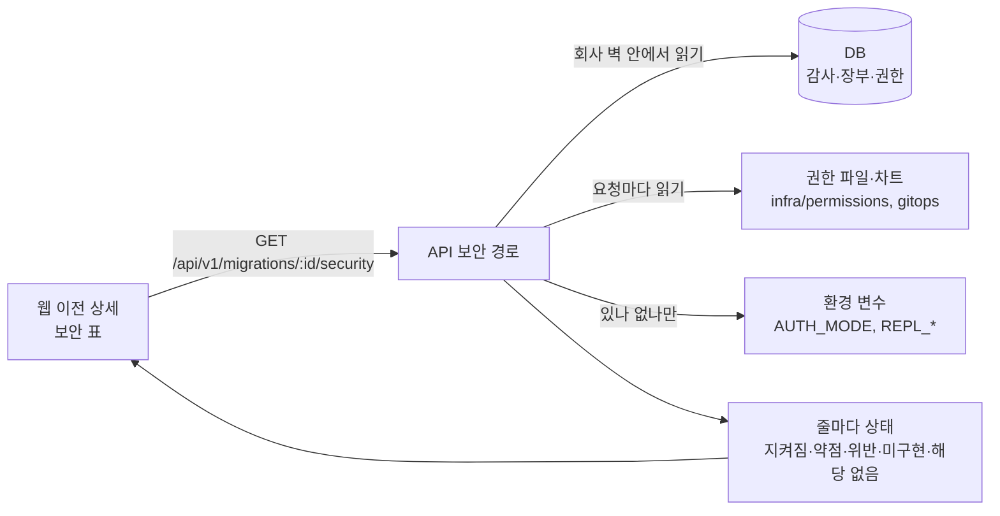

로드맵 위치: 본선 직전 / 스켈레톤 Z18: 보안 시각화 / 본선 연결점: 데모 필수 장면 "보안·거버넌스 시각화", 완성도·데모 30, 클라우드 활용 30

# 보안 표: 이전 한 건의 보안 상태를 한 장으로

> 문서 상태: AI 초안 (팀 검토 전) · 2026-10-31 17:40 UTC · 기준 코드: `integration/service-current.tgz` 17:15 UTC 판 (J2 장부·G3 권한 경계·Y 화면 포함)

## 그림 먼저



- 보안 표는 **새로 재는 장치가 아니다**. 이미 있는 것(감사 해시 체인, 임시 자격 장부, 최소 권한 파일, 차트, DB 권한)을 그 자리에서 읽어 한 줄씩 판정한다.
- 가짜 값은 없다. 확인할 재료가 없으면 그 줄은 **미구현**으로 나오고 이유가 같이 적힌다.
- 응답에는 비밀값·계정 번호·ExternalId 값이 없다. "있나 없나"와 개수만 나온다.

## 1. 화면에서 보이는 것

이전 상세의 **비용 비교 아래**에 "보안" 칸이 생긴다. 위에 요약 칩 4개(지켜짐·약점·위반·미구현), 아래에 영역별 표.

| 칸 | 뜻 |
|---|---|
| 상태 | ✓ 지켜짐 / ! 약점 / ✕ 위반 / … 미구현 / – 해당 없음. 색과 기호를 같이 써서 흑백에서도 구분된다 |
| 항목 | 무엇을 봤나 + 어느 환경(출발·도착)에 대한 줄인가 |
| 결과 | 숫자 위주 한 줄 |
| 근거 | 위협 모델·통제 번호(T-ROLE-8, SEC-AUD-02 …)와 읽은 곳(표 이름, 파일 경로) |

- "해당 없음" 줄은 기본으로 숨긴다. 체크 상자로 켠다.
- 진행 중인 이전은 5초마다 다시 읽고, 끝난 이전은 한 번만 읽는다.
- 캡처: `screenshots/z18-02-completed.png` (끝난 이전), `z18-01-spec-review.png` (만든 직후).

## 2. 줄 목록 (6영역, 이전마다 20~24줄)

| 영역 | 줄 ID | 무엇을 보나 | 어디서 읽나 |
|---|---|---|---|
| 임시 자격 | TC-LEDGER | 이 이전 자격 장부: 건수, 활성·회수 요청·회수, 만료됐는데 미회수. 끝난 이전에 살아 있는 실행 역할이 있으면 위반 | `temp_credentials` |
| | TC-TTL | 실행 역할 최대 수명 ≤ 900초 | 장부 expires_at − issued_at |
| | TC-AUDIT | 감사에 남은 발급·거부·회수·만료 수 | `audit_events` action `temp_role.*` |
| | TC-REVOKED | 끝난 뒤 실행 역할 전부 회수 (T27 `operateRoleRevoked`) | 정리·롤백 전이의 감사 detail.evidence |
| 최소 권한 | LP-AWS / LP-AWS-BOUNDARY / LP-AWS-ANYRES / LP-AWS-SESSION | AWS 천장 동작 수·와일드카드, IAM 쓰기에 권한 경계 조건, Resource "*" 쓰기 수, 단계별 세션 정책 크기·천장 안 | `infra/permissions/aws-*.json` |
| | LP-GCP / LP-GCP-IAM | GCP 커스텀 역할 권한 수·와일드카드, 주 역할에 setIamPolicy | `gcp-operate-custom-role.yaml` |
| | LP-ONPREM | 클러스터 전체에 묶인 ClusterRole 의 앱 자원 쓰기 수 | `onprem-operate-clusterrole.yaml` |
| | LP-AZURE | Azure 는 Mock 이라 실행 역할 없음 | 고정 (temp-role.ts 규칙) |
| | LP-EXTID-source/target | AWS 환경에 ExternalId 저장 여부 (값은 안 보임) | `environments.external_id` |
| 감사 기록 | AU-CHAIN | 회사 체인 해시를 처음부터 다시 계산. 끊기면 seq 표시 | `audit_events` (증적 리포트와 같은 읽기) |
| | AU-EVENTS | 이 이전 감사 줄 수, 거부·오류 수 | `audit_events` |
| | AU-APPEND | 앱 계정이 감사를 UPDATE·DELETE 못 하나 | `has_table_privilege` |
| 비밀값 | SE-PLAINTEXT | 감사 detail·명세·계획서에 비밀값 모양 0건 (AWS 키, 개인 키, GitHub·Anthropic 토큰, URL 비밀번호, password·token 같은 키 이름) | 위 세 표의 JSON |
| | SE-LEDGER / SE-LEDGER-DEL | 장부에 값 칸 없음, 앱 계정이 장부 못 지움 | `information_schema.columns`, `has_table_privilege` |
| | SE-CHART-ENV | 앱 DB 비밀번호가 secretKeyRef 로만 들어가나 | `gitops/charts/app/templates/deployment.yaml` |
| | SE-REPL | 복제 구독 접속 문자열에 비밀번호가 있나 (있으면 pg_subscription 에 평문) | env `REPL_*` 에서 비밀번호 유무만 |
| | SE-AUTH | 개발용 헤더 인증이 켜져 있나 | env `AUTH_MODE`, `NODE_ENV` |
| 런타임 | RT-POD / RT-SATOKEN | 도착 쪽 앱 Pod: securityContext·runAsNonRoot·privileged, 서비스 계정 토큰 자동 마운트 | 차트 `deployment.yaml`, `serviceaccount.yaml` |
| | RT-K3D | 이전에 온프레가 끼면: k3d 노드 컨테이너가 privileged 라는 사실 | k3d 동작 (실행 중 클러스터는 확인 안 함) |
| 통제 매트릭스 | CT-MATRIX | 보안 통제 12개 × 환경 매트릭스 | **미구현**: security-scan 처리기·결과 표가 없다 |

## 3. 지금 숫자 (17:15 판, 클라우드 사본, 로컬 Postgres 16)

AWS → GCP 이전을 만든 직후 (데모 콘티 이야기와 같은 쌍):

| 지켜짐 | 약점 | 위반 | 미구현 | 해당 없음 | 줄 |
|---|---|---|---|---|---|
| 13 | 5 | 0 | 2 | 4 | 24 |

- 약점 5: Resource "*" 쓰기 19개(A-1~A-3), AWS ExternalId 없음(T-ROLE-2), 개발용 헤더 인증(T-API-1), 차트에 securityContext 없음, 서비스 계정 토큰 자동 마운트.
- 미구현 2: 작업 단계가 아직 임시 역할을 안 빌림(TC-AUDIT), 통제 12개 매트릭스(CT-MATRIX).
- 【사실】 int3(17:05) 판에서는 LP-AWS-BOUNDARY 가 **위반**(경계 조건 없는 iam:CreateRole·iam:PutRolePolicy 2개)이었고, G3 가 들어온 17:15 판에서 **지켜짐**으로 바뀌었다. 표가 권한 파일을 진짜로 읽는다는 증거로 쓸 수 있다.
- 응답 속도: 끝난 이전(감사 303줄 체인) 0.021~0.027초, 5회. 응답 크기 약 5.7KB.

## 4. 데모 장면 S6 컷 1 에 맞춘 것 (콘티 10절 표 수정 제안)

콘티(`parallel/Z24/docs/DEMO-STORYBOARD.md`) S6 컷 1 은 이 문서 계획 기준으로 쓰였다. 실제 모양과 다른 곳만 적는다. 콘티 파일은 고치지 않았다.

| 콘티 위치 | 지금 문장 | 바꿀 문장 |
|---|---|---|
| S6 표 "화면에 보이는 것" 컷 1 | 영역 6개, 줄 20개 안팎 … "미구현"·`STUB:` 이 색과 글자로 갈린다【미확인 …】 | 영역 6개, 줄 20~24개(AWS→GCP 24줄, 기본 "해당 없음" 4줄 숨김). 요약 칩 "지켜짐 13 · 약점 5 · 위반 0 · 미구현 2". `STUB:` 글자는 없고 "미구현" 상태로 갈린다【사실: Z18 17:40 판】 |
| S6 표 "진짜인가" | 진짜로 계산 가능한 후보: 감사 체인 무결, 전권 정책 0개, privileged 0【추정】 | 진짜로 계산: 감사 체인 무결, 와일드카드 0, 권한 경계 조건, 세션 정책 크기, 장부 상태, T27 회수, 평문 비밀값 0, DB 권한. 미구현: 통제 12개 매트릭스(수집기 STUB)【사실: Z18】 |
| 10절 "Z18 보안 표" 줄 | 영역·줄 수를 `SECURITY-VIEW.md` 에 맞추고 【미확인】을 지운다 | 위 두 줄을 반영하면 끝. 캡처 `S6-security.png` 는 `screenshots/z18-02-completed.png` 모양 그대로 |
| 부록 A | `python3 -m json.tool \| head -40` | `patches/z18-demo-security.patch` 를 쓴다. 요약 한 줄 + 해당 없음 뺀 줄을 `상태 ID 결과` 로 찍는다. 이전 번호를 둘째 인자로 줄 수 있다 |

- 말할 한 줄 후보(컷 1): "여기 위반 0, 약점 5, 미구현 2. 약점과 미구현을 숨기지 않고 근거 번호와 파일 경로까지 같이 보여 줍니다."

## 5. 일부러 안 한 것

| 항목 | 이유 |
|---|---|
| 로그 비밀값 가림(redact) 자동 확인 | 경로 안에서 로거 설정을 읽을 깔끔한 방법이 없다. 설정은 core `obs/log.ts` 에 있다. 표에 줄을 만들면 확인 없이 "지켜짐"이라고 쓰게 되어 뺐다 |
| 실행 중 k3d 클러스터 조회 | API 는 Docker 에 붙지 않는다. RT-K3D 는 "k3d 동작"이라는 사실만 적고 근거 칸에 "실행 중 클러스터는 확인 안 함"이라고 쓴다 |
| 통제 12개 매트릭스 | security-scan 큐 처리기와 결과 표가 먼저다. 생기면 `summarizeCells()` 결과를 이 응답에 붙이면 된다 (CT-MATRIX 줄을 대체) |
| 감사 남기기 | 읽기 전용 경로라 증적 리포트(report)와 같이 감사를 안 남긴다 |

## 핵심 결정 3개 (+대안)

1. **없는 칸은 "미구현" 상태로 응답에 넣는다.** 대안: 없는 칸은 빼고 있는 것만 보여 주기. 버린 이유: 심사위원이 "보안 통제 매트릭스는?"이라고 물으면 화면에 이미 답이 있어야 한다. 빼면 숨긴 것처럼 보인다.
2. **권한 파일·차트를 요청마다 읽어 판정한다.** 대안: 시작할 때 한 번 읽어 캐시, 또는 CI 에서만 검사. 버린 이유: 파일 9개 합쳐 수 KB 라 응답 0.02초대에 영향이 작고, 데모 중 G3 처럼 파일이 바뀌면 바로 반영된다(int3 위반 → 17:15 판 지켜짐을 실제로 봤다).
3. **"평문 비밀값 0"은 우리 DB 기록(감사·명세·계획서)을 패턴으로 훑어 센다.** 대안: gitleaks 같은 외부 도구를 돌리기. 버린 이유: 의존성 추가 없이 요청 안에서 끝나야 하고, 대상이 JSON 이라 키 이름 규칙이 더 잘 맞는다. 대가: 패턴에 없는 모양은 놓친다 → 표 문구를 "0건 · 문서 N개 · 문자열 M개 검사"로 써서 범위를 밝힌다.

## 셀프 연습 1개

- `infra/permissions/aws-operate-role-policy.json` 에서 `AppRolesWithBoundary` 문장의 `Condition` 을 지우고 상세 화면을 새로 고친다. LP-AWS-BOUNDARY 가 ✕ 위반으로 바뀌고 결과 칸에 어떤 동작 2개가 나오는지 확인한 뒤 되돌린다. 왜 이 두 동작이 "자기 권한 상승"인지 한 문장으로 적어 본다.

## 검증 명령과 기대 출력

```
npm run typecheck
npm test
npm run test:db
npm run test:e2e -- e2e/security.spec.ts
bash docs/demo/demo.sh security
```

- typecheck: 오류 없이 끝남
- test: `# fail 0` (보안 단위 시험 12개 포함, 클라우드 사본 211 통과)
- test:db: `# fail 0` (보안 DB 시험 4개 포함, 클라우드 사본 118/118, 2회). 워커는 끈 상태로
- e2e: `1 passed` (클라우드 사본 13.9~15.7초, 3회). API·워커·DB 가 떠 있어야 함
- demo.sh security: 첫 줄 `지켜짐 N · 약점 N · 위반 N · 미구현 N · 해당 없음 N`, 그 아래 줄마다 `상태 ID 결과`
