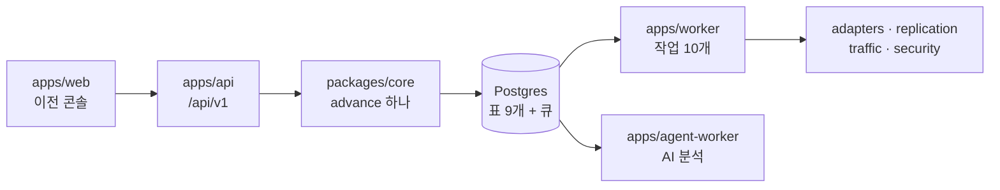
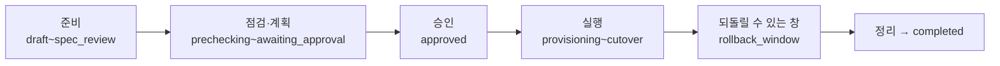

로드맵 위치: 본선 직전 / 코드에서 뽑은 명세 / 본선 연결점: 팀 개발(대안 문서화) 20, 완성도·데모 30

# 코드에서 뽑은 명세 (스켈레톤 통합본)

> 문서 상태: AI 초안 · 2026-10-31 16:30 UTC 갱신(리전 서울 반영) · 기준 코드: 통합본 `service-current.tgz`(16:11 UTC, B~I 포함, 리전은 16:27 UTC 판으로 확인) · 팀 검토 전 · 18:15 UTC 통합 2차 문서 묶음: T22 줄에 실제 관찰 시간(0.6초 → 시계, `TRAFFIC_OBSERVE_SEC`)

## 그림

이 문서는 아래 일곱 덩어리의 "지금 코드가 실제로 하는 일"을 적는다.



- 상태를 바꾸는 곳은 `packages/core`의 `advance()` 하나다. API와 워커 모두 이 함수만 부른다.
- 작업 큐는 따로 서버가 없다. 같은 Postgres 안의 pg-boss 표다.

## 이 문서의 규칙

- 코드에 있는 것만 적는다. 설계 문서에만 있는 것은 "빈 곳"(8장)에 모았다.
- 숫자는 코드를 직접 세거나 돌려서 얻었다. 각 표 아래에 어떻게 셌는지 적었다.
- 같은 내용의 자동 추출 문서(`docs/contracts/` 7개, `tools/extract.py`)가 서비스 안에 따로 있다. 이 문서는 사람이 한 번에 읽는 요약판이다.

---

## 1. 한눈에 숫자

| 항목 | 수 | 센 방법 |
|---|---|---|
| 이전 상태 | 22 | `MIGRATION_STATUSES` |
| 갈 수 있는 길(상태 → 상태) | 53 | `VALID` 표의 칸 수 |
| 조건이 붙은 길 | 21 + 멈춤 규칙 2 | `GUARDS` 표 21개, `checkGuard()`의 paused 규칙 2개 |
| 실제로 부르는 곳이 있는 길 | 28 | API 5 + 워커 12 + 청소 작업 11(stale 1, failed 6, paused 4) |
| 업무 API 경로 | 10 (+ 점검 2) | `/api/v1` 아래 10개, `/healthz`·`/readyz` |
| 큐 이름 | 15 | `QUEUES` |
| 처리기가 붙은 큐 | 13 | 워커 10 + 청소 2 + agent-worker 1 |
| DB 표 | 9 (+ pg-boss 표) | 마이그레이션 0001~0005 |
| 계약 스키마(Zod) | 28 | `packages/contracts` export |
| 코드 표시 | STUB 64 · TODO(human) 28 · DRAFT(ai) 54 · DECISION(team) 5 | 테스트 밖 소스 grep |

【사실】 같은 판에서 typecheck 0, 단위 테스트 75 통과·16 건너뜀·실패 0, DB 테스트 21/21, smoke 3회 7.8~8.2초(클라우드 컨테이너, 16:15 UTC).

---

## 2. 상태 머신

### 2-1. 정상 경로

정상 경로는 15칸이다. 사람이 누르는 칸은 셋이다.



| 순서 | 상태 | 화면 이름 | 누가 다음으로 옮기나 | 다음 상태 |
|---|---|---|---|---|
| 1 | draft | 초안 | API `POST /migrations` (만들자마자) | importing |
| 2 | importing | 가져오기 | 워커 `import` | spec_review |
| 3 | spec_review | 명세 검토 | **사람** `POST /migrations/:id/plan` | prechecking |
| 4 | prechecking | 사전 점검 | 워커 `precheck` | planning (막힘 0) / spec_review (막힘 ≥1) |
| 5 | planning | 계획 | 워커 `plan` | awaiting_approval |
| 6 | awaiting_approval | 승인 대기 | **사람** `POST /plans/:id/approvals` | approved / rejected |
| 7 | approved | 승인됨 | **사람** `POST /migrations/:id/start` | provisioning |
| 8 | provisioning | 자원 생성 | 워커 `apply` | deploying |
| 9 | deploying | 앱 배포 | 워커 `deploy` | syncing |
| 10 | syncing | DB 복제 | 워커 `sync` | shifting |
| 11 | shifting | 트래픽 이동 | 워커 `shift` | cutover |
| 12 | cutover | DB 컷오버 | 워커 `cutover` | rollback_window |
| 13 | rollback_window | 롤백 가능 창 | 워커 `cleanup` (창 끝에 깨어남) | cleanup |
| 14 | cleanup | 정리 | 워커 `cleanup` | completed |
| 15 | completed | 완료 | 끝 | - |

### 2-2. 정상 경로 밖 7개

| 상태 | 화면 이름 | 들어오는 길 | 나가는 길 | 지금 들어오게 하는 코드 |
|---|---|---|---|---|
| rejected | 거절 | awaiting_approval | spec_review, planning, cancelled | 승인 API(거절) |
| stale | 계획 낡음 | awaiting_approval, approved | planning, cancelled | 청소 작업(승인 후 시작 못 함) |
| paused | 멈춤 | deploying, syncing, shifting, cleanup | 멈추기 전 상태, rolling_back | 청소 작업(`WORKER_LOST` 등) |
| failed | 실패 | importing, prechecking, planning, provisioning, cutover, rolling_back | 실패 지점(재시도), rolling_back, cancelled | 청소 작업, 워커 단계 실패 |
| rolling_back | 되돌리는 중 | deploying, syncing, shifting, rollback_window, paused | rolled_back, failed | **없음** |
| rolled_back | 되돌리기 끝 | rolling_back | 끝 | 워커 `rollback` |
| cancelled | 취소 | 대부분의 준비 단계 상태, failed | 끝 | **없음** |

- 끝 상태는 completed, rolled_back, cancelled 셋이다(`TERMINAL`).
- 【사실】 `rolling_back`과 `cancelled`로 옮기는 코드가 없다. 그래서 워커의 `rollback` 처리기는 지금 불릴 일이 없다.

### 2-3. 길마다 붙은 조건 (guard)

`VALID`는 "갈 수 있는 길"만 본다. `checkGuard()`는 "지금 그 길을 가도 되나"를 본다. 조건이 실패하면 `409 GUARD_FAILED`로 막는다.

| 번호 | 길 | 조건 | 조건의 근거가 어디서 오나 |
|---|---|---|---|
| T01 | draft → importing | 출발·도착 환경 둘 다 `connected` | DB |
| T02 | importing → spec_review | 저장된 명세가 있다 | DB |
| T04 | spec_review → prechecking | 명세가 있고, 검토 필요 칸이 0개 | DB |
| T05 | prechecking → planning | 막는 점검 결과 0개 | 워커 증거 |
| T06 | prechecking → spec_review | 막는 점검 결과 1개 이상 | 워커 증거 |
| T07 | planning → awaiting_approval | 계획서가 있고, `proposed`이고, 만료 전 | DB |
| T09 | awaiting_approval → approved | T07 + 사람이 보낸 지문 = 저장된 지문 + 두 환경 연결 | DB + API 증거 |
| T11 | awaiting_approval → stale | 계획 만료 또는 환경 바뀜 | DB + 증거 |
| T15 | approved → provisioning | 환경 잠금을 쥐고 있고, 두 환경 연결 | DB |
| T16 | approved → stale | 잠금이 풀렸거나 계획 만료 | DB |
| T17 | provisioning → deploying | Terraform apply 성공 | 워커 증거 |
| T20 | deploying → syncing | Argo 정상 + 보안 동등성 | 워커 증거 |
| T21 | syncing → shifting | 복제 지연 0바이트 + 행 수 일치 | 워커 증거 |
| T22 | shifting → cutover | 가중치 100% + 100%에서 30초 이상 관찰 + 도착 로그 수신 | 워커 증거. int5 1차까지는 "30초"를 판정 30번(20ms 간격)으로 세서 STUB에서 실제 약 0.6초. 100% 관찰 수정 판부터 시계로 재고 문턱은 `TRAFFIC_OBSERVE_SEC`(기본 30) |
| T23 | cutover → rollback_window | 컷오버 C1~C6 성공 | 워커 증거 |
| T24 | cutover → shifting | 되돌림 C6' 성공 | 워커 증거 |
| T26 | rollback_window → cleanup | 창이 끝났고 정리 승인 | DB + 증거 |
| T27 | cleanup → completed | 임시 자원 0 + 실행 역할 회수 | 워커 증거 |
| T35 | rolling_back → rolled_back | 출발 가중치 100% + 출발 헬스 정상 | 워커 증거 |
| (T37) | failed → planning | 없앴다 (11/4 01:53Z). 다시 계획은 stale·rejected 에서만 | - |
| 재시도 | failed → 실패 지점 | 실패 지점과 같은 상태 + 사람이 고른 재시도 (`POST /migrations/:id/failure-decision`) | DB + 증거 |
| F8-1 | failed → rolling_back | 실패 지점이 자원을 만든 뒤(`ROLLBACK_ON_REJECT`: provisioning~rolling_back) | DB |
| T38 | failed → cancelled | 수동 정리 확인 | 증거 |
| T30 | 어디서든 → paused | 가드레일 규칙 번호 또는 실패 코드 | 증거 |
| T31·T32 | paused → (rolling_back 아닌 곳) | 멈추기 전 상태로만, 규칙이 풀렸을 때 | DB + 증거 |

- "워커 증거"는 워커가 재서 넘기는 값이다(`TransitionEvidence`). 감사 기록에 그대로 남는다.
- 【사실】 지금 워커 증거는 대부분 STUB 상수다. 예: `applyOk: true`, `replicationLagBytes: 0`. 조건 검사 자체는 진짜로 돈다.

### 2-4. `advance()`가 한 트랜잭션에서 하는 일

1. 이전 행을 잠그고(`FOR UPDATE`) 지금 상태가 기대한 상태인지 본다.
2. 길(`VALID`)과 조건(`checkGuard`)을 본다.
3. 환경 잠금: 승인 때 두 환경을 예약하고, 끝 상태에서 푼다.
4. 상태와 상태별 칸(`paused_from`, `failed_at_status`, `failure_code`, `rollback_window_ends_at`)을 고친다. `version`을 1 올린다.
5. 다음 큐 작업을 넣는다(같은 키는 하나만).
6. 감사 기록을 한 줄 쓴다.
7. `pg_notify('migration_events')`로 화면 신호를 낸다(지금 받는 쪽은 없다).

- `mode: "ifStill"`이면 상태가 이미 바뀌었을 때 오류 없이 `false`를 돌려준다. 같은 작업이 두 번 와도 한 번만 반영된다.

---

## 3. API (`/api/v1`)

모든 업무 경로는 `x-dev-tenant` 헤더(회사 번호)가 필요하다. 없으면 `401 UNAUTHENTICATED`.

OpenAPI 명세 `docs/openapi.yaml`·`docs/openapi.json` 은 생성 파일이다. `npm run openapi` 가 만들고, `npm test`·`npm run test:e2e`·`npm run dev:api`·api 이미지 빌드가 먼저 알아서 다시 만든다. 손으로 고치거나 패치에 넣지 않는다. CI 는 `npm run openapi:check` 로 올린 파일이 코드와 같은지만 본다.

| 메서드·경로 | 하는 일 | 상태 변화 | 성공 | 대표 오류 |
|---|---|---|---|---|
| `POST /migrations` | 이전 만들기 + 가져오기 시작 | draft → importing | 202 `{id}` | 400 본문 모양, 404 남의·없는 환경, 409 환경 미연결 |
| `GET /migrations` | 최근 50개 목록 | - | 200 `{items}` | - |
| `GET /migrations/:id` | 이전 한 건(10칸) | - | 200 `MigrationView` | 404 |
| `POST /migrations/:id/plan` | 명세 확정 → 점검·계획 | spec_review → prechecking | 202 `{id}` | 404, 409 상태 다름 |
| `GET /migrations/:id/plan` | 이 이전의 최신 계획서 | - | 200 `PlanDoc` | 404 |
| `GET /plans/:id` | 계획서 하나 | - | 200 `PlanDoc` | 404 |
| `POST /plans/:id/approvals` | 승인·거절 | awaiting_approval → approved / rejected | 200 `{migrationId, planId, status}` | 409 `PLAN_HASH_MISMATCH`, `PLAN_SUPERSEDED`, `PLAN_EXPIRED`, `ENV_BUSY` |
| `POST /migrations/:id/start` | 실행 시작 | approved → provisioning | 202 `{id}` | 409 `PLAN_NOT_APPROVED` |
| `GET /environments` | 환경 목록 | - | 200 `{items}` | - |
| `POST /cost/estimate` | 비용 추정(순수 계산) | - | 200 `CostEstimate` | 400 |
| `GET /healthz`, `GET /readyz` | 살아 있음·DB 연결 | - | 200 `{ok:true}` | 헤더 없이 열림 |

- 오류 모양은 하나다: `{status, code, message, requestId}`.
- 외래 키 위반(남의 회사 환경을 가리킴)은 404로 바꿔 보낸다. "남의 것"과 "없는 것"을 구별해 주지 않는다.
- 【사실】 `Idempotency-Key` 처리 장치(플러그인, `idempotency_keys` 표)는 있다. 하지만 위 경로들이 아직 그 장치를 부르지 않는다. 같은 키로 `POST /migrations`를 두 번 보내면 202가 두 번, 이전이 두 개 생긴다(클라우드에서 확인).

---

## 4. 큐와 작업

| 큐 | 처리기 | 기대 상태 → 옮기는 상태 | 다음 작업 | 지금 |
|---|---|---|---|---|
| import | worker | importing → spec_review | - | 어댑터 discover·normalize (데모 원본) |
| precheck | worker | prechecking → planning / spec_review | plan | 점검 2개 STUB |
| plan | worker | planning → awaiting_approval | - | 어댑터로 Terraform·Helm 만들어 지문. 진짜 계산 |
| apply | worker | provisioning → deploying | deploy | 지문 3중 확인은 진짜, apply는 STUB |
| deploy | worker | deploying → syncing | sync | STUB |
| sync | worker | syncing → shifting | shift | STUB (복제 모듈 연결 전) |
| shift | worker | shifting → cutover | cutover | STUB (판정 3번 ok) |
| cutover | worker | cutover → rollback_window | cleanup (창 끝에) | STUB |
| cleanup | worker | rollback_window → cleanup → completed | - | STUB |
| rollback | worker | rolling_back → rolled_back | - | STUB, 부르는 곳 없음 |
| lease-reaper | worker (60초마다) | 잠금 기한 지난 이전 → stale / failed / paused | - | 진짜 |
| idempotency-cleanup | worker (매시 17분) | 24시간 지난 키 삭제 | - | 진짜 |
| agent-run | agent-worker | (상태 머신 밖) | - | 대본 LLM, 메모리 저장 |
| verify-connection, security-scan | 없음 | - | - | 이름만 있음 |

- 워커 작업 하나는 짧은 트랜잭션 세 구간이다. ① DB에서 상태 다시 읽기 → ② 트랜잭션 밖에서 오래 걸리는 일 → ③ `advance()` 한 번.
- 큐 내용은 믿지 않는다. 처리기가 먼저 Zod로 모양을 보고, 회사 벽 안에서 DB를 다시 읽는다.

---

## 5. 데이터 모델

### 5-1. 표

| 표 | 한 줄이 뜻하는 것 | 주요 칸 | 회사 벽(RLS) |
|---|---|---|---|
| tenants | 회사 | id, name | 없음(읽기만) |
| environments | 연결된 클라우드 환경 | provider(aws·gcp·onprem·azure_mock), connection_status, account_id | 있음 |
| migrations | 이전 한 건 | source_env_id, target_env_id, status, version, paused_from, failed_at_status, failure_code, rollback_window_ends_at | 있음 |
| spec_versions | 공통 명세 한 판 | version, spec(jsonb), field_meta(칸별 출처·신뢰도·검토 필요) | 있음 |
| plans | 계획서 | plan_doc(jsonb), plan_hash, status(proposed·approved·rejected·stale·superseded), expires_at | 있음 |
| plan_approvals | 승인·거절 기록 | decision, approved_by, plan_hash, reason. 계획당 1줄 | 있음 |
| env_locks | 환경 잠금 | env_id(기본키), migration_id, holder(reserved·worker:…), lease_expires_at | 있음 |
| audit_events | 감사 기록 | actor, action, target, result, detail, prev_hash, hash | 있음(쓰기·읽기만) |
| idempotency_keys | 같은 요청 두 번 막기 | key, req_hash, status_code, response | 있음 |

- 회사 벽: 모든 업무 표에 `tenant_id`가 있다. `app.tenant_id` 설정값과 같은 줄만 보인다. 표 주인에게도 강제(`FORCE`)다.
- 0005에서 "같은 회사끼리만 참조" 외래 키를 걸었다. 남의 회사 환경 번호로 이전을 만들 수 없다.
- 【사실】 `migrations.status`에는 허용 값 검사(CHECK)가 없다. 22개 밖 값은 `advance()`만 막는다.
- 【사실】 "도착 자원 준비됨"(InfraReady)은 표가 없어 감사 기록 detail에 들어간다(STUB).

### 5-2. DB 계정

| 계정 | 쓰는 곳 | 할 수 있는 것 |
|---|---|---|
| platform_owner | 마이그레이션 | 표 만들기·바꾸기 |
| app_user | api, worker | 업무 표 읽기·쓰기. 감사는 넣기·읽기만 |
| svc_maintenance | 청소 함수 2개의 주인 | 회사 벽을 넘어 기한 지난 잠금·오래된 키만 본다 |

### 5-3. 주요 계약 모양 (`packages/contracts`)

| 모양 | 쓰는 곳 | 핵심 칸 |
|---|---|---|
| AppSpec | 가져오기, 계획, 비용 | app.name, service(image@sha256, port, replicas, cpu, memory), database(postgres 15~17), ingress(cloudflare-lb) |
| MigrationView | `GET /migrations/:id` | id, status, version, 환경 둘, pausedFrom, failedAtStatus, failureCode, rollbackWindowEndsAt, updatedAt |
| PlanDoc | 계획서 | steps 6개(provision·deploy·sync·shift·cutover·cleanup), precheck, rollbackCriteria(1%, 2배, 30초), tfPlanHash, helmValuesHash, planHash, expiresAt |
| ApprovalInput | 승인 본문 | decision, planHash, reason(500자) |
| EnvironmentView | 환경 목록 | provider, connectionStatus(8개), accountId |
| 작업 모양 | 큐 | 공통 tenantId·requestId + migrationId / planId / planHash / envId / agentRunId |

---

## 6. 묶음(패키지) 책임

| 묶음 | 책임 | 바깥에 내놓는 것 | 부르는 곳 | 지금 |
|---|---|---|---|---|
| contracts | 모든 경계의 모양 | Zod 스키마 28개, `VALID`, `QUEUES` | 전부 | 완성 |
| core | 상태 옮기기, 회사 벽, 잠금, 감사 | `advance`, `withTenant`, `checkGuard`, 계획 저장 | api, worker | 완성 |
| adapters | 클라우드마다 다른 것을 같은 모양으로 | `adapterFor(provider)`: discover, normalize, toTerraform, toHelmValues | worker | 계산은 진짜, discover는 데모 원본 |
| replication | DB 논리 복제와 쓰기 주인 바꾸기 | `Migration`: precheck, sync, cutover, rollback, teardown | (워커 연결 전) | 완성, 실제 PG16 두 대로 검증 |
| traffic | 트래픽 단계 전환과 자동 롤백 판정 | 판정 규칙(5xx 1%·p95 2배·30초), 전환기, 지표 | (워커 연결 전) | 메모리 LB, 가짜 지표 |
| security | 보안 점검·가드레일·임시 역할 | 점검 결과 요약, 가드레일, 임시 역할 | (연결 전) | 고정 결과, 메모리 역할 |
| agent | 온프레 Agent 보고 검증 + AI 점검 루프 | `acceptAgentReport`, 도구 7개 루프, 게이트 | agent-worker | 대본 LLM, 메모리 샌드박스 |
| cost | 공통 명세로 환경별 월 비용 | `estimateCost` | api | 계산 진짜, 가격표는 샘플 19줄 |

| 앱 | 책임 | 포트·실행 |
|---|---|---|
| api | 사람 요청 받기, 상태 한 칸, 작업 넣기 | 3000, `npm run dev:api` |
| worker | 큐 작업 처리, 잠금 청소 | `npm run dev:worker` |
| agent-worker | AI 분석 작업만. 클라우드 실행 권한 없음 | `agent-run` 큐 |
| web | 이전 콘솔(목록·진행·계획서·승인) | 5173, `npm run dev:web` |

---

## 7. STUB · TODO(human) 목록

### 7-1. STUB (가짜로 도는 곳) 영역별

| 영역 | 가짜인 것 | 진짜가 되려면 |
|---|---|---|
| 가져오기 | AWS·GCP·온프레 discover가 데모 원본을 돌려준다 | 관찰 역할로 ECS·RDS / GKE·Cloud SQL / Agent 보고 읽기 |
| 사전 점검 | 점검 2개가 항상 info | 연결·권한·DB 버전·복제 가능 점검 |
| 자원 생성 | apply 성공을 흉내, 출력값 고정 | `terraform apply` + 30초 생존 신호 |
| 앱 배포 | Argo `synced_healthy` 흉내 | gitops 레포 커밋 + Argo 상태 보기 |
| DB 복제·컷오버·롤백·정리 | 지연·멈춤 숫자 고정 | `@svc/replication` 연결 |
| 트래픽 이동 | 판정 3번 ok, 메모리 LB | Cloudflare LB API + 실제 지표 |
| 보안 | 점검 결과 고정, 임시 역할 메모리 | Prowler·Trivy·GuardDuty 등, STS·WIF |
| AI 에이전트 | 대본 LLM, 메모리 샌드박스, 게이트 4줄 | Anthropic 제공자, vCluster+gVisor, GATE-01~12 |
| 온프레 Agent | 보고 흉내, 키 메모리 | 실제 Agent, `agent_keys` 표 |
| 비용 | 가격표 샘플, 가격 API 호출 없음 | 하루 한 번 받기 + `price_catalog` 표 |
| 환경 연결 | 연결 링크·확인 경로 없음 | `verify-connection` 처리기와 API |
| 환경 잠금 | 대기열 없음, 바로 409 | 순서 넘기기 |

### 7-2. TODO(human) 28개 (사람이 정할 것)

상태 머신·워커:

1. 트래픽 판정이 bad면 rolling_back + rollback 작업으로 보낼지 (`worker/jobs/shift.ts`)
2. 배포가 실패하면 rolling_back과 paused 중 어디로 (`deploy.ts`)
3. 정리 전에 사람 승인을 받을지 (`cutover.ts`, `cleanup.ts`)
4. 창이 끝나기 전에 깨어난 정리 작업을 다시 예약할지 (`cleanup.ts`)
5. 출발 쪽 DB·자원을 지울지 남길지 (`cleanup.ts`)
6. apply 이후 작업에 환경 잠금 인수·반납을 붙이기 (`_step.ts`)
7. apply 직전 확인 ④ tfplan sha256 ⑤ 잠금 인수 ⑥ 고객 계정 확인 (`apply.ts`)
8. 환경별 리전을 어디서 가져올지. `environments`에 칸이 없다 (`plan.ts`)

API:

9. Idempotency-Key를 계획·승인 경로에도 필수로 걸기 (`routes/plans.ts`)
10. 만료된 계획을 승인하려 할 때 stale로 옮길지 (`routes/plans.ts`)

DB 복제·트래픽:

11. 쓰기 울타리를 풀 때 원래 권한을 저장했다 되돌릴지 (`replication/fence.ts`)
12. Cloudflare API 토큰 범위·계정 (`traffic/switcher.ts`)
13. 단계별 최소 유지 시간, 100% 관찰 30초를 판정 몇 번으로 볼지, 자동 롤백 뒤 재시도 대기 (`traffic/controller.ts`)

어댑터·인프라:

14. TargetEnv에 칸을 정식으로 넣을지 (`adapters/common/target.ts`)
15. 데모에서 ALB·GCLB를 직접 보여 줄지, 터널만 쓸지 (`k8s-values.ts`)
16. AWS 인스턴스 크기를 출발 RDS 클래스에서 가져올지 (`adapters/aws`)
17. GCP 운영 크기 (`adapters/gcp`)
18. 역할 만들기에 권한 경계(PermissionsBoundary) 조건을 걸지 (`export-permissions.ts`)
19. Cloud SQL을 IAM 인증으로 바꿀지 (`infra/modules/gcp/app`)
20. EKS API 공개 접근을 Argo 허브 IP로 좁힐지 (`infra/modules/aws/env`)
21. 온프레 Helm 차트 버전 고정 (`infra/onprem/bootstrap.sh`)

보안·에이전트·비용:

22. 위협 가드레일 규칙 번호와 동작(pause냐 warn이냐) (`security/guardrail.ts`)
23. 환경별 역할 이름 규칙(svc-observe / svc-operate) (`security/temp-role.ts`)
24. AI 기본 모델과 진짜 제공자 (`agent/ai/llm.ts`)
25. `agent_runs`·`agent_steps` 표와 DB 역할 (`agent-worker`)
26. 보안 "강화" 단계에 넣을 것과 가격 (`cost/profile.ts`) → 10/31 보드 기본값: I 초안 값 그대로, 【추정】 표시
27. GCP SKU 합산 규칙 (`cost/adapters/gcp-billing-catalog.ts`)
28. (위 3번과 같은 질문이 `cleanup.ts` DRAFT 주석에 한 번 더 나온다)

### 7-3. DECISION(team) 5개 (코드에 박힌 팀 결정)

- 업무 경로는 `/api/v1` 아래, 점검 경로는 루트 (`api/main.ts`)
- 롤백 기준: 5xx > 1% 또는 p95 > 출발 × 2, 30초 창 (`plan.ts`, `traffic/rule.ts`)
- 승인: 역할 없음, 회사 멤버 누구나, 본인 승인 허용(`self_approved`로 기록) (`routes/plans.ts`)
- AWS 도착 컴퓨트 = EKS (GKE·k3s와 같은 Helm 차트) (`adapters/aws`)

---

## 8. 빈 곳과 어긋난 곳

코드를 돌려 보고 찾은 것이다. 위에서 아래로 데모 영향이 큰 순서다.

| # | 내용 | 영향 | 근거 |
|---|---|---|---|
| 1 | 롤백·멈춤·재개·취소 API가 없다 | 데모에서 "되돌리기"를 화면으로 못 보여 준다 | `rolling_back`·`cancelled`로 옮기는 호출 0개 |
| 2 | 거절한 이전을 다시 계획할 경로가 없다 | 거절하면 그 이전은 멈춘다 | `rejected → planning` 길은 있으나 호출 0개 |
| 3 | `Idempotency-Key`를 경로가 쓰지 않는다 | 버튼 두 번이면 이전 두 개 | 같은 키 두 번 → 202 두 번, 다른 id (실측) |
| 4 | DB 복제 모듈이 워커에 안 붙었다 | 화면 흐름의 복제·컷오버 숫자가 가짜 | `sync.ts`·`cutover.ts`가 STUB |
| 5 | 비용이 계획서에 안 붙고 화면에도 없다 | 비용은 터미널로만 보인다 | `PlanDoc`에 비용 칸 없음 |
| 6 | 출발과 도착이 같은 환경이어도 만들어진다 | 잘못된 이전이 생길 수 있다 | 만들기 본문 검사에 비교 없음 (화면은 경고만) |
| 7 | 상태 칸에 허용 값 검사가 없다 | DB를 직접 고치면 22개 밖 값이 들어간다 | `migrations.status` CHECK 없음 |
| 8 | 화면 신호는 상태 변경만 온다 | 트래픽 비율·보안 표는 폴링으로만 바뀐다 | `GET /events`는 생겼다. `pg_notify`는 `advance()`만 보낸다 |
| 9 | 환경 연결·확인 경로가 없다 | 환경은 씨앗 데이터 2개뿐 | `verify-connection` 처리기 없음 |
| 10 | 조건에 막힌 작업이 감사에 안 남는다 | 왜 멈췄는지 화면·감사로 안 보인다 | 실패는 pg-boss 작업 표 `output`에만 (실측) |
| 11 | 자동 추출 문서가 코드보다 늦다 | `docs/contracts/` 표가 옛 숫자 | `extract.py --check` 종료 코드 1 (실측) |

- 【사실】 기본 리전은 서울이다(10/31 결정). AWS `ap-northeast-2`, GCP `asia-northeast3`, Azure 흉내 `koreacentral`, 비용 추정 `ap-northeast-2`로 코드 기본값이 맞춰져 있다.

---

## 핵심 결정 3개 (+대안)

| 결정 | 대안 | 고른 이유 |
|---|---|---|
| 상태를 바꾸는 함수를 `advance()` 하나로 | 경로·처리기마다 직접 UPDATE | 조건·잠금·감사·다음 작업을 한 트랜잭션에 묶을 수 있다. 빠뜨릴 곳이 없다 |
| 큐를 같은 Postgres(pg-boss)에 | Redis·SQS 같은 별도 큐 | 상태 변경과 작업 넣기가 한 트랜잭션이다. "상태는 바뀌었는데 작업이 없다"가 안 생긴다 |
| 조건 검사에 워커 증거를 받고 감사에 남긴다 | 조건에 필요한 사실을 전부 표로 만든 뒤 검사 | 표가 없어도 조건 모양을 지금 고정할 수 있다. STUB을 진짜로 바꿀 때 증거 값만 바꾸면 된다 |

## 셀프 연습 1개

1. `packages/core/src/guards.ts`에서 `"shifting>cutover"` 조건의 `>= 30`을 `>= 60`으로 바꾼다.
2. `npm run smoke`를 돌린다.
3. 기대: smoke가 `stopped at shifting`으로 끝난다. 계획서의 `holdSec`이 30이라 조건을 못 채운다.
4. 감사 기록에는 실패 줄이 없다. 실패는 큐 표에만 남는다. 아래로 확인한다.

```bash
docker compose exec db psql -U platform_owner -d platform -c "select name, state, output->>'code' from pgboss.job where name = 'shift' order by created_on desc limit 1"
```

- 기대: `shift | failed | GUARD_FAILED`. 【사실】 클라우드에서 그대로 나왔다.
5. 원래대로 되돌린다. 두 가지를 한 줄씩 쓴다. 관찰 시간(계획서)과 조건(코드)이 따로 있어도 되나? 조건에 막힌 작업을 감사에 남겨야 하나?

## 검증 명령과 기대 출력

서비스 폴더에서:

```bash
npm run typecheck
npm test
python3 -I docs/contracts/tools/extract.py --check
```

- `typecheck`: 오류 줄 없음.
- `npm test`: `# pass 75`, `# fail 0`.
- `extract.py --check`: 자동 추출 문서가 코드와 맞으면 0으로 끝난다. 1이면 `--check` 없이 다시 돌려 표를 새로 뽑는다.
- 【사실】 16:11 통합본에서는 1로 끝났다. `바뀔 문서: README.md, api.md, data-model.md, jobs.md, open-items.md, state-machine.md`. 자동 추출 문서가 코드보다 늦다.

숫자를 다시 세려면:

```bash
grep -rhoE "STUB|TODO\(human\)|DRAFT\(ai\)|DECISION\(team\)" apps packages db infra --include=*.ts --include=*.tsx --include=*.sql --include=*.tf --include=*.sh --exclude-dir=node_modules --exclude-dir=test | sort | uniq -c
```

- 기대: `5 DECISION(team)`, `54 DRAFT(ai)`, `64 STUB`, `28 TODO(human)` 근처. 코드가 바뀌면 달라진다.
