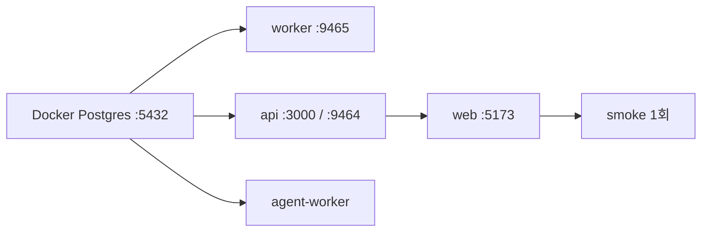

로드맵 위치: 결선 D-7 / 전체 기동 드릴 / 본선 연결점: 완성도·데모 30(아무 상태에서나 10분 안에 데모 화면까지)

# 전체 기동 드릴: 완전 초기화부터 smoke 1회, 끄기까지

> 상태: AI 초안, 10/31 18:05Z(2판), 18:15Z 통합 2차 문서 묶음에서 맥 실측 열·LLM 주의·100% 관찰 주의 추가. 클라우드 리눅스 VM에서 A·C를 이 순서 그대로 두 번 돌려 봄(int4+Z30, int5). 맥에서 int5로 한 번 돌려 소요를 쟀다(0-2 표). · 18:20Z 2차 묶음: A-4 `.env` `TRAFFIC_OBSERVE_SEC=0.5` 직접 넣기
> 기준: `integration/service-current.tgz` **int5 1차(17:36Z)**. Swagger UI(Z30)·Dockerfile·prod compose(Z4)·`.dockerignore` 고침이 이미 들어 있어 따로 패치할 것 없음.
> 비밀값은 이 문서에 하나도 없다. `.env` 값은 보지도 붙여 넣지도 않는다.

## 0. 그림: 무엇을 어떤 순서로 켜나



- 맨 먼저 DB. 나머지 넷은 모두 DB에 붙는다.
- worker·api·agent-worker는 서로 직접 부르지 않는다. DB 안의 작업 큐(pg-boss)로만 주고받는다.
- web(Vite)은 `/api/...` 요청을 api(3000)로 넘겨 주는 창구다.

## 0-1. 한눈에 보는 포트 【사실, 코드 확인】

| 무엇 | 주소 | 어디서 정하나 |
|---|---|---|
| Postgres(개발) | localhost:5432 | docker-compose.yml |
| API | http://localhost:3000 | .env `API_PORT`(기본 3000) |
| API 지표 | http://localhost:9464/metrics | .env `METRICS_PORT`(0이면 끔) |
| worker 지표 | http://localhost:9465/metrics | .env `WORKER_METRICS_PORT` |
| 웹 화면 | http://localhost:5173 | apps/web/vite.config.ts |
| 이미지 모드 웹 / API | http://localhost:8080 / 3300 | docker-compose.prod.yml |
| Grafana / Prometheus(선택) | :3001 / :9090 | docker-compose.observability.yml |

## 0-2. 전체 소요

| 구간 | 클라우드 VM 실측 【사실】 | 맥 int5 실측 【사실, 맥 RC 10/31】 |
|---|---|---|
| 끄기·정리 + DB 켜기·마이그레이션 12개 | 4.3초(int5), 5.2초(int4) | 정리 7초 + db:up 9초 (Docker Desktop이 꺼져 있으면 +30초 【추정】) |
| npm install(새 폴더, npm 캐시 있음) | 4.4초(int5), 9.8초(int4) | 3초. 처음이면 1~3분 【추정】 |
| 프로세스 4개 켜기 → readyz·화면 응답 | 3초 | 5~10초 【추정】 |
| URL 10개 확인 | 수동 1~2분 | 1~2분 【추정】 |
| smoke 1회 | int5 8.05 / 8.16 / 8.24초, int4 8.0 / 8.2 / 8.3초 | 8.23 / 8.29 / 8.23초 |
| (C) 이미지 모드 compose up | 16.9초(int5), 14.1초(int4) | 18초 |
| **합계(손 움직이는 시간 포함)** | — | **약 5~8분 【추정】** |

---

## A. 완전 초기화부터 전체 기동까지

준비물: 터미널 탭 5개. 탭마다 이름을 붙여 두면 헷갈리지 않는다.
- 탭 1 "명령" / 탭 2 "worker" / 탭 3 "api" / 탭 4 "web" / 탭 5 "agent"
- 탭 2~5는 프로그램이 앞에서 계속 돈다. 끌 때는 그 탭에서 `Ctrl+C`.

### A-1. 이미 떠 있는 것 끄기 (탭 1)

```
cd ~/Softbank_final/Service
```
Service 폴더로 이동. 이후 명령은 전부 이 폴더에서 친다.

```
pkill -f "tsx watch"
```
예전에 켜 둔 worker·api·agent-worker를 끈다. 아무것도 없으면 아무 말 없이 끝난다.

```
pkill -f vite
```
예전에 켜 둔 웹 화면(Vite)을 끈다.

```
docker compose -f docker-compose.prod.yml down -v
```
C(이미지 모드)를 켰던 적이 있으면 그 컨테이너 5개와 데이터를 지운다. 없으면 그냥 넘어간다.

```
docker compose down -v
```
개발용 Postgres 컨테이너를 끄고 데이터(볼륨 pgdata)까지 지운다. **데모 데이터가 전부 사라진다.** 완전 초기화가 목적일 때만.

```
brew services stop postgresql@16
```
맥에 Homebrew로 깐 Postgres가 5432를 잡고 있으면 끈다. 이걸 안 하면 다음 단계가 "address already in use"로 실패한다.

```
lsof -nP -iTCP -sTCP:LISTEN | grep -E ':(5432|3000|5173|9464|9465) '
```
쓸 포트를 아직 누가 잡고 있는지 본다.

- 이렇게 보이면 성공: 아무 줄도 안 나온다.

### A-2. Docker Postgres 켜기 + 표 만들기 (탭 1)

```
open -a Docker
```
Docker Desktop을 켠다. 이미 켜져 있으면 아무 일 없다. 메뉴 막대 고래 아이콘이 멈출 때까지 기다린다.

```
docker info --format '{{.ServerVersion}}'
```
Docker가 명령을 받을 준비가 됐는지 본다.

- 이렇게 보이면 성공: 버전 숫자 한 줄(예: `29.x.x`).

```
npm run db:up
```
Postgres 컨테이너를 켜고, 마이그레이션 실행기(migrate 컨테이너)가 `db/migrations/0001~0012`를 순서대로 넣는다.

- 이렇게 보이면 성공: 끝에서 `applied 0012_seed_dev_account_ids.sql` 다음 줄 `done: 12개 넣음` 【사실, VM】.
- 이미 넣은 DB면 `done: 0개 넣음`. 이것도 성공이다.

```
docker compose run --rm migrate --status
```
들어간 마이그레이션 목록을 본다.

- 이렇게 보이면 성공: `applied  0001_…`부터 `applied  0012_…`까지 12줄, `pending` 줄 없음.

`--baseline auto`는 언제 쓰나:
- 완전 초기화(`down -v`)를 했으면 **안 쓴다.** 위 `db:up`이 다 넣는다.
- 옛날 방식(docker 초기화 폴더)으로 만든 DB를 지우지 않고 쓸 때만 아래를 한 번 친다.

```
docker compose run --rm migrate --baseline auto
```
이미 있는 표를 보고 "어디까지 들어갔다"는 기록만 채운다. 표는 건드리지 않는다.

- 기록이 이미 있으면 `기록이 이미 12줄 있다. baseline 은 빈 기록에서만 한다` 【사실, VM】. 이것도 정상이다. 그다음 `npm run db:up`을 한 번 더.

### A-3. 의존성 받기 (탭 1)

```
npm install
```
package-lock.json에 적힌 버전 그대로 node_modules를 채운다. int5부터 Swagger UI 패키지(@fastify/swagger·swagger-ui)가 같이 들어온다.

- 이렇게 보이면 성공: `added N packages … audited 192 packages`. 끝의 `npm audit` 안내·`npm notice` 줄은 무시해도 된다.

```
ls node_modules/@fastify | grep swagger
```
Swagger UI 패키지가 들어왔는지 본다.

- 이렇게 보이면 성공: `swagger`와 `swagger-ui` 두 줄. 안 나오면 int5보다 옛날 폴더다.

### A-4. 프로그램 4개 켜기 (순서대로, 탭마다 하나)

순서: worker → api → web → agent-worker. 앞 것이 "ready" 줄을 찍은 뒤 다음 탭으로 간다.

**맥 `.env`에 `TRAFFIC_OBSERVE_SEC=0.5`를 직접 넣는다(한 번만).** `.env.example`에 이 줄이 주석으로만 있을 수 있어서, `.env`를 예제에서 복사했어도 값이 안 들어가 있을 수 있다. 먼저 있는지 본다:
```
grep TRAFFIC_OBSERVE_SEC .env
```
`.env`에서 이 이름이 든 줄을 찾는다. `TRAFFIC_OBSERVE_SEC=0.5`(앞에 `#` 없음)가 나오면 끝. 아무것도 안 나오면 아래 한 줄로 끝에 붙인다:
```
echo 'TRAFFIC_OBSERVE_SEC=0.5' >> .env
```
`>>`는 파일 끝에 덧붙인다는 뜻이다(`>` 하나면 파일이 통째로 지워지니 조심). `# TRAFFIC_OBSERVE_SEC=…`처럼 `#`로 시작하는 줄만 있으면 편집기로 열어 `#`를 지운다. 이 값이 없으면 100% 관찰 수정 판에서 이전 한 건이 약 38초 걸린다(A-6 주의).


탭 2 "worker":
```
cd ~/Softbank_final/Service
```
```
GITOPS_DISABLE=1 npm run dev:worker
```
작업 큐 10개를 받는 worker를 켠다. `GITOPS_DISABLE=1`은 .env에 GitOps 레포 주소가 있어도 배포 단계를 가짜(STUB)로 돌리라는 뜻이다. 레포에 커밋이 안 생긴다.

- 이렇게 보이면 성공: `"msg":"worker ready"`가 든 한 줄. 같은 줄에 `"queues":["import","precheck","plan","apply","deploy","sync","shift","cutover","cleanup","rollback"]`, `"metrics_port":9465` 【사실, VM】.

탭 3 "api":
```
cd ~/Softbank_final/Service
```
```
npm run dev:api
```
API 서버(Fastify)를 켠다. 파일을 고치면 저절로 다시 켜진다(tsx watch).

- 이렇게 보이면 성공: `"msg":"Server listening at http://127.0.0.1:3000"`.

탭 4 "web":
```
cd ~/Softbank_final/Service
```
```
npm run dev:web
```
웹 화면 개발 서버(Vite)를 켠다.

- 이렇게 보이면 성공: `VITE v6.x ready in … ms` 다음 줄 `Local:   http://localhost:5173/`.

탭 5 "agent":
```
cd ~/Softbank_final/Service
```
```
npm run dev -w @svc/agent-worker
```
AI 점검 작업(agent-run 큐)만 받는 agent-worker를 켠다. 루트에 `dev:agent` 같은 줄임 스크립트는 없다 【사실, package.json】.

- 이렇게 보이면 성공: 첫 줄 `"msg":"agent-worker LLM"`에 `"provider":"anthropic"`(키가 있을 때) 또는 `"provider":"mock"`(키 없음), 그다음 `"msg":"agent-worker ready"`.
- **주의(실제 LLM 호출)**: 맥 `.env`에 `ANTHROPIC_API_KEY`가 있으면 agent-worker는 실제 LLM(`claude-sonnet-5-5`)으로 뜬다. AI 작업 한 번마다 요금이 든다 【사실, 맥 실측 10/31】. 흉내(mock)로 띄우려면 `.env`의 키 줄을 비우거나, 명령 앞에 `AGENT_LLM_PROVIDER=mock`을 붙인다: `AGENT_LLM_PROVIDER=mock npm run dev -w @svc/agent-worker`. 환경변수 이름은 `AGENT_LLM_PROVIDER`다(`AGENT_PROVIDER` 아님) 【사실, `packages/agent/src/llm/select.ts`】.

주의: `tsx watch`는 안쪽 프로그램이 죽어도 자기는 살아서 기다린다. 탭에 `Node.js v22…`나 `EADDRINUSE`가 보이면 죽은 것이다. D절을 본다.

### A-5. 확인 URL (탭 1 또는 브라우저)

```
curl -s localhost:3000/healthz
```
API 프로세스가 살아 있는지. 성공: `{"ok":true}`.

```
curl -s localhost:3000/readyz
```
API가 DB까지 닿는지(`SELECT 1`). 성공: `{"ok":true}`.

```
curl -s localhost:5173/api/healthz
```
웹 → API 넘김이 되는지. 성공: `{"ok":true}`.

```
curl -s localhost:9464/metrics | head -3
```
API 지표. 성공: `# HELP svc_migrations Migrations by current status …`.

```
curl -s localhost:9465/metrics | head -3
```
worker 지표. 성공: `# HELP svc_job_runs_total Jobs handled by this worker …`.

```
curl -s -o /dev/null -w '%{http_code}\n' localhost:3000/api/v1/docs/ui/
```
Swagger UI 화면. 성공: `200`.

브라우저로 열 것 3개:
- http://localhost:5173 → 이전 목록 화면이 뜨면 성공.
- http://localhost:3000/api/v1/docs/ui → 제목 "Swagger UI", 경로 21개가 펼쳐지면 성공.
- http://localhost:3000/api/v1/docs → 경로 표 + "Swagger UI로 보기" 링크가 보이면 성공.

VM에서 위 10개 주소 전부 200 【사실, VM int4 17:37Z, int5 18:00Z】.

### A-6. smoke 1회 (탭 1)

```
npm run smoke
```
이전 만들기 → 가져오기 → 계획 → 승인 1번 → 시작 → completed까지 API로 한 바퀴 돈다. 상태가 바뀔 때마다 한 줄 찍는다.

- 이렇게 보이면 성공: 마지막 두 줄 `+  8xxx ms  status=completed`, `completed after 8xxx ms`.
- VM 3회: int5 8,054 / 8,163 / 8,241ms, int4 8,039 / 8,212 / 8,292ms 【사실】. 맥 int5: 8,229 / 8,290 / 8,228ms 【사실】.
- 【주의】 100% 관찰 수정(int5 2차부터 들어감)이 있는 판에서는 워커가 100%에서 실제 시계로 30초를 지켜본다. `.env`에 `TRAFFIC_OBSERVE_SEC=0.5`가 없으면 이전 한 건이 약 38초 걸린다. 그 이전 판(int5 1차)은 "30초 관찰"을 판정 30번(20ms 간격)으로 세서 실제로는 약 0.6초였다【사실, 코드 `packages/traffic/src/controller.ts`·설계 문서 5-2】. 줄여 돌리면 감사 기록에 `observeCompressed: true`가 남는다.
- 같은 DB에서 연달아 3번 돌려도 됐다 【사실, VM】. 실패하면 `stopped at <상태>`가 찍히고 끝난다 → D-6.

### A-7. 끄기

- 탭 2~5에서 각각 `Ctrl+C`. 탭이 다시 `%` 프롬프트로 돌아오면 꺼진 것.

```
npm run db:down
```
DB 컨테이너를 끈다. 데이터는 남는다(다음에 `npm run db:up`이면 그대로 이어짐).

```
docker compose down -v
```
데이터까지 지우고 싶을 때만. 데모 직전 깨끗한 판이 필요할 때 쓴다.

```
lsof -nP -iTCP -sTCP:LISTEN | grep -E ':(5432|3000|5173|9464|9465) '
```
다 꺼졌는지 확인. 성공: 아무 줄도 안 나온다.

---

## B. STUB 모드와 실제 클라우드 모드: 무엇이 다른가

- 코드는 같다. .env에 아래 값이 **있으면 진짜, 비면 가짜(STUB)**로 돈다 【사실, 코드 확인】.
- 값 자체는 .env에만 있다. 확인할 땐 이름만 센다: `grep -cE '^(REPL_SOURCE_URL|REPL_TARGET_URL)=' .env`.

| 단계 | 진짜로 바뀌는 조건 | 비면 | 끄는 법 |
|---|---|---|---|
| DB 복제(sync·cutover·rollback) | `REPL_SOURCE_URL`·`REPL_TARGET_URL` 둘 다 | 가짜 복제 한 바퀴 | 두 줄을 주석 처리 |
| 배포(deploy, GitOps) | `GITOPS_REPO_URL` 또는 `GITOPS_REPO_DIR` | STUB 배포 | 실행할 때 `GITOPS_DISABLE=1` 앞에 붙이기 |
| GitOps 원격 push | 위 + `GITOPS_PUSH=1` | 로컬 커밋만 | 기본이 꺼짐 |
| 트래픽 전환(shift) | `TRAFFIC_PROVIDER=cloudflare` + `TRAFFIC_LB_ID`·`CF_SOURCE_POOL_ID`·`CF_TARGET_POOL_ID` + 토큰 | mock 스위치 | `TRAFFIC_PROVIDER` 비우기 |
| 트래픽 지표 | `PROM_URL` | 가짜 지표(`TRAFFIC_STUB_SCENARIO`, 기본 clean) | 비우기 |
| AI 점검 초안(agent-worker) | `ANTHROPIC_API_KEY` | mock LLM(대본) | `AGENT_LLM_PROVIDER=mock` |
| Azure | 항상 Mock (`AZURE_MOCK=1`) | — | — |
| 클라우드 자원 만들기(apply) | **항상 STUB** | 가짜 출력값 | — |

알아 둘 것:
- worker의 apply 단계는 terraform을 부르지 않는다. 30초 기다리는 흉내 + 가짜 출력값이다 【사실, apps/worker/src/jobs/apply.ts】. 진짜 EKS·GKE는 `infra/`에서 사람이 terraform으로 따로 만든다(맥 RC 스레드, Jeong 승인 창).
- 그래서 "실제 클라우드 모드" = 복제 7줄(`REPL_…`) + Cloudflare 4줄 + LLM 키. 데모 판 전환은 이 줄들을 켜고 끄는 일이다.
- AI 점검(remediate) 쪽은 키가 있어도 아직 대본 LLM이다. 키가 쓰이는 건 명세 초안(spec-draft)뿐이다 【사실, apps/agent-worker/src/main.ts】.
- 진짜 클러스터에 kubectl을 쓸 때(맥 실측 【사실】):

```
gcloud components install gke-gcloud-auth-plugin
```
GKE 로그인 플러그인을 깐다. 없으면 kubectl이 GKE에 못 붙는다.

```
export PATH="$(gcloud info --format='value(installation.sdk_root)')/bin:$PATH"
```
플러그인이 든 gcloud 폴더를 PATH 맨 앞에 붙인다. 맥에선 이 폴더가 PATH 밖이라 이게 있어야 kubectl이 동작했다.

모드를 바꾼 뒤엔 탭 2·3·5를 `Ctrl+C` → 다시 켠다. .env는 켤 때 한 번만 읽힌다.

---

## C. Docker 이미지 모드(운영 모양 compose)로 기동

언제 쓰나: "클러스터에 올라갈 그 이미지로도 돈다"를 보여 줄 때. 평소 데모는 A가 기본.

- 프로젝트 이름이 `svc-prod`라 A와 컨테이너·볼륨이 안 겹친다. 포트도 다르다(8080·3300).
- DB 포트는 밖에 안 연다. 표는 컨테이너 첫 기동 때 초기화 폴더로 만든다(migrate 실행기 아님).

### C-1. 이미지 4개 만들기

```
docker build -f deploy/docker/Dockerfile --target api -t svc-api:dev .
```
API 이미지. 마지막 점(.)은 "Service 폴더 전체를 재료로"라는 뜻.

```
docker build -f deploy/docker/Dockerfile --target worker -t svc-worker:dev .
```
worker 이미지. int4에선 `infra/permissions`를 못 찾아 실패했는데 int5에서 고쳐졌다 【사실, VM】.

```
docker build -f deploy/docker/Dockerfile --target agent-worker -t svc-agent-worker:dev .
```
agent-worker 이미지.

```
docker build -f apps/web/Dockerfile -t svc-web:dev .
```
웹 이미지(nginx).

- 이렇게 보이면 성공: 각각 끝에 `naming to docker.io/library/svc-…:dev done`.
- 소요: VM에서 api 10초, agent-worker 2초(캐시), web 7초 【사실, int4·int5 같음】. Z4 기록 캐시 없을 때 api 6.3~7.8초, web 10.9초 【사실】.

### C-2. 켜기

```
IMAGE_PREFIX= IMAGE_TAG=dev docker compose -f docker-compose.prod.yml up -d --wait
```
GHCR이 아니라 방금 만든 로컬 이미지(`svc-…:dev`)로 5개(db·api·worker·agent-worker·web)를 켜고, 전부 healthy가 될 때까지 기다린다.

- 이렇게 보이면 성공: `Container svc-prod-… Healthy` 줄들. VM int5 16.9초, int4 14.1초 【사실】.

```
docker compose -f docker-compose.prod.yml ps --format '{{.Service}} {{.Status}}'
```
- 이렇게 보이면 성공: 5줄 모두 `(healthy)`.

### C-3. 확인 + smoke

```
curl -s localhost:8080/api/healthz
```
nginx → API 넘김. 성공: `{"ok":true}`.

```
curl -s -o /dev/null -w '%{http_code}\n' localhost:8080/nginx-health
```
nginx 자체. 성공: `200`.

```
API_PORT=3300 npm run smoke
```
smoke는 .env를 안 읽어서 포트를 앞에 붙여 줘야 한다.

- 이렇게 보이면 성공: `completed after 7xxx~8xxx ms`. VM int5 8,251 / 8,076 / 7,605ms, int4 7,532 / 7,754 / 7,172ms 【사실】.
- 브라우저: http://localhost:8080 화면.
- Swagger UI(`/api/v1/docs/ui`)는 이 모드에선 아직 **404** 【사실, VM int5】 → D-8.

### C-4. 끄기

```
docker compose -f docker-compose.prod.yml down -v
```
5개 컨테이너와 이 모드 데이터를 지운다. VM 1.1~1.2초 【사실】.

---

## D. 자주 나는 오류와 해결

### D-1. 5432 점유

- 보이는 것: `npm run db:up`이 `failed to bind host port 0.0.0.0:5432/tcp: address already in use` 【사실, VM에서 일부러 재현】.
- 원인: 맥 Homebrew Postgres가 같은 포트를 잡고 있다.

```
brew services stop postgresql@16
```
Homebrew Postgres를 끈다.

```
lsof -nP -iTCP:5432 -sTCP:LISTEN
```
누가 5432를 잡고 있는지. 아무 줄도 없으면 `npm run db:up` 다시.

### D-2. 3000·5173·9464·9465 포트 충돌

- 보이는 것: api·worker 탭에 `EADDRINUSE`. web은 5173 대신 `5174`로 켜진다(화면 주소가 바뀌니 주의).
- 원인: 예전에 켠 프로그램이 다른 탭이나 백그라운드에 남아 있다.

```
lsof -nP -iTCP:3000 -sTCP:LISTEN
```
3000을 쥔 프로그램 번호(PID)를 본다. 다른 포트면 숫자만 바꾼다.

```
pkill -f "tsx watch"
```
우리 node 프로그램을 한 번에 끈다. 그다음 A-4부터 다시.

### D-3. DB를 껐다 켰을 때

- api는 DB가 돌아오면 다시 붙는다. VM에서 DB를 down → up 한 뒤 `/readyz`가 다시 `{"ok":true}` 【사실】.
- worker는 큐 연결이 끊기면 죽을 수 있다 【추정】. 탭 2에 `Node.js v22…`가 보이면 `Ctrl+C` 후 다시 켠다.

### D-4. GITOPS_REPO_URL이 .env에 있을 때 test:db

- 예전 증상: 시험이 진짜 gitops 레포를 건드리거나 맥에서 실패해서, 앞에 `GITOPS_DISABLE=1 GITOPS_REPO_URL= GITOPS_PUSH=0`을 손으로 붙여야 했다.
- 지금(int5)은 `npm run test:db` 스크립트가 스스로 `GITOPS_DISABLE=1 GITOPS_REPO_URL= GITOPS_REPO_DIR= GITOPS_PUSH=0`을 붙인다 【사실, package.json】. **앞에 아무것도 안 붙이고 그냥 친다.**
- VM 확인 【사실, int5】: .env에 가짜 `GITOPS_REPO_URL`을 일부러 넣고 돌려도 `pass 122`, `fail 0`, 61초.
- .env의 `GITOPS_REPO_URL`은 지우지 않는다(일부러 넣은 값).
- 남는 함정: `npm run dev:worker`는 .env를 그대로 읽는다. 그래서 A-4에서 `GITOPS_DISABLE=1`을 꼭 붙인다.

```
npm run test:db
```
DB가 필요한 시험 전체. 성공: 끝 요약에 `# pass 122`, `# fail 0` 【사실, VM int5】. 맥 int4 기준은 114였다(시험이 늘어서 숫자가 다름).

### D-5. playwright(e2e) 오류

- 보이는 것: `Executable doesn't exist at …chromium…`.

```
npx playwright install chromium
```
시험용 크롬을 받는다(맥엔 이미 설치됨 【사실】, 지웠을 때만).

- 보이는 것: global-setup이 "API·워커·DB가 안 떠 있다"는 식으로 멈춤. e2e는 A-4의 worker·api·DB가 먼저 떠 있어야 한다. 웹은 없으면 Playwright가 직접 켠다 【사실, playwright.config.ts】.
- 롤백 장면 시험은 버튼 누를 시간이 필요하다. worker를 `ROLLBACK_WINDOW_SEC=20 GITOPS_DISABLE=1 npm run dev:worker`로 켠다.

```
npm run test:e2e
```
맥 int4 기준 13 통과 / 1 건너뜀 【사실】.

### D-6. smoke가 `stopped at …`로 끝남

- `stopped at failed` 또는 다음 이전이 `409 ENV_BUSY`: 앞 이전이 중간 상태로 남아 같은 환경을 잠갔다. 진짜 복제(REPL_…) 판에서 도착 DB를 안 비우고 다시 돌릴 때 잘 난다.
- 해결: A-7로 끄고 `docker compose down -v` → A-2부터. 복제 판이면 도착 DB도 비운다(`bash docs/demo/demo.sh reset`).
- `POST /migrations 401`: smoke가 다른 포트의 이미지 모드 API(운영 모드)를 불렀다. `API_PORT`를 확인한다.

### D-7. 이미지 모드: worker 빌드 오류

- `"/infra/permissions": not found`: int4 폴더다. int5에서 `.dockerignore`에 `!infra/permissions`가 들어가 고쳐졌다 【사실, VM】. int5 tgz로 바꾼다.
- `apk add --no-cache git`에서 `unable to select packages`: 알파인 패키지 서버에 못 닿는다. 클라우드 VM에선 이 서버가 막혀 있어 이 줄을 뺀 사본으로만 확인했다 【사실】. 집 맥은 인터넷이 열려 있어 그대로 될 것 【추정】.
- 회사망·클라우드처럼 프록시 뒤면 `npm ci`가 인증서 오류로 실패한다. 집 맥에선 필요 없음. 필요하면 `--secret id=extra_ca,src=<CA 파일>`을 build에 붙인다 【사실, Z4】.
- Docker Hub `429 Too Many Requests`: 내려받기 횟수 제한. 받는 곳을 바꾼다.

```
docker pull mirror.gcr.io/library/node:22.23.4-alpine3.24
```
같은 이미지를 구글 미러에서 받는다.

```
docker tag mirror.gcr.io/library/node:22.23.4-alpine3.24 node:22.23.4-alpine3.24
```
원래 이름표를 붙여서 Dockerfile이 그대로 찾게 한다. postgres·nginx도 같은 방식.

### D-8. 이미지 모드에서 Swagger UI 404

- 원인 【사실, 코드】: API가 `docs/openapi.json`을 소스 폴더 기준 상대 경로로 읽는데, 이미지에는 `docs/`가 빠져 있다(.dockerignore). 한 파일로 묶으면 경로도 바뀐다.
- int5에서도 그대로 404 【사실, VM】. 고침은 별도 수정 작업에서 진행 중.
- 지금 할 일: Swagger UI는 A(개발 모드)에서 보여 준다.

### D-9. 화면이 "API 응답 없음 (http://localhost:3000)"

- api 탭이 죽었거나 다른 포트로 켜졌다. Vite는 .env를 안 읽는다.

```
API_URL=http://localhost:3000 npm run dev:web
```
API 주소를 바꿨다면 웹을 켤 때 직접 알려 준다.

---

## E. (선택) 같이 켜는 것들: 맥 실측 【사실, 10/31 맥 RC】

| 무엇 | 켜는 명령 | 이렇게 보이면 성공 | 소요 |
|---|---|---|---|
| 관측(Prometheus·Grafana) | `docker compose -f docker-compose.observability.yml up -d` | Prometheus 타깃 9464·9465 둘 다 up, http://localhost:3001 health 200 | — |
| 온프레 k3d + CloudNativePG | `deploy/onprem-demo`에서 `bash scripts/00-preflight.sh` ~ `04-db-check.sh` | 00~04 전부 exit 0, 바깥 포트 55434 | 클러스터 53초, CNPG 25초, 앱 배포 111초(그중 DB 준비 110초) |
| 온프레 정리 | `bash scripts/99-cleanup.sh` | k3d 클러스터 없어짐 | — |
| helm 차트 검사 | (gitops 차트) `helm lint` | `0 chart(s) failed` | — |

- 관측은 A-4의 api·worker가 떠 있어야 긁을 게 있다. 켜는 순서는 A 다음.
- 온프레는 Docker 메모리를 많이 쓴다(맥 Docker 12.5GB 설정). A와 같이 켜도 됐다 【사실】.

---

## 핵심 결정 3개 (+대안)

1. **프로그램은 탭 4개에 앞쪽 실행, `dev-up.sh` 대신 손으로** (DRAFT(ai))
   - 대안: `scripts/dev-up.sh`(백그라운드 + 로그 파일, 15~18초). 버린 이유: 그 스크립트는 끝에 smoke까지 돌려 데모 DB에 이전 1건을 남기고, 어느 프로그램이 죽었는지 탭에서 바로 안 보인다. 연습 땐 써도 된다.
2. **완전 초기화 = `docker compose down -v`, baseline은 예외 때만** (DRAFT(ai))
   - 대안: 데이터 유지 + `--baseline auto`. 버린 이유: 이전 상태가 남으면 ENV_BUSY 같은 함정이 생긴다. 드릴은 매번 같은 출발점이 목적이다.
3. **드릴 기본은 STUB + `GITOPS_DISABLE=1`, 진짜 모드는 .env 줄 켜기** (DRAFT(ai))
   - 대안: 처음부터 진짜 모드. 버린 이유: 클라우드 자원·토큰 비용이 들고 실패 원인이 넓어진다. STUB로 8초 smoke가 돌면 그다음 한 줄씩 켠다.

## 셀프 연습 1개

- A-4에서 탭 3(api)을 끈 상태로 `npm run smoke`를 친다. 어떤 오류가 나는지 보고, api를 다시 켜서 smoke가 completed로 끝나는지 확인한다.
- 질문: worker만 끄고 smoke를 치면 어디서 멈출까? (힌트: 상태가 `importing`에서 안 넘어간다 【추정】)

## 검증 명령과 기대 출력

```
curl -s localhost:3000/readyz
```
기대: `{"ok":true}`

```
npm run smoke
```
기대: `completed after 7000~9000 ms`

```
curl -s -o /dev/null -w '%{http_code}\n' localhost:3000/api/v1/docs/ui/
```
기대: `200`

```
docker compose run --rm migrate --status
```
기대: `applied` 12줄, `pending` 0줄

```
lsof -nP -iTCP -sTCP:LISTEN | grep -E ':(5432|3000|5173|9464|9465) '
```
기대(끈 뒤): 아무 줄도 없음
