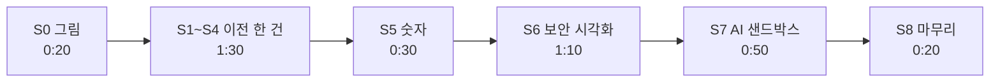

로드맵 위치: 결선 직전 / 최종 발표 토크 스크립트(통역용) / 본선 연결점: 완성도·데모 30 · 클라우드 활용 30 · 팀 개발 20 · 독창성 10 · AI 10

# 토크 스크립트: 5분 최종 발표 (8분 연습판 포함)

> 문서 상태: AI 초안(DRAFT) · 2026-10-31 17:25 UTC 작성, 17:45 UTC 콘티·런북과 불일치 정리(Z33: "미확인 값" 문구, 비용 크레딧 문장, 대체 규칙 15초/30초, 보안 표 숫자) · 한국어만(일본어판 안 만듦) · 5분판 화면·대체는 데모 콘티 5분판 `DEMO-STORYBOARD-5MIN.md`, 8분판은 `DEMO-STORYBOARD.md` 기준(둘 다 `parallel/Z33/docs/`) · 용어·숫자는 `parallel/Z16/docs/GLOSSARY.md` 기준 · 보안 표(Z18)·실제 LLM 에이전트(Z22)는 아직 안 합쳐져서 두 가지 판으로 적음 · 팀 검토 전 · 18:20 UTC 2차 묶음: 판 B 보안 표 숫자 위반 1·미구현 0

표시: 【사실】 코드·실측·대회 자료로 확인(출처 병기) / 【추정】 판단 / 【미확인】 아직 확인 못 함.

이 문서는 슬라이드가 아니다. 무대 화면은 설계 문서(`parallel/Z7/docs/PRESENTATION.md`), 웹 화면, 터미널 하나뿐이다【사실: 킥오프 p34-35 "슬라이드 금지, 설계 문서 + 데모"】. 이 문서는 통역사와 발표자가 보는 대본이다. 화면에 띄우지 않는다.

---

## 그림: 5분 안의 흐름



- 이야기는 하나다: "AWS에서 돌던 앱을 GCP로 옮긴다." 그 한 건 안에서 데모 필수 3장면(이전 · 보안 시각화 · AI 샌드박스)을 차례로 꺼낸다【사실: 킥오프 p20-21】.
- 장면 번호 S0~S8, 클릭·명령·실패 시 대체는 콘티에 있다(5분판 Z28, 8분판 Z24). 이 문서는 **말할 글만** 적고, 화면은 한 줄로만 적는다.
- 막혔을 때 다음 단계로 내려가는 기준: **5분판 15초, 8분판 30초**(런북 5-1).

## 왜 5분판이 본문인가

- 【사실】 최종 발표는 5분, 통역 시간은 빼고 잰다, 넘으면 강제로 끝날 수 있다(킥오프 p34-35, `notes/research/10-finals-kickoff-brief.md` 96줄).
- 【사실】 제출하는 토크 스크립트는 Notion에 쓰는 통역용 대본이다(킥오프 p28-29).
- 그래서 제출본은 5분판(목표 4:40, 여유 0:20)이다. 8분판은 리허설과 질문 대비용으로 4절에 따로 둔다. 8분판도 5분판 문단을 그대로 쓰고 문단만 더한다.

## 읽는 법

- 문단 하나 = 표 한 칸 묶음: **시간 / 장면 / 화면에 보이는 것 / 말할 글**.
- 말할 글은 `>` 줄이다. 한 줄 = 한 문장 = 한 가지 내용. 통역사가 한 줄씩 끊어 옮긴다.
- 숫자는 한 문장에 하나만 말한다. 숫자 옆 출처는 말하지 않는다(질문 오면 꺼낸다).
- 【판 A】는 지금 통합본(int3)으로 하는 말, 【판 B】는 Z18·Z22가 합쳐진 뒤 하는 말이다. 리허설 때 하나만 남긴다.

---

## 1. 5분판 대본 (제출본)

### 문단 1. 한 줄 소개 [0:00–0:20] · S0

- 화면: 설계 문서 1절 아키텍처 그림.

> 저희는 이미 실사용자가 있는 서비스를 멈추지 않고 다른 클라우드로 옮기는 플랫폼을 만들었습니다.
> 옮기는 과정 전체를 승인, 감사 기록, 롤백으로 감쌉니다.
> 오늘은 AWS에서 돌던 앱 하나를 GCP로 옮기면서 세 가지를 보여 드리겠습니다.
> 이전, 보안 시각화, 그리고 AI 에이전트입니다.

### 문단 2. 이전 시작과 계획 [0:20–0:55] · S1 + S3 앞부분

- 화면: 웹. 출발 dev-aws, 도착 dev-gcp → "새 이전 만들기" → 진행 칸이 "명세 검토"까지 초록 → "명세 확정" → "승인 대기"와 계획서(계획 지문 64자).

> 출발은 AWS, 도착은 GCP를 고르고 이전을 만듭니다.
> 워커가 출발 환경을 읽어서 클라우드에 상관없는 공통 명세를 만들었습니다.
> 사람이 명세를 확인하면 계획서가 나옵니다.
> 계획서에는 지문이 붙습니다. 사람이 본 계획과 실제로 실행할 계획이 다르면 실행되지 않습니다.

### 문단 3. 승인 → 실행 → 완료 [0:55–1:50] · S4 (필수 장면 a)

- 화면: "승인" → "실행 시작". 진행 칸이 자원 생성 · 앱 배포 · DB 복제 · 트래픽 이동 · DB 컷오버 · 롤백 가능 창 · 정리 순으로 초록, 15칸 모두 초록이 되고 "완료"【사실: W 3절, 기계 시간 6.7~6.9초】.

> 승인하고 실행합니다.
> 지금 칸이 하나씩 넘어갑니다.
> DB 복제와 컷오버는 진짜 Postgres 두 대 사이에서 돌고 있습니다.
> 출발 DB의 변경을 도착 DB로 계속 흘려보내다가, 마지막 순간에만 쓰기를 잠깐 멈추고 쓰기 담당을 바꿉니다.
> 클라우드 자원 생성과 트래픽 지표는 아직 흉내 값입니다. 화면에도 그렇게 표시해 두었습니다.
> 끝났습니다. 사람이 누른 버튼은 네 번입니다.

### 문단 4. 숫자 [1:50–2:20] · S5 (`numbers`만)

- 화면: 터미널 D `bash docs/demo/demo.sh numbers` → `cutover_pause_ms` 수십 ms, 마지막 줄 `stub(가짜)였나: f`.

> 방금 이전에서 쓰기가 멈춘 시간이 여기 나옵니다. 화면 값 그대로 읽겠습니다. ○○밀리초입니다.
> 쓰기를 계속 넣으면서 다섯 번 재면, 중앙값 41밀리초, 실패한 쓰기는 0건입니다.
> 이 값은 노트북 안 Postgres 두 대 사이에서 잰 값입니다. 클라우드 사이는 아직 재지 않았습니다.

- ○○ 자리는 화면 숫자를 그대로 읽는다. 외운 값을 말하지 않는다【사실: 화면 흐름 안 값은 27.5 / 45.3 / 28.8ms로 매번 다름, W 7절】.
- `stub(가짜)였나: t`가 나오면 첫 줄을 빼고 "이 숫자는 흉내 값이라 말씀드리지 않겠습니다"로 바꾼다(Z8 6절).

### 문단 5. 보안 시각화 [2:20–3:30] · S6 (필수 장면 b, 빼지 않음)

- 화면 컷 1(0:30): 이전 상세를 아래로 내려 보안 표. 【판 A】 보안 표가 아직 없으면 컷 1을 건너뛰고 컷 2부터.
- 화면 컷 2(0:20): `bash docs/demo/demo.sh wall` → `401` / `{"items":[]}` / `404 NOT_FOUND`.
- 화면 컷 3(0:20): `bash docs/demo/demo.sh audit` → 이번 이전의 감사 15줄, 줄마다 해시 12자.

【판 B: 보안 표가 합쳐진 뒤】 컷 1

> 같은 화면 아래에 출발과 도착 환경의 보안 상태가 한 표로 나옵니다.
> 위반 1, 약점 5, 미구현 0입니다.
> 위반 1건은 원래 있던 약점이 통제 매트릭스에 드러난 것입니다. 숨기지 않고, 근거 번호와 파일 경로까지 같이 보여 줍니다.

- 【사실: Z18 SECURITY-VIEW 3절】 AWS → GCP 이전 24줄. 완료된 이전 기준 지켜짐 16 · 약점 5 · 위반 1 · 미구현 0 · 해당 없음 2(기본 숨김)【사실, int5 2차 예정, STUB】. 위반 1건은 통제 12개 매트릭스(CT-MATRIX)다. 새 문제가 아니라 원래 있던 약점이 매트릭스로 보이게 된 것이다: 차트 설정(서비스 계정 토큰 자동 마운트, runAsNonRoot 없음), EKS 감사 로그 꺼짐, EKS·GKE API 공개 주소에 허용 대역 없음. 숫자는 화면 요약 칩을 그대로 읽는다. 다르면 화면 값을 읽는다.

【판 A: 보안 표 전】 컷 1 대신 한 줄

> 환경별 보안 표는 지금 합치는 중이라, 그 표를 받치는 장치 두 개를 직접 보여 드리겠습니다.

컷 2 (두 판 공통)

> 다른 회사의 번호로 목록을 부르면 비어 있습니다.
> 번호를 알고 직접 불러도 404입니다.
> 이 벽은 앱 코드가 아니라 데이터베이스의 행 단위 규칙이 칩니다.

컷 3 (두 판 공통)

> 상태가 바뀔 때마다 같은 트랜잭션에서 감사 기록이 한 줄씩 남습니다.
> 줄마다 앞 줄의 해시를 이어 붙입니다. 중간 한 줄을 고치면 거기서 체인이 깨집니다.

### 문단 6. AI 에이전트 샌드박스 [3:30–4:20] · S7 (필수 장면 c, 빼지 않음)

- 화면: 터미널 D `bash docs/demo/demo.sh agent` → `# pass 5`, `# fail 0`.

공통

> AI 에이전트는 샌드박스 안에서만 도구를 씁니다.
> 에이전트가 탈취돼도, 허용 목록 밖 도구는 실행되지 않습니다.
> Secret 추가나 privileged 같은 위험한 변경은 게이트가 막습니다.
> 마지막 적용은 사람이 승인합니다.

【판 A: 지금】 한 줄 더

> 지금 보신 시험은 언어 모델 대신 정해진 대본으로 돌렸습니다. 실제 모델 연결은 다음 단계입니다.

【판 B: Z22 합쳐진 뒤】 위 한 줄 대신

> 지금은 실제 언어 모델이 일회용 쿠버네티스 네임스페이스 안에서 문제를 찾고, 고친 설정을 먼저 거기에 적용해 봤습니다.
> 결과를 확인한 뒤 사람 승인을 기다립니다.

- 【판 B】의 화면·말은 Z22 결과가 나오면 실제 출력에 맞춰 고친다【미확인】.

### 문단 7. 마무리 [4:20–4:40] · S8

- 화면: 설계 문서 7절 수치 표.

> 정리하겠습니다.
> 컷오버 때 쓰기가 멈춘 시간은 41밀리초, 실패는 0건이었습니다.
> 롤백도 44밀리초로 같은 방식으로 돌아갑니다.
> 그리고 사람이 본 계획과 다르면, 실행되지 않습니다.
> 감사합니다.

- 4:40에 끝낸다. 남은 20초는 밀린 시간 흡수용이다. 4:30을 넘겼으면 둘째·셋째 줄만 말하고 "감사합니다"로 끝낸다.

---

## 2. 시간과 말 분량 검산

- 【추정】 발표용 한국어는 초당 4~5음절 정도다. 클릭·화면 넘어감 시간을 빼면 5분판에 말할 수 있는 양은 약 1,000~1,100음절이다.
- 【사실】 이 문서 1절의 `>` 줄 한글 글자 수는 아래 검증 명령으로 센다. 판 A와 판 B 줄이 함께 들어 있으므로, 실제로 말하는 양은 그 수보다 약 150음절 적다.
- 【사실】 타이머는 통역 시간을 뺀다(킥오프 p34-35). 그래도 통역을 기다리는 동안 데모 화면은 계속 돈다. 기계가 일하는 시간(S4 약 7초)은 말로 채운다.
- 리허설에서 문단마다 끝난 시각을 적어 아래 표에 채운다.

| 문단 | 목표 끝 시각 | 리허설 1 | 리허설 2 | 리허설 3 |
|---|---|---|---|---|
| 1 S0 | 0:20 | | | |
| 2 S1+S3 | 0:55 | | | |
| 3 S4 | 1:50 | | | |
| 4 S5 | 2:20 | | | |
| 5 S6 | 3:30 | | | |
| 6 S7 | 4:20 | | | |
| 7 S8 | 4:40 | | | |

- 밀리면 줄이는 순서: 문단 2 넷째 줄 → 문단 3 넷째 줄 → 문단 4 셋째 줄. 문단 3·5·6(필수 3장면)은 줄이지 않는다.

---

## 3. 배점 대응 표 (30 / 30 / 10 / 10 / 20)

【사실】 결선 배점은 예선과 같다: 완성도·데모 30 / 클라우드 활용 30 / 독창성 10 / AI 10 / 팀 개발 20 (킥오프 p40-41, Z15 0절).

| 문단 | 완성도·데모 30 | 클라우드 활용 30 | 독창성 10 | AI 10 | 팀 개발 20 |
|---|---|---|---|---|---|
| 1 한 줄 소개 | | ○ 여러 환경을 묶는 관리면 | | | ○ 설계 문서 그림 |
| 2 이전 시작·계획 | ○ 실제 화면 흐름 | ○ 공통 명세(추상화) | ○ 계획 지문 | | |
| 3 승인→완료 | ◎ 이전 완주(필수 a) | ◎ 무중단 설계, 쓰기 담당 교체 | | | |
| 4 숫자 | ◎ 실측 41ms·실패 0 | ○ 무중단 근거 | | | ○ 측정을 숫자로 남김 |
| 5 보안 시각화 | ◎ 보안 시각화(필수 b) | ◎ 권한·거버넌스(RLS, 감사 체인) | | | |
| 6 AI 샌드박스 | ○ 필수 c | | ○ 탈취 가정 시험 | ◎ 샌드박스 점검·수정 | |
| 7 마무리 | | ○ 롤백 44ms | | | ○ 한계를 먼저 말함 |

◎ 그 항목의 주된 근거 / ○ 보조 근거.

- 30점 두 항목은 문단 3·4·5가 함께 받친다. 그래서 시간도 이 셋에 2:35(전체의 55%)를 준다.
- 팀 개발 20점은 대본보다 질문 답에서 받는다. 질문이 오면 설계 문서의 결정 표 "버린 대안" 열을 가리킨다(Z5 JUDGE-QA).

---

## 4. 8분판에서 더하는 문단 (리허설·질문 대비)

8분판은 Z24 콘티 S0~S8 전부(7:30 + 여유 0:30)다. 5분판 문단 1~7을 그대로 쓰고 아래 세 문단을 끼운다. 시간은 Z24 1절을 따른다.

### 추가 A. 비용 비교 [S2, 문단 2 뒤, 0:40]

- 화면: 이전 상세의 비용 비교 막대.

> 같은 명세로 세 환경의 월 비용을 계산했습니다.
> 지금 트래픽이면 GCP가 AWS보다 월 86.4달러 쌉니다.
> 그중 73달러는 GKE 무료 크레딧입니다.
> 다만 GCP 단가는 아직 샘플 값이라, 화면에도 미확인 값으로 표시했습니다.

- 【사실】 AWS 월 $233.3(10 rps, 실제 가격 캐시, V CHANGES 49줄). 【미확인】 GCP 월 $146.9는 샘플 단가(Z16 4절). 그래서 $86.4는 반드시 셋째(크레딧)·넷째(미확인 값) 줄과 함께 말한다. 크레딧을 빼면 $13.4라는 점은 질문이 오면 답한다(Z28 4절). 화면 문구는 "미확인·가정 값"이다(`CostCompare.tsx`).
- 결선 전 `prices:fetch` 뒤 GCP가 `origin: live`가 되면 둘째 줄 숫자를 새 값으로 갈고, 셋째 줄 크레딧 문장은 남긴다.
- 화면에 $227.5 / $80.6이 나오면 가격 캐시를 안 읽은 판이다. 숫자는 말하지 않고 셋째 줄만 말한다(Z24 S2).

### 추가 B. 지문 거부 [S3 뒷부분, 문단 2 뒤, 0:25]

- 화면: `bash docs/demo/demo.sh wronghash` → `409 PLAN_HASH_MISMATCH`, 상태 `awaiting_approval` 그대로.

> 옛 화면을 보고 승인하면 이렇게 됩니다.
> 지문이 달라서 409로 거부되고, 이전 상태는 그대로입니다.

### 추가 C. 옮겨진 행과 롤백 [S5 나머지, 문단 4 안, 0:20]

- 화면: `bash docs/demo/demo.sh rows` → 출발·도착 둘 다 `orders 2000`, `customers 100`. 이어서 `measure`.

> 도착 DB가 0행에서 2,100행이 됐습니다. 출발과 같습니다.
> 거꾸로 되돌리는 롤백도 같은 방법으로 재면 쓰기 멈춤 중앙값 44밀리초입니다.

---

## 5. 말하는 숫자와 출처

말하는 숫자는 아래뿐이다. 이 표에 없는 숫자는 무대에서 말하지 않는다.

| 숫자 | 말하는 문단 | 조건 | 표시·출처 |
|---|---|---|---|
| 컷오버 쓰기 멈춤 중앙값 41ms (39~46ms, 5회) | 4, 7 | 쓰기 8개 계속, 같은 호스트 Postgres 두 대 | 【사실】 W 2-2(16:33~16:42 UTC), Z16 4절 |
| 실패한 쓰기 0건 (0 / 4,338) | 4, 7 | 위와 같음 | 【사실】 W 2-2 |
| 롤백 쓰기 멈춤 중앙값 44ms (41~52ms, 5회) | 7, 추가 C | 역방향 복제 미리 만듦 | 【사실】 W 2-2 |
| 이번 이전의 쓰기 멈춤 ○○ms | 4 | 화면 값 그대로 | 【사실】 그 자리 출력(`numbers`, `stub: f`일 때만) |
| 사람이 누르는 버튼 4번 | 3 | 웹 | 【사실】 Z16 4절 |
| 진행 칸 15칸 | 화면만 | 웹 진행 막대 | 【사실】 `apps/web/src/status.ts` |
| 2,100행 (orders 2,000 + customers 100) | 추가 C | 데모 데이터 | 【사실】 W 7절, Z24 S5 |
| 월 $86.4 절약 | 추가 A만 | AWS $233.3 실제 가격, GCP $146.9 샘플 | 【추정, GCP 단가 57% 아이오와·크레딧 $73 포함】 AWS만 【사실】 V → 크레딧 문장, "미확인 값" 문장과 함께만. 결선 전 `prices:fetch` 후 수치 갱신 |

- 5분판에서는 비용 숫자를 말하지 않는다. GCP 단가가 샘플이라서다(GCP 합계의 57%가 아이오와 단가, $86.4 중 $73이 크레딧【사실: Z28 4절】).
- 전날 가격을 받아 GCP가 실제 값이 되면 문단 7 셋째 줄 앞에 두 문장을 **함께** 넣을 수 있다: "같은 명세로 계산하면 GCP가 월 ○○달러 쌉니다." "그중 ○○달러는 GKE 무료 크레딧입니다." 또는 크레딧 뺀 값만 말한다. 첫 문장만 혼자 말하지 않는다.
- 쓰지 않는 옛 값: 62ms, 47ms, 48ms, $227.5, $80.6 (조건이 다른 측정, Z16 4절).

---

## 6. 말할 때 지킬 것

- 용어는 Z16 표대로: 이전, DB 복제, DB 컷오버, 트래픽 이동, 롤백 중 / 롤백 완료, 일시 정지, 쓰기 멈춤 시간, 계획 지문, 회사.
- "쓰기 멈춤 41ms"와 상태 "일시 정지"를 한 문장에 섞지 않는다(Z16 셀프 연습).
- 흉내 값(STUB)은 묻기 전에 먼저 말한다. 이 대본에서는 문단 3 다섯째 줄, 문단 4 셋째 줄, 문단 6 판 A 줄이다.
- 화면 글자 `stub(가짜)였나`는 소리 내어 읽지 않는다. 말로는 "흉내 값"이라고 한다(Z16 3절).
- 막히면 Z8 6절 "고치는 동안 할 말"을 그대로 쓴다. 5분판은 15초 안에 다음 단계로 내려간다. 침묵하며 타자 치지 않는다.
- 화면에 `.env`, 계정 번호, 키가 보이는 창을 띄우지 않는다(Z8 6절).

---

## 7. 질문이 오면 (대본 밖)

답 원문은 `parallel/Z5/docs/JUDGE-QA.md`에 있다. 장면별 질문 번호는 Z24 9절에 있다. 여기서는 5분판에서 뺀 것만 적는다.

| 뺀 것 | 질문이 오면 보여 줄 것 |
|---|---|
| 비용 비교 | 추가 A 문단 그대로 + `bash docs/demo/demo.sh cost` |
| 지문 거부 409 | 추가 B 문단 그대로 |
| 롤백 | 추가 C 둘째 줄 + `measure` |
| 무엇이 아직 흉내인가 | Z5 Q29·Q30, Z15 3절 상위 5개 |
| 화면 "가격 기준" 날짜 | "그 날짜는 AWS 가격을 받은 날입니다. GCP는 아직 샘플 단가입니다." (화면 날짜는 실제로 받은 가격 중 첫 시각만 보여 준다, Z28 4절) |

---

## 핵심 결정 3개 (+대안)

| 결정 | 대안 | 고른 이유 |
|---|---|---|
| 제출본은 5분판, 8분판은 문단만 더하는 연습판 | 8분 대본 하나를 깎아 쓰기 | 최종 발표가 5분이고 넘으면 강제로 끝난다(킥오프 p34-35). 5분판을 먼저 굳혀야 필수 3장면이 잘리지 않는다 |
| 5분판에서 비용 숫자를 말하지 않는다 | $86.4를 마무리 숫자로 말하기(Z7·Z24 원안) | GCP 단가가 샘플 값이라 【미확인】이다. 확인 안 된 숫자를 마무리에 두면 질문 하나에 무너진다. 대신 롤백 44ms(【사실】)를 넣었다 |
| 판 A(지금)와 판 B(합쳐진 뒤)를 같은 자리에 나란히 적는다 | 합쳐진 뒤 대본을 새로 쓰기 | 보안 표·실제 LLM이 결선 전에 합쳐질지 아직 모른다. 어느 쪽이든 리허설에서 한 줄만 지우면 된다 |

## 셀프 연습 1개

- 스톱워치를 켜고 1절(5분판)을 판 A로 소리 내어 한 번 읽는다. 데모 없이 읽은 시간이 3:50을 넘으면, 2절 "줄이는 순서"대로 한 줄씩 지우고 다시 잰다. 3회 재서 2절 표에 적는다.

## 검증 명령과 기대 출력

이 문서가 있는 폴더(`parallel/Z26/docs/`)에서 한 줄씩 실행한다.

```bash
grep -c '^### 문단' TALK-SCRIPT.md
```

- 기대: `7` (5분판 문단 7개).

```bash
python3 -c "import re;t=open('TALK-SCRIPT.md').read().split('## 2.')[0];print(sum(len(re.findall('[가-힣]',l)) for l in t.splitlines() if l.startswith('> ')))"
```

- 기대: 1,000 안팎의 숫자 하나(작성 때 999). 1절 `>` 줄의 한글 글자 수다. 판 A·B 줄이 함께 세지므로 실제 말하는 양은 약 150 적다. 1,250을 넘으면 5분판이 길다는 뜻이다.

```bash
grep -n '62ms\|47ms\|227.5\|80.6' TALK-SCRIPT.md
```

- 기대: 3줄. 4절 추가 A의 "가격 캐시를 안 읽은 판" 안내, 5절 "쓰지 않는 옛 값" 줄, 이 명령 줄 자신. 1절 대본 문단에는 하나도 없어야 한다.
