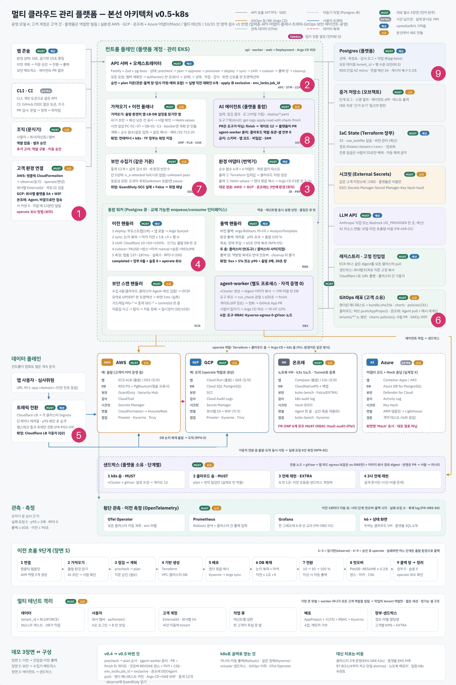
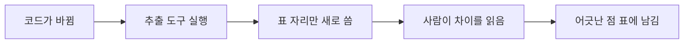

로드맵 위치: 본선 D-7 / 뼈대 코드에서 거꾸로 뽑은 명세 / 본선 연결점: 팀 개발 20점(문서와 코드가 같은 말을 한다), 완성도·데모 30점(영역끼리 붙일 때 안 깨진다)

# 명세 문서 묶음 (코드에서 거꾸로 뽑음)

상태: AI 초안



**그림의 어디인가.** 그림의 1~9번 영역 전부가 대상이다. 그중 지금 코드가 있는 곳은 2번(API 서버와 오케스트레이터)과 3번(가져오기와 어댑터)의 일부다.

**무슨 일을 하나.** 이 폴더의 문서는 뼈대 코드를 읽고 "지금 코드가 실제로 무엇을 약속하는지"를 적는다. 설계 문서는 "이렇게 만들 것이다"를 적는다. 이 폴더는 "코드가 지금 이렇다"를 적는다. 둘이 다르면 이 폴더의 "어긋난 점" 표에 남긴다.

**정한 것.**
- 표는 사람이 손으로 쓰지 않는다. `tools/extract.py`가 코드에서 뽑아 표 자리를 다시 쓴다.
- 사람이 쓴 설명 문장은 도구가 건드리지 않는다. 도구는 `<!-- GEN:이름 -->` 표시 사이만 바꾼다.
- 코드와 이 문서가 다르면 코드가 맞다. 문서를 다시 뽑는다.

---

## 전제 (모든 문서가 공유)

아래는 팀이 정한 아키텍처 전제다. 이 폴더의 문서는 이 전제를 바꾸지 않는다.

- 이전 방식은 리플랫폼(앱은 도착 환경에 새로 배포하고, DB는 논리 복제로 따라가게 한 뒤 컷오버)이다. 디스크를 통째로 복사하지 않는다.
- DB는 관리형 Postgres(RDS)를 먼저 다룬다. 다른 DB 종류는 나중이다.
- 환경은 AWS와 GCP가 필수다. 온프레(k3s + CloudNativePG)도 반드시 보여 준다. Azure는 어댑터 모양과 가짜(Mock)만 둔다.
- 이전 대상 고객 앱은 3티어(웹, API, DB)를 기준으로 한다.
- AI 에이전트의 추론은 상용 LLM API(Anthropic)를 부른다. 모델 서버를 직접 띄우지 않는다.
- 고객 권한은 비밀 키가 아니라 임시 역할로 빌린다. 관찰 역할과 실행 역할을 나눈다. 코드에 자격 증명을 넣지 않는다.

---

## 문서 목록

| 파일 | 무엇을 적나 | 이런 질문에 답한다 |
|---|---|---|
| `api.md` | HTTP 경로, 입력, 응답, 오류 | "이전을 만들려면 무엇을 보내고 무엇을 받나?" |
| `state-machine.md` | 이전 한 건의 상태 22개와 갈 수 있는 길 53개 | "지금 `shifting`인데 어디로 갈 수 있나?" |
| `jobs.md` | 큐 15개, 작업 내용 모양, 재시도 정책 | "워커는 어떤 작업을 받고, 실패하면 몇 번 다시 하나?" |
| `data-model.md` | DB 표 6개와 contracts 스키마 | "명세는 어디에 어떤 모양으로 저장되나?" |
| `modules.md` | 코드 패키지, 어댑터 함수, 영역별 코드 위치 | "3번 영역 코드는 어디에 쓰나?" |
| `open-items.md` | 아직 안 정한 것, 코드 표시, 어긋난 점, 이후 변경 반영 필요 | "무엇을 팀이 정해야 하나?" |

각 문서는 그 문서 하나로 읽힌다.

### 문서에 쓰는 표시

| 표시 | 뜻 |
|---|---|
| 【사실】 | 코드나 문서에서 확인했다. 괄호에 위치를 쓴다 |
| 【추정】 | 코드에 없다. 설계 문서나 추론에서 온 내용이다 |
| 【미확인】 | 아직 돌려 보지 않았다 |
| 구현 | 코드가 있고, 뼈대에서 실제로 돌려 봤다 |
| 모양만 | contracts에 스키마는 있지만 쓰는 코드가 없다 |
| 계획 | 설계 문서에만 있다 |

---

## 지금 코드가 어디까지 왔나

이 숫자는 `tools/extract.py`가 뽑는다.

<!-- GEN:gaps -->
- 상태 이동 53개 중 코드가 있는 것: 6개
- 큐 15개 중 작업을 넣는 코드가 있는 것: 3개
- 큐 15개 중 처리 코드가 있는 것: 1개
- API 경로 수: 9개
- contracts 스키마 수: 33개 (JSON Schema 로 내보내는 것은 export-json-schema.ts 목록 기준)
- DB 표 수: 6개
<!-- /GEN:gaps -->

코드 안의 결정 표시 수는 아래와 같다. 표시의 뜻은 `open-items.md` 첫 절에 있다.

<!-- GEN:marker_counts -->
`DRAFT(ai)` 22건 · `DECISION(team)` 3건 · `STUB` 37건 · `TODO(human)` 20건
<!-- /GEN:marker_counts -->

---

## 다시 뽑는 법

코드가 바뀌면 이 문서들을 다시 뽑는다. 이 그림은 다시 뽑는 순서를 보여 준다.



여기서 볼 점은 도구가 설명 문장은 고치지 않는다는 것이다. 표가 바뀌면 사람이 설명이 아직 맞는지 읽는다.

### 명령

Service 레포 루트에서 실행한다. 이 폴더가 `docs/contracts/`에 있다고 본다.

```bash
npm ci
python3 -I docs/contracts/tools/extract.py
git diff --stat docs/contracts
```

- 첫 줄: 의존 패키지를 설치한다. 도구가 contracts를 실제로 불러오려면 필요하다.
- 둘째 줄: 코드를 읽어 표 자리를 다시 쓴다. `-I`는 현재 폴더의 파이썬 파일을 섞어 읽지 않게 하는 옵션이다.
- 셋째 줄: 어느 문서가 바뀌었는지 본다.

기대 출력 (둘째 줄):

```text
다시 쓴 문서: api.md, data-model.md, ...
```

바뀐 것이 없으면 `다시 쓴 문서: 없음`이 나온다.

검사만 하고 쓰지 않으려면 `--check`를 붙인다. 바뀔 것이 있으면 종료 코드가 1이다. 나중에 CI에 넣을 수 있다.

```bash
python3 -I docs/contracts/tools/extract.py --check
```

### 도구가 무엇을 읽나

| 읽는 것 | 어떻게 | 채우는 표 |
|---|---|---|
| `packages/contracts/src/*.ts` | node로 실제로 불러와 JSON Schema로 바꾼다 | 스키마 칸 표, 상태, 큐 이름 |
| `apps/**/*.ts`의 `r.post("/...")` 같은 줄 | 글자 패턴으로 찾는다 | API 경로 표 |
| `advance(...)` 호출 | 글자 패턴으로 찾는다 | 코드가 있는 상태 이동, 큐를 넣는 곳 |
| `boss.work(...)` 호출 | 글자 패턴으로 찾는다 | 큐를 처리하는 곳 |
| `packages/core/src/boss.ts`의 `POLICY` 표 | 글자 패턴으로 찾는다 | 큐 정책과 재시도 수 |
| `db/migrations/*.sql` | `CREATE TABLE` 블록을 읽는다 | DB 표 칸 |
| 코드 전체의 `DRAFT(ai)`, `DECISION(team)`, `STUB:`, `TODO(human)` | 줄 단위로 찾는다 | 미정 사항 표 |
| `tools/planned-routes.tsv` | 명세 v4의 API 45개 목록 | "명세에 있고 코드에 없는 경로" 표 |

글자 패턴으로 찾는 부분은 코드 모양이 많이 바뀌면 놓칠 수 있다. 예를 들어 경로를 `app.route({...})` 모양으로 쓰면 못 찾는다. 그때는 `extract.py`의 `routes()` 함수를 고친다.

---

## 핵심 결정 3개 (+대안)

| 결정 | 대안 | 버린 이유 |
|---|---|---|
| 표는 도구가 코드에서 뽑고, 설명만 사람이 쓴다 | 문서를 손으로 다 쓴다 | 병렬로 코드가 바뀌는 중이라 손으로 쓴 표는 하루 안에 틀린다 |
| contracts는 node로 실제로 불러와서 읽는다 | 파이썬으로 Zod 코드를 글자 패턴으로 읽는다 | `.extend()`, `.partial()` 같은 조합을 글자로는 못 따라간다 |
| 명세에 있는 API 목록을 TSV 한 파일로 둔다 | 명세 문서를 매번 파싱한다 | 명세 문서 모양이 바뀌면 도구가 깨진다. TSV는 사람이 한 줄씩 고칠 수 있다 |

## 셀프 연습 1개

`apps/api/src/routes/migrations.ts`에 `r.get("/migrations", ...)` 경로를 하나 더한다. 도구를 다시 돌린 뒤 `api.md`의 "명세에 있고 코드에 없는 경로" 표에서 `GET /migrations` 줄이 "있음"으로 바뀌는지 본다.

## 검증 명령과 기대 출력

```bash
python3 -I docs/contracts/tools/extract.py --check
echo $?
```

기대 출력: 문서를 막 다시 뽑았다면 `바뀔 문서: 없음`과 `0`.

## 용어집

| 용어 | 쉬운 뜻 | 이 문서에서 하는 일 |
|---|---|---|
| contracts | 영역 사이에 오가는 데이터 모양을 Zod로 적은 패키지 | 문서 표의 원본 |
| GEN 블록 | 문서 안에서 도구가 다시 쓰는 자리 | 사람이 쓴 문장과 도구가 쓴 표를 나눈다 |
| JSON Schema | 데이터 모양을 JSON으로 적는 표준 양식 | 도구가 Zod 모양을 읽는 중간 형태 |
| Zod | TypeScript에서 데이터 모양을 적고 검사하는 라이브러리 | 모든 스키마를 이걸로 적었다 |
| 역추출 | 코드를 먼저 쓰고, 코드에서 명세를 뽑는 방식 | 이 폴더의 작성 방식 |
