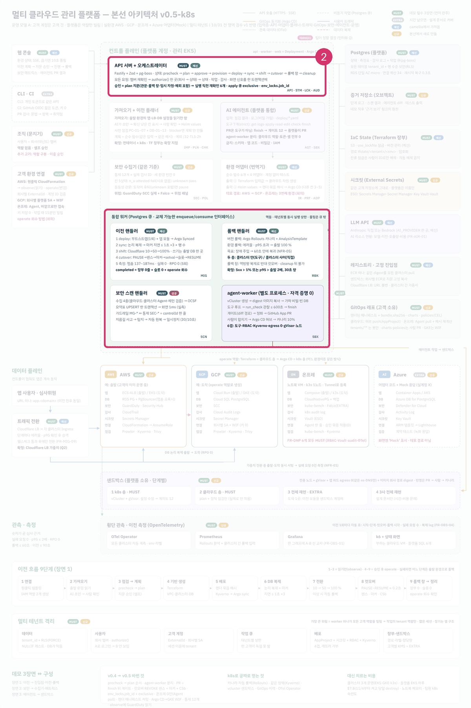

로드맵 위치: 본선 D-7 / 뼈대 코드의 HTTP API 명세 / 본선 연결점: 완성도·데모 30점(화면과 CLI가 같은 약속으로 붙는다), 팀 개발 20점

# API 명세: 화면과 CLI가 플랫폼에 보내는 요청

상태: AI 초안



**그림의 어디인가.** 가운데 위의 "API 서버" 상자다. 왼쪽의 웹 콘솔과 CLI가 이 상자로 요청을 보낸다.

**무슨 일을 하나.** API 서버는 사람의 요청을 받는다. 요청 모양을 검사하고, 어느 회사의 요청인지 확인한다. 그다음 이전 한 건의 상태를 한 칸 옮기고, 오래 걸리는 일은 큐에 넣는다. 들어오는 것은 HTTP 요청이고, 나가는 것은 HTTP 응답과 큐 작업이다.

**정한 것.**
- 오래 걸리는 일은 바로 202(접수함)로 답하고 번호만 돌려준다. 진행 상황은 다시 읽어서 본다.
- 오류 응답은 언제나 같은 모양이다. `{status, code, message, requestId}` 네 칸이다.
- 요청 본문은 Zod로 검사한다. 모르는 칸이 있으면 거부한다(strict).
- 지금 코드에 있는 경로 전체 목록은 `docs/openapi.yaml`이 원본이다(모두 `/api/v1` 아래). 명세에 적은 경로는 45개다. 이 문서의 표는 뼈대 시점 기준이라 4절 표의 "코드" 칸만 현행화했다.

---

## 1. 요청 하나가 지나가는 길

API 서버는 요청마다 같은 순서를 지난다. 이 그림은 `POST /migrations` 하나가 지나가는 길이다.


여기서 볼 점은 "상태 옮기기"와 "큐 작업 넣기"가 한 덩어리라는 것이다. 둘 중 하나만 저장되는 일은 없다.

> **용어**
>
> | 용어 | 쉬운 뜻 |
> |---|---|
> | 202 Accepted | "받았다. 처리는 나중에 끝난다"는 HTTP 응답 코드 |
> | 회사 벽(RLS) | DB가 다른 회사의 행을 안 보여 주는 기능. 행 단위 보안 |
> | strict | 스키마에 없는 칸이 오면 거부하는 검사 방식 |

1. **모양 검사.** 【사실】(`apps/api/src/main.ts:10`) Fastify(Node.js 웹 서버 라이브러리)가 경로마다 붙은 Zod 스키마로 본문을 검사한다. 틀리면 400 `BAD_REQUEST`다.
2. **회사 확인.** 【사실】(`apps/api/src/plugins/auth.ts`) 지금은 뼈대용이다. `x-dev-tenant` 헤더에서 회사 번호를 읽는다. 헤더가 없으면 401 `UNAUTHENTICATED`다. 진짜 로그인은 이 파일만 바꿔서 넣는다.
3. **상태 옮기기.** 【사실】(`packages/core/src/advance.ts`) 상태를 바꾸는 함수는 `advance()` 하나다. 갈 수 없는 길이면 409 `INVALID_TRANSITION`이다.
4. **DB 저장과 큐 작업.** 【사실】(`packages/core/src/db.ts`) 모든 DB 일은 `withTenant()` 안에서 한다. 트랜잭션(여러 DB 작업을 "전부 되거나 전부 안 되거나"로 묶는 단위)을 열고, 회사 번호를 DB에 알린 뒤, 일을 하고 확정한다.

---

## 2. 지금 코드에 있는 경로

이 표는 코드에서 뽑았다. "하는 일"은 경로 바로 위의 코드 주석이다.

<!-- GEN:routes -->
| 방법 | 경로 | 입력 | 성공 코드 | 하는 일 (코드 주석) | 코드 위치 |
|---|---|---|---|---|---|
| GET | `/healthz` | - | 200 | - | apps/api/src/main.ts:15 |
| GET | `/readyz` | - | 200 | - | apps/api/src/main.ts:16 |
| POST | `/migrations` | 본문 `CreateMigration` | 202 | 이전 만들기 + 가져오기 시작 (T01). 202와 번호만 돌려준다 | apps/api/src/routes/migrations.ts:16 |
| GET | `/migrations/:id` | 경로값 `id: z.uuid()` | 200 | - | apps/api/src/routes/migrations.ts:34 |
| POST | `/migrations/:id/plan` | - | 202 | 명세 확정 → 점검·계획 시작 (T04). 202 | apps/api/src/routes/plans.ts:31 |
| GET | `/migrations/:id/plan` | - | 200 | DRAFT(ai): 설계 3.4 경로 표에 없는 경로. 화면이 승인 버튼을 그리려면 이전 번호로 최신 계획을 찾아야 해서 추가 | apps/api/src/routes/plans.ts:46 |
| GET | `/plans/:id` | - | 200 | 계획서 보기. 화면은 여기 나온 planHash를 승인 요청에 그대로 넣는다 | apps/api/src/routes/plans.ts:56 |
| POST | `/plans/:id/approvals` | 본문 `ApprovalInput` | 200 | 승인·거절 (T09·T10). 화면이 본 planHash와 저장된 planHash가 다르면 409 | apps/api/src/routes/plans.ts:65 |
| POST | `/migrations/:id/start` | - | 202 | 실행 시작 (T15). 승인된 계획의 지문을 apply 작업에 싣는다. 202 | apps/api/src/routes/plans.ts:96 |
<!-- /GEN:routes -->

### `POST /migrations`: 이전 만들기

출발 환경과 도착 환경을 받아 이전 한 건을 만든다. 만들자마자 가져오기를 시작한다.

요청 본문 (모양 이름 `CreateMigration`, 경로 파일 안에 있음):

```json
{
  "sourceEnvId": "2222…(uuid)",
  "targetEnvId": "3333…(uuid)"
}
```

| 칸 | 모양 | 꼭 있나 |
|---|---|---|
| `sourceEnvId` | uuid | 예 |
| `targetEnvId` | uuid | 예 |

응답 (202):

```json
{ "id": "4a8c…(uuid)" }
```

【사실】(`apps/api/src/routes/migrations.ts:16`) 서버는 한 트랜잭션 안에서 네 가지를 한다.

1. 이전 행을 `draft`로 넣는다.
2. 상태를 `importing`으로 옮긴다.
3. `import` 큐에 작업을 넣는다. 같은 이전에 작업이 두 번 생기지 않게 `import:<이전 번호>`라는 중복 방지 키를 붙인다.
4. 감사 기록 한 줄과 화면 신호를 남긴다.

【실측】 뼈대에서 이 요청부터 상태가 `spec_review`가 될 때까지 중앙값 1.47초였다(11회).

### `GET /migrations/:id`: 이전 한 건 보기

【사실】(`apps/api/src/routes/migrations.ts:34`) 지금은 다섯 칸만 돌려준다. `id`, `status`, `version`, `sourceEnvId`, `targetEnvId`다. 다른 회사의 번호를 넣으면 회사 벽 때문에 행이 안 보이고, 404 `NOT_FOUND`가 나온다. 남의 이전이 "있는지"조차 알려 주지 않는다.

```json
{
  "id": "4a8c…",
  "status": "spec_review",
  "version": 2,
  "sourceEnvId": "2222…",
  "targetEnvId": "3333…"
}
```

contracts의 화면용 모양 `MigrationView`는 열 칸이다. 지금 응답에는 그중 다섯 칸만 있다. 이 차이는 아래 "어긋난 점"에 적었다.

### `GET /healthz`, `GET /readyz`: 살아 있나, 준비됐나

- `/healthz`는 프로세스가 살아 있으면 `{"ok": true}`를 돌려준다. 인증을 거치지 않는다.
- `/readyz`는 DB에 `SELECT 1`을 보내 본 뒤 `{"ok": true}`를 돌려준다.
- k8s(쿠버네티스, 컨테이너를 돌리는 플랫폼)는 이 두 경로로 "다시 띄울지", "요청을 보내도 될지"를 판단한다.

---

## 3. 오류 응답

모든 오류는 같은 모양이다. 화면은 `code`만 보고 무엇을 할지 정한다. `requestId`는 서버 로그에서 같은 요청을 찾을 때 쓴다.

```json
{
  "status": 409,
  "code": "INVALID_TRANSITION",
  "message": "spec_review -> shifting",
  "requestId": "req-1a"
}
```

이 표는 코드에서 뽑은 오류 코드 전부다.

<!-- GEN:errors -->
| code | HTTP | 만드는 곳 | 코드 위치 |
|---|---|---|---|
| UNAUTHENTICATED | 401 | 응답 직접 | apps/api/src/plugins/auth.ts:17 |
| BAD_REQUEST | 400 | 응답 직접 | apps/api/src/plugins/errors.ts:12 |
| INTERNAL | 500 | 응답 직접 | apps/api/src/plugins/errors.ts:14 |
| NOT_FOUND | 404 | `NotFound` | packages/core/src/errors.ts:6 |
| INVALID_TRANSITION | 409 | `InvalidTransition` | packages/core/src/errors.ts:9 |
| LEASE_LOST | 409 | `LeaseLost` | packages/core/src/errors.ts:14 |
| JOB_NOT_CREATED | 409 | `JobNotCreated` | packages/core/src/errors.ts:17 |
<!-- /GEN:errors -->

【사실】(`apps/api/src/plugins/errors.ts`) 위 표에 없는 예외는 모두 500 `INTERNAL`로 바뀐다. 이때 `message`는 `internal error` 하나뿐이다. 내부 정보가 화면에 새지 않게 하려는 것이다.

---

## 4. 명세에 있고 코드에 없는 경로

요구사항·기능 명세 v4에 적은 API 45개와 지금 코드를 맞대 본 표다. 목록 원본은 `tools/planned-routes.tsv`다. "경로 이름 추정"이 붙은 줄은 설계 문서에도 아직 이름이 없는 경로다.

<!-- GEN:planned -->
명세 목록 45개 중 코드에 있는 것. 표 끝쪽 "있음" 줄 중 명세 목록에 없는 경로(`/migrations/:id/plan`·`replan`·`spec/reopen` 과, 뒤에 코드로 먼저 생긴 `/auth/*`·`/docs*`·`/tokens`·`/migrations/:id/{spec,timeline,report,cost,…}` 등)는 실제 경로(`docs/openapi.yaml`)와 맞춰 적은 것이다. 이 표와 실제 경로의 일치는 `apps/api/test/api-doc-sync.test.ts`가 본다.

| 방법 | 경로 | 영역 | 하는 일 | 코드 |
|---|---|---|---|---|
| GET | `/auth/login` | 입력층 | 외부 OIDC(GitHub OAuth) 로그인 시작 (경로 이름 추정) | 있음 (코드는 POST) |
| GET | `/auth/callback` | 입력층 | OIDC 콜백 (경로 이름 추정) | 없음 |
| POST | `/auth/logout` | 입력층 | 세션 종료 (경로 이름 추정) | 있음 |
| POST | `/tenants` | 입력층 | 회사(테넌트) 만들기 (경로 이름 추정) | 없음 |
| POST | `/members` | 입력층 | 멤버 초대(이메일 또는 GitHub 로그인) | 없음 |
| DELETE | `/members/:id` | 입력층 | 멤버 제거 | 없음 |
| POST | `/environments` | 입력층 | 관리 대상 환경 등록(draft) | 있음 |
| GET | `/environments` | 입력층 | 자기 회사 환경 목록 + 연결 상태 + 마지막 검증 시각 | 있음 |
| POST | `/environments/:id/connection-link` | 입력층 | 원클릭 연결 링크 발급 | 있음 |
| POST | `/environments/:id/verify` | 입력층 | 연결 검증 | 있음 |
| POST | `/environments/:id/agent-token` | 입력층 | 온프레 Agent 일회용 등록 토큰(10분) + 설치 명령 한 줄 발급 | 있음 |
| POST | `/agent/register` | 입력층 | Agent가 일회용 토큰으로 등록하고 장기 Agent 키를 받음 | 있음 |
| GET | `/events` | 입력층 | SSE | 없음 |
| POST | `/tokens` | 입력층 | CLI 개인 토큰 발급(범위 지정, 30일, 해시 저장) (경로 이름 추정) | 있음 |
| POST | `/migrations` | 가져오기·명세 | 이전 생성 + 가져오기 시작 | 있음 |
| GET | `/migrations` | 가져오기·명세 | 자기 회사 이전 목록(상태·version·출발·도착) | 있음 |
| GET | `/migrations/:id` | 가져오기·명세 | 이전 상세: 상태, version, 현재 명세(spec + field_meta), plan 요약, 단계 타임스탬프, lease 상태 | 있음 |
| PATCH | `/specs/:id` | 가져오기·명세 | 명세 칸 수정 | 없음 (같은 일을 하는 `PATCH /migrations/:id/spec` 이 있음) |
| POST | `/migrations/:id/plan` | 이전 | 명세 확정, 사전 점검, 계획 생성 | 있음 |
| GET | `/plans/:id` | 이전 | 계획 내용: 단계, 사전 점검 결과, Terraform plan 요약, 정책 게이트, 예외 티켓, 임시 자원 선언, planHash | 있음 |
| POST | `/plans/:id/approvals` | 이전 | 계획 승인·거절. 깃발 PLAN_ACKS=1 이면 승인 때 본문 `acks`가 확인 항목을 다 덮어야 함(아니면 409 ACKS_MISSING) | 있음 |
| POST | `/migrations/:id/start` | 이전 | Terraform 실행 시작. 깃발 PLAN_ACKS=1 이면 본문 `planHash`가 승인 지문과 같아야 함(아니면 409 PLAN_HASH_MISMATCH). 깃발 TENANT_MAX_ACTIVE>0 이면 회사 동시 진행 상한 초과 시 409 TENANT_BUSY | 있음 |
| POST | `/migrations/:id/reclaim` | 이전 | 롤백 대기를 일찍 끝내고 정리로 넘긴다 | 있음 |
| POST | `/migrations/:id/resume` | 이전 | 가드레일로 멈춘 이전을 멈추기 전 상태로 재개 | 있음 |
| POST | `/migrations/:id/rollback` | 이전 | 수동 롤백 | 있음 |
| POST | `/migrations/:id/cancel` | 이전 | 취소 | 있음 |
| POST | `/migrations/:id/force-unlock` | 이전 | tfstate 잔류 잠금 강제 해제 | 없음 |
| GET | `/security/matrix` | 보안 | 보안 매트릭스 요약표(통제 × 환경) | 없음 |
| GET | `/security/cells/:env/:control` | 보안 | 칸 근거: finding 50건 + 조용한 소스(결과 안 낸 도구) + 연결된 가드레일 + 이 환경의 눈이 못 보는 것 | 없음 |
| GET | `/security/threats` | 보안 | 활성 위협 목록(GuardDuty·SCC·Falco) | 없음 |
| POST | `/security/threats/:key/ack` | 보안 | 위협 확인(ack) | 없음 |
| POST | `/security/attestations` | 보안 | 도구가 못 보는 통제를 사람이 확인·기록(24시간 시효) | 없음 |
| GET | `/migrations/:id/equivalence` | 보안 | 이전 전후 보안 동등성(출발 열 vs 도착 열) | 없음 |
| GET | `/migrations/:id/guardrails` | 보안 | 가드레일 패널: 구간별 규칙 상태·발동·원복 시각·초 | 없음 |
| GET | `/audit-events` | 보안 | 감사 타임라인 + 체인 무결 표시 | 없음 |
| GET | `/audit-events/verify` | 보안 | 회사 감사 체인을 처음부터 재검증(30분 타이머와 같은 함수) | 없음 |
| POST | `/agent/reports` | 보안 | 온프레 Agent 보고 수신(Falco 경보·PolicyReport·kube-bench·스크립트·audit log) | 있음 |
| POST | `/agent-runs` | 에이전트 | 에이전트 실행 요청 (경로 이름 추정) | 없음 |
| GET | `/agent-runs/:id` | 에이전트 | 실행 상세 + 타임라인(단계·도구·입력·결과 지문·거부 규칙·ms) + PR 링크 (경로 이름 추정) | 없음 |
| POST | `/agent-runs/:id/cancel` | 에이전트 | 실행 취소 (경로 이름 추정) | 없음 |
| GET | `/migrations/:id/measurements` | 운영 | 이전 측정표(자동 생성) (경로 이름 추정) | 없음 |
| GET | `/ops/active-migrations` | 운영 | 진행 중 이전 수 | 없음 |
| GET | `/healthz` | 운영 | 프로세스 살아 있음(k8s liveness) | 있음 |
| GET | `/readyz` | 운영 | api: DB + LISTEN 연결 / worker: DB (k8s readiness) | 있음 |
| POST | `/cost-estimates` | 비용 (2단계) | 비용 예측 만들기 (경로 이름 추정) | 없음 |
| GET | `/cost-estimates/:id` | 비용 (2단계) | 환경별 월 비용, 단가 출처와 시각, 모르는 칸, 추천 프로필과 이유 (경로 이름 추정) | 없음 |
| GET | `/migrations/:id/plan` | - | 명세 목록에 없는 경로 | 있음 |
| POST | `/migrations/:id/replan` | - | 다시 계획하기: failed(provisioning 이하)·stale·rejected → planning | 있음 |
| POST | `/migrations/:id/spec/reopen` | - | 거절 뒤 명세부터 다시 고치기: rejected → spec_review | 있음 |
| GET | `/auth/config` | 입력층 | 로그인 화면을 띄울지(devAuth·loginRequired·github.enabled). 인증 불필요 | 있음 |
| POST | `/auth/login` | 입력층 | 이메일+비밀번호 로그인 → Bearer 접근 토큰(15분) + HttpOnly 쿠키 svc_refresh | 있음 |
| POST | `/auth/refresh` | 입력층 | 쿠키로 접근 토큰 갱신 (리프레시 토큰은 쓰면 바로 무효) | 있음 |
| GET | `/auth/me` | 입력층 | 내 정보 (사람 로그인 전용, 개인 토큰으로는 불가) | 있음 |
| DELETE | `/environments/:id` | 입력층 | 환경 연결 해제. 진행 중 이전이 있으면 409, Agent 키 끊고 임시 자격 회수 요청 | 있음 |
| GET | `/environments/:id/status` | 입력층 | 환경 자체의 자원 상태 (aws·gcp·onprem은 실자원 읽기, 못 읽으면 unknown) | 있음 |
| GET | `/environments/:id/inventory` | 입력층 | 환경에 지금 돌고 있는 것과 이전 때문에 생기고 걷히는 것 | 있음 |
| GET | `/environments/:id/agent-reports` | 보안 | 온프레 Agent가 보낸 보고를 사람이 봄 (회사 벽 안) | 있음 |
| GET | `/tokens` | 입력층 | 내 CLI 개인 토큰 목록 (원문 없음) | 있음 |
| DELETE | `/tokens/:id` | 입력층 | 개인 토큰 끊기 (204). 남의 토큰은 404 | 있음 |
| GET | `/migrations/:id/spec` | 가져오기·명세 | 그 이전의 최신 명세 한 판 (받아들인 판, 없으면 AI 초안 최신 판) | 있음 |
| PATCH | `/migrations/:id/spec` | 가져오기·명세 | 명세 칸 수정 (baseVersion 비교, 감사에는 칸 이름만) | 있음 |
| GET | `/migrations/:id/plan/resources` | 이전 | 출발 서비스 → 도착 서비스 대응표 (어떤 방식으로 옮겨지나) | 있음 |
| GET | `/migrations/:id/timeline` | 이전 | 감사 기록을 시간순 전이 타임라인으로 | 있음 |
| GET | `/migrations/:id/report` | 이전 | 증적 리포트 (json 기본, 쿼리로 md·html) | 있음 |
| GET | `/migrations/:id/cost` | 이전 | 출발 vs 도착 월 비용 비교 | 있음 |
| POST | `/cost/estimate` | 비용 (2단계) | 비용 예측 (가격표 캐시 기준, 네트워크 안 씀) | 있음 |
| GET | `/migrations/:id/live-traffic` | 이전 | 실시간 트래픽 지표 | 있음 |
| GET | `/migrations/:id/traffic-shift` | 이전 | 트래픽 전환 진행 (없으면 available:false) | 있음 |
| GET | `/migrations/:id/security` | 보안 | 이전의 보안 현황 | 있음 |
| POST | `/migrations/:id/security/check` | 보안 | 지금 출발·도착을 다시 점검하고 감사에 남김 | 있음 |
| GET | `/migrations/:id/security/regression` | 보안 | 출발·도착 점검 스냅숏을 열쇠별로 비교 (읽기 전용) | 있음 |
| GET | `/migrations/:id/agent-review` | 에이전트 | 장애 점검 결과 읽기 | 있음 |
| POST | `/migrations/:id/agent-review/run` | 에이전트 | 장애 점검 시작 (Idempotency-Key 지원) | 있음 |
| GET | `/docs` | 운영 | API 문서 HTML (외부 스크립트 없음) | 있음 |
| GET | `/docs/openapi.yaml` | 운영 | OpenAPI 3.1 YAML | 있음 |
| GET | `/docs/openapi.json` | 운영 | 같은 내용 JSON | 있음 |
<!-- /GEN:planned -->


---

## 4-1. 경로는 같고 요청·응답 칸이 바뀐 곳 (DOCAPI2)

지금 경로는 `docs/openapi.yaml` 기준 52개이고 4절 표와 맞는다(`api-doc-sync` 시험). 아래는 같은 경로의 요청·응답 칸과 오류 코드가 바뀐 것이다. 칸 모양의 원본은 `packages/contracts`의 Zod 스키마이고, 이 절은 그 요약이다. 깃발(환경변수)은 워커·API가 읽는 이름 그대로 적었다.

### `GET /migrations/:id/spec`: v2 명세 칸

- 응답 스키마는 `MigrationSpecViewV2`다(`packages/contracts/src/spec.ts`).
- 보여 주는 판에 `spec_v2`(공통 명세 v2, 가져오기 깃발 `IMPORT_IR=v2`로 저장)가 있을 때만 세 칸이 더 붙는다. v1 판의 응답은 전과 글자 그대로다.

| 칸 | 모양 | 뜻 |
|---|---|---|
| `needsReviewV2` | 문자열 목록 | v2 검토 칸 키 (`spec_v2.fieldMeta` 중 `needs_review=true`). 화면은 이 키를 PATCH `confirm`에 그대로 보낸다 |
| `specV2` | `AppSpecV2` | v2 명세 본문 (리소스·의존성·라우팅·보안 기준선) |
| `fieldMetaV2` | `FieldMetaV2` | v2 칸별 출처·신뢰도 |

- `unmapped`·`ids`·`environment`는 내보내지 않는다. 화면이 안 쓰고, 벤더 고유 키가 섞여 있기 때문이다.

### `PATCH /migrations/:id/spec`: v2 경로·posture·초안 받아들이기

- 기준 판(받아들일 초안이 있으면 그 초안)에 `spec_v2`가 있으면 v2 경로만 받는다. v1 판에는 v1 경로만 받는다. 섞이면 400 `SPEC_PATH_IR_MISMATCH`.
- v2 `changes[].path`:
  - `components.<id>.<칸>`: 리소스 props 맨 위 칸 하나를 통째로 바꾼다.
  - `links`, `entry`, `posture`: 통째로 바꾼다.
  - `posture` 통째 바꾸기는 출발 방화벽을 못 읽은 데이터 자원(사전 점검이 사람 결정으로 막는 것)을 풀 길이다.
- v2 `confirm[]`: `spec_v2.fieldMeta` 키를 그대로 보낸다 (`components.…`, `links.<a>-><b>`, `entry.…`, `check.reviews[i]`). 모르는 키는 아무것도 안 지우고 새 판만 만든다.
- 검사 순서: v2 값을 고친다 → `AppSpecV2` 모양 검사 + `checkV2` 오류 → v1 명세를 v2에서 다시 뽑는다(`rebuildFromV2`) → 세 칸을 한 줄에 같이 저장한다.
- 감사 `spec.edited` detail에는 `ir: "v2"`가 붙는다. 칸 이름만 남고 값은 남지 않는다.
- `acceptDraft`: 초안에 `spec_v2`가 없으면 같은 이전에서 가장 최근에 받아들인 판의 `spec_v2`를 이어받는다. v2 검토 칸이 남는다. 감사 detail에 `inheritedV2: true`가 붙는다.
  - 같은 요청 안에서 v2 키 `confirm`은 400이다(기준이 초안 v1 판이라서). 받아들인 뒤 다시 보낸다.

| 오류 | 언제 |
|---|---|
| 400 `SPEC_PATH_IR_MISMATCH` | 판의 IR 버전과 경로 종류가 다름 |
| 400 `SPEC_PATCH_INVALID` | v2 모양 검사·`checkV2`·다시 뽑기 실패 (칸 이름과 이유만, 값은 안 돌려줌). 출발 원래 실행 모양 `components.<id>.origin` 을 고치려 해도 400 (가져오기가 정한 값, 도착 실행 방식은 `runtime` 으로 바꾸고 승인) |
| 400 `SPEC_DRAFT_NOT_FOUND` | 없는 초안 번호 |
| 409 `SPEC_DRAFT_STALE` | 받아들인 판보다 옛 초안 |
| 409 `SPEC_DRAFT_NOT_ACCEPTED` | 초안만 있는데 `acceptDraft` 없이 고침 |
| 409 `SPEC_VERSION_CONFLICT` | `baseVersion`이 지금 보이는 판이 아님 |
| 409 `SPEC_INVALID` | v2 판인데 v1 부분이 `AppSpec` 모양이 아니라 다시 뽑을 재료가 없음 |
| 409 `INVALID_TRANSITION` | 상태가 `spec_review`가 아님 |

### `POST /migrations/:id/plan` → 사전 점검: v2 대조 줄 (깃발 `PLAN_IR=v2`)

- 경로와 응답(202)은 그대로다. 결과는 이전 상태 전이와 감사 detail `precheck`, 그리고 계획서 `precheck`에 남는다.
- 깃발이 꺼져 있으면 아래 줄은 하나도 안 생긴다(전과 같음).

| 점검 id | 수준 | 뜻 |
|---|---|---|
| `PC-V2-SOURCE` | info | v2 명세 출처 (`spec_v2` 또는 `upconvert`)와 리소스 수 |
| `PC-V2-UNSUP-n` | block | 도착 Builder가 못 그리는 것 (capability 밖, azure_mock 신원 2개 이상, 옮길 수 없는 IAM 권한 등) |
| `PC-V2-HUMAN-n` | block | 사람이 정해야 하는 것. 데이터 자원 줄 포함: DLQ 못 찾음, 버킷 공개 여부 모름·공개 버킷, 캐시 AUTH, 출발 방화벽 못 읽음 |
| `PC-V2-HUMAN` | block | v2 명세 자체를 못 씀 (사람이 고친 판에 `spec_v2`가 빠짐 등) |
| `PC-V2-GRANTS-n` | warn | 옮긴 IAM 권한 알림: 권한 경계 밖 문장, 좁힌 `Resource "*"`, 온프레·azure_mock은 권한 안 옮김 |

- block이 하나라도 있으면 이전은 `failed`가 아니라 `spec_review`로 돌아간다. 사람이 명세를 고친 뒤 다시 `POST /plan`을 보낸다.
- warn은 계획서 확인 항목(`acknowledgements`, kind `precheck_warn`, id `precheck_warn:<점검 id>`)이 된다.

### `GET /plans/:id`: 계획서 v2 칸

- `PLAN_IR=v2`로 만든 계획서에만 세 칸이 붙는다. v1 계획서 본문엔 키 자체가 없다(지문 `planHash` 보존).

| 칸 | 뜻 |
|---|---|
| `irVersion` | `"2"` |
| `specSource` | `spec_v2` 또는 `upconvert` |
| `instances` | Terraform 매트릭스 줄 `module.<종류>["<IR id>"]` (비용 고지·화면용) |

- apply·deploy는 깃발이 아니라 이 칸으로 길을 고른다. 승인 뒤에 깃발을 바꿔도 승인한 길 그대로 간다.
- `acknowledgements[].kind`: `cost`, `failure_cost_policy`, `runtime_change`, `build`, `precheck_warn`, `low_confidence`.

### `POST /plans/:id/approvals`, `POST /migrations/:id/start` (깃발 `PLAN_ACKS=1`)

- 승인 본문 `acks`(문자열 목록, 최대 500개)가 계획서 `acknowledgements[].id`를 전부 덮어야 한다. 하나라도 빠지면 409 `ACKS_MISSING`이고, 메시지에 빠진 id가 있다. 거절은 `acks`를 안 본다. 막히면 상태·잠금은 그대로다.
- start 본문 `planHash`는 선택 칸이다(본문 없는 `{}` 호환). 깃발이 켜져 있는데 빠졌거나 승인 지문과 다르면 409 `PLAN_HASH_MISMATCH`.

### `POST /environments/:id/verify`: 관찰 역할 선택 권한 빠짐 (`missingPermissions`)

- 연결은 성공했는데 관찰 역할에 선택 권한이 빠져 있으면(예전 연결 스크립트로 만든 고객) 실패로 바꾸지 않는다. 상태는 `connected`이고, 사람이 할 일로 남긴다.
- 감사 `env.verified` detail에 `missingPermissions`(빠진 권한 이름 목록)가 남는다.
- DB `environments.verify_detail`에는 `missingPermissions`와 `needsHuman`(사람이 할 일 한 줄)이 남는다.
- `GET /environments` 목록과 `POST /environments` 응답(`EnvironmentView`)에 선택 칸 두 개로 보인다: `missingPermissions`(문자열 목록), `needsHuman`(문자열 목록). 비었거나 없으면 칸 자체가 없다(전 응답과 같은 키). `verify_detail`의 다른 칸(`clusters`·`checkedAt`)은 내보내지 않는다.
- 응답에서만 다듬는다(DB 원본은 그대로): 12자리 숫자(AWS 계정 ID, ARN 계정 칸)는 `••••` + 끝 4자리로 가리고, 목록은 앞 100개·한 줄 300자까지 자른다. 계약도 `maxItems 100`·`maxLength 300`. 문자열 아닌 값이 섞이면 칸을 안 붙인다. (DRAFT(ai))
- 환경 상태 SSE 신호는 아직 없다(`packages/core/src/connection.ts` TODO(human)). 연결 확인은 `migration_events` 신호를 보내지 않으니 화면은 목록을 다시 읽어야 한다.

### 이번 물결 깃발 (요청·응답 모양을 바꾸는 것만)

| 깃발 | 기본 | 켜면 |
|---|---|---|
| `IMPORT_IR=v2` | 끔 | 가져오기가 `spec_v2`를 같이 저장한다 → `GET /spec`에 v2 칸이 붙고, PATCH는 v2 경로만 받는다 |
| `IMPORT_AWS_IAM=1` | 끔 | (`IMPORT_IR=v2`와 함께) 앱 신원 IAM 정책을 읽어 의존성 `grants`·`posture.permissions`를 채운다 |
| `PLAN_IR=v2` | 끔 | 사전 점검 v2 대조 줄 + 계획서 v2 칸 |
| `PLAN_ACKS=1` | 끔 | 승인 `acks`·start `planHash` 강제 |

---

## 5. 어긋난 점 (코드와 설계가 다른 곳)

| 무엇이 | 코드 | 설계 | 어느 쪽으로 맞출지 |
|---|---|---|---|
| 경로 앞부분 | 【사실】 `/migrations` (앞부분 없음) | 【추정】 `/api/v1/migrations` | TODO(human). 붙이려면 `main.ts`에서 `prefix` 한 줄 |
| 오류 모양 | 【사실】 `{status, code, message, requestId}` | 【추정】 명세 v4 표는 `{"error": {code, message}}` | 코드 쪽을 추천. contracts `ApiError`가 이미 있다 |
| `/readyz` 인증 | 【사실】 인증 훅이 `/healthz`만 건너뛴다. `/readyz`는 헤더 없이 부르면 401이다 (`auth.ts:14`) | k8s 프로브용이라 인증 없이 열려야 한다 | 고쳐야 한다. 아래 셀프 연습 |
| `GET /migrations/:id` 응답 | 【사실】 다섯 칸. 응답 스키마를 붙이지 않아 모양 검사도 없다 | `MigrationView` 열 칸 | `MigrationView`를 응답 스키마로 붙인다 |
| `CreateMigration` 위치 | 【사실】 경로 파일 안에 있다 | 다른 영역(CLI, 화면)도 같은 모양을 써야 한다 | contracts로 옮기는 것을 추천 |
| 출발·도착 환경 확인 | 【사실】 둘이 같아도, "연결됨"이 아니어도 만든다 | 둘 다 "연결됨"이고 서로 달라야 한다 | 검사를 `POST /migrations`에 더한다 |
| 다른 회사 환경 번호 | 【추정】 외래 키 검사는 회사 벽을 건너뛴다(PostgreSQL 문서). 그래서 남의 환경 번호를 넣어도 이전이 만들어질 수 있다. 그 뒤 워커는 출발 환경을 못 읽고 아무것도 안 한다. 이전은 `importing`에 멈춘다 | 다른 회사 번호는 404 | 【미확인】 시험 하나로 확인한 뒤 고친다 |
| 같은 요청 두 번 | 【사실】 `Idempotency-Key` 헤더를 보지 않는다. 버튼을 두 번 누르면 이전이 둘 생긴다 | 【추정】 POST는 `Idempotency-Key` 필수 | 큐 이름 `idempotency-cleanup`만 자리를 잡아 두었다 |
| 실시간 신호 | 【사실】 DB 알림(`pg_notify`)은 보내지만, 화면으로 내보내는 `GET /events`가 없다 | SSE(서버가 브라우저로 한 방향으로 계속 보내는 연결) | 경로를 더한다 |

---

## 6. 이후 변경 반영 필요

다른 작업이 뼈대 코드를 바꾸는 중이다. 이 문서는 아래 시점의 뼈대를 기준으로 썼다. 이 항목이 코드에 들어오면 표를 다시 뽑고, 위 설명 문장도 다시 읽는다.

- 로그인이 진짜로 바뀌면 "회사 확인" 설명과 401·403 오류 코드를 다시 쓴다.
- 경로가 늘면 2절 표와 4절 표는 도구가 바꾼다. 경로마다 요청·응답 예시는 사람이 더한다.
- 경로 앞부분(`/api/v1`)과 오류 모양을 팀이 정하면 5절 표에서 줄을 지운다.

---

## 핵심 결정 3개 (+대안)

| 결정 | 대안 | 버린 이유 |
|---|---|---|
| 오래 걸리는 요청은 202와 번호만 준다 | 끝날 때까지 기다렸다가 200 | 가져오기와 Terraform은 몇 분 걸린다. 연결이 끊기면 결과를 잃는다 |
| 오류 모양은 하나다 (`ApiError`) | 경로마다 자유롭게 | 화면이 오류마다 다른 처리를 짜야 한다 |
| 다른 회사 자원은 403이 아니라 404 | 403(권한 없음) | 403은 "그 번호가 있다"는 정보를 준다 |

## 셀프 연습 1개

1. `apps/api/src/plugins/auth.ts`에서 `/healthz`를 건너뛰는 줄을 찾는다.
2. 헤더 없이 `curl -i localhost:3000/readyz`를 보낸다. 401이 나오는지 본다.
3. 건너뛰는 조건에 `/readyz`를 더한다. 다시 보내서 200이 나오는지 본다.
4. 왜 k8s 프로브가 401을 받으면 위험한지 한 줄로 쓴다. 힌트: k8s는 "준비 안 됨"으로 보고 요청을 안 보낸다.

## 검증 명령과 기대 출력

뼈대 루트에서 DB, API, 워커를 띄운 뒤 실행한다.

```bash
T=11111111-1111-4111-8111-111111111111
S=22222222-2222-4222-8222-222222222222
G=33333333-3333-4333-8333-333333333333
B=$(printf '{"sourceEnvId":"%s",' $S)
B="$B$(printf '"targetEnvId":"%s"}' $G)"
U=localhost:3000/migrations
J='content-type: application/json'
curl -s -XPOST $U -H "x-dev-tenant: $T" \
  -H "$J" -d "$B"
curl -s -XPOST $U -H "x-dev-tenant: $T" \
  -H "$J" -d '{"sourceEnvId":"x"}'
```

기대 출력:

```text
{"id":"…uuid…"}
{"status":400,"code":"BAD_REQUEST",…}
```

- 앞의 일곱 줄: 개발용 회사·환경 번호와 요청 본문을 변수에 담는다.
- 첫 요청: 202와 이전 번호.
- 둘째 요청: 모양이 틀려서 400.

## 용어집

| 용어 | 쉬운 뜻 | 이 문서에서 하는 일 |
|---|---|---|
| 202 Accepted | 받았고 처리는 나중에 끝난다는 응답 | 오래 걸리는 요청의 답 |
| advance() | 이전 상태를 한 칸 옮기는 유일한 함수 | 상태를 바꾸는 모든 경로가 부른다 |
| Fastify | Node.js 웹 서버 라이브러리 | API 서버 |
| Idempotency-Key | 같은 요청을 두 번 보내도 한 번만 처리하게 붙이는 헤더 | 아직 없음 |
| requestId | 요청마다 붙는 번호 | 로그에서 같은 요청 찾기 |
| SSE | 서버가 브라우저로 계속 신호를 보내는 연결 | 아직 없음 |
| strict | 모르는 칸을 거부하는 검사 | 모든 본문 |
| 트랜잭션 | 여러 DB 작업을 전부 되거나 전부 안 되게 묶는 단위 | 상태 변경과 큐 작업을 묶음 |
| 회사 벽(RLS) | DB가 다른 회사 행을 안 보여 주는 기능 | 다른 회사 번호는 404 |
| x-dev-tenant | 뼈대에서 회사 번호를 넣는 임시 헤더 | 진짜 로그인 전까지 인증 대신 |
