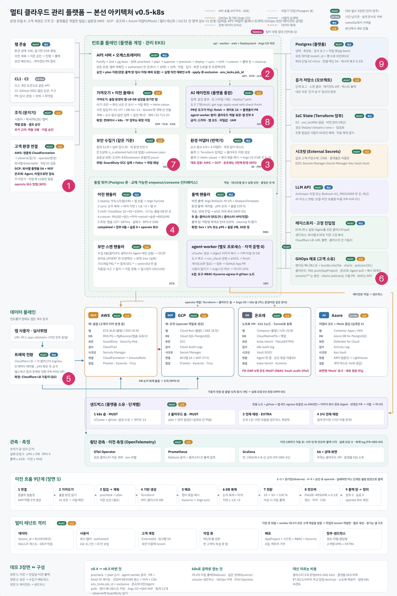
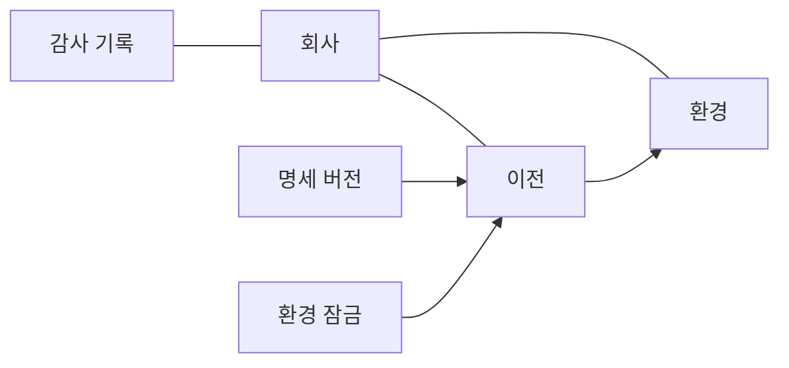

로드맵 위치: 본선 D-7 / DB 표와 공통 스키마 명세 / 본선 연결점: 클라우드 활용 30점(멀티 테넌트 격리), 팀 개발 20점(데이터 모양 합의)

# 데이터 모델: 무엇이 어디에 어떤 모양으로 저장되나

상태: AI 초안



**그림의 어디인가.** 그림 가운데의 플랫폼 Postgres다. 1~9번 영역이 모두 이 DB에 결과를 남기고 서로의 결과를 읽는다.

**무슨 일을 하나.** 이 문서는 두 가지 모양을 적는다. 하나는 DB 표(무엇이 오래 저장되나)다. 다른 하나는 contracts 스키마(영역 사이에 무슨 모양이 오가나)다. 들어오는 것은 각 영역의 결과이고, 나가는 것은 화면과 다른 영역이 읽는 행이다.

**정한 것.**
- 회사가 있는 모든 표에는 `tenant_id` 칸과 회사 벽(RLS)을 켠다. 표 주인에게도 강제한다.
- 앱은 표 주인 계정이 아니라 `app_user` 계정으로 접속한다.
- 감사 기록은 넣고 읽기만 된다. 고치거나 지울 수 없다.
- 공통 명세(앱을 클라우드 이름 없이 적은 우리 양식)는 `spec_versions` 표에 JSON으로 버전마다 한 줄씩 쌓는다.

---

## 1. 표 6개가 어떻게 이어지나

이 그림은 표 사이의 연결을 보여 준다. 화살표는 "이 표가 저 표의 번호를 가리킨다"는 뜻이다.



여기서 볼 점은 "이전"이 가운데라는 것이다. 이전 한 건은 출발 환경과 도착 환경 두 개를 가리킨다.

> **용어**
>
> | 용어 | 쉬운 뜻 |
> |---|---|
> | 회사 벽(RLS) | DB가 다른 회사의 행을 안 보여 주는 기능. 행 단위 보안 |
> | 외래 키 | 한 표의 칸이 다른 표의 번호를 가리키게 하는 규칙 |
> | jsonb | Postgres에서 JSON을 저장하는 칸 타입 |

---

## 2. 회사 벽은 어떻게 걸리나

【사실】(`db/migrations/0001_init.sql`) 순서는 이렇다.

1. 앱이 트랜잭션을 연다.
2. 앱이 `app.tenant_id`라는 설정값에 회사 번호를 넣는다. 이 값은 그 트랜잭션 안에서만 산다.
3. DB는 표를 읽고 쓸 때마다 `tenant_id = app.tenant_id`인 행만 보여 준다. 다른 회사의 행을 쓰려 하면 거부한다.
4. 회사 번호를 안 넣으면 어떤 행도 안 보인다.

【사실】 `FORCE ROW LEVEL SECURITY`를 켰다. 표 주인은 원래 회사 벽을 건너뛴다. 이 설정을 켜면 표 주인에게도 벽이 걸린다. 【사실】(PostgreSQL 문서) 다만 슈퍼유저는 이 설정과 무관하게 벽을 건너뛴다. 로컬 docker의 `platform_owner`는 슈퍼유저다. 그래서 앱은 반드시 `app_user`로 접속한다.

<!-- GEN:rls -->
회사 벽(RLS)이 켜진 표: `environments`, `migrations`, `spec_versions`, `env_locks`, `audit_events`

- `GRANT SELECT ON tenants TO app_user`
- `GRANT SELECT, INSERT, UPDATE, DELETE ON environments, migrations, spec_versions, env_locks TO app_user`
- `GRANT SELECT, INSERT ON audit_events TO app_user`
- `GRANT USAGE ON SEQUENCE audit_events_seq_seq TO app_user`
<!-- /GEN:rls -->

### 감사 기록은 해시 체인이다

【사실】(`packages/core/src/audit.ts`) 감사 기록 한 줄에는 바로 앞 줄의 해시가 들어간다. 중간 줄 하나를 고치면 뒤의 모든 해시가 안 맞는다. 그래서 몰래 고친 것을 찾을 수 있다.

- 해시는 키를 정렬한 JSON으로 만든다. 같은 내용이면 칸 순서가 달라도 같은 해시다.
- 회사마다 체인이 하나다. 같은 회사의 기록 두 개가 동시에 들어오지 않게 회사별 잠금(`pg_advisory_xact_lock`)을 건다.
- 이 잠금은 트랜잭션의 마지막 잠금이다. 다른 잠금보다 늦게 잡아서 서로 기다리는 교착을 피한다.

---

## 3. DB 표 6개

이 표들은 코드에서 뽑았다.

<!-- GEN:tables -->
#### `tenants` (db/migrations/0001_init.sql:6)

| 칸 | 타입 | 규칙 | 주석 |
|---|---|---|---|
| `id` | uuid | PRIMARY KEY DEFAULT gen_random_uuid() |  |
| `name` | text | NOT NULL |  |

#### `environments` (db/migrations/0001_init.sql:11, 회사 벽 켜짐)

| 칸 | 타입 | 규칙 | 주석 |
|---|---|---|---|
| `id` | uuid | PRIMARY KEY DEFAULT gen_random_uuid() |  |
| `tenant_id` | uuid | NOT NULL REFERENCES tenants(id) |  |
| `provider` | text | NOT NULL CHECK (provider IN ('aws','gcp','onprem','azure_mock')) |  |
| `name` | text | NOT NULL |  |
| `connection_status` | text | NOT NULL DEFAULT 'draft' |  |
| `external_id` | text |  |  |
| `account_id` | text |  |  |
| `last_verified_at` | timestamptz |  |  |

#### `migrations` (db/migrations/0001_init.sql:22, 회사 벽 켜짐)

| 칸 | 타입 | 규칙 | 주석 |
|---|---|---|---|
| `id` | uuid | PRIMARY KEY DEFAULT gen_random_uuid() |  |
| `tenant_id` | uuid | NOT NULL REFERENCES tenants(id) |  |
| `source_env_id` | uuid | NOT NULL REFERENCES environments(id) |  |
| `target_env_id` | uuid | NOT NULL REFERENCES environments(id) |  |
| `status` | text | NOT NULL DEFAULT 'draft' |  |
| `version` | int | NOT NULL DEFAULT 0 |  |
| `paused_from` | text |  |  |
| `failed_at_status` | text |  |  |
| `failure_code` | text |  |  |
| `rollback_window_ends_at` | timestamptz |  |  |
| `created_at` | timestamptz | NOT NULL DEFAULT now() |  |
| `updated_at` | timestamptz | NOT NULL DEFAULT now() |  |

#### `spec_versions` (db/migrations/0001_init.sql:37, 회사 벽 켜짐)

| 칸 | 타입 | 규칙 | 주석 |
|---|---|---|---|
| `id` | uuid | PRIMARY KEY DEFAULT gen_random_uuid() |  |
| `tenant_id` | uuid | NOT NULL REFERENCES tenants(id) |  |
| `migration_id` | uuid | NOT NULL REFERENCES migrations(id) |  |
| `version` | int | NOT NULL |  |
| `spec` | jsonb | NOT NULL |  |
| `field_meta` | jsonb | NOT NULL |  |
| `created_at` | timestamptz | NOT NULL DEFAULT now() |  |
| (묶음 규칙) | UNIQUE (migration_id, version) |  |  |

#### `env_locks` (db/migrations/0001_init.sql:48, 회사 벽 켜짐)

| 칸 | 타입 | 규칙 | 주석 |
|---|---|---|---|
| `env_id` | uuid | PRIMARY KEY REFERENCES environments(id) |  |
| `tenant_id` | uuid | NOT NULL REFERENCES tenants(id) |  |
| `migration_id` | uuid | NOT NULL REFERENCES migrations(id) |  |
| `holder` | text | NOT NULL | 'reserved' \| 'worker:<id>' |
| `job_id` | uuid |  |  |
| `lease_expires_at` | timestamptz | NOT NULL |  |

#### `audit_events` (db/migrations/0001_init.sql:57, 회사 벽 켜짐)

| 칸 | 타입 | 규칙 | 주석 |
|---|---|---|---|
| `seq` | bigserial | PRIMARY KEY |  |
| `tenant_id` | uuid | NOT NULL REFERENCES tenants(id) |  |
| `at` | timestamptz | NOT NULL DEFAULT now() |  |
| `actor` | text | NOT NULL |  |
| `action` | text | NOT NULL |  |
| `target` | text | NOT NULL |  |
| `result` | text | NOT NULL |  |
| `detail` | jsonb | NOT NULL DEFAULT '{}' |  |
| `prev_hash` | text | NOT NULL |  |
| `hash` | text | NOT NULL |  |
<!-- /GEN:tables -->

### 표마다 누가 쓰나

| 표 | 쓰는 쪽 | 읽는 쪽 |
|---|---|---|
| `tenants` | 플랫폼 운영 (지금은 개발용 넣기 SQL) | 모두 |
| `environments` | 입력층 (환경 등록, 연결 확인) | 모두 |
| `migrations` | `advance()`만 상태를 바꾼다 | 모두 |
| `spec_versions` | 가져오기 워커, 사람의 명세 수정 | 이전 계획, 화면 |
| `env_locks` | 실행 단계 워커, 감시 작업 | `advance()` |
| `audit_events` | 모든 영역 (`writeAudit()`로만) | 화면, 감사 검증 |

### 개발용 넣기 데이터

【사실】(`db/migrations/0002_seed_dev.sql`) 회사 하나와 환경 둘이 고정 번호로 들어간다. 스모크 시험이 이 번호를 바로 쓴다.

| 무엇 | 번호 | 내용 |
|---|---|---|
| 회사 | `11111111-1111-4111-8111-111111111111` | `dev-company` |
| 환경 | `22222222-2222-4222-8222-222222222222` | AWS, 연결됨 |
| 환경 | `33333333-3333-4333-8333-333333333333` | GCP, 연결됨 |

---

## 4. 공통 명세 (AppSpec)

공통 명세는 출발 설정을 모으는 곳이고, 도착 설정을 만드는 출발점이다. 이 표들은 코드에서 뽑았다.

<!-- GEN:schemas_spec -->
#### `AppSpec` (모르는 칸 거부(strict))

| 칸 | 모양 | 꼭 있나 |
|---|---|---|
| `schemaVersion` | "1" 고정 | 예 |
| `app` | 객체(1칸) | 예 |
| `app.name` | 문자열 (패턴 ^[a-z][a-z0-9-]{1,30}$) | 예 |
| `service` | 객체(8칸) | 예 |
| `service.image` | 문자열 (패턴 @sha256:[a-f0-9]{64}$) | 예 |
| `service.port` | 정수 (1 이상, 65535 이하) | 예 |
| `service.healthPath` | 문자열 (패턴 ^\/.*) | 예 |
| `service.replicas` | 정수 (1 이상, 10 이하) | 예 |
| `service.cpu` | 1 · 250m · 500m | 예 |
| `service.memory` | 512Mi · 1Gi · 2Gi | 예 |
| `service.env` | 배열<객체(2칸)> | 예 |
| `service.env[].name` | 문자열 | 예 |
| `service.env[].value` | 문자열 (최대 256자) | 예 |
| `service.secretRefs` | 배열<객체(2칸)> | 예 |
| `service.secretRefs[].name` | 문자열 | 예 |
| `service.secretRefs[].key` | 문자열 | 예 |
| `database` | 객체(3칸) | 아니오 |
| `database.engine` | "postgres" 고정 | 아니오 |
| `database.majorVersion` | 15 · 16 · 17 | 아니오 |
| `database.storageGb` | 정수 (100 이하) | 아니오 |
| `ingress` | 객체(2칸) | 예 |
| `ingress.hostname` | 문자열 | 예 |
| `ingress.entry` | "cloudflare-lb" 고정 | 예 |

#### `FieldMetaEntry` (모르는 칸 거부(strict))

| 칸 | 모양 | 꼭 있나 |
|---|---|---|
| `source` | 문자열 | 예 |
| `confidence` | 1 고정 / 0.9 고정 / 0.6 고정 | 예 |
| `needs_review` | 참/거짓 | 예 |
| `rationale` | 문자열 | 아니오 |

#### `ImportResult` (모르는 칸 거부(strict))

| 칸 | 모양 | 꼭 있나 |
|---|---|---|
| `spec` | 객체(5칸) | 예 |
| `spec.schemaVersion` | "1" 고정 | 아니오 |
| `spec.app` | 객체(1칸) | 아니오 |
| `spec.app.name` | 문자열 (패턴 ^[a-z][a-z0-9-]{1,30}$) | 아니오 |
| `spec.service` | 객체(8칸) | 아니오 |
| `spec.service.image` | 문자열 (패턴 @sha256:[a-f0-9]{64}$) | 아니오 |
| `spec.service.port` | 정수 (1 이상, 65535 이하) | 아니오 |
| `spec.service.healthPath` | 문자열 (패턴 ^\/.*) | 아니오 |
| `spec.service.replicas` | 정수 (1 이상, 10 이하) | 아니오 |
| `spec.service.cpu` | 1 · 250m · 500m | 아니오 |
| `spec.service.memory` | 512Mi · 1Gi · 2Gi | 아니오 |
| `spec.service.env` | 배열<객체(2칸)> | 아니오 |
| `spec.service.env[].name` | 문자열 | 아니오 |
| `spec.service.env[].value` | 문자열 (최대 256자) | 아니오 |
| `spec.service.secretRefs` | 배열<객체(2칸)> | 아니오 |
| `spec.service.secretRefs[].name` | 문자열 | 아니오 |
| `spec.service.secretRefs[].key` | 문자열 | 아니오 |
| `spec.database` | 객체(3칸) | 아니오 |
| `spec.database.engine` | "postgres" 고정 | 아니오 |
| `spec.database.majorVersion` | 15 · 16 · 17 | 아니오 |
| `spec.database.storageGb` | 정수 (100 이하) | 아니오 |
| `spec.ingress` | 객체(2칸) | 아니오 |
| `spec.ingress.hostname` | 문자열 | 아니오 |
| `spec.ingress.entry` | "cloudflare-lb" 고정 | 아니오 |
| `fieldMeta` | 맵<문자열, 객체(4칸)> | 예 |
| `unmapped` | 배열<객체(2칸)> | 예 |
| `unmapped[].resource` | 문자열 | 예 |
| `unmapped[].reason` | 문자열 | 예 |
<!-- /GEN:schemas_spec -->

### 공통 명세의 규칙과 이유

| 규칙 | 이유 |
|---|---|
| 이미지는 `@sha256:` 지문으로만 적는다 | 태그(`:v1`)는 나중에 다른 이미지를 가리킬 수 있다 |
| CPU와 메모리는 정해진 세 값 중에서만 고른다 | AI나 사람이 무엇을 넣어도 어댑터가 아는 값만 흘러간다 |
| 비밀은 이름만 적는다 (`secretRefs`) | 명세는 화면과 감사에 그대로 보인다 |
| 모르는 칸은 거부한다 | 오타 난 칸이나 위험한 칸(예: 특권 컨테이너)이 조용히 지나가는 것을 막는다 |
| 칸마다 출처와 믿음 정도를 따로 적는다 (`FieldMetaEntry`) | 1은 클라우드에서 그대로 읽은 값, 0.9는 규칙으로 바꾼 값, 0.6은 AI가 채운 값이다. 사람이 무엇을 확인해야 하는지 안다 |

---

## 5. 그 밖의 contracts 스키마

아래 스키마는 contracts에 모양만 있다. 쓰는 코드는 아직 없다. 이 표들은 코드에서 뽑았다.

### 환경

<!-- GEN:schemas_env -->
#### `Provider` (값 4개)

`aws` · `gcp` · `onprem` · `azure_mock`

#### `ConnectionStatus` (값 8개)

`draft` · `awaiting_customer` · `verifying` · `connected` · `unstable` · `failed` · `expired` · `disconnected`

#### `EnvironmentView` (모르는 칸 거부(strict))

| 칸 | 모양 | 꼭 있나 |
|---|---|---|
| `id` | uuid | 예 |
| `provider` | aws · gcp · onprem · azure_mock | 예 |
| `name` | 문자열 | 예 |
| `connectionStatus` | `ConnectionStatus` 값 중 하나 | 예 |
| `accountId` | 문자열 또는 null | 예 |
| `lastVerifiedAt` | 문자열 또는 null | 예 |
| `failureReason` | 문자열 또는 null | 예 |

#### `ConnectionLink` (모르는 칸 거부(strict))

| 칸 | 모양 | 꼭 있나 |
|---|---|---|
| `url` | URL | 예 |
| `externalId` | 문자열 | 예 |
| `expiresAt` | 문자열 | 예 |
<!-- /GEN:schemas_env -->

### 이전

<!-- GEN:schemas_migration -->
#### `MigrationStatus` (값 22개)

`draft` · `importing` · `spec_review` · `prechecking` · `planning` · `awaiting_approval` · `approved` · `provisioning` · `deploying` · `syncing` · `shifting` · `cutover` · `rollback_window` · `cleanup` · `completed` · `paused` · `rolling_back` · `rolled_back` · `failed` · `cancelled` · `rejected` · `stale`

#### `MigrationView` (모르는 칸 거부(strict))

| 칸 | 모양 | 꼭 있나 |
|---|---|---|
| `id` | uuid | 예 |
| `status` | `MigrationStatus` 값 중 하나 | 예 |
| `version` | 정수 | 예 |
| `sourceEnvId` | uuid | 예 |
| `targetEnvId` | uuid | 예 |
| `pausedFrom` | `MigrationStatus` 값 중 하나 또는 null | 예 |
| `failedAtStatus` | `MigrationStatus` 값 중 하나 또는 null | 예 |
| `failureCode` | 문자열 또는 null | 예 |
| `rollbackWindowEndsAt` | 문자열 또는 null | 예 |
| `updatedAt` | 문자열 | 예 |
<!-- /GEN:schemas_migration -->

### 계획과 승인

<!-- GEN:schemas_plan -->
#### `PrecheckItem` (모르는 칸 거부(strict))

| 칸 | 모양 | 꼭 있나 |
|---|---|---|
| `id` | 문자열 | 예 |
| `level` | block · warn · info | 예 |
| `message` | 문자열 | 예 |
| `fix` | 문자열 | 아니오 |

#### `PlanStep` (모르는 칸 거부(strict))

| 칸 | 모양 | 꼭 있나 |
|---|---|---|
| `id` | provision · deploy · sync · shift · cutover · cleanup | 예 |
| `owner` | terraform · argocd · agent · worker | 예 |
| `estSec` | 정수 (0 초과) | 아니오 |
| `gate` | 문자열 | 아니오 |
| `weights` | 배열<정수> | 아니오 |
| `holdSec` | 정수 | 아니오 |
| `rollback` | 문자열 | 아니오 |

#### `PlanDoc` (모르는 칸 거부(strict))

| 칸 | 모양 | 꼭 있나 |
|---|---|---|
| `planId` | uuid | 예 |
| `migrationId` | uuid | 예 |
| `adapterVersion` | 문자열 | 예 |
| `steps` | 배열<객체(7칸)> | 예 |
| `steps[].id` | provision · deploy · sync · shift · cutover · cleanup | 예 |
| `steps[].owner` | terraform · argocd · agent · worker | 예 |
| `steps[].estSec` | 정수 (0 초과) | 아니오 |
| `steps[].gate` | 문자열 | 아니오 |
| `steps[].weights` | 배열<정수> | 아니오 |
| `steps[].holdSec` | 정수 | 아니오 |
| `steps[].rollback` | 문자열 | 아니오 |
| `precheck` | 배열<객체(4칸)> | 예 |
| `precheck[].id` | 문자열 | 예 |
| `precheck[].level` | block · warn · info | 예 |
| `precheck[].message` | 문자열 | 예 |
| `precheck[].fix` | 문자열 | 아니오 |
| `rollbackCriteria` | 객체(3칸) | 예 |
| `rollbackCriteria.errorRatePct` | 숫자 | 예 |
| `rollbackCriteria.p95Multiplier` | 숫자 | 예 |
| `rollbackCriteria.windowSec` | 정수 | 예 |
| `tfPlanHash` | 문자열 | 예 |
| `helmValuesHash` | 문자열 | 예 |
| `planHash` | 문자열 | 예 |
| `expiresAt` | 문자열 | 예 |

#### `ApprovalInput` (모르는 칸 거부(strict))

| 칸 | 모양 | 꼭 있나 |
|---|---|---|
| `decision` | approve · reject | 예 |
| `planHash` | 문자열 | 예 |
| `reason` | 문자열 (최대 500자) | 아니오 |
<!-- /GEN:schemas_plan -->

### 신호

<!-- GEN:schemas_events -->
#### `NotifyMigration` (모르는 칸 거부(strict))

| 칸 | 모양 | 꼭 있나 |
|---|---|---|
| `t` | uuid | 예 |
| `id` | uuid | 예 |
| `s` | `MigrationStatus` 값 중 하나 | 예 |

#### `SseEvent` (종류 7개 중 하나)

| type | 칸 |
|---|---|
| `migration.status_changed` | migrationId, status |
| `weight_changed` | migrationId, targetPct |
| `rollback_started` | migrationId, reason |
| `rollback_done` | migrationId, recoverSec |
| `matrix_changed` | envId |
| `agent.step` | agentRunId, step |
| `reload_all` | - |

#### `InfraReady` (모르는 칸 거부(strict))

| 칸 | 모양 | 꼭 있나 |
|---|---|---|
| `tenantId` | uuid | 예 |
| `migrationId` | uuid | 예 |
| `planId` | uuid | 예 |
| `tfOutputs` | 맵<문자열, 문자열> | 예 |
| `helmValuesKey` | 문자열 | 예 |
<!-- /GEN:schemas_events -->

### 결과

<!-- GEN:schemas_results -->
#### `DeployResult` (모르는 칸 거부(strict))

| 칸 | 모양 | 꼭 있나 |
|---|---|---|
| `bundleHash` | 문자열 | 예 |
| `status` | synced_healthy · applied · failed | 예 |
| `resources` | 배열<문자열> | 예 |
| `reason` | 문자열 | 아니오 |

#### `TrafficJudgement` (모르는 칸 거부(strict))

| 칸 | 모양 | 꼭 있나 |
|---|---|---|
| `migrationId` | uuid | 예 |
| `stepPct` | 정수 | 예 |
| `samples` | 정수 | 예 |
| `target5xx` | 정수 | 예 |
| `targetErrorRatePct` | 숫자 | 예 |
| `sourceErrorRatePct` | 숫자 | 예 |
| `targetP95Ms` | 숫자 | 예 |
| `sourceP95Ms` | 숫자 | 예 |
| `verdict` | ok · hold · bad · bad_shortcut | 예 |
| `at` | 문자열 | 예 |

#### `Finding` (모르는 칸 거부(strict))

| 칸 | 모양 | 꼭 있나 |
|---|---|---|
| `tool` | prowler · kyverno · trivy · guardduty · scc · falco · agent_script · audit_verify | 예 |
| `toolCheckId` | 문자열 | 예 |
| `controlId` | 문자열 또는 null | 예 |
| `resource` | 문자열 | 예 |
| `status` | pass · fail · unknown | 예 |
| `severity` | info · low · medium · high · critical | 예 |
| `kind` | posture · threat | 예 |
| `observedAt` | 문자열 | 예 |
| `evidence` | 문자열 (최대 2000자) | 예 |

#### `MatrixCell` (모르는 칸 거부(strict))

| 칸 | 모양 | 꼭 있나 |
|---|---|---|
| `envId` | uuid | 예 |
| `controlId` | 문자열 | 예 |
| `state` | pass · fail · unknown · not_applicable · attested | 예 |
| `reason` | 문자열 | 예 |
| `topSeverity` | 문자열 또는 null | 예 |
| `count` | 정수 | 예 |
| `lastObservedAt` | 문자열 또는 null | 예 |

#### `GuardrailEvent` (모르는 칸 거부(strict))

| 칸 | 모양 | 꼭 있나 |
|---|---|---|
| `migrationId` | uuid | 예 |
| `ruleId` | 문자열 | 예 |
| `controlId` | 문자열 또는 null | 예 |
| `action` | warn · pause_migration · auto_revert | 예 |
| `evidence` | 문자열 | 예 |
| `at` | 문자열 | 예 |

#### `AgentFinish` (모르는 칸 거부(strict))

| 칸 | 모양 | 꼭 있나 |
|---|---|---|
| `outcome` | proposed · no_change · gave_up | 예 |
| `title` | 문자열 (최대 80자) | 예 |
| `reason` | 문자열 (최대 2000자) | 예 |
| `checked` | 배열<문자열>, 최대 10개 | 예 |
| `notDone` | 배열<문자열>, 최대 10개 | 예 |

#### `Measurement` (모르는 칸 거부(strict))

| 칸 | 모양 | 꼭 있나 |
|---|---|---|
| `migrationId` | uuid | 예 |
| `name` | 문자열 | 예 |
| `value` | 숫자 | 예 |
| `unit` | ms · s · count · pct · rps | 예 |
| `env` | 문자열 | 예 |
| `at` | 문자열 | 예 |

#### `ApiError` (모르는 칸 거부(strict))

| 칸 | 모양 | 꼭 있나 |
|---|---|---|
| `status` | 정수 | 예 |
| `code` | 문자열 | 예 |
| `message` | 문자열 | 예 |
| `requestId` | 문자열 | 예 |
<!-- /GEN:schemas_results -->

---

## 6. 어긋난 점과 빠진 표

| 무엇이 | 지금 코드 | 설계 | 추천 |
|---|---|---|---|
| 상태 칸 검사 | 【사실】 `migrations.status`는 `text`이고 22개 값 검사가 없다 | 22개 중 하나 | `CHECK` 규칙을 더한다. 어긋나면 DB가 막는다 |
| 연결 상태 칸 검사 | 【사실】 `environments.connection_status`도 검사가 없다 | 8개 중 하나 | 같다 |
| 계획 표 | 【사실】 없음. `PlanDoc` 모양만 있다 | 계획과 계획 지문 저장 | `plans` 표. 승인 때 지문 비교에 필요 |
| 승인 표 | 없음 | 누가 언제 무슨 지문을 승인했나 | `approvals` 표 |
| 멤버 표 | 없음. 인증이 헤더 뼈대라서다 | 사용자, 회사 멤버 | 진짜 로그인과 같이 넣는다 |
| 측정표 | 없음. `Measurement` 모양만 있다 | 컷오버 멈춤 시간 등 숫자 | `measurements` 표 |
| 보안 결과 표 | 없음. `Finding`, `MatrixCell` 모양만 있다 | 매트릭스 | 보안 영역이 넣는다 |
| 에이전트 표 | 없음 | 실행 기록, 단계 기록 | 에이전트 영역이 넣는다 |
| 다른 회사 환경 번호 | 【추정】 외래 키 검사는 회사 벽을 건너뛴다(PostgreSQL 문서). 남의 환경 번호로 이전 행이 만들어질 수 있다 | 막혀야 한다 | 【미확인】 시험으로 확인한 뒤 `POST /migrations`에서 회사 벽 안에서 환경을 먼저 읽는다 |

---

## 7. 이후 변경 반영 필요

- 새 SQL 파일(`db/migrations/0003_*.sql` 등)이 들어오면 3절 표는 도구가 바꾼다. 2절 "표마다 누가 쓰나" 표는 사람이 고친다.
- 새 표에 회사 벽을 켰는지 2절의 목록으로 확인한다. 회사 번호가 있는데 목록에 없으면 위험하다.
- 【사실】 도구는 `ALTER TABLE ... ADD COLUMN`을 아직 읽지 않는다. 표를 고치는 SQL이 생기면 `extract.py`의 `sql_tables()`를 고친다.
- contracts 스키마가 바뀌면 4절, 5절 표는 도구가 바꾼다.

---

## 핵심 결정 3개 (+대안)

| 결정 | 대안 | 버린 이유 |
|---|---|---|
| 회사 하나의 DB를 따로 두지 않고, 한 DB에 `tenant_id` + 회사 벽 | 회사마다 DB나 스키마 | 데모 규모에서 DB 수만 는다. 회사 벽은 코드에서 `WHERE`를 빠뜨려도 막아 준다 |
| 공통 명세는 버전마다 새 줄 | 한 줄을 계속 고친다 | 누가 무엇을 바꿨는지 사라진다. 승인한 명세가 나중에 바뀔 수 있다 |
| 감사 기록은 해시 체인 + 넣기·읽기만 | 일반 로그 표 | 고쳐도 티가 안 난다 |

## 셀프 연습 1개

1. DB에 `app_user`로 접속한다. 회사 번호를 넣지 않고 `select count(*) from migrations;`를 실행한다.
2. 0이 나오는 것을 본다.
3. `select set_config('app.tenant_id', '11111111-1111-4111-8111-111111111111', false);`를 실행한 뒤 다시 센다.
4. 왜 회사 번호를 안 넣었을 때 "오류"가 아니라 "0건"이 나오도록 만들었는지 한 줄로 쓴다.

## 검증 명령과 기대 출력

뼈대 루트에서 DB를 띄운 뒤 실행한다.

```bash
docker compose exec db \
  psql -U app_user -d platform \
  -c "select count(*) from migrations;" \
  -c "update audit_events set actor='x';"
```

기대 출력:

```text
 count
-------
     0
ERROR:  permission denied for table audit_events
```

- 첫 줄: 회사 번호가 없으니 0건이다.
- 둘째 줄: 감사 기록은 고칠 수 없다. 【미확인】 오류 문구는 Postgres 버전에 따라 조금 다를 수 있다.

## 용어집

| 용어 | 쉬운 뜻 | 이 문서에서 하는 일 |
|---|---|---|
| AppSpec (공통 명세) | 앱을 클라우드 이름 없이 적은 우리 양식 | `spec_versions`에 저장 |
| app_user | 앱이 접속하는 DB 계정. 회사 벽이 걸린다 | api와 worker가 쓴다 |
| FieldMeta | 명세 칸마다 출처와 믿음 정도 | 사람 검토 대상 표시 |
| FORCE ROW LEVEL SECURITY | 표 주인에게도 회사 벽을 거는 설정 | 모든 회사 표 |
| jsonb | JSON 저장 칸 타입 | 명세, 감사 상세 |
| 외래 키 | 다른 표의 번호를 가리키는 규칙 | 이전이 환경을 가리킨다 |
| 해시 체인 | 각 줄이 앞 줄의 지문을 담아 이어진 기록 | 감사 기록 |
| 회사 벽(RLS) | 다른 회사 행을 안 보여 주는 DB 기능 | 모든 회사 표 |
