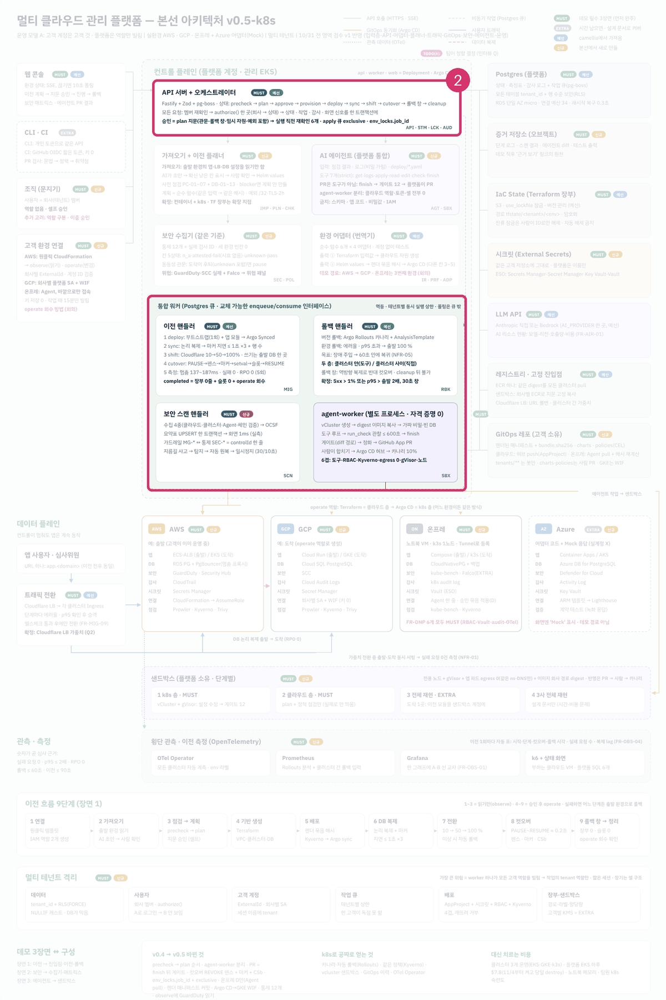
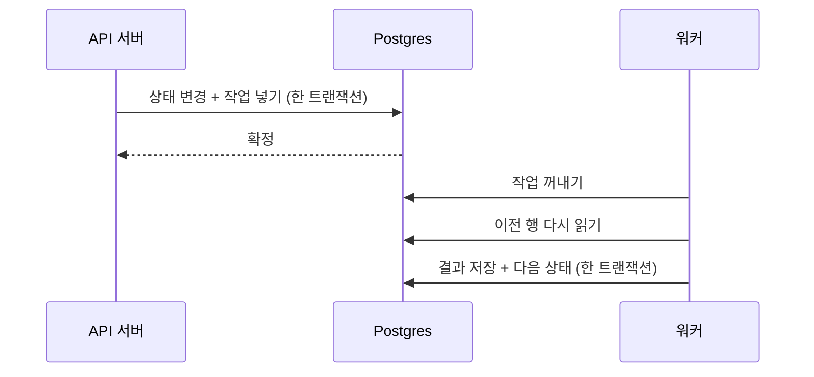

로드맵 위치: 본선 D-7 / 큐 작업 명세 / 본선 연결점: 완성도·데모 30점(워커가 죽어도 이전이 멈추지 않는다), 클라우드 활용 30점

# 큐 작업 명세: 워커는 무엇을 받아 무엇을 하나

상태: AI 초안



**그림의 어디인가.** 가운데 위의 "오케스트레이터" 상자와 그 아래 워커다. 큐는 둘 사이에 놓인 "할 일 목록"이다.

**무슨 일을 하나.** 가져오기, Terraform 실행, 배포처럼 오래 걸리는 일은 API 서버가 직접 하지 않는다. API 서버는 큐에 작업을 넣고 바로 답한다. 워커가 큐에서 작업을 꺼내 처리한다. 큐는 Postgres 안에 있는 pg-boss(Postgres 표를 큐로 쓰는 라이브러리)다. 들어오는 것은 `advance()`가 넣은 작업이고, 나가는 것은 처리 결과(DB 표)와 다음 상태 이동이다.

**정한 것.**
- 큐는 15개다. 이름은 contracts의 `QUEUES` 한 곳에 적는다.
- 작업 내용에는 번호만 넣는다. 데이터는 워커가 DB에서 다시 읽는다.
- 작업은 상태 변경과 같은 트랜잭션 안에서 넣는다.
- 큐마다 재시도 수를 정한다. Terraform 실행(`apply`)은 재시도 0이다.

---

## 1. 작업 하나가 오가는 순서

이 그림은 이전을 만들 때 작업 하나가 어떻게 오가는지 보여 준다.



여기서 볼 점은 워커가 작업 내용을 그대로 믿지 않는다는 것이다. 꺼낸 뒤 DB에서 이전 행을 다시 읽는다.

> **용어**
>
> | 용어 | 쉬운 뜻 |
> |---|---|
> | 큐 | 처리할 일을 줄 세워 두는 목록 |
> | 워커 | 큐에서 일을 꺼내 처리하는 프로그램 |
> | pg-boss | Postgres 표를 큐로 쓰게 해 주는 Node.js 라이브러리 |

### 왜 작업 내용에 번호만 넣나

【사실】(`packages/contracts/src/jobs.ts`의 주석) 큐 표는 회사 벽(RLS, DB가 다른 회사 행을 안 보여 주는 기능) 밖에 있다. 그래서 작업 내용이 조작되거나 낡을 수 있다고 본다. 워커는 두 번 확인한다.

1. 작업 내용의 모양을 Zod로 본다. 모르는 칸이 있으면 거부한다.
2. 회사 번호로 회사 벽을 켠 뒤, 이전 행을 다시 읽는다. 상태가 기대와 다르면 아무것도 안 하고 끝낸다.

【사실】(`apps/worker/src/jobs/import.ts`) 가져오기 처리기가 이 두 단계를 그대로 한다.

### 왜 같은 트랜잭션에 넣나

【사실】(`packages/core/src/boss.ts`의 `asBossDb`) 작업을 넣을 때 상태 변경과 같은 DB 연결을 pg-boss에 넘긴다. 상태 변경이 취소되면 작업도 같이 사라진다. 따로 넣으면, 상태는 바뀌었는데 작업이 없어서 이전이 영원히 멈추는 일이 생긴다.

---

## 2. 큐 15개

이 표는 코드에서 뽑았다.

- "작업 내용 모양"은 contracts의 `JOB_SCHEMAS`에 적힌 이름이다.
- "큐 정책"은 `packages/core/src/boss.ts`의 `POLICY` 표다. 표에 없는 큐는 기본값을 쓴다.
- "넣는 코드"는 `advance()` 호출 중 그 큐를 넣는 곳이다.
- "처리 코드"는 `boss.work()`로 그 큐를 받는 곳이다.

<!-- GEN:queues -->
| 큐 | 작업 내용 모양 | 큐 정책 | 넣는 코드 | 처리 코드 |
|---|---|---|---|---|
| `verify-connection` | `EnvJob` | stately, 재시도 3 | 없음 | 없음 |
| `import` | `MigrationJob` | stately, 재시도 3 | apps/api/src/routes/migrations.ts:23 | 없음 |
| `precheck` | `MigrationJob` | stately, 재시도 2 | apps/api/src/routes/plans.ts:35 | 없음 |
| `plan` | `PlanJob` | stately, 재시도 2 | 없음 | 없음 |
| `apply` | `ApplyJob` | stately, 재시도 0 | apps/api/src/routes/plans.ts:103 | 없음 |
| `deploy` | `MigrationJob` | (기본값) stately, 재시도 1 | 없음 | 없음 |
| `sync` | `MigrationJob` | (기본값) stately, 재시도 1 | 없음 | 없음 |
| `shift` | `MigrationJob` | (기본값) stately, 재시도 1 | 없음 | 없음 |
| `cutover` | `MigrationJob` | (기본값) stately, 재시도 1 | 없음 | 없음 |
| `cleanup` | `MigrationJob` | (기본값) stately, 재시도 1 | 없음 | 없음 |
| `rollback` | `MigrationJob` | (기본값) stately, 재시도 1 | 없음 | 없음 |
| `security-scan` | `EnvJob` | (기본값) stately, 재시도 1 | 없음 | 없음 |
| `agent-run` | `AgentRunJob` | (기본값) stately, 재시도 1 | 없음 | apps/agent-worker/src/main.ts:10 |
| `lease-reaper` | 없음 | singleton, 재시도 0 | 없음 | 없음 |
| `idempotency-cleanup` | 없음 | singleton, 재시도 0 | 없음 | 없음 |
<!-- /GEN:queues -->

### 큐 정책 두 가지

| 정책 | 뜻 | 쓰는 곳 |
|---|---|---|
| `stately` | 같은 중복 방지 키로는 대기 중 1개, 실행 중 1개까지만 둔다 | 이전 단계 작업 대부분 |
| `singleton` | 큐 전체에서 한 번에 하나만 돈다 | 감시·정리 작업 |

【사실】 이전을 만들 때 `import:<이전 번호>`라는 중복 방지 키(`singletonKey`)를 붙인다. 그래서 같은 이전에 가져오기 작업이 두 개 쌓이지 않는다.

### 재시도 수를 다르게 둔 이유

- 가져오기와 연결 확인은 3번 다시 한다. 클라우드 API가 잠깐 실패해도 다시 하면 된다. 두 번 해도 결과가 같다.
- Terraform 실행(`apply`)은 0번이다. 반쯤 만들고 죽은 자원 위에 다시 실행하면 인프라 장부가 꼬일 수 있다. 실패하면 사람이 본다.
- 기본값은 1번이다. 【추정】 아직 처리기가 없는 큐에 임시로 걸린 값이다. 처리기를 만들 때 정한다.

---

## 3. 작업 내용 모양

모든 작업은 공통 앞부분 `JobBase`(회사 번호, 요청 번호)를 가진다. 요청 번호는 API 서버 로그와 워커 로그를 이어 볼 때 쓴다.

이 표들은 코드에서 뽑았다.

<!-- GEN:job_schemas -->
#### `AgentRunJob` (모르는 칸 거부(strict))

| 칸 | 모양 | 꼭 있나 |
|---|---|---|
| `tenantId` | uuid | 예 |
| `requestId` | 문자열 | 예 |
| `agentRunId` | uuid | 예 |

#### `ApplyJob` (모르는 칸 거부(strict))

| 칸 | 모양 | 꼭 있나 |
|---|---|---|
| `tenantId` | uuid | 예 |
| `requestId` | 문자열 | 예 |
| `migrationId` | uuid | 예 |
| `planId` | uuid | 예 |
| `planHash` | 문자열 | 예 |

#### `EnvJob` (모르는 칸 거부(strict))

| 칸 | 모양 | 꼭 있나 |
|---|---|---|
| `tenantId` | uuid | 예 |
| `requestId` | 문자열 | 예 |
| `envId` | uuid | 예 |

#### `JobBase` (모르는 칸 거부(strict))

| 칸 | 모양 | 꼭 있나 |
|---|---|---|
| `tenantId` | uuid | 예 |
| `requestId` | 문자열 | 예 |

#### `MigrationJob` (모르는 칸 거부(strict))

| 칸 | 모양 | 꼭 있나 |
|---|---|---|
| `tenantId` | uuid | 예 |
| `requestId` | 문자열 | 예 |
| `migrationId` | uuid | 예 |

#### `PlanJob` (모르는 칸 거부(strict))

| 칸 | 모양 | 꼭 있나 |
|---|---|---|
| `tenantId` | uuid | 예 |
| `requestId` | 문자열 | 예 |
| `migrationId` | uuid | 예 |
| `planId` | uuid | 예 |
<!-- /GEN:job_schemas -->

예: `import` 큐 작업 한 개

```json
{
  "tenantId": "1111…",
  "requestId": "req-1a",
  "migrationId": "4a8c…"
}
```

---

## 4. 설계상 상태와 큐의 연결 (아직 코드 대부분 없음)

아래는 설계 문서에 적은 "어느 상태로 갈 때 어느 큐 작업을 넣나"다. 【추정】 지금 코드에는 첫 줄만 있다. 처리기를 하나씩 더할 때 이 표를 따른다.

| 상태 이동 | 누가 부르나 | 넣는 큐 | 받는 영역 |
|---|---|---|---|
| `draft`에서 `importing` | 사람 | `import` | 가져오기 |
| `spec_review`에서 `prechecking` | 사람 | `precheck` | 이전 계획 |
| `prechecking`에서 `planning` | 워커 | `plan` | 이전 계획 + 어댑터 번역 |
| `approved`에서 `provisioning` | 사람 | `apply` | 이전 계획 (Terraform) |
| `provisioning`에서 `deploying` | 워커 | `deploy` | GitOps |
| `deploying`에서 `syncing` | 워커 | `sync` | DB 복제 |
| `syncing`에서 `shifting` | 워커 | `shift` | 트래픽 전환 |
| `shifting`에서 `cutover` | 워커 | `cutover` | DB 컷오버 |
| `rollback_window`에서 `cleanup` | 워커 | `cleanup` | 정리 |
| 여러 상태에서 `rolling_back` | 워커 또는 사람 | `rollback` | 트래픽 전환 + DB |

이전과 무관하게 도는 큐도 있다.

| 큐 | 언제 도나 (설계, 【추정】) | 작업 내용 |
|---|---|---|
| `verify-connection` | 사람이 "연결 확인"을 누를 때, 그리고 1시간마다 | `EnvJob` |
| `security-scan` | 주기적으로 환경마다 | `EnvJob` |
| `agent-run` | 사람이 에이전트 실행을 요청할 때 | `AgentRunJob` |
| `lease-reaper` | 주기적으로. 기한이 지난 환경 잠금을 찾아 이전을 `failed`로, 작업을 실패로 정리 | 없음 |
| `idempotency-cleanup` | 주기적으로. 오래된 중복 방지 기록 정리 | 없음 |

---

## 5. 이후 변경 반영 필요

- 처리기가 생기면 2절 표의 "넣는 코드", "처리 코드" 칸이 채워진다. 도구가 바꾼다.
- 【사실】 `deploy` 큐의 작업 모양은 지금 `MigrationJob`이다. 설계에는 "도착 자원 준비됨"(`InfraReady`) 묶음을 넘긴다고 되어 있다. 작업 내용에 넣을지, DB 표에 넣고 번호만 넘길지 정하면 이 절을 고친다. 추천은 DB 표다. 작업 내용에는 번호만 넣는다는 원칙과 맞다.
- `lease-reaper`와 `idempotency-cleanup`은 작업 모양도, 주기 등록 코드도 없다. 주기를 정하면 4절 표에 숫자를 쓴다.
- 기본값(재시도 1)을 쓰는 큐는 처리기를 만들 때 값을 정하고 `POLICY` 표에 올린다.

---

## 핵심 결정 3개 (+대안)

| 결정 | 대안 | 버린 이유 |
|---|---|---|
| 큐는 Postgres 안의 pg-boss | Redis 큐, SQS | DB와 같은 트랜잭션에 작업을 넣을 수 있다. 프로그램이 하나 덜 는다 |
| 작업 내용은 번호만 | 필요한 데이터를 다 담기 | 큐 표는 회사 벽 밖이다. 담은 데이터가 그새 바뀌었을 수 있다 |
| Terraform 실행은 재시도 0 | 다른 큐처럼 재시도 3 | 반쯤 만든 자원 위의 자동 재실행은 장부를 꼬이게 할 수 있다 |

## 셀프 연습 1개

1. `apps/worker/src/jobs/import.ts`에서 `if (!row || row.status !== "importing") return;` 줄을 찾는다.
2. 이 줄을 지웠다고 생각해 본다. 같은 가져오기 작업이 두 번 오면 `spec_versions` 표에 무슨 일이 생기는지 쓴다. 힌트: 이 표에는 `(migration_id, version)` 묶음 중복 금지 규칙이 있다.

## 검증 명령과 기대 출력

DB와 API, 워커를 띄운 뒤 뼈대 루트에서 실행한다.

```bash
npm run smoke
docker compose exec db psql -U platform_owner \
  -d platform -c \
  "select name, state from pgboss.job
   order by created_on desc limit 1;"
```

기대 출력:

```text
POST /migrations 202 …
status=spec_review after … ms
  name  |   state
--------+-----------
 import | completed
```

- 첫 명령: 이전을 하나 만들고 `spec_review`가 될 때까지 기다린다.
- 둘째 명령: 마지막 큐 작업이 `import`이고 끝났는지 본다. 【미확인】 pg-boss 12의 표 이름과 칸 이름은 직접 확인이 필요하다.

## 용어집

| 용어 | 쉬운 뜻 | 이 문서에서 하는 일 |
|---|---|---|
| JobBase | 모든 작업 내용의 공통 앞부분 | 회사 번호와 요청 번호 |
| pg-boss | Postgres 표를 큐로 쓰는 라이브러리 | 모든 큐 |
| singleton | 큐 전체에서 한 번에 하나만 도는 정책 | 감시·정리 작업 |
| singletonKey | 같은 일을 두 번 쌓지 않게 붙이는 키 | `import:<이전 번호>` |
| stately | 같은 키로 대기 1개, 실행 1개까지만 두는 정책 | 이전 단계 작업 |
| 워커 | 큐에서 일을 꺼내 처리하는 프로그램 | 모든 오래 걸리는 일 |
| 재시도 | 실패한 작업을 자동으로 다시 하는 횟수 | 큐마다 다름 |
| 큐 | 할 일을 줄 세운 목록 | 이 문서 전체 |
| 회사 벽(RLS) | DB가 다른 회사 행을 안 보여 주는 기능 | 큐 표는 이 밖에 있다 |
