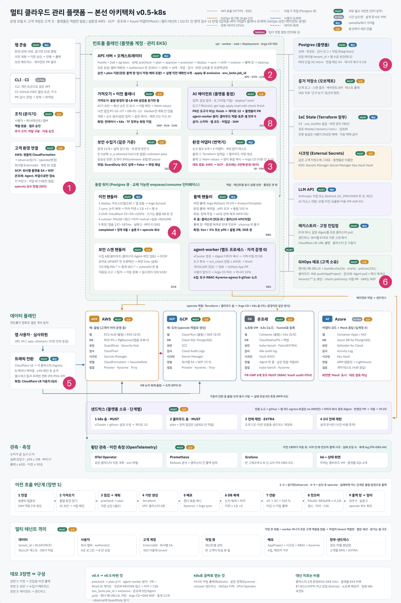
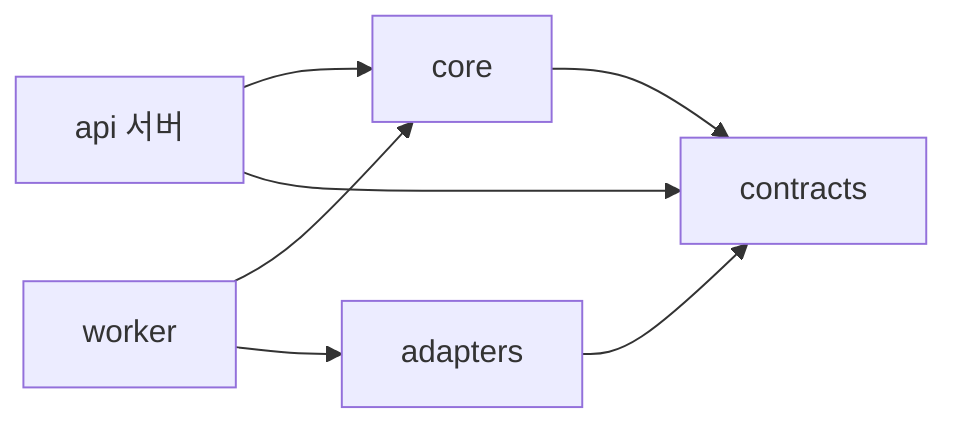
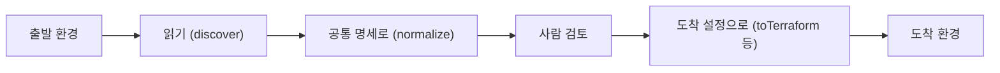

로드맵 위치: 본선 D-7 / 코드 패키지와 영역별 코드 위치 / 본선 연결점: 팀 개발 20점(영역마다 손댈 곳이 겹치지 않는다)

# 모듈 명세: 코드는 어떻게 나뉘고, 영역마다 어디에 쓰나

상태: AI 초안



**그림의 어디인가.** 그림의 1~9번 영역 전부다. 이 문서는 영역 하나가 아니라, 영역이 코드의 어느 폴더에 사는지를 본다.

**무슨 일을 하나.** Service 레포는 프로그램 셋(api, worker, 나중에 agent-worker와 web)과 공용 패키지 셋(contracts, core, adapters)으로 나뉜다. 이 문서는 패키지끼리 누가 누구를 가져다 쓰는지, 그리고 어댑터 함수가 무엇을 받고 무엇을 돌려주는지 적는다.

**정한 것.**
- 데이터 모양은 `packages/contracts` 한 곳에만 적는다. 다른 패키지는 여기서 가져다 쓴다.
- 상태 변경, DB 연결, 큐, 감사는 `packages/core`에 모은다.
- 클라우드마다 다른 코드는 `packages/adapters` 안에만 둔다. 나머지 코드에는 클라우드 이름이 없다.
- 어댑터 함수 중 네트워크를 쓰는 것은 `discover` 하나다. 나머지는 같은 입력이면 같은 출력을 내는 순수 함수다.

---

## 1. 패키지가 서로 가져다 쓰는 방향

【사실】(각 `package.json`의 `dependencies`) 이 그림은 패키지 사이의 방향을 보여 준다. 화살표는 "가져다 쓴다"는 뜻이다.



여기서 볼 점은 화살표가 모두 오른쪽으로 간다는 것이다. contracts는 아무것도 가져다 쓰지 않는다. 그래서 화면이나 CLI도 contracts만 가져다 쓸 수 있다.

> **용어**
>
> | 용어 | 쉬운 뜻 |
> |---|---|
> | 모노레포 | 여러 프로그램과 패키지를 레포 하나에 두는 방식 |
> | npm workspaces | 모노레포 안의 패키지끼리 서로 가져다 쓰게 해 주는 npm 기능 |
> | 순수 함수 | 같은 입력이면 언제나 같은 출력을 내고, 밖에 아무것도 안 하는 함수 |

---

## 2. 폴더마다 무엇이 있나

| 폴더 | 하는 일 | 지금 상태 |
|---|---|---|
| `apps/api` | HTTP 요청을 받아 상태를 옮기고 큐에 넣는다 | 구현. 경로 4개 |
| `apps/worker` | 큐 작업을 처리한다 | 구현. 처리기 1개(가져오기) |
| `apps/agent-worker` | AI 에이전트 실행 루프. `agent-run` 큐를 받는다 | 계획. 설명 파일만 |
| `apps/web` | 화면. Vite + React 예정 | 계획. 설명 파일만 |
| `packages/contracts` | 데이터 모양 (Zod) | 모양만. 대부분 쓰는 코드가 아직 없다 |
| `packages/core` | DB 연결, 회사 벽, `advance()`, 큐, 감사, 오류 | 구현. 조건 검사만 자리만 |
| `packages/adapters` | 클라우드별 번역 | 뼈대. 네 환경 모두 같은 가짜 |
| `db/migrations` | 표를 만드는 SQL | 구현. 표 6개 |
| `infra/modules` | Terraform 모듈. `infra/modules/<클라우드>/<종류>` | 계획. 설명 파일만 |
| `gitops` | 앱 Helm 차트 원본. 렌더 결과는 별도 gitops 레포로 | 계획. 설명 파일만 |
| `deploy` | 플랫폼 자체를 배포하는 파일 | 계획. 설명 파일만 |
| `tools` | 끝에서 끝까지 한 번 돌려 보는 스모크 시험 | 구현 |

---

## 3. 영역마다 어디에 코드를 쓰나

| 영역 | 주로 쓰는 곳 | 지금 있는 코드 |
|---|---|---|
| 1번 입력층 (콘솔, CLI, 환경 연결) | `apps/web`, `apps/api/src/routes`, `apps/api/src/plugins/auth.ts` | 뼈대 인증 (헤더로 회사 번호) |
| 2번 API 서버와 오케스트레이터 | `apps/api`, `packages/core` | `advance()`, 이전 만들기·보기 |
| 3번 가져오기와 어댑터 | `apps/worker/src/jobs/import.ts`, `packages/adapters` | 가져오기 처리기, 가짜 어댑터 |
| 4번 이전 계획과 DB 컷오버 | `apps/worker/src/jobs/`, `infra/modules` | 없음 |
| 5번 트래픽 전환과 자동 롤백 | `apps/worker/src/jobs/` | 없음 |
| 6번 GitOps와 여러 클러스터 | `gitops`, `apps/worker/src/jobs/` | 없음 |
| 7번 보안과 거버넌스 | `apps/worker/src/jobs/`, `apps/api/src/routes` | 없음 |
| 8번 AI 에이전트와 샌드박스 | `apps/agent-worker` | 없음 |
| 9번 플랫폼 운영과 관측 | `deploy`, `apps/api` 상태 경로 | `/healthz`, `/readyz` |

【사실】(`apps/worker/src/main.ts`의 주석) 새 큐 처리기는 `apps/worker/src/jobs/`에 파일 하나를 더하고, `main.ts`에 `boss.work(...)` 한 줄을 더한다.

---

## 4. 어댑터: 클라우드마다 다른 부분을 한곳에

어댑터는 "공통 명세"와 "클라우드마다 다른 설정" 사이를 번역한다. 공통 명세는 앱을 클라우드 이름 없이 적은 우리 양식이다.

이 그림은 어댑터가 이전 한 건에서 언제 불리는지 보여 준다.



여기서 볼 점은 클라우드에 접속하는 것이 맨 앞의 "읽기" 하나라는 것이다.

### 어댑터 함수 8개

【사실】(`packages/contracts/src/adapter.ts`의 `EnvironmentAdapter`)

| 함수 | 받는 것 | 돌려주는 것 | 네트워크 | 언제 쓰나 |
|---|---|---|---|---|
| `capabilities()` | 없음 | 이 환경이 할 수 있는 것 목록. 예: `db.postgres.16` | 안 씀 | 사전 점검 |
| `discover(s, scope)` | 관찰 세션, 가져올 범위 | 클라우드 자원 목록 그대로 (`RawInventory`) | 씀 | 가져오기 |
| `normalize(raw)` | 자원 목록 | 공통 명세 일부 + 칸별 출처 | 안 씀 | 가져오기 |
| `requiredOperateActions(spec)` | 공통 명세 | 실행 역할에 필요한 권한 이름 목록 | 안 씀 | 사전 점검 |
| `toTerraform(spec, t)` | 공통 명세, 도착 환경 | Terraform 모듈 위치와 변수 | 안 씀 | 계획 |
| `toHelmValues(spec, out, t)` | 공통 명세, Terraform 결과값, 도착 환경 | Helm 값 | 안 씀 | 계획 |
| `imageRef(src, t)` | 출발 이미지 주소, 도착 환경 | 도착 저장소 이미지 주소. 지문은 그대로 | 안 씀 | 배포, 에이전트 |
| `version` (값) | - | 어댑터 판 번호 | - | 계획 지문에 들어간다 |

순수 함수로 두는 이유는 계획 지문 때문이다. 사람이 승인한 계획서의 지문(planHash)은 어댑터 출력으로 만든다. 같은 입력에 다른 출력이 나오면, 승인한 계획과 실행하는 계획이 달라진다.

### 지금 어댑터 상태

【사실】(`packages/adapters/src/stub.ts`) AWS, GCP, 온프레, Azure Mock 네 개 모두 같은 가짜 어댑터다. 가짜는 이렇게 동작한다.

- `discover`는 빈 목록을 돌려준다.
- `normalize`는 고정된 `demo-app` 명세를 돌려준다. 이미지 `registry/demo@sha256:000…`, 포트 8080, 복제 2개다.
- `toTerraform`은 `infra/modules/<환경>/app` 위치를 돌려준다. 변수는 비어 있다.
- `toHelmValues`는 이미지와 포트만 돌려준다.
- `imageRef`는 받은 주소를 그대로 돌려준다.

【사실】(`packages/adapters/test/adapters.test.ts`) 시험 두 개가 지금 어댑터를 지킨다. 하나는 "네 어댑터의 `normalize` 결과가 모두 공통 명세 검사를 통과한다"이다. 다른 하나는 "같은 입력이면 같은 Helm 값이 나온다"이다. 진짜 어댑터를 넣을 때도 이 두 시험은 통과해야 한다.

---

## 5. 이후 변경 반영 필요

- 진짜 어댑터가 들어오면 4절 "지금 어댑터 상태"를 환경마다 다시 쓴다. 환경별 자원 종류(예: AWS ECS, GCP Cloud Run)는 팀이 정할 일이다. 코드에는 `STUB:`이나 `TODO(human):`으로 남긴다.
- `apps/agent-worker`, `apps/web`에 코드가 생기면 2절 표와 1절 그림에 더한다. 그림 상자가 7개를 넘으면 그림을 나눈다.
- 영역이 `jobs/` 아래에 파일을 더하면 3절 표의 "지금 있는 코드"를 고친다.

---

## 핵심 결정 3개 (+대안)

| 결정 | 대안 | 버린 이유 |
|---|---|---|
| 모양은 contracts 한 곳 | 패키지마다 자기 타입 | 같은 모양이 여러 곳에 생기고 서로 어긋난다 |
| 클라우드 코드는 adapters 안에만 | 처리기 안에서 `if (aws)` | 환경이 넷이라 분기가 모든 처리기로 퍼진다 |
| 어댑터는 `discover` 빼고 순수 함수 | 번역 중에도 클라우드를 조회 | 승인한 계획의 지문이 실행 때 안 맞을 수 있다 |

## 셀프 연습 1개

1. `packages/adapters/src/gcp/index.ts`에서 GCP 어댑터만 `toHelmValues`가 `Date.now()`를 값에 넣도록 바꿔 본다.
2. `npm test`를 돌린다. "어댑터는 순수하다" 시험이 깨지는지 본다.
3. 원래대로 돌린다. 이 시험이 없으면 승인 뒤 실행 단계에서 무슨 일이 생기는지 한 줄로 쓴다.

## 검증 명령과 기대 출력

뼈대 루트에서 실행한다.

```bash
npm run typecheck && npm test 2>&1 \
  | grep -E '어댑터|^# (pass|fail)'
```

기대 출력:

```text
✔ 모든 어댑터의 normalize 결과는 AppSpec을 통과한다
✔ 어댑터는 순수하다: 같은 입력이면 같은 출력
# pass 7
# fail 0
```

## 용어집

| 용어 | 쉬운 뜻 | 이 문서에서 하는 일 |
|---|---|---|
| contracts | 데이터 모양을 적은 패키지 | 모든 패키지가 가져다 쓴다 |
| core | 상태 변경, DB, 큐, 감사를 모은 패키지 | api와 worker가 쓴다 |
| adapters | 클라우드별 번역 패키지 | 워커가 쓴다 |
| Helm | k8s 배포 파일을 값으로 찍어 내는 도구 | `toHelmValues` |
| Terraform | 클라우드 자원을 코드로 만드는 도구 | `toTerraform` |
| 계획 지문(planHash) | 계획서 전체의 해시 | 승인과 실행이 같은지 확인 |
| 공통 명세 | 앱을 클라우드 이름 없이 적은 양식 | 어댑터의 입력과 출력 |
| 모노레포 | 레포 하나에 여러 프로그램 | Service 레포 |
| 순수 함수 | 같은 입력이면 같은 출력, 밖에 아무것도 안 함 | 어댑터 함수 7개 |
