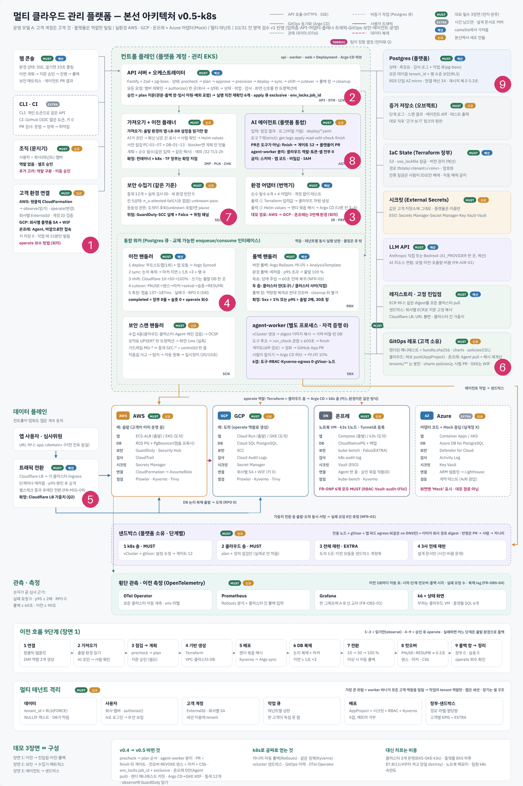
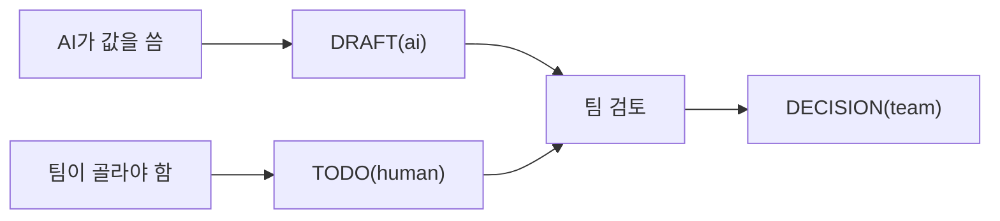

로드맵 위치: 본선 D-7 / 아직 안 정한 것과 코드의 결정 표시 / 본선 연결점: 팀 개발 20점(AI가 정한 것과 팀이 정한 것을 나눠 보인다)

# 미정 사항: 무엇이 아직 안 정해졌나

상태: AI 초안



**그림의 어디인가.** 그림의 1~9번 영역 전부다. 어느 영역이든 "아직 정하지 않은 것"이 생기면 이 문서에 모인다.

**무슨 일을 하나.** 이 문서는 세 가지를 모은다. 첫째, 코드 안에 남긴 결정 표시(누가 정했나)다. 둘째, 코드와 설계가 어긋난 곳이다. 셋째, 팀이 골라야 하는 설계 결정이다. 앞의 것은 도구가 코드에서 뽑고, 뒤의 둘은 사람이 쓴다.

**정한 것.**
- AI가 임시로 정한 값과 팀이 정한 값을 코드 주석으로 나눈다.
- 이 문서의 표시 표는 `grep`으로 다시 만들 수 있다.
- 팀 결정 항목마다 추천안을 하나씩 단다. 추천은 결정이 아니다.

---

## 1. 코드 안의 결정 표시 네 가지

AI가 쓴 값이 팀 결정처럼 굳어지는 것을 막으려고, 사람이 정하지 않은 값 바로 위에 주석을 단다.

| 표시 | 뜻 | 지워도 되나 |
|---|---|---|
| `// DRAFT(ai): <무엇을 왜>` | AI가 임시로 정한 것. 팀이 검토해야 한다 | 팀이 검토하면 `DECISION(team)`으로 바꾼다 |
| `// DECISION(team): <요약> (근거)` | 사람이 확정한 것 | AI는 지우거나 바꾸지 않는다 |
| `// STUB: <나중에 할 일>` | 가짜 구현. 그럴듯한 고정값을 돌려준다 | 진짜 구현이 들어오면 지운다 |
| `// TODO(human): <고를 것>` | AI가 정하면 안 되는 설계 결정 | 팀이 정하면 `DECISION(team)`으로 바꾼다 |

이 그림은 표시 하나가 바뀌어 가는 길을 보여 준다.



여기서 볼 점은 끝이 언제나 `DECISION(team)`이라는 것이다. AI가 직접 `DECISION(team)`을 달지 않는다.

> **용어**
>
> | 용어 | 쉬운 뜻 |
> |---|---|
> | 뼈대(스켈레톤) | 전체 흐름은 돌지만 속은 비어 있는 첫 코드 |
> | 가짜 구현(STUB) | 진짜 일은 안 하고 고정값만 돌려주는 코드 |

### 지금 코드의 표시 수

<!-- GEN:marker_counts -->
`DRAFT(ai)` 22건 · `DECISION(team)` 3건 · `STUB` 37건 · `TODO(human)` 20건
<!-- /GEN:marker_counts -->

### 표시 전체 목록

<!-- GEN:markers -->
| 표시 | 코드 위치 | 내용 |
|---|---|---|
| STUB | apps/agent-worker/src/handle-agent-run.ts:29 | STUB: 게이트 통과 시 GitHub App 1시간 토큰으로 PR 만들기 (플랫폼 쪽 코드, 아직 없음) |
| TODO(human) | apps/agent-worker/src/handle-agent-run.ts:30 | TODO(human): agent_runs / agent_steps 표와 DB 역할(app_agent) 정의는 db/migrations 담당과 합의 |
| STUB | apps/agent-worker/src/handle-agent-run.ts:34 | STUB: 메모리 저장소. agent_runs 표가 생기면 withTenant 로 바꾼다 |
| STUB | apps/agent-worker/src/handle-agent-run.ts:48 | STUB: 기본 의존성. 진짜 LLM 없이 데모 대본으로 돈다 |
| STUB | apps/agent-worker/src/main.ts:6 | STUB: 저장소는 메모리, LLM은 대본. agent_runs 표와 Anthropic 제공자가 생기면 갈아 끼운다 |
| STUB | apps/api/src/routes/plan-store.ts:5 | STUB: plans·plan_approvals 표(0004_plans.sql 예정)가 아직 없어서 감사 기록(audit_events.detail)에서 읽고 쓴다. |
| DRAFT(ai) | apps/api/src/routes/plan-store.ts:7 | DRAFT(ai): worker 쪽 jobs/plan-store.ts와 같은 내용이다. 표로 옮길 때 packages/core로 하나로 합친다 |
| DRAFT(ai) | apps/api/src/routes/plans.ts:10 | DRAFT(ai): 화면이 계획 번호를 알 길이 필요해서 추가) |
| TODO(human) | apps/api/src/routes/plans.ts:15 | TODO(human): Idempotency-Key 필수 처리는 공용 플러그인이 붙으면 이 경로들에도 걸린다 |
| DRAFT(ai) | apps/api/src/routes/plans.ts:45 | DRAFT(ai): 설계 3.4 경로 표에 없는 경로. 화면이 승인 버튼을 그리려면 이전 번호로 최신 계획을 찾아야 해서 추가 |
| TODO(human) | apps/api/src/routes/plans.ts:76 | TODO(human): 만료된 계획을 승인하려 하면 awaiting_approval → stale로 옮길지. 지금은 409만 |
| DECISION(team) | apps/api/src/routes/plans.ts:81 | DECISION(team): 역할 없음, 회사 멤버 누구나 승인, 본인 승인 허용 → self_approved로 기록 (입력층 v1, 10/31) |
| TODO(human) | apps/api/src/routes/plans.ts:86 | TODO(human): 승인 때 출발·도착 환경 잠금 예약(env_locks holder='reserved', 설계 5.4) — 잠금 장치 작업 범위 |
| DRAFT(ai) | apps/worker/src/jobs/_step.ts:33 | DRAFT(ai): STUB 작업이 "일하는 척" 기다리는 시간. 데모·smoke가 너무 빨리 끝나 화면에서 안 보이는 걸 막는 용도 |
| TODO(human) | apps/worker/src/jobs/_step.ts:64 | TODO(human): apply 이후 작업은 env_locks 인수·반납(fence)을 같이 해야 한다 (설계 5.4). 잠금 장치 작업이 끝나면 fence 옵션을 붙인다 |
| TODO(human) | apps/worker/src/jobs/apply.ts:20 | TODO(human): ④ tfplan 파일 sha256 대조 ⑤ env_lock 인수 ⑥ GetCallerIdentity == 고객 계정 — 잠금 장치·실제 Terraform이 들어오면 추가 |
| STUB | apps/worker/src/jobs/apply.ts:24 | STUB: 진짜로는 terraform apply를 돌리고 30초마다 heartbeat. 출력값은 비밀을 빼고 받는다 |
| STUB | apps/worker/src/jobs/apply.ts:32 | STUB: Helm 값 저장 위치. 진짜로는 객체 저장소 경로 |
| TODO(human) | apps/worker/src/jobs/cleanup.ts:25 | TODO(human): 창이 아직 안 끝났는데 깨어난 경우 다시 예약할지. 지금은 startAfter를 믿고 그냥 끝낸다 |
| STUB | apps/worker/src/jobs/cleanup.ts:35 | STUB: 진짜로는 출발 환경 앱 축소·복제 슬롯 삭제·임시 권한 반납. 보안 장부(7번)에 정리 기록 |
| TODO(human) | apps/worker/src/jobs/cleanup.ts:36 | TODO(human): 출발 쪽 DB·자원을 지울지, 남겨 둘지 (고객 동의 범위) |
| STUB | apps/worker/src/jobs/cleanup.ts:38 | STUB: replication slot", "STUB: source app scaled to 0"] } }; |
| DRAFT(ai) | apps/worker/src/jobs/cutover.ts:4 | DRAFT(ai): 롤백 가능 창 길이. 운영값은 사람이 정한다. 스켈레톤은 smoke가 빨리 끝나게 짧게 둔다 |
| STUB | apps/worker/src/jobs/cutover.ts:15 | STUB: 진짜로는 출발 DB 쓰기 권한 회수(REVOKE) → 마지막 LSN 따라잡기 확인 → 시퀀스 맞추기 → 도착으로 연결 전환 |
| DRAFT(ai) | apps/worker/src/jobs/cutover.ts:25 | DRAFT(ai): 계약 표는 "rollback_window → cleanup 때 cleanup 작업"인데, 그 전이를 일으킬 주체가 없어서 |
| TODO(human) | apps/worker/src/jobs/cutover.ts:27 | TODO(human): 정리 전에 사람 승인을 받을지 (계약 표의 "정리 승인 뒤") |
| STUB | apps/worker/src/jobs/deploy.ts:14 | STUB: 진짜로는 Helm 값을 gitops 레포에 커밋하고 Argo CD가 synced+healthy가 될 때까지 본다 |
| TODO(human) | apps/worker/src/jobs/deploy.ts:21 | TODO(human): status가 failed면 어디로 보낼지 (rolling_back? paused?) — 지금은 정상 길만 있다 |
| STUB | apps/worker/src/jobs/plan-store.ts:5 | STUB: plans·plan_approvals 표(0004_plans.sql 예정)가 아직 없어서 감사 기록(audit_events.detail)에 넣고 거기서 읽는다. |
| DRAFT(ai) | apps/worker/src/jobs/plan-store.ts:7 | DRAFT(ai): api 쪽 routes/plan-store.ts와 같은 내용이다. 표로 옮길 때 packages/core로 하나로 합친다 |
| DRAFT(ai) | apps/worker/src/jobs/plan.ts:16 | DRAFT(ai): 승인 유효 시간 2시간 (설계 5.4 "승인 유효 2시간"을 따름) |
| STUB | apps/worker/src/jobs/plan.ts:24 | STUB: 진짜 Terraform 출력값은 apply 뒤에 생긴다. 계획 단계에서는 빈 값으로 Helm 값 모양만 고정한다 |
| DRAFT(ai) | apps/worker/src/jobs/plan.ts:26 | DRAFT(ai): 단계별 예상 시간·게이트는 설계 문서 수치가 정해지기 전 임시값 |
| DECISION(team) | apps/worker/src/jobs/plan.ts:41 | DECISION(team): 롤백 기준 5xx>1% 또는 p95>2배, 30초 창 (decisions 2026-10-30) |
| TODO(human) | apps/worker/src/jobs/plan.ts:72 | TODO(human): 환경별 리전은 environments 표에 칸이 없다. 연결 정보에서 가져올지 정해야 한다 |
| STUB | apps/worker/src/jobs/precheck.ts:6 | STUB: 진짜로는 PC-01~ 점검(연결 상태, 권한, DB 버전, 복제 가능 여부 등)을 어댑터·관찰 역할로 확인한다 |
| STUB | apps/worker/src/jobs/precheck.ts:9 | STUB: 출발·도착 환경 연결 확인됨" }, |
| STUB | apps/worker/src/jobs/precheck.ts:10 | STUB: 실행 역할 권한 확인됨" }, |
| DRAFT(ai) | apps/worker/src/jobs/precheck.ts:30 | DRAFT(ai): 설계 5.3은 plan:<envId>. 지금은 이전 번호로 묶는다 (환경 잠금이 들어오면 envId로) |
| STUB | apps/worker/src/jobs/rollback.ts:12 | STUB: 진짜로는 Cloudflare LB 가중치 출발 100% → 컷오버 뒤라면 역방향 복제 확인 |
| STUB | apps/worker/src/jobs/shift.ts:18 | STUB: 진짜로는 Cloudflare LB 가중치를 바꾸고 holdSec 동안 5xx·p95를 모아 판정한다 |
| TODO(human) | apps/worker/src/jobs/shift.ts:26 | TODO(human): verdict가 bad면 rolling_back + rollback 작업. 판정 함수는 트래픽 패키지 작업 범위 |
| STUB | apps/worker/src/jobs/sync.ts:12 | STUB: 진짜로는 출발 RDS에 publication, 도착 Postgres에 subscription을 만들고 지연(lag)을 잰다 |
| DRAFT(ai) | apps/worker/src/main.ts:6 | DRAFT(ai): 큐 확인 간격 0.5초 (pg-boss 기본 2초면 단계 9개가 smoke에서 너무 느리다) |
| STUB | packages/adapters/src/aws/index.ts:1 | STUB: 진짜 구현 시 관찰 역할로 Resource Explorer·RDS·EKS 목록을 읽는다(discover), RDS Postgres → AppSpec.database |
| TODO(human) | packages/adapters/src/aws/index.ts:2 | TODO(human): 출발지(AWS)용 자원 매핑 범위(RDS만? ElastiCache·S3 포함?) |
| STUB | packages/adapters/src/azure-mock/index.ts:1 | STUB: Azure는 어댑터 모양과 가짜만 둔다(아키텍처 전제). 데모 경로에 넣지 않는다 |
| STUB | packages/adapters/src/gcp/index.ts:1 | STUB: 진짜 구현 시 Cloud SQL Postgres + GKE 기준 Terraform 변수·Helm values를 만든다 |
| TODO(human) | packages/adapters/src/gcp/index.ts:2 | TODO(human): 데모 경로 방향(AWS→GCP 기본값, 반대 방향 지원 여부) |
| STUB | packages/adapters/src/onprem/index.ts:1 | STUB: 진짜 구현 시 k3s + CloudNativePG 기준 Helm values를 만든다. IAM·KMS 대응 모듈은 아직 없음 |
| TODO(human) | packages/adapters/src/onprem/index.ts:2 | TODO(human): 온프레에서 임시 역할·비밀 관리를 무엇으로 대신할지 |
| STUB | packages/agent/src/ai/gate.ts:2 | STUB: 설계 v1의 GATE-01~12는 YAML을 파싱해 JSON 경로 단위로 비교한다. 지금은 줄 단위 간이 검사 4개만 둔다 |
| STUB | packages/agent/src/ai/llm.ts:17 | STUB: 정해진 도구 호출을 순서대로 내는 가짜 LLM. 시험과 데모 리허설용. |
| TODO(human) | packages/agent/src/ai/llm.ts:18 | TODO(human): 진짜 제공자는 @anthropic-ai/sdk 로 만든다. 기본 모델(설계 v1은 opus vs sonnet 비교 미정)과 |
| DRAFT(ai) | packages/agent/src/ai/loop.ts:6 | DRAFT(ai): 설계 v1 예산. 단계 30 / 도구 호출 40 / 900초 / 토큰 40만 |
| STUB | packages/agent/src/ai/sandbox.ts:10 | STUB: 진짜는 회사·실행마다 만든 vCluster(gVisor, egress 0, Kyverno restricted)다. |
| DRAFT(ai) | packages/agent/src/ai/tools.ts:5 | DRAFT(ai): 에이전트·샌드박스 설계 v1의 도구 정의를 Zod로 옮겼다 |
| DRAFT(ai) | packages/agent/src/onprem/report.ts:7 | DRAFT(ai): 계약 문서 미정 1번 추천안 그대로. 보안 결과는 Finding 배열, 회사·환경은 본문이 아니라 Agent 키로 정한다. |
| DRAFT(ai) | packages/agent/src/onprem/report.ts:41 | DRAFT(ai): 서명 = HMAC-SHA256(secret, "<timestamp>.<본문>"), 시계 차이 허용 5분. 재전송 막기용 |
| STUB | packages/agent/src/onprem/report.ts:74 | STUB: 진짜는 agent_keys 표(해시로 저장)에서 읽는다. 지금은 메모리 |
| STUB | packages/agent/src/onprem/stub-agent.ts:4 | STUB: 온프레 k3s 안에서 도는 Agent 흉내. 진짜 Agent는 Falco·Kyverno·kubectl·CNPG 상태를 읽는다. |
| STUB | packages/agent/src/onprem/stub-agent.ts:22 | STUB: privileged 0" }, |
| STUB | packages/agent/src/onprem/stub-agent.ts:25 | STUB: Terminal shell in container" : "STUB: 경보 없음" }, |
| DRAFT(ai) | packages/security/src/controls.ts:4 | DRAFT(ai): 목록·소스는 보안·거버넌스 설계 v1(controls.yaml, Prowler 5.47.0 기준)에서 옮겼다. 팀 검토 전 |
| TODO(human) | packages/security/src/guardrail.ts:29 | TODO(human): 위협 가드레일의 규칙 번호와 동작(pause vs warn)은 보안 담당 MG 목록과 합쳐서 정한다. 지금은 임시 번호 |
| STUB | packages/security/src/scanner.ts:10 | STUB: 진짜 수집기는 Prowler(AWS/GCP), Kyverno 보고서, Trivy, GuardDuty/SCC, 온프레 Agent 보고를 읽는다. |
| STUB | packages/security/src/scanner.ts:11 | STUB:"을 붙여 화면에서도 구분된다. |
| STUB | packages/security/src/scanner.ts:31 | STUB: ${provider} ${c.title} ${fail ? "위반 (가짜)" : "통과 (가짜)"}`, |
| DRAFT(ai) | packages/security/src/summarize.ts:8 | DRAFT(ai): 설계 v1 값. 통과 결과는 30분 지나면 믿지 않는다, 사람 확인은 24시간 유효 |
| DRAFT(ai) | packages/security/src/temp-role.ts:5 | DRAFT(ai): 아래 두 스키마는 워커 ↔ 보안 패키지 경계를 넘으므로 packages/contracts 로 옮길 후보다 (통합 스레드에 요청) |
| DRAFT(ai) | packages/security/src/temp-role.ts:13 | DRAFT(ai): 최대 1시간. AWS AssumeRole 기본값(1h)과 같게 잡았다. 긴 작업은 다시 빌린다 |
| STUB | packages/security/src/temp-role.ts:63 | STUB: 진짜는 AWS STS AssumeRole(ExternalId), GCP 서비스 계정 가장(Workload Identity Federation), |
| TODO(human) | packages/security/src/temp-role.ts:65 | TODO(human): 환경별 역할 이름(svc-observe / svc-operate) 규칙은 입력층 연결 템플릿과 맞춰 정한다 |
| STUB | packages/security/test/security.test.ts:18 | STUB:")); } |
| DRAFT(ai) | packages/traffic/src/controller.ts:6 | DRAFT(ai): 10 → 50 → 100%. 단계는 시간이 아니라 "정상 판정 3번"이 쌓여야 넘어간다 (설계 v1) |
| TODO(human) | packages/traffic/src/controller.ts:9 | TODO(human): 단계별 최소 유지 시간, 100% 뒤 관찰 30초를 판정 몇 번으로 볼지, 자동 롤백 뒤 재시도 대기 시간 |
| DRAFT(ai) | packages/traffic/src/metrics.ts:8 | DRAFT(ai): 계약 문서 미정 2번 추천안. 두 클러스터에서 같은 이름을 쓰고 관측 표시 셋(env, tenant, migration)을 붙인다 |
| STUB | packages/traffic/src/metrics.ts:14 | STUB: 가짜 지표. 시나리오별로 결정적인 숫자를 만든다 (랜덤 없음, 시험이 흔들리지 않게) |
| DECISION(team) | packages/traffic/src/rule.ts:2 | DECISION(team): 5xx > 1% 또는 p95 > 출발 × 2, 30초 창 (10/30 아키텍처 결정) |
| DRAFT(ai) | packages/traffic/src/rule.ts:3 | DRAFT(ai): 아래 보호 장치(표본 하한, 5xx 개수 하한, 출발 대비 3배, 연속 2번, 지름길)는 트래픽 전환 설계 v1 PoC에서 찾은 값이다 |
| STUB | packages/traffic/src/switcher.ts:18 | STUB: Cloudflare API를 부르지 않는 메모리 LB. 호출 기록을 남겨 시험에서 본다. |
| TODO(human) | packages/traffic/src/switcher.ts:19 | TODO(human): 진짜 구현은 PATCH /accounts/{id}/load_balancers/{lb} (API 토큰은 비밀 저장소). 토큰 범위·계정은 팀이 정한다 |
<!-- /GEN:markers -->

### 표시 없이 주석으로만 "뼈대"라고 적힌 곳

【사실】 지금 뼈대는 표시 규칙이 생기기 전에 썼다. 그래서 아래처럼 보통 주석으로만 "뼈대", "가짜", "자리만"이라고 적혀 있다. 이 줄들은 `STUB:` 표시로 바꾸는 것을 추천한다. 그래야 다음에 grep 한 번으로 찾힌다.

<!-- GEN:implicit -->
| 코드 위치 | 주석 |
|---|---|
| apps/api/src/plugins/auth.ts:8 | // 뼈대용 인증: 헤더로 회사 번호를 받는다. |
| apps/api/test/plans.it.ts:107 | // 승인 안 된 계획으로 apply 작업이 와도(가짜 작업) 상태를 안 바꾼다 |
| apps/worker/src/jobs/plan-store.ts:6 | // 감사 표는 넣기·읽기만 되고 회사 벽(RLS)이 걸려 있어 임시 저장소로 쓸 만하다. 표가 생기면 이 함수 몸통만 갈아 끼운다. |
| packages/adapters/src/stub.ts:3 | // 뼈대용 가짜 어댑터. 진짜 구현이 들어오면 함수 하나씩 갈아 끼운다 |
| packages/agent/src/ai/sandbox.ts:11 | // 지금은 메모리 안의 가짜 클러스터. "메모리 상한이 너무 낮아 재시작" 상황 하나를 흉내 낸다 |
| packages/core/src/advance.ts:14 | // 조건이 붙는 전이는 여기서 본다 (뼈대에서는 자리만) |
| packages/security/src/temp-role.ts:4 | // 임시 역할 발급. 고객 권한은 비밀 키가 아니라 짧게 빌리는 역할로만 쓴다 (관찰 역할, 실행 역할 분리). |
| packages/security/src/temp-role.ts:64 | // 온프레는 Agent 키로 범위 제한 토큰. 지금은 어떤 클라우드도 부르지 않고 가짜 참조만 돌려준다. |
<!-- /GEN:implicit -->

---

## 2. 코드와 설계가 어긋난 곳

코드를 읽다가 찾은 것이다. 각 줄의 자세한 설명은 같은 폴더의 API, 상태기계, 데이터 모델 문서에도 있다. 여기서는 한 줄씩 모았다.

| 무엇이 | 지금 코드 | 왜 문제인가 | 추천 |
|---|---|---|---|
| `/readyz` 인증 | 【사실】 헤더 없이 부르면 401이다. 인증 훅이 `/healthz`만 건너뛴다 | k8s가 "준비 안 됨"으로 보고 요청을 안 보낸다 | `/readyz`도 건너뛴다 |
| 다른 회사 환경 번호 | 【추정】 외래 키 검사는 회사 벽을 건너뛴다. 남의 환경 번호로 이전이 만들어질 수 있다 | 이전이 `importing`에 영원히 멈춘다. 남의 번호 존재 여부도 샌다 | 【미확인】 시험으로 확인. `POST /migrations`에서 회사 벽 안에서 두 환경을 먼저 읽는다 |
| 출발·도착 검사 | 【사실】 같은 환경이어도, 연결 전이어도 만든다 | 설계는 "둘 다 연결됨, 서로 다름" | 검사를 더한다 |
| 같은 요청 두 번 | 【사실】 `Idempotency-Key`를 안 본다 | 버튼을 두 번 누르면 이전이 둘 | 헤더를 받고 기록 표를 둔다 |
| `GET /migrations/:id` 응답 | 【사실】 다섯 칸. 응답 스키마 없음 | 화면용 모양 `MigrationView`는 열 칸 | 응답 스키마를 붙인다 |
| 오류 모양 | 【사실】 `{status, code, message, requestId}` | 명세 v4 표는 `{"error": {code, message}}` | 코드 쪽으로 명세를 고친다 |
| 경로 앞부분 | 【사실】 없음 | 명세 v4는 `/api/v1` | 팀이 정한다 |
| 조건 검사 | 【사실】 `guardOk()`가 언제나 참 | 사람 확인 필요 칸이 남아도 점검으로 넘어간다 | 길마다 조건을 넣는다 |
| `paused`에서 돌아가기 | 【사실】 네 상태 어디로든 돌아갈 수 있다 | 멈추기 전 상태가 아닌 곳으로 갈 수 있다 | `paused_from`과 같을 때만 허용 |
| 실패·멈춤 정보 칸 | 【사실】 `paused_from`, `failed_at_status`, `failure_code`, `rollback_window_ends_at`을 쓰는 코드가 없다 | 화면이 왜 멈췄는지 못 보여 준다 | `advance()` 옵션으로 넣는다 |
| 상태 칸 검사 | 【사실】 `migrations.status`, `environments.connection_status`가 아무 글자나 받는다 | 오타 난 상태가 DB에 들어갈 수 있다 | SQL `CHECK` 규칙 |
| `deploy` 작업 모양 | 【사실】 `MigrationJob` | 설계는 "도착 자원 준비됨"(`InfraReady`)을 넘긴다 | DB 표에 저장하고 작업에는 번호만 |
| 화면 신호 | 【사실】 `GET /events`가 상태 변경 신호를 보낸다. `weight_changed`·`rollback_*`·`matrix_changed`·`agent.step`은 보내는 쪽이 없다 | 트래픽 비율·보안 표 변화는 화면이 폴링으로만 안다 | 보내는 쪽에 `pg_notify`를 더한다 |
| 화면 신호 연결 끊기 | 【사실】 연결은 연 토큰이 만료되면 끊긴다(JWT `exp`와 15분 상한 중 이른 쪽, 개인 토큰·개발용 헤더는 15분). `session_events`(로그아웃·사용자 끄기)가 오면 그 회사·사용자의 연결이 닫힌다 | 개인 토큰 지우기와 갱신 토큰 재사용 감지는 `session_events`를 안 보낸다. 듣기 연결이 끊긴 사이 온 알림도 잃는다. 그런 연결은 상한(최대 15분)까지 신호를 받는다 | 15분을 받아들일지 정한다. 줄이려면 그 두 곳에서도 `session_events`를 보낸다 |
| `CreateMigration` 위치 | 【사실】 경로 파일 안 | 화면과 CLI도 같은 모양이 필요하다 | contracts로 옮긴다 |

---

## 3. 팀이 골라야 하는 것 (TODO(human))

추천은 AI 초안이다. 팀이 고르기 전까지는 결정이 아니다.

| # | 정할 것 | 고를 수 있는 것 | 추천과 이유 |
|---|---|---|---|
| 1 | 경로 앞부분 | `/api/v1`을 붙인다 / 안 붙인다 | 붙인다. 나중에 판을 바꿀 때 옛 화면이 안 깨진다. 코드 한 줄이다 |
| 2 | 오류 응답 모양 | 지금 코드 / 명세 v4 모양 | 지금 코드. contracts `ApiError`와 시험이 이미 있다 |
| 3 | Argo CD 동기화 실패를 새 상태로 둘지 | 새 상태 / `failed` + `failure_code` | `failed` + `ARGO_SYNC_FAILED`. 상태 22개를 늘리지 않는다 |
| 4 | "도착 자원 준비됨"을 어디로 넘길지 | 작업 내용 / DB 표 + 번호 | DB 표. 작업 내용은 번호만이라는 원칙과 같다 |
| 5 | 온프레 Agent 보고 모양 | 새 모양 / 보안 결과 `Finding` 배열 | `Finding` 배열. 회사와 환경은 본문이 아니라 Agent 키로 정한다 |
| 6 | 에이전트 실행 요청 경로 | `POST /agent-runs` / 다른 이름 | `POST /agent-runs`. 202와 실행 번호 |
| 7 | Ingress 지표 이름 | 클러스터마다 / 하나로 통일 | 하나로 통일. 환경, 회사, 이전 번호 표시를 붙인다 |
| 8 | 비용 추론을 붙일 자리 | 공통 명세 확장 / 따로 된 순수 함수 | 순수 함수 하나. 공통 명세와 도착 환경을 받아 예상 비용을 돌려준다. 공통 명세 모양은 그대로 |
| 9 | 아직 처리기가 없는 큐의 재시도 수 | 기본값 1 / 큐마다 정함 | 처리기를 만들 때 큐마다 정한다. 두 번 해도 같은 결과인 일만 재시도한다 |
| 10 | `lease-reaper` 주기 | 숫자 | 【추정】 설계 실험에서 워커 죽음 감지가 27~41초였다. 주기는 이 숫자를 보고 정한다 |
| 11 | 환경별 실제 자원 종류 | 예: AWS ECS 또는 EKS, GCP Cloud Run 또는 GKE | 어댑터에 `TODO(human)`으로 남겨 두고 팀이 정한다 |

---

## 4. 이후 변경 반영 필요

【사실】 지금 여러 작업이 동시에 뼈대 코드를 바꾸고 있다. 이 문서 묶음은 그 전의 뼈대를 기준으로 썼다. 기준 뼈대는 이전 만들기부터 명세 검토 상태까지만 돈다.

코드가 바뀌면 이 순서로 다시 맞춘다.

1. Service 레포 루트에서 `python3 -I docs/contracts/tools/extract.py`를 실행한다. 표 자리가 새로 써진다.
2. `git diff docs/contracts`로 바뀐 표를 본다.
3. 바뀐 표 옆의 설명 문장이 아직 맞는지 읽는다. 도구는 문장을 고치지 않는다.
4. 2절 "어긋난 곳"에서 고쳐진 줄을 지운다. 새로 생긴 어긋남을 더한다.
5. 3절에서 팀이 정한 항목은 코드에 `DECISION(team)`을 달고, 이 표에서 지운다.

다시 볼 때 특히 확인할 것은 아래와 같다.

- 새 경로가 생겼는데 요청·응답 예시가 없다. API 문서에 사람이 예시를 더한다.
- 새 큐 처리기가 생겼는데 재시도 수가 기본값이다. 큐 문서에서 이유와 함께 정한다.
- 새 표가 생겼는데 회사 벽 목록에 없다. 데이터 모델 문서의 회사 벽 목록을 본다.
- 1절 "표시 없이 주석으로만 적힌 곳"이 늘었다. `STUB:` 표시로 바꾼다.
- 상태나 큐 이름이 바뀌었다. 상태기계 문서의 그림 라벨을 사람이 고친다. 그림은 도구가 안 바꾼다.

---

## 핵심 결정 3개 (+대안)

| 결정 | 대안 | 버린 이유 |
|---|---|---|
| 미정 사항을 코드 주석 표시로 남기고 grep으로 모은다 | 문서에만 적는다 | 문서는 코드와 떨어져 있어서 고친 뒤 안 지워진다 |
| AI는 `DECISION(team)`을 직접 달지 않는다 | AI도 단다 | AI 추측이 팀 결정처럼 굳는다 |
| 팀 결정마다 추천안을 하나 단다 | 선택지만 나열 | 회의 시간이 짧다. 추천이 있으면 "그대로 갈지"만 정하면 된다 |

## 셀프 연습 1개

1. `packages/adapters/src/stub.ts` 맨 위 주석을 `// STUB: 진짜 어댑터가 들어오면 함수 하나씩 갈아 끼운다`로 바꾼다.
2. 도구를 다시 돌린다.
3. 1절 "표시 수"에서 `STUB`이 1건이 되고, "주석으로만 적힌 곳" 표에서 그 줄이 빠지는지 본다.

## 검증 명령과 기대 출력

Service 레포 루트에서 실행한다.

```bash
grep -rn "DRAFT(ai)\|STUB:\|TODO(human)" \
  apps packages db | wc -l
```

기대 출력: 지금 기준 뼈대에서는 `0`. 다른 작업이 표시를 달면 숫자가 늘고, 1절 표의 줄 수와 같아야 한다.

## 용어집

| 용어 | 쉬운 뜻 | 이 문서에서 하는 일 |
|---|---|---|
| DECISION(team) | 팀이 확정한 값 표시 | AI가 안 바꾼다 |
| DRAFT(ai) | AI가 임시로 정한 값 표시 | 팀 검토 대상 |
| grep | 파일에서 글자를 찾는 명령 | 표시 모으기 |
| STUB | 가짜 구현 표시 | 진짜로 바꿀 곳 |
| TODO(human) | 사람이 골라야 하는 결정 표시 | 3절 표의 원본 |
| 뼈대(스켈레톤) | 흐름만 도는 첫 코드 | 이 문서의 기준 |
| 어긋남 | 코드와 설계가 다른 곳 | 2절 표 |
