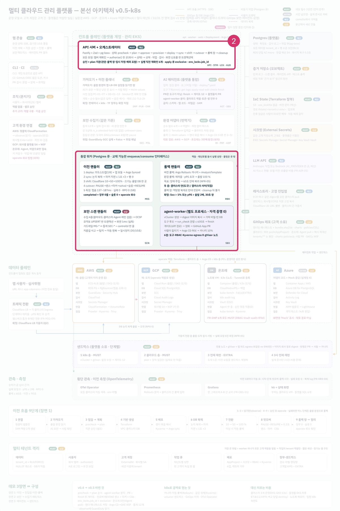
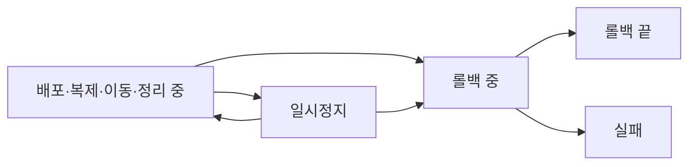
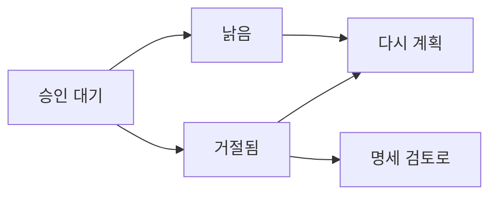

로드맵 위치: 본선 D-7 / 이전 한 건의 상태기계 명세 / 본선 연결점: 완성도·데모 30점(라이브 이전이 중간에 멈춰도 어디서 멈췄는지 안다), 클라우드 활용 30점

# 상태기계 명세: 이전 한 건은 어떤 상태를 지나가나

상태: AI 초안



**그림의 어디인가.** 가운데 위의 "API 서버 + 오케스트레이터" 상자다. 오케스트레이터는 이전 한 건이 지금 어느 단계인지 들고 있는 부분이다.

**무슨 일을 하나.** 이전 한 건은 언제나 상태 22개 중 하나에 있다. 다음 단계로 가려면 정해진 길로만 간다. 길은 53개다. 상태를 옮길 때 다음 일(큐 작업), 감사 기록, 화면 신호를 함께 남긴다. 들어오는 것은 "이 상태에서 저 상태로" 요청이고, 나가는 것은 바뀐 상태와 다음 큐 작업이다.

**정한 것.**
- 상태를 바꾸는 함수는 `advance()` 하나다. 어느 영역이든 상태를 바꿀 때 이 함수를 부른다.
- 갈 수 있는 길은 contracts의 `VALID` 표 한 곳에 적는다.
- 상태가 바뀔 때마다 `version`이 1씩 오른다. 화면은 이 숫자로 최신인지 안다.
- 끝난 상태는 `completed`, `rolled_back`, `cancelled` 셋이다. 여기서는 더 갈 곳이 없다.

---

## 1. 상태기계가 왜 필요한가

이전은 몇 분에서 몇십 분 걸린다. 그동안 워커가 죽거나, 사람이 취소하거나, 가드레일이 멈출 수 있다. 상태가 정해져 있지 않으면 "지금 무엇을 해도 되는지"를 아무도 모른다. 예를 들어 트래픽을 옮기는 중에 누가 "취소"를 누르면 어떻게 해야 할까? 상태기계는 이 질문에 "그 상태에서 취소로 가는 길은 없다. 롤백으로 가라"고 답한다.

> **용어**
>
> | 용어 | 쉬운 뜻 |
> |---|---|
> | 상태기계 | "지금 상태"와 "갈 수 있는 다음 상태"를 표로 정해 둔 것 |
> | 전이 | 한 상태에서 다른 상태로 옮기는 것 |
> | 끝난 상태 | 더 갈 곳이 없는 상태 |

---

## 2. 상태 22개

【사실】(`packages/contracts/src/migration.ts`) 코드에서 뽑은 숫자다.

<!-- GEN:statuses -->
상태 22개, 갈 수 있는 길 53개, 끝난 상태 3개 (`completed`, `rolled_back`, `cancelled`).
<!-- /GEN:statuses -->

| 묶음 | 상태 | 뜻 |
|---|---|---|
| 준비 | `draft` | 이전 행을 막 만들었다 |
| 준비 | `importing` | 출발 환경을 읽어 공통 명세를 만드는 중 |
| 준비 | `spec_review` | 사람이 공통 명세를 검토하는 중 |
| 준비 | `prechecking` | 도착 환경에서 이전이 가능한지 점검하는 중 |
| 준비 | `planning` | 이전 계획서를 만드는 중 |
| 준비 | `awaiting_approval` | 사람의 승인을 기다리는 중 |
| 준비 | `approved` | 승인됨. 실행 시작을 기다린다 |
| 이전 | `provisioning` | Terraform으로 도착 자원을 만드는 중 |
| 이전 | `deploying` | 도착 클러스터에 앱을 배포하는 중 |
| 이전 | `syncing` | DB를 논리 복제로 따라가게 하는 중 |
| 이전 | `shifting` | 사용자 요청을 10, 50, 100%로 옮기는 중 |
| 이전 | `cutover` | DB 쓰기 주인을 도착 쪽으로 바꾸는 중 |
| 이전 | `rollback_window` | 이전은 끝났고, 되돌릴 수 있는 시간이 남아 있다 |
| 이전 | `cleanup` | 출발 쪽 자원을 정리하는 중 |
| 이전 | `completed` | 끝 |
| 비정상 | `paused` | 가드레일이나 사람이 멈췄다 |
| 비정상 | `rolling_back` | 출발 쪽으로 되돌리는 중 |
| 비정상 | `rolled_back` | 되돌리기 끝 |
| 비정상 | `failed` | 실패. 다시 계획할 수 있다 |
| 비정상 | `cancelled` | 취소됨. 끝 |
| 비정상 | `rejected` | 사람이 계획을 거절했다 |
| 비정상 | `stale` | 계획이 낡았다. 승인 뒤 시간이 지났거나 입력이 바뀌었다 |

【사실】 `failed`, `rejected`, `stale`은 끝난 상태가 아니다. 여기서 다시 계획으로 돌아갈 수 있다.

---

## 3. 정상 경로를 그림으로

상태 22개를 한 그림에 넣으면 읽을 수 없다. 그래서 네 장으로 나눴다.

이 그림은 준비 단계에서 사람이 두 번 끼어든다는 것을 보여 준다.


여기서 볼 점은 사람의 일이 "명세 검토"와 "승인" 둘뿐이라는 것이다. 나머지는 워커가 한다.

이 그림은 승인 뒤 자원을 만들고 트래픽을 옮기기까지를 보여 준다.


이 그림은 트래픽을 다 옮긴 뒤 끝나기까지를 보여 준다.


여기서 볼 점은 점선 하나다. 【사실】 `cutover`에서 `shifting`으로 돌아가는 길이 있다. 【추정】 컷오버 준비 단계에서 막혔을 때 트래픽 단계로 물러나는 길로 보인다. 코드 주석에는 이유가 없다.

---

## 4. 비정상 경로를 그림으로

이 그림은 이전 도중 멈추거나 되돌리는 길을 보여 준다.



여기서 볼 점은 두 가지다.

- 【사실】 `provisioning` 이후에는 `cancelled`로 가는 길이 없다. 자원을 만들기 시작하면 취소가 아니라 롤백으로 간다.
- 【사실】 `paused`는 `deploying`, `syncing`, `shifting`, `cleanup` 네 곳으로 돌아갈 수 있다. 하지만 "멈추기 전 상태로만" 돌아가야 한다는 조건은 아직 코드에 없다. 아래 "조건 검사" 절을 본다.

이 그림은 계획이 거절되거나 낡았을 때의 길이다.



여기서 볼 점은 거절된 계획을 그대로 다시 승인하는 길이 없다는 것이다. 반드시 다시 계획하거나 명세부터 고친다.

---

## 5. 갈 수 있는 길 53개 전부

이 표는 코드에서 뽑았다. "(코드 있음)"이 붙은 길은 그 길로 `advance()`를 부르는 코드가 실제로 있다는 뜻이다.

<!-- GEN:transitions -->
| 지금 상태 | 갈 수 있는 수 | 갈 수 있는 상태 |
|---|---|---|
| `draft` | 2 | `importing` (코드 있음), `cancelled` |
| `importing` | 3 | `spec_review` (코드 있음), `failed`, `cancelled` |
| `spec_review` | 2 | `prechecking` (코드 있음), `cancelled` |
| `prechecking` | 4 | `planning`, `spec_review`, `failed`, `cancelled` |
| `planning` | 3 | `awaiting_approval`, `failed`, `cancelled` |
| `awaiting_approval` | 4 | `approved`, `rejected`, `stale` (계획 만료 깨우기 작업 `plan-expiry`·만료 뒤 승인 시도, G7-1), `cancelled` |
| `approved` | 3 | `provisioning` (코드 있음), `stale`, `cancelled` |
| `provisioning` | 2 | `deploying`, `failed` |
| `deploying` | 3 | `syncing`, `paused`, `rolling_back` |
| `syncing` | 3 | `shifting`, `paused`, `rolling_back` |
| `shifting` | 3 | `cutover`, `paused`, `rolling_back` |
| `cutover` | 3 | `rollback_window`, `shifting`, `failed` |
| `rollback_window` | 2 | `cleanup`, `rolling_back` |
| `cleanup` | 2 | `completed`, `paused` |
| `completed` | 0 | 끝 (더 갈 곳 없음) |
| `paused` | 5 | `deploying`, `syncing`, `shifting`, `cleanup`, `rolling_back` |
| `rolling_back` | 2 | `rolled_back`, `failed` |
| `rolled_back` | 0 | 끝 (더 갈 곳 없음) |
| `failed` | 3 | `prechecking` (다시 계획, G7-2), `rolling_back` (컷오버·롤백 중 실패만, F8-1), `cancelled` |
| `cancelled` | 0 | 끝 (더 갈 곳 없음) |
| `rejected` | 3 | `spec_review`, `prechecking` (다시 계획, G7-2), `cancelled` |
| `stale` | 2 | `prechecking` (다시 계획, G7-2), `cancelled` |
<!-- /GEN:transitions -->

---

## 6. `advance()`가 한 번에 하는 일

【사실】(`packages/core/src/advance.ts`) 상태 한 칸을 옮길 때 이 함수는 한 트랜잭션 안에서 여섯 가지를 차례로 한다.

1. **행 잠금.** 이전 행을 `FOR UPDATE`로 잠근다. 같은 이전을 두 곳에서 동시에 옮기지 못한다.
2. **지금 상태 확인.** DB의 상태가 부른 쪽이 생각한 상태(`from`)와 다르면 멈춘다. 그리고 `VALID` 표에 없는 길이면 409 `INVALID_TRANSITION`을 낸다.
3. **환경 잠금 확인.** 부른 쪽이 환경 잠금을 쥐고 있다고 했으면, 잠금 표에서 정말 쥐고 있는지, 기한이 남았는지 본다. 아니면 409 `LEASE_LOST`다.
4. **상태 변경.** 상태를 바꾸고 `version`을 1 올린다.
5. **다음 작업.** 다음 큐 작업을 같은 트랜잭션 연결로 넣는다. 작업이 안 만들어지면 409 `JOB_NOT_CREATED`이고 전부 취소된다.
6. **감사와 신호.** 감사 기록 한 줄을 넣고, DB 알림(`pg_notify`)을 보낸다. 알림은 트랜잭션이 확정될 때만 나간다.

> **용어**
>
> | 용어 | 쉬운 뜻 |
> |---|---|
> | FOR UPDATE | 읽은 행을 트랜잭션이 끝날 때까지 다른 쪽이 못 바꾸게 잠그는 SQL |
> | 환경 잠금 | 한 환경에서 한 번에 이전 하나만 돌게 하는 표의 한 줄. 기한이 있다 |
> | pg_notify | Postgres가 연결된 서버들에 짧은 신호를 보내는 기능 |

### 두 가지 모드

| 모드 | 지금 상태가 `from`과 다르면 | 누가 쓰나 |
|---|---|---|
| `strict` (기본) | 409 오류 | 사람의 요청. "이미 바뀌었다"를 사람이 알아야 한다 |
| `ifStill` | 오류 없이 `false`를 돌려주고 아무것도 안 한다 | 워커. 같은 작업이 두 번 와도 두 번째는 조용히 끝난다 |

### 지금 코드에서 `advance()`를 부르는 곳

<!-- GEN:advance_calls -->
| 이동 | 부르는 쪽 | 같이 넣는 큐 작업 | 모드 | 코드 위치 |
|---|---|---|---|---|
| `draft` 에서 `importing` | req.actor | `import` | strict | apps/api/src/routes/migrations.ts:23 |
| `spec_review` 에서 `prechecking` | req.actor | `precheck` | strict | apps/api/src/routes/plans.ts:35 |
| `awaiting_approval` 에서 `ok` | req.actor | - | strict | apps/api/src/routes/plans.ts:87 |
| `approved` 에서 `provisioning` | req.actor | `apply` | strict | apps/api/src/routes/plans.ts:103 |
| `ifStill` 에서 `worker` | "worker" | - | ifStill | apps/worker/src/jobs/_step.ts:65 |
| `importing` 에서 `spec_review` | "worker" | - | ifStill | apps/worker/src/jobs/import.ts:24 |
<!-- /GEN:advance_calls -->

---

## 7. 조건 검사 (아직 자리만)

`VALID` 표는 "길이 있는가"만 본다. "그 길을 지금 가도 되는가"는 따로 봐야 한다. 이것을 조건 검사(가드)라고 한다.

【사실】(`packages/core/src/advance.ts:14`) `guardOk()` 함수는 지금 언제나 참을 돌려준다. 설계에서 정한 조건은 아래와 같다. 모두 【추정】이고 코드에 없다.

| 길 | 조건 |
|---|---|
| `importing`에서 `spec_review` | 공통 명세가 Zod 검사를 통과한다. 이 조건만은 워커 코드 안에서 이미 본다 |
| `spec_review`에서 `prechecking` | "사람 확인 필요" 칸이 하나도 없다 |
| `prechecking`에서 `planning` | 막는 점검(`block` 등급)이 0개다 |
| `awaiting_approval`에서 `approved` | 승인 본문의 계획 지문이 저장된 계획 지문과 같다 |
| `approved`에서 `provisioning` | 승인이 만료되지 않았다 |
| `shifting`에서 `cutover` | 100%에 도달했고 관찰 시간 동안 이상이 없었다 |
| `paused`에서 원래 상태 | `paused_from` 칸에 적힌 상태로만 돌아간다 |

---

## 8. 상태와 같이 저장해야 하는 칸

이전 표에는 상태 말고도 칸이 네 개 더 있다. 【사실】(`db/migrations/0001_init.sql`) 칸은 있지만 지금 이 칸을 채우는 코드는 없다.

| 칸 | 언제 채우나 (설계, 【추정】) |
|---|---|
| `paused_from` | `paused`로 갈 때, 멈추기 전 상태 |
| `failed_at_status` | `failed`로 갈 때, 실패한 단계 |
| `failure_code` | `failed`로 갈 때, 이유 코드. 예: `WORKER_LOST`, `ARGO_SYNC_FAILED` |
| `rollback_window_ends_at` | `rollback_window`로 갈 때, 창이 닫히는 시각 |

---

## 9. 이후 변경 반영 필요

- 처리기가 하나 늘 때마다 5절 표의 "(코드 있음)"이 늘어난다. 도구가 바꾼다.
- `guardOk()`에 조건이 들어오면 7절 표를 코드 기준으로 다시 쓴다.
- 8절의 칸을 채우는 코드가 들어오면 그 칸을 `advance()`의 옵션으로 넣을지, 처리기에서 따로 쓸지 적는다.
- Argo CD 동기화 실패를 새 상태로 둘지 팀이 정하면 2절 표를 고친다. 지금 추천은 새 상태 없이 `failed` + `failure_code`다.

---

## 핵심 결정 3개 (+대안)

| 결정 | 대안 | 버린 이유 |
|---|---|---|
| 상태 변경은 `advance()` 한 함수로만 | 영역마다 `UPDATE`를 직접 | 잠금 순서와 감사가 흩어진다. 큐 작업이 빠지는 멈춤이 생긴다 |
| 상태 변경, 큐 작업, 감사, 신호를 한 트랜잭션에 | 상태를 바꾼 뒤 큐 작업은 따로 | 그 사이에 서버가 죽으면 "상태는 바뀌었는데 할 일이 없는" 이전이 남는다 |
| 워커는 `ifStill` 모드 | 워커도 `strict` | 큐는 같은 작업을 두 번 줄 수 있다. 두 번째가 오류로 재시도되면 소음만 는다 |

## 셀프 연습 1개

1. `packages/contracts/src/migration.ts`의 `VALID`에서 `shifting`의 목록에 `cancelled`를 더한다.
2. `npm test`를 돌린다. "전이 53개" 시험이 깨지는 것을 본다.
3. 원래대로 돌린다. 그리고 트래픽을 옮기는 중에 바로 취소하면 무엇이 남는지 한 줄로 쓴다. 힌트: 도착 쪽 자원과 트래픽 비율.

## 검증 명령과 기대 출력

뼈대 루트에서 실행한다.

```bash
npm test 2>&1 | grep -E '상태 22개|^# (pass|fail)'
```

기대 출력:

```text
✔ 상태 22개, 전이 53개, 최종 3개는 나가는 길 없음
# pass 7
# fail 0
```

## 용어집

| 용어 | 쉬운 뜻 | 이 문서에서 하는 일 |
|---|---|---|
| advance() | 상태를 한 칸 옮기는 유일한 함수 | 상태 변경의 입구 |
| FOR UPDATE | 읽은 행을 잠그는 SQL | 동시 변경 막기 |
| ifStill | 상태가 이미 바뀌었으면 조용히 끝나는 모드 | 워커가 쓴다 |
| version | 상태가 바뀔 때마다 1 오르는 숫자 | 화면이 최신인지 판단 |
| 가드(조건 검사) | 길이 있어도 지금 가도 되는지 보는 검사 | 아직 자리만 |
| 끝난 상태 | 더 갈 곳이 없는 상태 | 완료, 롤백 끝, 취소 |
| 상태기계 | 상태와 갈 수 있는 길을 정한 표 | 이 문서 전체 |
| 컷오버 | DB 쓰기 주인을 출발 쪽에서 도착 쪽으로 바꾸는 순간 | `cutover` 상태 |
| 환경 잠금 | 한 환경에서 이전 하나만 돌게 하는 기한 있는 표시 | 실행 단계에서 확인 |
| pg_notify | Postgres가 서버들에 보내는 짧은 신호 | 화면 갱신 |
