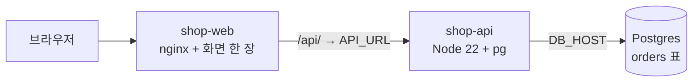

# 아이언 철물점 (데모 이전 대상 샘플 앱)

상태: AI 초안

AWS 출발 샘플(`src-aws-sample`)의 `shop-web`·`shop-api` 자리에 이미지만 바꿔 끼우는 작은 철물점 앱이다.
이전 전후로 같은 화면을 띄워 **데이터까지 그대로 옮겨졌는지**(주문 수·마지막 주문·데이터 지문)와 **어느 DB 에 붙어 있는지**를 보여 준다.



## 이전을 안 깨기 위해 지킨 것

출발 템플릿(`tools/real/flow/sample-3tier-eks.yaml.tpl`)과 시드(`tools/aws-source-app.sh seed`)는 **하나도 안 바꾼다.**

| 템플릿·시드가 정한 것 | 이 앱 |
|---|---|
| `shop-web` 80번 포트, 준비 검사 `GET /` | nginx 가 화면을 내보낸다. `/api/` 는 `API_URL` 로 넘긴다. API 주소가 아직 없으면 최대 120초 기다린 뒤 뜬다 (nginx 는 주소를 못 찾으면 바로 죽기 때문) |
| `shop-web` env `API_URL=http://shop-api.<ns>.svc` | 그대로 쓴다. 이전하면 플랫폼이 도착 주소로 다시 쓴다 (`packages/adapters/src/import/env-rewrite.ts`) |
| `shop-api` 8080번 포트, 준비 검사 `GET /`, http-echo 인자 `-listen=:8080 -text=ok` | `/` 는 DB 없이 바로 200. 인자는 `ENTRYPOINT` 뒤에 붙어 무시된다 |
| env `DB_HOST`·`DB_PORT`·`DB_NAME`·`DB_USER`·`DB_PASSWORD` | 이 다섯 개만 읽는다 |
| 표 `orders(id, item, qty, created_at)` 100행, 앱 계정 `shop_app` (표 주인 아님) | 이 표만 읽고 쓴다. 표를 만들거나 바꾸지 않는다 (논리 복제는 표 구조 변경을 옮기지 않는다) |

그 밖에:
- DB 외 자원(캐시·저장소·큐)을 쓰지 않는다. 의존성은 `pg` 하나다
- 앱 메모리에 상태가 없다. 전환 중 출발·도착을 오가도 같은 화면이다
- DB 가 잠깐 끊겨도(컷오버) 앱은 죽지 않고 503 을 준 뒤 다음 요청에서 다시 붙는다
- `SIGTERM` 을 받으면 하던 요청을 끝내고 내려간다
- DB TLS 는 기본으로 켠다(RDS·Cloud SQL 요구). 서버 인증서는 검증하지 않는다. 로컬 시험만 `DB_SSLMODE=disable`

## 화면

| 칸 | 뜻 |
|---|---|
| 지금 연결된 데이터베이스 | DB 서버 설정으로 고른다: `rds.force_ssl` 있음 → AWS RDS, `cloudsql.logical_decoding` 있음 → GCP Cloud SQL, 둘 다 없음 → CNPG·자체 운영. **컷오버 뒤 바뀌어야 한다** |
| 주문 수 · 마지막 주문 · 데이터 지문 | 지문 = 모든 주문(번호·상품·수량)을 번호 순으로 이은 md5 앞 8자. **이전 전후로 같아야 한다** |
| 주문하기 | 철물 8종 중 하나를 1개 주문한다 (새 행은 철물 이름으로 저장) |
| 최근 주문 | 시드의 옛 행(`item-N`)은 DB 값을 안 바꾸고 화면에서만 철물 이름으로 보인다 |

## 이미지 만들기와 올리기 (사람이 한다)

도착(GKE·온프레)도 이미지를 받아야 하니 누구나 받을 수 있는 저장소에 올리고 digest 로 고정한다.

```bash
docker buildx build --platform linux/amd64 -t <저장소>/ironshop-api:1 --push examples/ironshop/api
docker buildx build --platform linux/amd64 -t <저장소>/ironshop-web:1 --push examples/ironshop/web
```

## 출발 샘플에 올리기

`tools/aws-source-app.sh` 의 이미지 두 개만 바꾼다. 나머지 명령은 `bash tools/team-env.sh <slot> source` 가 찍는 줄 그대로다.

```bash
WEB_IMAGE=<저장소>/ironshop-web@sha256:<digest> API_IMAGE=<저장소>/ironshop-api@sha256:<digest> \
  KUBE_CONTEXT=<컨텍스트> DB_HOST=<RDS 엔드포인트> DB_INSTANCE=<RDS 식별자> bash tools/aws-source-app.sh app
```

공유 환경(`src-aws-sample`)이면 올리기 전에 팀 채널에 알린다. 다른 사람의 이전도 같은 앱을 쓰게 된다.

## 로컬 확인

```bash
cd examples/ironshop/api && npm ci && npm test          # 순수 함수 시험
DB_HOST=127.0.0.1 DB_PORT=5432 DB_NAME=shop DB_USER=shop_app DB_PASSWORD=<로컬 값> DB_SSLMODE=disable PORT=8080 node server.mjs
```

## 아직 확인 못 한 것

- 로컬 Docker 에서는 확인했다: 두 이미지 빌드, 출발 시드와 같은 Postgres + 템플릿 인자로 띄운 api + nginx 경유 화면·조회·주문, API 이름이 늦게 생겨도 web 이 기다렸다 붙음(`web/05-wait-api.sh`). 실제 클러스터에는 아직 올려 보지 않았다
- `rds.force_ssl`·`cloudsql.logical_decoding` 로 위치를 고르는 규칙은 실계정에서 확인 전이다
- 온프레(CNPG) 도착에서 앱이 `shop_app` 으로 붙을 수 있는지(비밀번호만 CNPG 비밀로 바뀜)는 실제 이전으로 확인해야 한다. 지금까지 출발 샘플 API(http-echo)는 DB 에 붙지 않아서 이 길이 검증된 적이 없다
