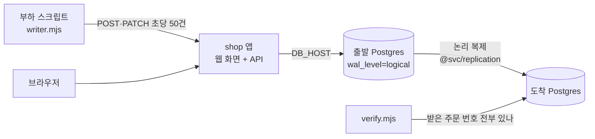

로드맵 위치: 본선 준비 마지막 주 / 이관 대상 샘플 앱 / 데모 "실시간 클라우드 간 이관" 장면의 이삿짐

# Shop 샘플 앱 (이관 대상)

> 문서 상태: DRAFT(ai), 10/31 클라우드 컨테이너에서 실제 기동·측정함. 팀 검토 전.



## 이게 뭔가

데모에서 "이미 운영 중인 시스템"을 맡는 작은 주문 관리 앱이다. 플랫폼이 이 앱을 한 클라우드에서 다른 클라우드(EKS, GKE, 온프레 k3s)로 옮기고, 옮기는 동안 쓰기가 하나도 실패하지 않았다는 걸 숫자로 보여 주는 데 쓴다.

- 3티어: 웹 화면(정적 HTML) + API(Node 22, `pg` 하나만 씀) + Postgres. 웹과 API는 컨테이너 하나다.
- 표 4개, 모두 기본키 있음: `customers` 2만, `products` 1천, `orders` 6만, `order_items` 18만 (합 26만 1천 행, DB 51 MB).
- 표 주인은 `shop_owner`, 앱 계정 `app`은 읽기·쓰기만 한다. 앱 계정이 표 주인이 아니어야 컷오버 때 쓰기 권한을 회수(펜스)할 수 있기 때문이다.
- 화면 위쪽에 "지금 어느 DB에 붙어 있나"(DB 주소, 버전, wal_level)를 보여 준다. 컷오버 뒤 이 줄이 바뀌는 게 데모 장면이 된다.

## 파일

| 경로 | 내용 |
|---|---|
| `app/` | 앱 코드, `Dockerfile`, `package-lock.json` |
| `app/src/server.mjs` | API: `/healthz`, `/readyz`, `/api/v1/info`, `/api/v1/stats`, `/api/v1/orders`(GET·POST), `/api/v1/orders/:id`(GET·PATCH) |
| `app/src/verify.mjs` | 부하 스크립트가 성공으로 받은 주문 번호가 DB에 다 있는지 센다 (RPO 0 확인) |
| `app/src/checksum.mjs` | 표마다 행 수와 내용 지문(md5). 원본과 대상에서 각각 돌려 비교 |
| `db/` | 계정·스키마 (Postgres 처음 뜰 때 자동 실행) |
| `seed/seed.sql` | 결정적 시드. 같은 `SEED_SCALE`이면 언제나 같은 행 |
| `load/writer.mjs` | 쓰기 부하. 재시도 3회×100ms, 끝에 재시도 횟수·실패 건수 출력 |
| `load/kill-sessions.sh`, `load/fence-blip.sh` | 장애 흉내: 앱 DB 세션 강제 종료 / 쓰기 권한 잠깐 회수 |
| `break/` | 셀프 연습용: 기본키 없는 표 만들기와 되돌리기 |
| `spec/appspec.shop.json` | 이 앱을 적은 AppSpec (통합본 `@svc/contracts` 검사 통과) |
| `spec/targets/*.json` | 대상 3곳: EKS 서울, GKE 서울, 온프레 k3s |
| `spec/gen-values.ts` | AppSpec + 대상 → G 어댑터 `toTerraform`·`toHelmValues` 결과 파일 |
| `helm/*.values.json` | 위 스크립트가 실제로 만든 Helm values (`helm -f`에 그대로 넣을 수 있다. JSON은 YAML로도 읽힌다) |
| `helm/*.tfvars.json` | 같은 스크립트가 만든 Terraform 변수 |
| `rehearse/sync-check.ts` | H 복제 모듈로 로컬 대상 DB에 복제해 보는 리허설 |

## 처음 띄우기

준비물: Docker Desktop, Node 22(부하 스크립트를 맥에서 직접 돌릴 때만).

1. `.env.example`을 `.env`로 복사한다. 안의 비밀번호는 로컬 전용 자리표시니 아무 값으로 바꿔도 된다.
2. 앱과 DB를 띄운다. 처음엔 시드 때문에 13–15초 걸린다.
3. 브라우저로 `http://localhost:8080`을 연다.

```
cp .env.example .env
docker compose up -d --build --wait
curl -s localhost:8080/api/v1/stats
```

- `cp`: 설정 파일 복사.
- `docker compose up -d --build --wait`: 이미지를 만들고(`--build`), 뒤에서 띄우고(`-d`), 건강 검사가 통과할 때까지 기다린다(`--wait`).
- `curl`: 행 수를 확인한다. 기대 출력은 아래 "검증 명령"에 있다.

## 쓰기 부하 돌리기

```
DURATION_SEC=30 docker compose --profile load run --rm load
```

- `--profile load`: 평소엔 안 뜨는 `load` 서비스를 켠다.
- `run --rm`: 한 번 돌리고 컨테이너를 지운다.
- 조절 값: `RATE`(초당 요청, 기본 50), `CONCURRENCY`(동시 요청, 8), `DURATION_SEC`(0이면 Ctrl+C까지), `RETRIES`(3), `RETRY_DELAY_MS`(100).
- 매초 `ok/fail/retry`를 찍고, 끝에 "요청 / 성공 / 실패 / 재시도" 한 줄과 지연 p50·p95·p99를 찍는다. 실패가 1건이라도 있으면 종료 코드 1.
- 성공한 주문 번호는 `load/out/acked-<시각>.txt`, 요약은 `load/out/run-<시각>.json`에 남는다.

재시도는 같은 `clientRef`(주문마다 하나인 uuid)로 다시 보낸다. DB가 `client_ref`에 UNIQUE를 걸어 두었으니 다시 보내도 주문이 두 번 생기지 않는다. 4xx는 다시 보내지 않고, 5xx·연결 오류·타임아웃만 다시 보낸다.

## 측정값 (10/31, 클라우드 컨테이너, docker PG 16.15)

| 무엇 | 결과 |
|---|---|
| 처음 기동 + 시드 (3회) | 14.6 / 12.6 / 14.6 초 |
| 부하 30초, 초당 50 | 1,500건 성공, 실패 0, p50 4.2 ms, p95 6.3 ms |
| 부하 15초, 초당 100 / 200 / 400 | 실패 0 / 0 / 0, p95 6.5 / 5.2 / 5.8 ms |
| 앱 DB 세션 강제 종료 2초마다, 20초 (재시도 3회로 3번, 0회로 3번) | 6번 모두 실패 0. 앱 안의 1회 재시도가 먼저 흡수했다. 최대 지연 115–214 ms |
| 쓰기 권한 150 ms 회수 2초마다, 20초, 재시도 3회 (3번) | 실패 0 / 0 / 0, 재시도 89 / 93 / 94회, 재시도로 살린 요청 67 / 69 / 71 |
| 같은 시험, 재시도 0회 (3번) | 실패 66 / 62 / 66 |
| 권한 500 ms 회수, 재시도 3회 | 실패 56. 재시도 창(약 300 ms)보다 길면 못 막는다 |
| 성공으로 받은 주문 번호 17,223개를 DB에서 찾기 | 17,223개 다 있음, 빠진 것 0 |
| H 복제 모듈 리허설: 점검 → 부하 중 동기화 (3번) | 점검 15개 전부 OK, 초기 복사+지연 판정 2.08 / 1.87 / 1.79 초, 마커 지연 0.7–11.7 ms, 쓰기 멈춘 뒤 행 수 원본 = 대상, teardown 뒤 남은 것 0 |

이 숫자로 말할 수 있는 것: 컷오버 중 앱이 "DB를 잠깐 못 쓰는" 시간이 300 ms 안이면, 앱 1회 재시도 + 부하 스크립트 3회 재시도로 실패 0을 유지한다. 10/31 컷오버 설계 실측(정지 55–187 ms)은 이 창 안에 들어온다. 다만 원래 설계는 앞단(PgBouncer 같은 연결 중계)에서 요청을 붙잡아 두는 방식이라, 재시도는 그게 새는 경우의 보험이다.

## 장애 흉내 시험

```
RETRIES=3 load/fence-blip.sh
RETRIES=0 load/fence-blip.sh
BLIP_SEC=0.5 load/fence-blip.sh
load/kill-sessions.sh
```

- `fence-blip.sh`: 20초 동안 2초마다 앱 계정의 INSERT·UPDATE 권한을 `BLIP_SEC`초(기본 0.15) 뺐다가 돌려준다. 컷오버 2단계(펜스)를 흉내 낸다.
- `kill-sessions.sh`: 2초마다 앱 계정 DB 세션을 전부 끊는다. 펜스의 "세션 강제 종료"를 흉내 낸다.

## 이 앱을 다른 곳으로 복제해 보기 (로컬 리허설)

`docker compose --profile target up -d --wait target`이 빈 대상 DB(계정과 스키마만 있음)를 55433 포트에 띄운다. 그다음 Service 레포 루트에서 `rehearse/sync-check.ts`를 돌린다. 이 스크립트는 통합본 `@svc/replication`을 import하므로 Service 레포 안에서만 돈다.

- 모드: `precheck`, `sync`, `compare`, `teardown`, `all`(앞의 셋).
- 환경 변수: `REPL_SOURCE_URL`, `REPL_TARGET_URL`(맥에서 붙는 주소, 127.0.0.1:55432 / 55433), `REPL_SOURCE_PEER_URL`, `REPL_TARGET_PEER_URL`(도커 안에서 서로 부르는 주소, `db:5432` / `target:5432`). 값에는 `.env`의 비밀번호가 들어가니 셸에서만 쓰고 파일에 적지 않는다.
- 컷오버(앱이 붙는 DB 바꾸기)는 이 스크립트가 하지 않는다. 그건 worker와 트래픽 훅 몫이다.

## AppSpec과 Helm values

`spec/appspec.shop.json`이 이 앱의 공통 명세다. 클라우드 이름이 없다. 대상 3곳(`spec/targets/`)과 합쳐 G 어댑터를 실제로 돌린 결과가 `helm/`이다. 다시 만들려면 Service 레포 루트에서 이렇게 돌린다.

```
npx tsx <sample-app 경로>/spec/gen-values.ts <sample-app 경로>/spec <출력 폴더>
```

| 대상 | 이미지 주소 | DB | 시크릿 저장소 |
|---|---|---|---|
| EKS 서울 `ap-northeast-2` | ECR `<env:accountId>.dkr.ecr…/platform/tenant-demo/shop-sample-app@sha256:…` | RDS, 주소는 apply 뒤 `db_address` | aws-secrets-manager |
| GKE 서울 `asia-northeast3` | Artifact Registry `asia-northeast3-docker.pkg.dev/<env:projectId>/…` | Cloud SQL 사설 IP | gcp-secret-manager |
| 온프레 k3s | `registry.local:5000/platform/tenant-demo/…` | CNPG 클러스터 `shop-db-rw` (차트가 만듦) | vault |

- `<env:…>`, `<tf-output:…>`은 어댑터의 자리표시다. apply 직전·직후 worker가 채운다.
- 이미지 digest는 STUB: 로컬 빌드 이미지 ID를 넣었다. 레지스트리에 올리면 digest가 달라지니 그때 바꾼다.
- 차트는 `DB_HOST/DB_PORT/DB_NAME/DB_USER/DB_PASSWORD`를 넣는다. 앱이 이 이름을 그대로 읽게 맞췄다. `DB_SSLMODE=require`는 AppSpec의 env로 넣었다(RDS PG 15+는 기본으로 SSL을 강제하고, CNPG도 TLS를 켠다). 로컬 compose만 `disable`.
- `helm template`으로 렌더해 보는 건 이 컨테이너에서 못 했다(helm 내려받기가 막힘). 맥에서 확인이 필요하다.

## 찾은 것 (통합 쪽에 넘길 것)

1. 고친 버그: `pg` 풀에서 빌려 간 연결에 `error` 처리기가 없으면, DB가 세션을 끊는 순간(펜스) Node 프로세스가 통째로 죽는다(`ECONNRESET` unhandled). 첫 시험에서 앱이 죽어 실패가 수백 건 났다. 빌린 연결에도 처리기를 달고 깨진 연결은 버리게 고친 뒤 실패 0. 제어판 API·worker도 `pool.connect()`를 쓰는 곳이 있으면 같은 문제가 날 수 있다.
2. 계정 모양 불일치: AWS 모듈은 RDS 마스터 사용자 이름을 `app`으로 만들고, Helm 차트도 `DB_USER=app`으로 고정한다. 그러면 클라우드 대상에선 앱이 마스터(표 주인급) 계정으로 붙는다. 이 샘플 앱의 원본은 "앱 계정 ≠ 표 주인"(DB-14)이라 펜스가 먹히는데, 클라우드로 옮긴 뒤 다시 되돌리기(역방향)를 하면 도착 쪽 펜스가 안 먹힐 수 있다. GCP 모듈의 `app` 사용자도 Cloud SQL에선 기본으로 `cloudsqlsuperuser` 권한을 가진다.
3. 대상 DB 스키마 준비: 논리 복제는 표 구조를 옮기지 않는다. 대상에 `db/01-roles.sh` + `db/02-schema.sql`(시드 빼고)을 먼저 돌려야 점검 DB-T4가 통과한다. 이 단계가 worker 흐름 어디에 들어가는지 정해야 한다.
4. 건강 검사 경로가 하나뿐: AppSpec `healthPath` 하나가 readiness·liveness 둘 다로 간다. 이 앱은 `/healthz`(프로세스만 봄)를 쓰게 했다. DB를 보는 `/readyz`를 readiness로 쓰면 컷오버 정지 순간 모든 파드가 "준비 안 됨"이 되어 트래픽이 끊긴다.

## 핵심 결정 3개

| 결정 | 고른 것 | 대안과 버린 이유 |
|---|---|---|
| 재시도 위치 | 앱 안 1회(200 ms, 연결 오류만) + 부하 스크립트 3회×100 ms(5xx·연결·타임아웃) | 재시도 없음: 150 ms 권한 회수에 실패 62–66건. 무한 재시도: 실패를 숨겨 "실패 0"이 의미 없어짐 |
| 중복 막기 | 클라이언트가 만든 `clientRef` uuid + UNIQUE | 서버 멱등성 키 표: 표가 하나 더 늘고 복제 대상도 늘어남. 샘플 앱엔 과함 |
| 시드 방식 | SQL `generate_series`로 결정적 생성 (13–15초) | 덤프 파일 동봉: 파일이 커지고 바꾸기 어려움. 랜덤 시드: 원본·대상 비교 숫자가 매번 달라짐 |

TODO(human):
- 컷오버 때 앱이 붙을 주소를 어떻게 바꾸나: PgBouncer 같은 중계를 둘지, Helm values의 `DB_HOST`를 바꿔 파드를 다시 띄울지. 후자면 파드 교체 시간 동안 두 DB에 동시에 쓰는 순간이 생긴다.
- 운영 TLS를 `verify-full` + 클라우드별 CA로 할지.
- 데모 부하량: 초당 50이면 화면에서 숫자가 잘 움직인다. 400까지 실패 0이었다.

## 셀프 연습 1개

기본키 없는 표를 만들어 복제 사전 점검이 막는지 본다.

```
docker compose exec -T db psql -U postgres -d shop -f /break/no-pk-table.sql
```

- 그다음 `rehearse/sync-check.ts precheck`를 돌리면 `FAIL DB-T2 … no primary key: audit_log`가 나와야 한다(10/31 실측 그대로).
- `/break/fix-no-pk-table.sql`로 기본키를 붙이면 DB-T2는 OK가 된다. 그래도 DB-T4(대상에 그 표 없음)가 남는다. 왜 그런지, 대상에 무엇을 먼저 해야 하는지 생각해 본다.

## 검증 명령과 기대 출력

```
curl -s localhost:8080/api/v1/stats
DURATION_SEC=30 docker compose --profile load run --rm load
cat load/out/acked-*.txt | docker compose exec -T app node src/verify.mjs
docker compose exec -T app node src/checksum.mjs
```

- 갓 띄운 직후 stats: `"customers":20000,"products":1000,"orders":60000,"order_items":180000`
- 부하: 마지막 줄 근처에 `요청 1500 / 성공 1500 / 실패 0`
- verify: `"missing":0`
- checksum(갓 띄운 직후, 쓰기 전): `orders` md5 `4f5fabc555867a607f388ae8f11625c7`, `order_items` md5 `1cf8f148e96b800d8cbdc6608a555170`
