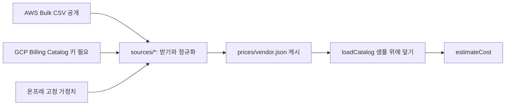

# @svc/cost (비용 추론, 3번 가져오기와 4번 계획 승인 사이)

상태: AI 초안 (AWS 가격은 실제 API 캐시, GCP는 키 대기, 팀 검토 전)

| 항목 | 내용 |
|---|---|
| 목적 | 공통 명세(AppSpec)와 트래픽 가정을 받아 환경(AWS/GCP/온프레, Azure Mock)별 월 예상 비용, 절약액, 보안 프로필별 추천을 낸다 |
| 받는 것 | `CostEstimateRequest` (spec, from, targets, region, traffic: `{peakRps}` 또는 `{mau,…}`, profile, applyCredits, load, nodeSkus) + `PriceCatalog` |
| 넘기는 것 | `CostEstimate` (환경별 합계·덩어리·크레딧·미확인 표시, cheapest, savings, recommendations, breakpoints, priceAsOf, priceStale) |
| 부작용 | `estimateCost`는 없음(순수 함수). `refreshCatalog`는 가격 API를 부를 수 있지만 지금 fetcher는 STUB(던짐), DB에 쓰지 않음 |
| 실패 코드 | 입력 parse 실패는 ZodError(라우트에서 400). 환경 단위: `PRICE_MISSING`, `ONPREM_CAPACITY_EXCEEDED`, `NODE_LIMIT_EXCEEDED`. 가격 소스: `PRICE_SOURCE_NOT_CONFIGURED`, `NO_ROWS` |

## 파일

- `src/schema.ts` 입출력 Zod 스키마. DRAFT(ai): `packages/contracts/src/cost.ts`로 옮길 대상
- `src/estimate.ts` `estimateCost()` 진입점, `estimateEnv()` 환경 하나 전수 탐색, `recommend()`, `findBreakpoints()`
- `src/load.ts` MAU→피크 rps, 필요 vCPU·메모리, 노드 수
- `src/profile.ts` 보안 단계(기본/강화)와 프로필 가중치(스타트업/금융)
- `src/catalog.ts` 샘플 가격표 읽기, 리전 매핑, 계단식 가격, 7일 경과 판정
- `src/data/sample-prices.json` 서울 온디맨드 샘플 19줄. 줄마다 `evidence`(fact/unverified/assumed/mock)와 `source`
- `src/adapters/*` AWS Price List(GetProducts), GCP Billing Catalog(skus), Azure Retail Prices 응답 파서(순수) + `PriceSource` 만들기. HTTP는 `fetchPage`로 밖에서 넣는다
- `src/refresh.ts` `refreshCatalog()` 하루 한 번 받기. 실패한 벤더는 어제 값 유지
- `src/sources/*` 실제 수집: `aws-bulk.ts`(공개 CSV 스트리밍), `gcp-catalog.ts`(키 필요, E2 core+ram 합산), `onprem.ts`(가정치), `cache.ts`(캐시 읽기·쓰기·폴백, `loadCatalog`)
- `prices/*.json` 벤더별 가격 캐시 (생성: `scripts/fetch-prices.ts`)
- `scripts/demo.ts` PoC 네 장면 재현

## 가격 수집 (작업 V)



- `npm run prices:fetch -w @svc/cost`: 실제 API를 불러 `prices/*.json`을 다시 쓴다. 실패하면 있던 캐시를 그대로 쓴다
- GCP는 환경 변수 `GCP_BILLING_API_KEY`가 있을 때만 부른다. 없으면 캐시(지금은 샘플값을 옮긴 seed)
- API 라우트는 `loadCatalog()`만 쓴다. 요청 처리 중에는 네트워크를 쓰지 않는다
- 캐시 파일마다 `fetchedAt`(수집 시각), `sources[].url`·`publishedAt`(출처와 벤더 발행 시각), `origin`(live/seed)
- 가격표에만 있고 합계에 안 넣는 것: ALB(`lb`, `lb_capacity`), 노드 디스크 EBS(`volume`)
- 네트워크 데이터 전송료: **제외**(10/31 보드 기본값). 단가 근거가 아직 없어 넣지 않고, 화면에 "전송료 제외"로 표시한다
- 트래픽 가정: 비용 화면(`GET /migrations/:id/cost`)은 피크 **10 rps 고정**(`PREVIEW_PEAK_RPS`), MAU 입력 없음(10/31 보드 기본값). 라이브러리는 MAU 입력도 받는다
- 【추정】 값: 노드 단가(seed 캐시·샘플 단가), 보안 "강화" 추가비(DB 1배 + $30, `src/profile.ts`), 온프레 고정비. 청구서가 아니다
- 7일 넘으면 `priceStale` 경고. 본선 전날 `prices:fetch`를 한 번 다시 돌린다

## 계산식 (cost_poc.py와 같음)

```text
피크 rps = MAU x 0.2 x 50 / 86400 x 3
필요 vCPU = max(0.5 + 0.01 x rps, 복제 수 x 요청 CPU)
노드 수 = max(2, 올림(vCPU / (노드 vCPU x 0.6)), 올림(메모리 / (노드 메모리 x 0.6)))
월 비용 = 클러스터 x 730 - 크레딧 + 노드 수 x 단가 x 730 + DB + GB x 스토리지
온프레 = 고정비, 노드 수 x 노드 vCPU > 서버 용량이면 불가
추천 점수 = w_cost x 비용/최대 + w_risk x (1 - 보안) + w_time x 시간/최대 (낮을수록 좋음)
```

PoC와 달라진 점: 노드 종류를 가격표에 있는 만큼 전부 계산한다(`nodeSkus`로 제한 가능), 메모리도 노드 수에 반영, 명세의 복제 수 x CPU 아래로는 줄이지 않는다(DRAFT(ai)).

## 확인

```bash
npm run typecheck -w @svc/cost
npm test -w @svc/cost
npm run demo -w @svc/cost
```

기대: `pass 27, fail 0` (sources.test.ts 9개 포함, 네트워크 안 씀). demo 첫 줄 `aws: t3.medium 2대 월 $227.5`, 둘째 줄 `gcp: e2-medium 2대 월 $146.9`.
