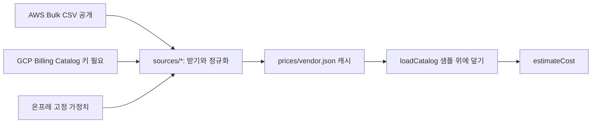
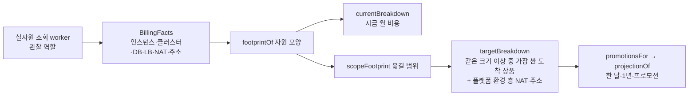

# @svc/cost (비용 추론, 3번 가져오기와 4번 계획 승인 사이)

상태: AI 초안 (AWS 가격은 실제 API 캐시, GCP는 서울 공식 페이지 값, 팀 검토 전)

| 항목 | 내용 |
|---|---|
| 목적 | 공통 명세(AppSpec)와 트래픽 가정을 받아 환경(AWS/GCP/온프레, Azure Mock)별 월 예상 비용, 절약액, 보안 프로필별 추천을 낸다. 근거 있는 비용: 실자원으로 지금 월 비용, 도착 후보별 한 달·1년 비용과 프로모션을 항마다 근거와 함께 낸다 |
| 받는 것 | `CostEstimateRequest` (spec, from, targets, region, traffic: `{peakRps}` 또는 `{mau,…}`, profile, applyCredits, load, nodeSkus) + `PriceCatalog`. v2: `estimateCostV2({ spec: AppSpecV2, providers, peakRps }, PriceCatalog)`. 근거 있는 비용: `envCost(env, InventoryForCost, PriceCatalog, lang)`, `moveCost(source, inventory, SourceScope, targets, PriceCatalog, lang)` |
| 넘기는 것 | `CostEstimate` (환경별 합계·덩어리·크레딧·미확인 표시, cheapest, savings, recommendations, breakpoints, priceAsOf, priceStale). v2: `{ priceAsOf, peakRps, envs: EnvEstimate[] }` (`unknown`에 못 넣은 구성요소 이름). 근거 있는 비용: `EnvCostView`, `MoveCostView` (contracts `cost-evidence.ts`) |
| 부작용 | `estimateCost`·`estimateCostV2`·`envCost`·`moveCost`는 없음(순수 함수). `refreshCatalog`는 가격 API를 부를 수 있지만 지금 fetcher는 STUB(던짐), DB에 쓰지 않음 |
| 실패 코드 | 입력 parse 실패는 ZodError(라우트에서 400). 환경 단위: `PRICE_MISSING`, `ONPREM_CAPACITY_EXCEEDED`, `NODE_LIMIT_EXCEEDED`. 가격 소스: `PRICE_SOURCE_NOT_CONFIGURED`, `NO_ROWS`. 근거 있는 비용은 던지지 않고 `status`(ok·partial·unavailable)와 `reason`, 합계 밖 항목은 `gaps` |

## 파일

- `src/schema.ts` 입출력 Zod 스키마. DRAFT(ai): `packages/contracts/src/cost.ts`로 옮길 대상
- `src/estimate.ts` `estimateCost()` 진입점, `estimateEnv()` 환경 하나 전수 탐색, `recommend()`, `findBreakpoints()`
- `src/estimate-v2.ts` `estimateCostV2()` 공통 명세 v2(AppSpecV2) 환경별 월 비용 (계획서 고지용). 아래 "v2 명세 비용" 참고
- `src/load.ts` MAU→피크 rps, 필요 vCPU·메모리, 노드 수
- `src/profile.ts` 보안 단계(기본/강화)와 프로필 가중치(스타트업/금융)
- `src/catalog.ts` 샘플 가격표 읽기, 리전 매핑, 계단식 가격, 7일 경과 판정
- `src/data/sample-prices.json` 서울 온디맨드 샘플 19줄. 줄마다 `evidence`(fact/unverified/assumed/mock)와 `source`
- `src/adapters/*` AWS Price List(GetProducts), GCP Billing Catalog(skus), Azure Retail Prices 응답 파서(순수) + `PriceSource` 만들기. HTTP는 `fetchPage`로 밖에서 넣는다
- `src/refresh.ts` `refreshCatalog()` 하루 한 번 받기. 실패한 벤더는 어제 값 유지
- `src/sources/*` 실제 수집: `aws-bulk.ts`(공개 CSV 스트리밍), `gcp-catalog.ts`(키 필요, E2 core+ram 합산), `onprem.ts`(가정치), `cache.ts`(캐시 읽기·쓰기·폴백, `loadCatalog`)
- `prices/*.json` 벤더별 가격 캐시 (생성: `scripts/fetch-prices.ts`)
- `scripts/demo.ts` PoC 네 장면 재현

## 가격 수집 (작업 V)



- `npm run prices:fetch -w @svc/cost`: 실제 API를 불러 `prices/*.json`을 다시 쓴다. 실패하면 있던 캐시를 그대로 쓴다
- AWS 는 노드 후보 7종(`node`) 말고도 실자원 단가 찾기용 인스턴스 86종(`instance`), RDS PostgreSQL 등급 134개(`db_class`, 단일·다중 AZ), NAT 게이트웨이(`nat`), 공인 IPv4(`public_ip`, AmazonVPC 파일)를 읽는다. 예전 합계(`estimateCost`)가 훑는 `node`·`db` 줄은 그대로라 금액이 안 바뀐다
- 네트워크가 큰 파일을 끊으면(11/06 이 맥에서 EC2 서울 CSV 약 200MB 가 6초쯤에 끊김) 같은 공개 파일을 `curl -C -` 로 이어 받아 폴더에 두고 `AWS_BULK_DIR=<폴더> npm run prices:fetch -w @svc/cost`. 출처 주소는 원래 공개 주소 그대로 남는다
- GCP는 환경 변수 `GCP_BILLING_API_KEY`가 있을 때만 부른다. 없으면 캐시. 지금 캐시(`origin: seed`)는 서울 공식 가격 페이지 값(E2 네 종류·Cloud SQL·디스크·IP·포워딩 규칙·NAT·GKE)과, 같은 카탈로그에서 생성한 Cyclenerd `pricing.yml`(11/05 생성, 나머지 머신 종류 `sourceKind: secondary`)을 옮긴 것. 줄마다 `sourceUrl`·`sourceKind`
- 줄의 `sourceKind`: `official_api`(AWS Price List 파일) · `official_page`(벤더 가격 페이지) · `secondary`(공식 카탈로그에서 생성한 공개 자료) · `assumption`(가정)
- API 라우트는 `loadCatalog()`만 쓴다. 요청 처리 중에는 네트워크를 쓰지 않는다
- 캐시 파일마다 `fetchedAt`(수집 시각), `sources[].url`·`publishedAt`(출처와 벤더 발행 시각), `origin`(live/seed)
- 가격표에만 있고 합계에 안 넣는 것: ALB(`lb`, `lb_capacity`), 노드 디스크 EBS(`volume`)
- 네트워크 데이터 전송료: **제외**(10/31 보드 기본값). 단가 근거가 아직 없어 넣지 않고, 화면에 "전송료 제외"로 표시한다
- 트래픽 가정: 비용 화면(`GET /migrations/:id/cost`)은 피크 **10 rps 고정**(`PREVIEW_PEAK_RPS`), MAU 입력 없음(10/31 보드 기본값). 라이브러리는 MAU 입력도 받는다
- 【추정】 값: 노드 단가(seed 캐시·샘플 단가), 보안 "강화" 추가비(DB 1배 + $30, `src/profile.ts`), 온프레 고정비. 청구서가 아니다
- 7일 넘으면 `priceStale` 경고. 본선 전날 `prices:fetch`를 한 번 다시 돌린다

## 계산식 (cost_poc.py와 같음)

```text
피크 rps = MAU x 0.2 x 50 / 86400 x 3
필요 vCPU = max(0.5 + 0.01 x rps, 복제 수 x 요청 CPU)
노드 수 = max(2, 올림(vCPU / (노드 vCPU x 0.6)), 올림(메모리 / (노드 메모리 x 0.6)))
월 비용 = 클러스터 x 730 - 크레딧 + 노드 수 x 단가 x 730 + DB + GB x 스토리지
온프레 = 고정비, 노드 수 x 노드 vCPU > 서버 용량이면 불가
추천 점수 = w_cost x 비용/최대 + w_risk x (1 - 보안) + w_time x 시간/최대 (낮을수록 좋음)
```

PoC와 달라진 점: 노드 종류를 가격표에 있는 만큼 전부 계산한다(`nodeSkus`로 제한 가능), 메모리도 노드 수에 반영, 명세의 복제 수 x CPU 아래로는 줄이지 않는다(DRAFT(ai)).

## v2 명세 비용 (`estimateCostV2`, DRAFT(ai))

식은 위와 같고, 가격표에 줄이 있는 덩어리만 합계에 넣는다. 못 넣은 구성요소·칸은 환경의 `unknown`에 `<종류>:<id>` 또는 `<종류>:<id>.<칸>`으로 남긴다(단가를 지어내지 않음). upconvertV1 판은 v1 `estimateCost`와 같은 금액이다.

| 구성요소 | 합계 | 근거 |
|---|---|---|
| k8s 서비스 (여러 개) | 넣음 | 복제 수 min x (주 컨테이너 + 주입 아닌 사이드카) 요청량 합 → 노드 수. request 없으면 limit(k8s 규칙). 모르면 `service:<id>.resources` |
| 클러스터 관리비·크레딧 | k8s 서비스가 있을 때만 | 관리형·VM 만 있는 앱은 클러스터·노드를 안 씀 |
| postgres (여러 개) | 넣음 | 개수 x `db` 단가 + 각 `storage` GB. `ha`·`readReplicas`·`compute`(가격표 DB 줄은 크기 하나)는 `postgres:<id>.<칸>` |
| 온프레 | 고정비 | v1 과 같음 |
| cache · objectStore · queue · job · 관리형 컨테이너(ECS Fargate·Cloud Run) · VM 서비스 | 못 넣음 | 가격표에 줄 없음 → `<종류>:<id>` (서비스는 `service:<id>`) |

출발도 같은 명세·같은 실행 방식으로 센다(v1 과 같은 비교 방식, origin 으로 따로 안 셈).

## 근거 있는 비용 (`evidence.ts`, DRAFT(ai))

환경 목록의 "지금 월 비용"과 새 마이그레이션 도착 고르기의 "한 달·1년 예상 요금"을 낸다. 숫자 하나마다 수량 근거(`basis`: 어느 실자원을 몇 개 셌나)와 단가 근거(`price`: SKU·발행 시각·출처 주소)를 싣는다.
API: `GET /api/v1/environments/:id/cost`, `POST /api/v1/environments/:id/cost/move` (`apps/api/src/routes/env-cost.ts`, `?lang=ko|en|ja` 로 근거 문장 언어).



| 항 | 수량 근거 | 단가 |
|---|---|---|
| 클러스터 관리비 | 실자원 EKS·GKE 클러스터 수 / 도착은 1개 | `cluster` |
| 노드 | 실자원 인스턴스 종류별 대수 (EKS 태그·GKE 라벨로 클러스터와 잇는다). 인스턴스 목록이 없으면 GKE 노드 수 x 노드 풀 머신(종류가 하나일 때만) / 도착은 출발 vCPU·메모리 이상 중 가장 싼 `node` | `instance` · `node` |
| 노드 디스크 | 【가정】 문서 기본값: EKS 관리형 노드 그룹 20 GiB gp3, GKE 부팅 디스크 100 GB pd-balanced | `volume` |
| DB | 실자원 RDS 등급·저장 GB·다중 AZ / Cloud SQL 등급 이름의 vCPU·메모리 (HA 는 2배) / 도착은 같은 크기 이상 중 가장 싼 등급, Cloud SQL 은 맞춤 등급 규칙(vCPU 1 또는 짝수, vCPU 당 0.9~6.5 GiB, 3.75 GiB 이상) | `db_class` · `db_vcpu`·`db_mem` · `storage` |
| 로드 밸런서 | 실자원 ALB·포워딩 규칙 수 / 도착은 Cloudflare 터널이라 없음 | `lb` |
| NAT | 실자원 NAT 수 (GCP 는 뒤의 VM 수 x VM 당 단가) / 도착은 플랫폼 환경 층(`infra/modules/<벤더>/env`)이 만드는 1개 | `nat` |
| 공인 IPv4 | 인스턴스·고정 주소·NAT 의 공인 주소 + 공개 ALB 의 AZ 별 주소 / 도착은 NAT 고정 주소 1개 | `public_ip` |
| 온프레 | 【가정】 서버 감가 $15,000/60개월, 전기 350W x PUE 1.54 x 182원/kWh, 상면 2U x 7만 원, 환율 1,460원/$ (`onprem-model.ts`, 항마다 출처 주소). 서버 1대 = 64 스레드·256 GiB, 출발 노드·DB 합으로 대수 | 가정 |

- 합계에 넣지 않는 것(`gaps`): 인터넷 전송량·NAT 처리량·ALB LCU(사용량을 안 읽음), 스팟(시세), 단가가 없는 종류, Autopilot 파드 요금, 온프레 회선·운영 인력(참고값만). 단가를 지어내지 않는다
- 프로모션(`promotions.ts`, 2026-11-06 공식 문서로 확인): `applied` = 조건 없이 금액에서 뺌(GKE 무료 등급), `conditional` + 금액 = 새 계정이면(GCP 무료 체험 $300·90일·8코어 한도, AWS 프리 티어 $100), `conditional` + 0 = 신청·심사형(Startups·RaMP·Lift·Activate·MAP, 출발을 떠날 때 전송료 면제)이라 조건·출처만
- 1년 = 정가 x 12 (`yearlyUsd`), 적용됨 반영(`appliedYearlyUsd`), 조건 충족 시(`conditionalYearlyUsd`)
- 실자원 조회는 비용용 명령(`ec2 describe-instances`·`describe-nat-gateways`·`describe-addresses`, `compute instances·addresses·routers list`)을 같이 부른다. 모두 관찰 권한 표에 이미 있는 읽기 명령이고, 실패해도 환경 건강·화면 자원 묶음은 그대로이며 `status: partial` 과 이유로만 알린다
- 조사 근거: Notion "본선(11/7–8)에 쓸 수 있는 AWS·GCP 프로모션과 서울 단가 조사"

## 확인

```bash
npm run typecheck -w @svc/cost
npm test -w @svc/cost
npm run demo -w @svc/cost
```

기대: `pass 45, fail 0` (sources.test.ts 9개, estimate-v2.test.ts 7개, evidence.test.ts 11개 포함, 네트워크 안 씀). demo 첫 줄 `aws: t3.medium 2대 월 $227.5`, 둘째 줄 `gcp: e2-medium 2대 월 $146.9` (샘플 가격표 기준).
저장된 캐시 기준 10 rps 는 AWS $233.3 / GCP $172.1 (11/06 GCP Cloud SQL 을 아이오와 → 서울 단가로 바꿔 $146.9 에서 오름) / 온프레 $250.
