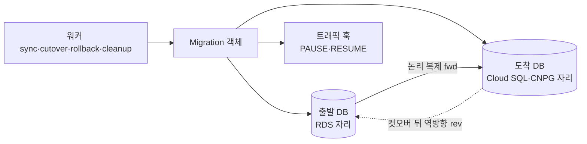

로드맵 위치: 본선 직전 / DB 이전(복제·컷오버) 모듈 뼈대 / 4번 영역 "도착 DB를 출발과 같게 만들고 쓰기 담당을 바꾸기"

# @svc/replication

문서 상태: AI 초안, 팀 검토 전 (2026-10-31). 코드와 테스트가 기준이고, 이 문서는 코드에서 뽑았다.

## 한눈에



- 리플랫폼 전제(앱 재배포 + DB 논리 복제/CDC)의 "DB 논리 복제" 부분이다.
- 출발·도착은 **접속 문자열만** 받는다. RDS, Cloud SQL, CloudNativePG, 로컬 Postgres 모두 같은 SQL로 돈다. 클라우드 API는 부르지 않는다.
- 쓰기 담당이 어디인지는 DB 안에 남은 구독 위치로 판단한다. 그래서 워커가 죽었다 다시 떠도 같은 함수를 다시 부르면 된다.

## 워커가 부르는 함수 (B 스레드 STUB 자리)

| 큐 작업 | 상태 전이 | 부를 함수 | 성공 기준 | 남길 측정값 |
|---|---|---|---|---|
| `precheck` | precheck 중 | `m.precheck()` | `ok === true` | 실패 항목 `checks[]` (id, hint) |
| `sync` | syncing → shifting | `m.sync()` | `gate.ready === true` (아니면 재시도) | `replication_lag_ms`, `initial_copy_ms`, `replication_slot_lag_bytes` |
| `cutover` | cutover → rollback_window | `m.cutover({ hooks })` | `ok === true`. `ok:false`면 C6' 되돌림이 끝난 상태 → shifting으로 | `cutover_pause_ms`, 단계별 `c1_pause_ms`…`c6_resume_ms` |
| `rollback` | rolling_back → rolled_back | `m.rollback({ hooks })` | `kind` before_cutover / after_cutover + `result.ok` | `cutover_pause_ms` (역방향) |
| `cleanup` | cleanup → completed | `m.teardown()` 후 `m.leftovers()` | `leftovers()` 가 빈 배열 | `removed[]` |

```ts
import { Migration, endpointFromEnv } from "@svc/replication";

const m = new Migration({
  key: job.migrationId,                          // 복제 객체 이름 꼬리 (repl_<key>_fwd / _rev)
  source: endpointFromEnv("REPL_SOURCE"),         // REPL_SOURCE_URL, _PEER_URL, _PROVIDER, _APP_ROLE
  target: endpointFromEnv("REPL_TARGET"),
  tables: ["customers", "orders"],                // 없으면 스키마의 모든 표
  gate: { maxLagMs: 1000, consecutive: 3 },
});
const r = await m.sync();
if (!r.gate.ready) throw new Error(r.gate.reasons.join());   // pg-boss 재시도에 맡김
```

- `measures`는 `{ name, value, unit }` 배열이다. contracts의 `Measurement`에 `migrationId`, `env`, `at`만 붙이면 된다. 이 패키지는 contracts에 의존하지 않아 혼자 빌드된다.
- `hooks`(TrafficHooks)는 앱 DB 연결을 붙잡고 푸는 쪽이다: `pause()`, `resume(writer)`. 진짜로는 PgBouncer PAUSE/RESUME 또는 앱 설정 전환(트래픽 모듈). 안 주면 아무것도 안 한다(그 경우 C2에서 끊긴 앱 세션은 에러를 본다).

## 끝점(Endpoint) = 접속 문자열 묶음

| 필드 | 뜻 |
|---|---|
| `adminUrl` | 워커가 이 DB에 붙는 관리자 주소 |
| `peerUrl` | **상대 DB가** 이 DB로 복제 연결할 때 쓰는 주소. 네트워크 위치가 달라 다를 수 있다 (도커 서비스 이름, 사설 IP, 터널). 없으면 adminUrl |
| `provider` | `postgres` `rds` `cloudsql` `cnpg` `azure`. 점검 메시지(어떤 파라미터를 켜나)에만 쓴다 |
| `appRole` | 앱 DB 계정. 컷오버 때 이 계정 쓰기 권한을 회수한다 |
| `schema` | 기본 `public` |

### 이전마다 끝점 (db 0050 `replication_endpoints`)

DECISION(team): 끝점은 이전마다 DB 행으로 (2026-11-05, 보안·온프레 영역). 워커 전역 `REPL_SOURCE_URL`·`REPL_TARGET_URL` 하나면 회사가 다른 두 이전이 같은 출발 DB 를 쓸 수 있었다.

| 받는 것 | 넘기는 것 | 부작용 | 실패 코드 |
|---|---|---|---|
| `EndpointRecord` 두 줄 (contracts `ReplicationEndpoint` 모양) + env | `Migration` (끝점 `origin: "db"`) 또는 줄이 없으면 `null` | 없음 (비밀번호 참조 풀기만 env 를 읽음) | `ReplConfigError` `REPL_ENDPOINT_INCOMPLETE`(한쪽만), `REPL_SECRET_UNRESOLVED`(참조를 못 풂) |

- 워커는 `replicationFor(tenantId, migrationId)` 하나로 복제 객체를 얻는다 (`apps/worker/src/jobs/_repl.ts`). 두 줄 → 줄, 둘 다 없음 → 예전 `replicationFromEnv`, 한 줄 → 오류.
- 비밀번호는 칸에 없다. `password_ref` = `derive:<용도>` (`REPL_SECRET_MASTER_KEY` HMAC, `deriveReplPassword`) 또는 `env:REPL_SECRET_<이름>`. 그 밖의 이름(`env:DATABASE_URL` 등)은 거부.
- TLS: `sslmode` + `ca_pem`(없으면 `REPL_CA_FILE`) + `tls_servername`(host 가 IP 일 때 인증서에서 확인할 이름). 상대가 붙는 `peerUrl` 에는 `sslmode=require`.
- 등록·보기: `npm run repl:endpoint -- set|show --tenant <회사> --migration <이전> …` (`tools/repl-endpoint.ts`).

## 단계 (컷오버 C1~C6)

1. C1 붙잡기: `hooks.pause()` — 진행 중인 요청은 끝까지, 새 요청은 기다림
2. C2 출발 울타리: 앱 계정 `REVOKE` + 남은 앱 세션 종료 + DB `default_transaction_read_only=on`(보조)
3. C3 마지막 따라잡기: 출발에 마커 1행 → 도착에 보이면 "울타리 전 변경은 다 왔다". 이어서 표별 행 수가 **정확히** 같은지 확인. 시간 초과·불일치면 C6' 되돌림(출발 울타리 걷고 출발 그대로 RESUME)
4. C4 시퀀스: 논리 복제가 안 옮기는 유일한 상태. 도착에서 `setval(max(id) + 1000)`
5. C5 정방향 구독 제거(출발 슬롯도 삭제) → 도착에 역방향 publication + 슬롯을 **RESUME 전에** 만든다
6. C5b 도착 울타리 걷기 → C6 `hooks.resume(도착)` → 옛 출발에 역방향 구독(copy_data=false)

롤백은 같은 함수를 방향만 바꿔 부른다. 컷오버 전 롤백은 정방향 복제만 걷는다(출발은 처음부터 주인).

## 실측 (클라우드 컨테이너, docker Postgres 16.15 두 대, 같은 호스트)

| 무엇 | 값 | 조건 |
|---|---|---|
| 초기 복사 | 512 / 308 / 311 ms (중앙 311) | orders 10만 행 + customers 100, 3회 |
| 복제 지연(마커 왕복) | 0.8 ~ 7.7 ms | 부하 중, 판정 샘플 |
| 컷오버 멈춤 | 55, 69, 62, 66, 56 ms (중앙 62) | 앱 쓰기 8 workers 계속, 5회 |
| 롤백 멈춤 | 64, 50, 59, 59, 68 ms (중앙 59) | 같은 조건, 5회 |
| 앱 쓰기 | 2365건, 실패 0, p50 25.6 / p99 102 / max 119 ms | 컷오버·롤백 10번을 지나는 동안 |
| C6' 되돌림 | 316 ms (제한 300 ms + 되돌림) | 구독을 일부러 멈춤, 실패 0 |
| 정리 뒤 남은 객체 | 0 | 슬롯·발행·구독 양쪽 |

- 【사실】 위 숫자는 `npm run measure`, `npm run test:it` 출력 (2026-10-31 16:0xZ).
- 【추정】 클라우드 사이(RDS → Cloud SQL)에서는 왕복 지연이 수십 ms 늘어 C3·C5가 길어진다. 10/31 설계 문서의 로컬 측정(137–187 ms)과 비교하면 이번 값이 더 작은 건 프록시 대신 프로세스 안 라우터를 썼기 때문.
- 【미확인】 큰 표(수백만 행) 초기 복사 시간, 실제 PgBouncer 사용 시 멈춤 시간.

## 하지 않는 것 (경계)

- DDL은 복제되지 않는다. 도착 스키마는 앱 재배포 때 앱 마이그레이션이 만든다 (점검 DB-T4가 확인).
- 클라우드 자원 생성, 파라미터 그룹 변경, 네트워크 열기는 안 한다 (인프라 모듈 몫).
- 대형 객체(large object)는 안 옮긴다 (점검 DB-T3).

## 클라우드에서 달라질 것 【추정】

| 제공자 | 출발로 쓸 때 | 도착(구독)으로 쓸 때 |
|---|---|---|
| RDS | 파라미터 그룹 `rds.logical_replication=1`, 복제 계정에 `rds_replication`, 보안 그룹에서 도착 IP 허용 | `rds_superuser` 필요 |
| Cloud SQL | 플래그 `cloudsql.logical_decoding=on`, `ALTER USER ... REPLICATION` | `cloudsqlsuperuser` |
| CloudNativePG | `spec.postgresql.parameters.wal_level: logical`, `pg_hba`에 복제 허용 | superuser 또는 PG16 `pg_create_subscription` |

- 구독의 접속 문자열(비밀번호 포함)은 도착 DB `pg_subscription`에 저장된다. 임시 복제 계정을 쓰고 cleanup 때 지우는 게 맞다 (TODO(human)).

## 파일

| 파일 | 내용 |
|---|---|
| `src/endpoint.ts` | 끝점, 관리자 연결, 환경 변수 읽기 |
| `src/record.ts` | DB 줄 → 끝점, 도달 확인(TCP) |
| `src/secret-ref.ts` | `password_ref` 문법·유도·풀기 |
| `src/precheck.ts` | 점검 DB-01~05 (서버 설정·권한), DB-T1~T5 (표·기본키·대형 객체·도착 스키마·빈 표) |
| `src/replicate.ts` | publication/subscription/slot 만들기·지우기 |
| `src/lag.ts` | 초기 복사 진행, 마커 왕복 지연, 슬롯 바이트 지연 |
| `src/judge.ts` | 전환 가능 판정 (순수 함수) |
| `src/fence.ts` | 쓰기 울타리 치기·걷기 |
| `src/switchover.ts` | C1~C6, C6' |
| `src/migration.ts` | 워커 입구 `Migration` (sync, cutover, rollback, teardown, leftovers, phase) |
| `test/unit.test.ts` | 판정·이름 단위 테스트 |
| `test/replication.it.ts` | 두 DB 실제 복제 통합 테스트 |
| `test/harness.ts` | 시드, 앱 쓰기 부하, PgBouncer 대역 라우터 |
| `scripts/measure.ts` | 반복 측정 |
| `docker-compose.test.yml` | Postgres 16 두 대 (55432 출발, 55433 도착, wal_level=logical) |

## 핵심 결정 3개 (+대안)

1. **"따라왔다"는 마커 왕복 + 울타리 뒤 행 수 일치로 판정.** 대안: LSN 비교(발행자·구독자 LSN 의미가 달라 헷갈림), 표 전체 체크섬(큰 표에서 느림). 버린 이유: 마커는 사용자가 느끼는 지연과 같은 단위(ms)이고 C3에서 그대로 재사용된다.
2. **울타리 = 권한 회수(REVOKE) + 세션 종료, read_only는 보조.** 대안: `default_transaction_read_only`만. 버린 이유: 10/31 실험에서 기존 세션에 안 먹고 `SET`으로 우회됨.
3. **역방향 슬롯을 RESUME 전에 만든다 → 컷오버 직후부터 롤백 가능.** 대안: 롤백할 때 역방향을 새로 만들기. 버린 이유: 그 사이 도착에 쓴 데이터를 출발로 못 돌려보냄(RPO > 0). 측정: 롤백 뒤 부하가 넣은 행 전부 출발에 있음(누락 0).

## 셀프 연습 1개

`docker-compose.test.yml`의 src `command`에서 `"-c", "wal_level=logical",`를 지우고 `npm run db:up` → `npm run test:it`.
- 기대: 1번 테스트가 `DB-01 ... wal_level=replica` (hint: `wal_level = logical (재시작 필요)`)로 실패하고, 2·3번도 복제를 못 만들어 실패한다. 7번(정리)은 통과.
- 원래대로 되돌리고 `npm run db:up` → `# pass 4`. (2026-10-31 실제로 깨뜨려 봄, 위 출력 그대로 나옴)
- 생각해 볼 것: RDS라면 같은 실패에서 무엇을 바꾸나? (hint가 provider에 따라 바뀐다: `src/precheck.ts` WAL_HINT)

## 검증 명령과 기대 출력

```
npm install
npm run typecheck
npm test
npm run db:up
npm run test:it
npm run measure
npm run db:down
```

- `npm run typecheck`: 출력 없이 끝남 (에러 0)
- `npm test`: `# pass 5`, `# fail 0`
- `npm run test:it`: `# pass 4`, `# fail 0`. 로그에 `cutover true cutover_pause_ms=...`, `load { ok: ..., fail: 0 }`
- `npm run measure`: 마지막 줄 `leftovers: []`, `app writes ... fail=0`
- DB가 안 떠 있으면 통합 테스트 4개는 skip으로 나온다
